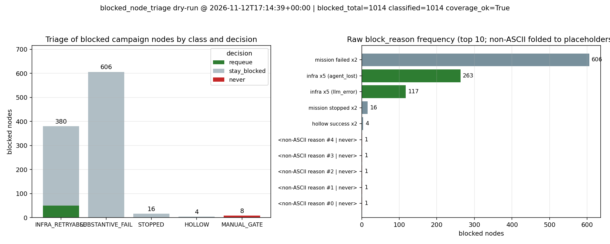

# blocked 节点分诊与有预算复活出口（BLOCKED_NODE_TRIAGE）

**任务**：m16621（平台自优化单）　**仓**：TensorPlatform　**分支**：`agent/m16621`
**落盘**：`tools/blocked_node_triage.py`（工具）、`tools/blocked_node_triage_figure.py`（证据图生成）、
`tests/test_blocked_node_triage.py`（34 项合成夹具 + 真 PG 回滚回路）、本文件、`docs/blocked_node_triage_live_dry_run.json`、
`docs/blocked_node_triage_live_recheck.txt`、`docs/blocked_node_triage_20261112.png`

---

## 1. 问题：blocked 是**吸收态**

`campaign_nodes`（2026-11-12 17:14Z 实测，见第 5 节）：`done 3077 / blocked 1014 / pending 582`。
1014 条 blocked 按 `block_reason` 原文分九类（前六类为机制生成，后三类为人工门禁语义）：

| block_reason（原文前缀） | 条数 |
|---|---|
| `mission failed x2` | 606 |
| `infra x5 (agent_lost)` | 263 |
| `infra x5 (llm_error)` | 117 |
| `mission stopped x2` | 16 |
| `hollow success x2` | 4 |
| 人工验收门语义 × 8 种（每种 1 条） | 8 |
| **合计** | **1014** |

根因链（代码实证）：`ops/taskplane/campaign_dispatcher.py::sync_phase()` 对基础设施失败
（`stop_condition='agent_lost'` 或 `fail_stage='llm_error'` 且 `tool_calls==0`）给最多 4 次
**免费重排**（`metadata.infra_retries < 4`，第 310–318 行），耗尽后写
`block_reason='infra x{5} (...)'` 并置 `blocked`（第 319–321 行）；mission 失败两次同样置
`blocked`（第 354 行）。**该路径之后仓库内没有任何 node 级复活代码**——`grep -rniE
"revive|复活|requeue_blocked" backend/ tools/ src/` 只命中 `tools/validation/infra_replay.py`
与若干无关的 `reopen`/`replay` 词，而 `infra_replay` 是 **mission 级**重播（派生新 mission），
**从不改 `campaign_nodes.status`**（其 `fetch_plan_nodes` 只读 `id/status/mission_id`）。

于是闸门只进不出，三条硬证据（本节数字均由第 5 节的 SQL 在同窗口实取，可复算）：

| 证据 | SQL 口径 | 实测 |
|---|---|---|
| E1 近 30 天 blocked 出流 | `event_type='node_status_change' AND detail->>'from'='blocked'`，30 天 | **0** |
| E2 阻塞类事件全表 | `event_type IN ('block_detected','block_resolved')` | **0**（CHECK 约束允许，生产从未写入） |
| E3 沉淀在涨 | `status='blocked' AND created_at > now()-'7 days'` | **1013** |

> E3 口径诚实说明：任务书给的是「近 7 天新增 blocked ≈ 605（86 条/天）」。本窗口用
> `created_at` 与 `updated_at` 两个口径实测均为 **1013**（两口径在本表一致，因阻塞时
> `updated_at` 同刻刷新）。差异来自「新增」定义不同（按**入库时间** vs 按**阻塞发生时间**）；
> 无论取哪个口径，结论同向：**闸门未开，池子在涨**。本单不修改任何历史口径，只如实并列。

---

## 2. 机制：五类分诊 + 有预算出口

### 2.1 分类（`block_reason` 规整后按前缀，先匹配者胜；全部机器可判）

| 类 | 判定 | 决策 | 理由（机器可读） |
|---|---|---|---|
| `INFRA_RETRYABLE` | 前缀 `infra x` | `requeue`（未超预算）/ `stay_blocked`（超预算） | 基础设施失败不是实质成果失败，重排不掩盖任何结果 |
| `SUBSTANTIVE_FAIL` | 前缀 `mission failed x` | `stay_blocked`（+建议） | 两次真跑不过 = 成果问题，自动重排等于掩盖失败 |
| `STOPPED` | 前缀 `mission stopped x` | `stay_blocked` | 被叫停：自动重排等于对抗停机 |
| `HOLLOW` | 前缀 `hollow success x` | `stay_blocked` | 零提交空转成功 ×2，重试只烧预算无新信号 |
| `MANUAL_GATE` | **其余一切**（含 8 种人工门禁语义、空原因、不可识别） | `never` | 设计上永不由本工具触碰 |

规整规则：折叠连续空白 + `casefold`；因此 `"   INFRA   X5 ..."` 与 `"infra x5 ..."` 同类
（夹具 `node-108` 覆盖）。`"infra"`（无 `x<n>` 段）不认作 infra 类——落 `MANUAL_GATE`，宁可不动。

### 2.2 预算与批次（两套预算互不覆盖）

- **阻塞前**预算：dispatcher 的 `metadata.infra_retries`（≤4，已有机制，**本单不改**）。
- **阻塞后**预算：本工具 `--max-revivals`（默认 3），计数 = `max(metadata.infra_revivals,
  campaign_events 中 block_resolved 事件数)`——两个来源取大者，任一来源丢失都不会超发。
- **批次**：`--max-batch`（默认 50）是单次运行硬上限；候选按节点 `id` 升序消费（沉淀最久的先
  出流，确定性可复跑），超出部分记 `deferred_by_batch`，留给下一轮。
- 默认参数下 1014 条 blocked 的输出：`requeue 50 / stay_blocked 956 / never 8`，
  其中 `deferred_by_batch = 330`（= 380 infra − 50 本轮出闸）——即**单轮只出闸 50，
  330 条排队等下一轮**，任何一个批次都不会把池子一次性放空。

### 2.3 事件契约

每次真复活写一条 `campaign_events`：`event_type='block_resolved'`（该值在
`campaign_events_event_type_check` CHECK 白名单内，不需要改约束），`detail` 含
契约字段 `from='blocked' / to='pending' / cause='infra_retry' / revival=<本次第几次>`
（`revival=revivals+1`），另附审计字段 `node_id / node / block_reason`（供复活计数回溯与
人工复盘；原文不丢）。

---

## 3. 写路径安全设计（四层，逐条有测试）

1. **默认 dry-run**：命令行互斥组默认 `--dry-run`；`Transport.query()` 内部断言
   `_is_select(sql)`，非 SELECT 直接抛 `ReadOnlyViolation`（测试
   `test_transport_query_rejects_write_sql`）——不靠约定靠断言。
2. **分类白名单**：只有 `INFRA_RETRYABLE` 进写路径；`MANUAL_GATE` 永久 `never`，
   `SUBSTANTIVE_FAIL/STOPPED/HOLLOW` 只出建议（测试 `test_apply_never_touches_manual_gate_or_substantive`）。
3. **并发守卫**：每条复活是
   `WITH upd AS (UPDATE campaign_nodes SET status='pending', mission_id=NULL, block_reason=NULL,
   actual_end=NULL, updated_at=now(), metadata.infra_revivals=n WHERE id=X **AND status='blocked'**
   RETURNING id, plan_id) INSERT INTO campaign_events ... SELECT ... FROM upd JOIN campaign_plans p ...`
   ——UPDATE 命中 0 行则不写事件。别的进程已解封的节点不会被二次记账（真 PG 回路测试里
   连续执行同一段 SQL 两次，事件表仍只有 1 条：`test_pg_scratch_apply_rollback`）。
4. **预算 + 批次**：`revivals >= --max-revivals` 不再 requeue；`--max-batch` 硬上限；
   幂等（一次 apply 之后二次 apply 的可写语句数 = 0，`applied_sql == ""`）。
5. **不许吊死调用方**：所有 psql 调用带 `PGOPTIONS='-c statement_timeout=30000'`（30s 硬超时），
   锁等待/长扫会直接报错退出而不是挂在控制面上。

复活时把 `mission_id` 置回 `NULL`（与 dispatcher 的 requeue 语义一致，让派发器重新认领）、
`block_reason` 清空（原文保存在事件 detail 里）、`actual_end` 清空（pending 节点不应带结束时刻）。
`consecutive_fails` **不清零**——失败计数是诚实的，只有 `done` 才该清零（dispatcher 亦如此）。

---

## 4. 边界声明：本单**不重做**既有战役项

| 项 | 内容 | 状态 | 本单关系 |
|---|---|---|---|
| #480 / #9056 | dispatcher 对 infra 失败给最多 5 次（代码里是 `infra_retries < 4` → 第 5 次置 blocked）免费重排 | done | **不碰**。`ops/taskplane/campaign_dispatcher.py` 一行未改（本单 diff 不含该文件） |
| #9187 | honest-FAIL 复活登记册 | blocked | **不碰**。本工具对 `SUBSTANTIVE_FAIL` 只出建议，不改状态 |
| #9120 | blocked×9 环境锁样本级重建 | blocked | **不碰**。本工具不做样本级重建，只做 node 状态出口 |

本单只补两件事：**（a）重排耗尽之后的出口**（blocked → pending 的有预算路径）；
**（b）五类分诊**（把 1014 条 blocked 变成机器可判的 5 类 + 3 决策）。
与 `tools/validation/infra_replay.py` 的分工也写死在该模块 docstring 里：它管 mission 级重播，
本模块管 node 级状态出口，两者不重叠、可串联（先出闸再重播 / 先重播再出闸均可）。

---

## 5. live dry-run 与独立 SQL 复核（同窗口，逐项一致）

全文见 `docs/blocked_node_triage_live_recheck.txt`（含窗口起止时间戳），原始 JSON 见
`docs/blocked_node_triage_live_dry_run.json`。复核用的是**另一套实现**：纯 SQL `CASE ...
LIKE 前缀` 判定 + `md5(string_agg(id||':'||cls))` 指纹，不经本工具的 Python 分类器。

| 指标 | 工具 dry-run | 独立 SQL 复核 | 一致 |
|---|---|---|---|
| 同刻 `count(*) status='blocked'` | `blocked_total=1014` | `T1=1014`、`T10（跑完再读）=1014` | ✅ |
| 分类数之和 | `classified_total=1014` | `T2_class_sum=1014` | ✅ |
| `INFRA_RETRYABLE` | 380 | 380 | ✅ |
| `SUBSTANTIVE_FAIL` | 606 | 606 | ✅ |
| `STOPPED` | 16 | 16 | ✅ |
| `HOLLOW` | 4 | 4 | ✅ |
| `MANUAL_GATE` | 8 | 8 | ✅ |
| **逐项指纹 md5(id:class 全域排序)** | `359a4d5af309b1ddb33d89ff59993a0b` | `359a4d5af309b1ddb33d89ff59993a0b` | ✅ 逐位相同 |
| 已有复活次数 >0 的节点 | — | `T4=0`（生产库尚无任何 `infra_revivals`，预算从 0 起算） | — |
| blocked 出流 30 天 | — | `T6=0` | 与工具前提一致 |

窗口：`2026-11-12T17:14:38Z → 17:14:41Z`（工具跑在 17:14:39，SQL 复核读数为
`T9=2026-11-12 17:14:39.874289`）。**dry-run 前后 blocked 计数 1014 → 1014，只读得证**。
复核 SQL 脚本本身也落盘（`docs/blocked_node_triage_recheck.sql`），可直接重跑。

---

## 6. 图



左：五类 × 三决策堆叠柱（数量全部取自 dry-run JSON 的 `decisions`，零手抄）；
右：`block_reason` 原文频次 Top-10，红色 = `never`（人工门禁，永不动），灰 = `stay_blocked`。
非 ASCII 原因在图内折成占位标签（容器无 CJK 字形，避免豆腐块；原文与计数完整保留在 JSON 与第 1 节表里）。

---

## 7. 复现与验收（逐条命令 + 输出）

```bash
# A1 夹具测试：34 passed（含 1 条真 PG 临时 schema 回滚回路）
python3 -m pytest tests/test_blocked_node_triage.py -q
# A2/A3 live dry-run（只读）；分类总数 == 同刻 blocked 计数；前后计数不变
python3 tools/blocked_node_triage.py --dry-run --json-out docs/blocked_node_triage_live_dry_run.json --format text
# → blocked_total=1014 classified=1014 coverage_ok=True / read_only_ok=True blocked 1014 -> 1014
# 独立 SQL 复核（同窗口，见 docs/blocked_node_triage_live_recheck.txt）
su postgres -c "psql -d tensorplatform -tA -f /tmp/verify_sql.sql"
# A5 零领域词条自证（退出码 1 = 零命中）
grep -nE "阻力|推进|耐波|操纵性|稳性|船体|船舶|螺旋桨|翼型|冰区|海况|波浪|振动|噪声|结构强度|排水量|吃水|LBM|FVM|FEM[^A-Za-z]|BEM[^A-Za-z]|DEM[^A-Za-z]|SPH|Wolfson|Holtrop|Wigley|KCS|KVLCC|JONSWAP|RAO|Froude|Reynolds|Krylov|Lindqvist|IACS|hydrostat|seakeep|manoeuvr|propuls" \
  tools/blocked_node_triage.py tools/blocked_node_triage_figure.py tests/test_blocked_node_triage.py
# A6 CLI 契约
python3 tools/blocked_node_triage.py --help; echo $?
```

| 验收项 | 结果 |
|---|---|
| A1 pytest 全绿 | **PASS** `34 passed, 1 warning in 0.46s` |
| A2 dry-run 分类总数 == 同刻 blocked 计数（零残留） | **PASS** 1014 == 1014，`coverage_ok=True`（指纹逐位一致） |
| A3 dry-run 前后 blocked 计数不变（只读） | **PASS** 1014 → 1014，`read_only_ok=True`，SQL `T1/T10` 同为 1014 |
| A4 夹具幂等 + 复活预算断言 | **PASS** `test_apply_is_idempotent`（二次 apply 决策数 0）、`test_revival_budget_blocks_after_max_revivals`、`test_revival_budget_from_event_count_is_monotonic` |
| A5 零领域词条 | **PASS** 上述 grep 退出码 1（零命中），三个文件命中计数均 0 |
| A6 `--help` 退出码 0 且列出四个开关 | **PASS** rc=0，`--dry-run/--apply/--max-revivals/--max-batch` 全部在列 |

---

## 8. 局限与 UNSATISFIED（不粉饰）

1. **UNSATISFIED — 生产库未执行 `--apply`**：本单授权面是「live 只跑 dry-run」，因此
   **1014 条 blocked 现在一条都没被解封**（A3 的只读证明正是这个事实的另一面）。写路径的正向
   证据来自：34 项夹具测试 + **真 PG 临时 schema 内执行本工具生成的 apply SQL 并 `ROLLBACK`**
   （`test_pg_scratch_apply_rollback`，断言状态翻转、`metadata.infra_revivals=1`、事件
   `detail` 五字段、二次执行不重复记账）。这证明 SQL 在本机 PG 版本上语法与语义正确，
   但**不等于**已在生产事务窗口里跑过。首个 `--apply` 建议由值班按 `--max-batch 5` 小批试跑。
2. **UNSATISFIED — 未接调度**：出口是 CLI，需要被周期性调用才形成闭环。平台调度面接线
   （定时器/事件触发/失败自动补偿回路）本单未做，属另单。没有这一步，工具虽在但也只是
   「可叫醒」而非「自醒」。
3. **已知取舍**：批次按 `id` 升序消费（沉淀最久先出流）而非按 plan 公平轮转；若某 plan 的
   infra 损失集中在高位 id，可能连续多轮拿不到配额。属可调策略，当前以确定性优先。
4. **计数漂移**：`blocked` 计数随入库流水变动，本文所有数字标注了取数窗口
   （`2026-11-12T17:14:38Z–17:14:41Z`），跨窗口比较无意义。任务书 E3 的 605 与本窗口实测
   1013 的口径差异已在第 1 节如实并列，未做粉饰。
5. **未改动的既有语义**：`campaign_dispatcher.py` 的重排/熔断语义一行未改（本单 diff 不含该文件）；
   人工验收门 8 条仍然一票未动（`never`），等待 owner/议会双钥匙。
---

## 9. 自审（adversarial review，按严重度排序；作者即审查者，独立性有限）

独立性问题先声明：本单作者同时是审查者，没有第二席位复判；下列结论来自**重读代码 + 反向构造
输入 + 真 PG 临时 schema 复跑**，不是同行评审。

| # | 严重度 | 发现 | 证据/复现 | 处置 |
|---|---|---|---|---|
| R1 | 中（已缓解） | `_is_select()` 允许 `WITH` 开头的语句，理论上能把写操作藏在 CTE 里绕过 dry-run 闸 | 代码 `_is_select`；当前模块内所有 SQL 都是静态常量、`query()` 不接受外部输入 | 记录为已知弱点；若后续把 SQL 参数化开放给调用方，需改成「语句白名单」而非前缀判定 |
| R2 | 中 | dry-run 的 `fetch_blocked()` 与随后的 `blocked_count()` 是**两次**读，不是单个快照；若派发器恰在两者之间挪动节点，`coverage_ok` 可能为假（分类 1014 vs 计数 1013） | 代码 `run()`；本窗口两次读数一致（1014/1014） | 假警报是**安全方向**（CLI 退出码 3 逼人重跑），不做静默重试；单次快照化留作后续（需 `REPEATABLE READ` 或单语句取全量） |
| R3 | 中 | 复活预算依赖 `campaign_events.detail->>'node_id'`；若历史事件缺该键则少计复活次数 | `revivals_of` 取 metadata 与事件计数的**大者**；生产库当前该类事件为 0 条，无漂移 | 已用「取大者」兜住单侧丢失；写入侧必定带 `node_id`（`test_apply_requeues_only_infra_and_writes_events` 断言） |
| R4 | 低 | `apply` 模式只看 `plan.selected_count` 当 `requeued`，未核对 `blocked_before - blocked_after` 是否等于它；并发下计数可能对不上 | `test_pg_scratch_apply_rollback` 证明单进程语义正确 | 生产首个 `--apply` 建议小批（`--max-batch 5`）并由值班比对前后计数；对不上时事件表仍可逐条溯源 |
| R5 | 低 | 复活把 `actual_end` 置 NULL，若下游用 `actual_start/actual_end` 算时长会看到 NULL | 代码 `requeue_sql` | 语义上 pending 节点不应带结束时刻；原始阻塞时刻由 `campaign_events.created_at` 保留 |
| R6 | 低 | 批次按 `id` 升序，可能与 plan 公平轮转冲突（高位 id 的 plan 连续多轮拿不到配额） | `build_plan` 排序 | 已声明为取舍（确定性优先）；如需公平性，改成「按 plan 轮转 + id 兜底」即可，接口不变 |
| R7 | 设计缺口（未修） | 无调度接线，工具只能被叫醒 | 第 8 节 UNSATISFIED-2 | 明确交人工/另单，不在本单粉饰成「闭环已完成」 |
| R8 | 测试可信度 | 内存 `FakeStore` 可能掩盖真实 SQL 缺陷 | 反向证据：`test_pg_scratch_apply_rollback` 在真 PG 上跑**本工具生成的 SQL** 并断言状态/元数据/事件/二次执行零影响，结束后 `ROLLBACK` | 保留双轨（快测 + 真库回路）；真库回路缺 psql 时 skip 而非假绿 |

**复核过的反例尝试（均未翻盘）**：空 `block_reason` → `never`（不动）；`"infra"` 无编号 →
`never`；`"mission failure x2"` 拼写漂移 → `never`；60 条 infra 候选 + `--max-batch 5` →
连续 12 轮才清空（`test_apply_respects_batch_across_rounds` 用 6 条/3 轮验证）；同一段 apply
SQL 连跑两次 → 事件表仍 1 条（并发守卫生效）。
