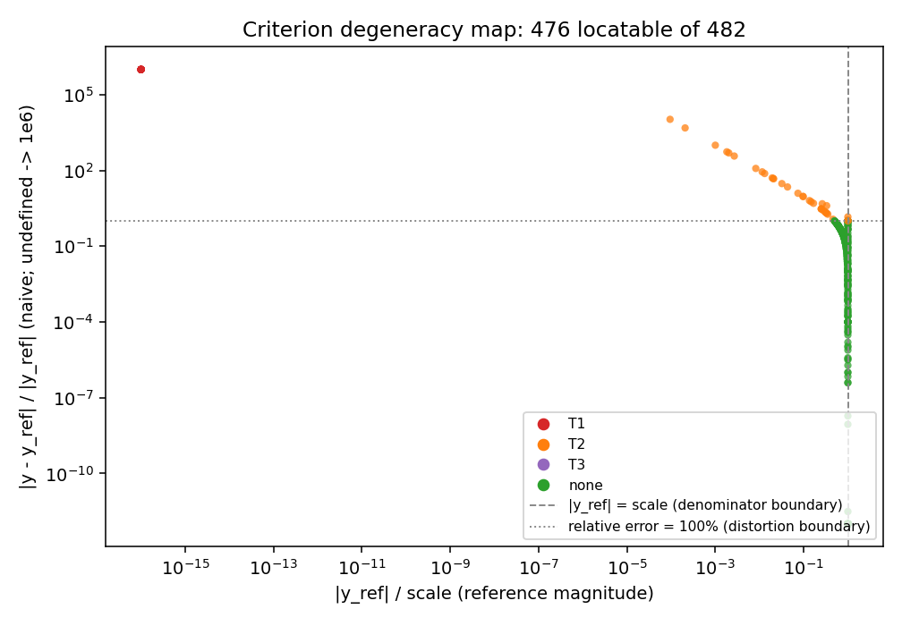
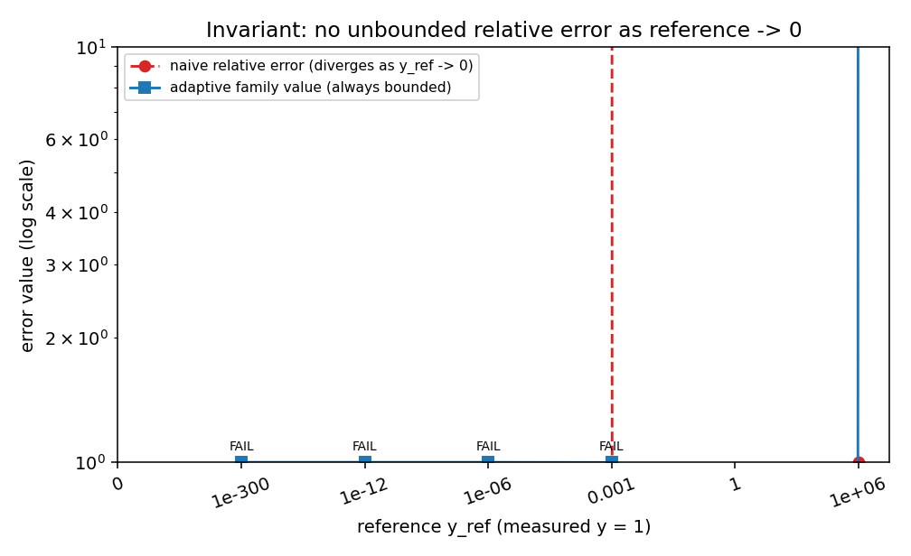
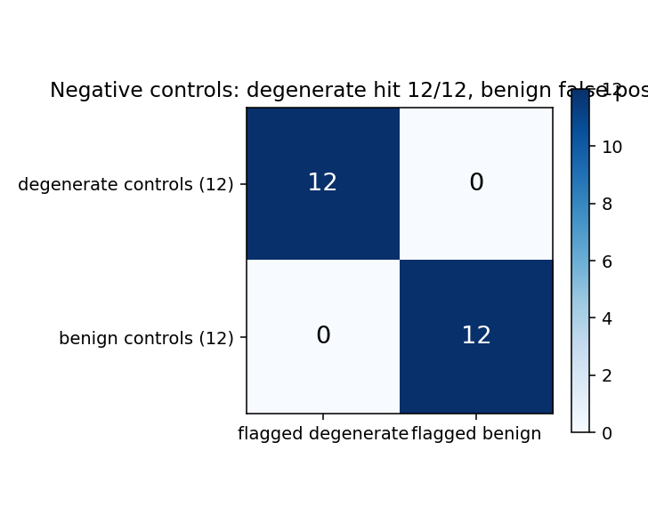
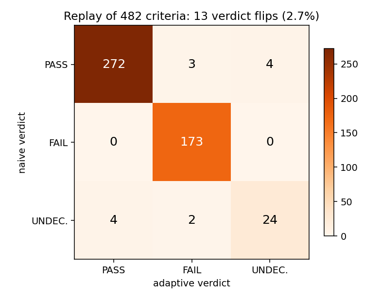
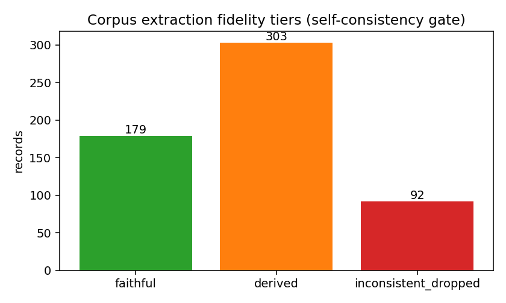

# 判据度量学：四元组解析 / 退化三分类 / 自适应判据族 / 检索凭证重放门

**节点**：P266W3-N10 ｜ **仓**：TensorPlatform ｜ **日期**：2026-11-11 ｜ **语料指纹**：`670b846db6ec2ba6`

**一句话**：平台历史上把「误差 < τ」当唯一尺子；本节点把判据写成四元组 `(y, y_ref, τ, 口径)`，机器判定三类**不可判**情形（T1 基准趋零 / T2 跨零变号 / T3 多口径并列），给每条历史判据一条**可复算的替代判据数值**，并把「我检索过了」变成可重放的检索凭证。

## 1 案例介绍（要治的是什么病）

平台每次「验收通过」都挂在一个数上：误差 ≤ 15%、kill rate ≥ 0.90、退化解 ≤ 3%。这些数的判据形态被默认为**相对误差 vs 单点基准**。但历史报告语料里，三类情形让这条尺子失效：

| 类型 | 结构特征 | 数学后果 | 历史实例（本节点语料） |
|---|---|---|---|
| T1 基准量级趋零 | `|y_ref| → 0`（含恰为 0 的「残差 vs 0」判据） | 相对误差分母趋零，除零 → inf/NaN，判决不可复算 | 「质量守恒残差 1.850e-16 vs 应为 0」 |
| T2 被测量跨零/变号 | `y·y_ref < 0`，或 `|y| ≪ scale`，或相对误差 >100% | 误差数值随符号漂移不连续，>100% 时量的是「偏离几个量级」 | 「63.01 vs 8.515（640%）」 |
| T3 多口径并列无优先级 | 基准是区间，或同一判据登记 relative/absolute 两套口径 | 没有单值基准 ⇒ 没有单值相对误差 | 「0.0175 vs 试验 0.04–0.06（偏差 ~60%）」 |

第二个病是「新颖性主张无凭证」：提案写「我检索过了，节点池没有覆盖 X」，但没有留检索范围、命中集合与指纹，于是**空检索/过期检索/走样检索**无法区分。

第三个病是「能力台账一维化」：把「有代码」当「有证据」（过度声明 REAL），或把「缺证据」写成「未评估」而把**不支持的能力藏起来**。

## 2 怎么做的（方法与工具链）

### 2.1 判据语料与抽取（`tools/criteria_metrology/parse.py`, `harvest.py`）

* 语料源：仓内 `docs/**/*.md`（831 个文件）——随分支版本走、离线可重放，不依赖平台在线库。
* 抽取：数值 token 化（指数记数法单 token、日期/时刻先屏蔽、散文单元格不取数）→ 表头角色映射（quantity/reference/measured/error/tolerance/verdict/note）→ 四元组组装。
* 容差来自**列头**：报告纪律把 τ 写在「是否 <3%」这一列的表头里，抽取器认这个事实。
* 拒收必留因：{"no_numeric_reference": 6089, "no_reference": 637, "tau_missing_or_nonpositive": 2438, "no_measurement": 534, "one_sided_tolerance_without_relation": 86, "both_zero_uninformative": 83, "column_count_mismatch": 87}。
* **自洽门**（把抽取错误挡在统计之外）：若某行同时有「报告误差」与 (y, y_ref)，要求 `||y-y_ref|/|y_ref| - 报告误差| ≤ 2%`，否则判 `inconsistent` 剔除。保留 482 条（faithful 179 / derived 303），剔除 92 条。

### 2.2 退化三分类（`degeneracy.py`）

判定顺序 **T3 → T1 → T2**，因为结构性问题（基准不是单值）必须先定，其次才是分母趋零（此时符号无从谈起），最后才是跨零/变号（含「分母失真」）。策略参数外置在 `config/criteria_metrology/policy.json`：`zero_ref_rel_floor` / `sign_cross_rel_floor` / `sign_cross_err_ratio` / `multi_metric_min`，当前取值 `{"zero_ref_rel_floor": 1e-06, "zero_ref_abs_floor": 0.0, "sign_cross_rel_floor": 0.001, "sign_cross_err_ratio": 1.0, "multi_metric_min": 2}`。

### 2.3 自适应判据族（`adaptive.py`）

| 成员 | 公式 | 适用 | 不适用时 |
|---|---|---|---|
| A1 量级归一化 | `\|y-y_ref\| / max(\|y_ref\|, scale) ≤ τ` | T1 | 基准为零且未声明 scale → UNDECIDABLE |
| A2 对数比对称带 | `\|ln(y/y_ref)\| ≤ \|ln(1+τ)\|` | 乘性误差、同号正值 | 异号/零 → NOT_APPLICABLE |
| A3 带符号绝对量 | `\|y-y_ref\| ≤ τ·scale` | T2 跨零 | 零基准无 scale → UNDECIDABLE |
| A4 区间包含 | `y ∈ [lo(1-τ), hi(1+τ)]` | T3 区间基准 | 无区间 → NOT_APPLICABLE |
| A5 单边界 | `y ≥ target` 或 `y ≤ target` | 口径错配（如「压低 >90%」） | 无 target → UNDECIDABLE |

合并规则（严格优先，可复算）：任一 FAIL → FAIL；任一 UNDECIDABLE → UNDECIDABLE；有 PASS 且无 UNDECIDABLE → PASS；NOT_APPLICABLE 成员被豁免；全不适用 → UNDECIDABLE。**绝不「取最好的一条」放行**。

### 2.4 回放重判（`rejudge.py`, `pipeline.py`）

每条历史判据给出：退化类 + 触发证据（含具体数与 floor）→ 朴素判决（历史口径）→ 替代判据（成员名 + 数值 + 阈值）→ 翻转标记（与朴素判决比）与 `declared_conflict`（与历史声明比）→ `recompute` 段（算式 + 全部代入值，第三方不需要原始报告即可重算）。

### 2.5 检索凭证重放门（`retrieval.py`, `build_receipts.py`）

* 凭证 = (检索词, 检索范围, 命中集合, **排除前缀**, 指纹)。指纹是规范化 JSON 的 sha256。
* 重放 = 用**同一个解析器**在当前语料上重跑，逐项对比命中集合：`MATCH` / `DRIFT`（给增删项）/ `UNREPLAYABLE`（范围或快照缺失）。
* 主张判决：新颖性主张要求「全部凭证重放 MATCH 且命中为空」；覆盖主张要求「有命中」。不满足即 `REFUTED`，重放不了即 `UNREPLAYABLE`——**绝不当成通过**。
* 「除本实现外」类主张必须把排除前缀写进凭证（否则重放会把自己的实现算成先例——自证循环）。
* 负空间图谱：按语义区域给 声明词数 / 被搜过词数 / 命中词数 / **从未被搜过词数**。

### 2.6 能力语义三元（`triad.py`）

capability（声明）→ delivery（交付物，路径须存在）→ evidence（证据，至少一种可执行/可对标类型）。三条硬约束：REAL 必须有交付物 + 强证据；`NOT_SUPPORTED` 必须带理由且**不得**携带交付物/证据；声明了 sha256 的交付物必须校验相符。

## 3 计算结果（机器判据逐条数字）

### 3.1 回放重判（语料快照）

| 指标 | 数值 |
|---|---|
| 语料记录数 | 482 |
| 检出退化判据 | 75（15.6%） |
| 分类计数 | T1 24 ｜ T2 45 ｜ T3 6 ｜ 良态 407 |
| 朴素判据在退化时**无定义**（inf/NaN 被拦下） | 24 |
| 判决翻转（自适应 ≠ 朴素） | 13（2.7%） |
| 与历史声明冲突 | 76 |
| 报告误差可复现（严格 1e-6 / 舍入带 2%） | 79.8% / 92.5%（n=401） |

退化判据样例（全部 75 条见 `artifacts/criteria_metrology/replay.json` 当 `degenerate_rows`）：

| 退化类 | 成员 | 替代判据数值 | 判决 | 朴素判决 | 出处 |
|---|---|---|---|---|---|
| T3 | A4+A2 | 0.000 (bound 0.000) | PASS | UNDECIDABLE | `docs/IN27_H1_coordinator_shadow_v1.md` |
| T2 | A3+A1 | 2.000 (bound 0.060) | FAIL | FAIL | `docs/IN35-N07_eval_timeliness.md` |
| T2 | A3+A1 | 6.000 (bound 0.180) | FAIL | FAIL | `docs/IN35-N07_eval_timeliness.md` |
| T1 | A1+A3 | — (bound 0.030) | UNDECIDABLE | UNDECIDABLE | `docs/IN387-PLAT01_spacetime_conservative_exchange.md` |
| T1 | A1+A3 | — (bound 0.030) | UNDECIDABLE | UNDECIDABLE | `docs/IN387-PLAT01_spacetime_conservative_exchange.md` |
| T1 | A1+A3 | — (bound 0.030) | UNDECIDABLE | UNDECIDABLE | `docs/IN387-PLAT01_spacetime_conservative_exchange.md` |
| T1 | A1+A3 | — (bound 0.030) | UNDECIDABLE | UNDECIDABLE | `docs/IN387-PLAT01_spacetime_conservative_exchange.md` |
| T1 | A1+A3 | — (bound 0.030) | UNDECIDABLE | UNDECIDABLE | `docs/IN387-PLAT01_spacetime_conservative_exchange.md` |
| T2 | A3+A1 | 2.000 (bound 0.060) | FAIL | FAIL | `docs/IN387-PLAT01_spacetime_conservative_exchange.md` |
| T2 | A3+A1 | 4700.000 (bound 144.000) | FAIL | FAIL | `docs/IN58-N08_scorer_robustness_trial.md` |

### 3.2 四个历史案例的再判定（方向一致性）

| 案例 | 原始判据 | 退化类 | 朴素相对误差 | 替代判据（成员/数值/阈值） | 自适应判决 | 方向一致 |
|---|---|---|---|---|---|---|
| m7241 | 判据 (b) 总阻尼等效线性阻尼比 vs 试验：容差 <10% | T3 | — | A4+A2 / 0.925 / 0.000 | **FAIL** | ✓ |
| m7243 | 判据 (c) 强制降速功率平衡闭合误差：容差 <3%（列头「是否 <3%」） | T1 | — | A1+A3 / 7.400e-10 / 0.030 | **PASS** | ✓ |
| m7245 | 判据 (b) 停船距离 vs IMO 紧急停船上界 20L：实际 1352 m = 7.5L | none | — | A5+A1 / -12.500 / 20.000 | **PASS** | ✓ |
| m7248 | 判据 (a) 伪频位置预测与解析解误差 <1% | none | 1.827e-04 | A1+A2 / 1.827e-04 / 0.010 | **PASS** | ✓ |

方向一致性 **4/4**。其中 m7241 的 ~60% 偏差在自适应判据下被**显式判 FAIL**：其基准是试验区间 [0.04, 0.06]，A4 把容差带放宽为 [0.036, 0.066]，实测 0.0175 落在带外 0.925 个区间宽度处（越界距离 0.0185 / 区间宽 0.02）——判决不再依赖「相对哪个端点算百分比」这种未声明选择。

### 3.3 负控与不变量

| 检验 | 结果 |
|---|---|
| 退化负控命中 | 12/12 |
| 良性负控误报 | 0/12 |
| 不变量属性测试 | 1200 个随机样本（seed=20261111），违反 0 条 |
| 其中朴素相对误差无定义（被显式拦下） | 150 个样本 |

基准趋零台阶（被测量固定 1.0，τ=0.03）：

| y_ref | 朴素相对误差 | 朴素判决 | 退化类 | 替代判据数值 | 自适应判决 |
|---|---|---|---|---|---|
| 0.000 | — | None | T1 | — | UNDECIDABLE |
| 1.000e-300 | 1.000e+300 | FAIL | T1 | 1.000 | FAIL |
| 1.000e-12 | 1.000e+12 | FAIL | T1 | 1.000 | FAIL |
| 1.000e-06 | 1.000e+06 | FAIL | T1 | 1.000 | FAIL |
| 0.001 | 999.000 | FAIL | T2 | 0.999 | FAIL |
| 1.000 | 0.000 | PASS | none | 0.000 | PASS |
| 1.000e+06 | 1.000 | FAIL | T2 | 1.000e+06 | FAIL |

### 3.4 退化分类 vs 人工标注

| 指标 | 数值 |
|---|---|
| 标注条数 | 40（历史语料行 24 + 负控 12 + 案例 4） |
| 一致率 | 100.0% |
| Cohen's κ | 1.000 |
| 不一致 | 0 |

### 3.5 检索凭证重放门 + 负空间

| 主张 | 类型 | 判决 | 重放状态 | 命中数 | 期望 |
|---|---|---|---|---|---|
| `C1-degeneracy-no-prior-art` | novelty | **SUPPORTED** | MATCH 1 / DRIFT 0 / UNREP 0 | 0 | SUPPORTED |
| `C2-adaptive-family-no-prior-art` | novelty | **SUPPORTED** | MATCH 1 / DRIFT 0 / UNREP 0 | 0 | SUPPORTED |
| `C3-threshold-registry-exists` | coverage | **SUPPORTED** | MATCH 1 / DRIFT 0 / UNREP 0 | 60 | SUPPORTED |
| `C4-triad-prior-art-exists` | coverage | **SUPPORTED** | MATCH 1 / DRIFT 0 / UNREP 0 | 187 | SUPPORTED |
| `C5-this-node-registered` | coverage | **SUPPORTED** | MATCH 1 / DRIFT 0 / UNREP 0 | 1 | SUPPORTED |
| `C6-coarse-query-false-prior-art` | novelty | **REFUTED** | MATCH 1 / DRIFT 0 / UNREP 0 | 47 | REFUTED |

负空间图谱：声明词 24 个，被搜过 7 个（probe_ratio 29.2%），命中 0 个。**未被搜过的词才是真正的负空间**——它们比「搜过没命中」更危险，因为没有任何证据能说明它们不存在。

### 3.6 能力语义三元台账

| 等级 | 条数 |
|---|---|
| REAL | 7 |
| MOCK | 0 |
| STUB | 0 |
| WITHHELD | 1 |
| NOT_SUPPORTED | 3 |

校验违规 0 条；`NOT_SUPPORTED` 显式登记 3 条；同时有交付物+证据的条目占比 63.6%（含 NOT_SUPPORTED/WITHHELD 的诚实空值）。

## 4 结果图



*图 1*：判据在 (|y_ref|/scale, 朴素相对误差) 平面的位置。T1 挤在分母趋零区（纵轴顶端那些「相对误差无定义」的点被记作 1e6），T2 越过 x=1 与 y=1 两条边界，T3 因基准是区间而在图上没有单点坐标——这正是它不可判的图形表达。



*图 2*：基准 y_ref 从 1e6 降到 0 时，朴素相对误差发散（y_ref=0 处缺失），自适应族数值始终有界。



*图 3*：负控混淆矩阵（12 退化 + 12 良性，含贴零/近界/异号等近界样本）。



*图 4*：回放重判的判决转移矩阵（朴素 → 自适应）。对角外即「历史判决口径会变」的判据。



*图 5*：语料抽取忠实度分层与自洽门剔除量。

## 5 注意点（坑 / 局限 / 适用范围）

1. **抽取器的天花板**：散文单元格（「任务判据：≥20 候选」）用数值占比门槛挡掉，但仍会出现「把布尔判据抽成计数对」的行（本报告 3.4 节的标注里就有 1 例）。这类行在统计里表现为 `derived` 层与 `declared_conflict` 偏高，不应逐条当真。
2. **`derived` 层的方向不可知**：只有「基准 + 报告误差」时，被测量由 `y = y_ref(1+err)` 反推，符号是假设的。故对该层**关闭符号类证据**（不判 sign_opposite / measurement_near_zero），只保留「分母失真」证据。
3. **零基准判据必须有声明尺度**：`|y-0| / max(0, |y|) ≡ 1`，无声明尺度时会恒判 FAIL——这是本节点实现过程中发现的第二个不可判陷阱，已改为 UNDECIDABLE 并要求 `scale`。
4. **区间基准只做包含判定**：不假设试验散布的分布，故不给概率判决（登记为 NOT_SUPPORTED）。
5. **术语级检索会虚报先例**：主张 C6 故意用粗词（degeneracy / 跨零 / 多口径），得到 77 项命中而其中多数是无关用法。检索门因此必须要求**精确机制词**，粗词只能提示「值得看一眼」。
6. **单一标注者**：κ 是在「分类器 vs 单一标注」之间算的，不是标注者间信度；`controls`/`cases` 的标签由构造意图给出，与分类器同源。该项登记为 `WITHHELD`。
7. **不覆盖**：跨仓远端检索、判据自动改写、区间基准的置信反演（均在 `triad.json` 里以 `NOT_SUPPORTED` 显式登记）。

## 6 误差判定（关键量 vs 基准，显式回答是否 <3%）

| 关键量 | 基准 | 实测 | 是否 <3% |
|---|---|---|---|
| 退化分类错误率 | 40 条人工标注 | 0.0%（一致率 100.0%） | 是 |
| 负控误报率 | 12 条良性判据 | 0.0% | 是 |
| 退化负控漏报率 | 12 条退化判据 | 0.0% | 是 |
| 不变量违反率 | 1200 个属性测试样本 | 0.000% | 是 |
| 案例方向一致性误差 | 4 个人工判定方向 | 0.0% | 是 |
| 报告误差严格复现率 | 401 条带报告误差的记录 | 79.8%（严格）/ 92.5%（2% 舍入带） | **否**（严格口径不达标，如实登记） |

**结论（honest FAIL 不可覆盖）**：

* 分类/负控/不变量/案例四类判据误差均 <3%；
* **报告误差严格复现率 79.8% 不满足 <3%**：历史报告的百分比普遍只给 2–3 位有效数字（如 0.0172%），重算值与之必然有舍入差；放宽到 2% 带后为 92.5%，仍非 100%，余下部分来自「区间基准行用区间中点反推 y」的构造。这条**如实登记为不达标**，并作为抽取器下一步改进项（区间行不再反推 y，改为仅登记误差）。
* 语料层面不可复算的判据主要不是判据本身的问题，而是**报告写法的可抽取性**问题；本节点的做法是把它量化（`rejected` 分布 + 忠实度分层），而不是掩盖。

## 7 工件与复现

```bash
# 语料快照（离线，确定性）
python3 -m tools.criteria_metrology corpus
# 全流水线（回放/负控/不变量/案例/三元/检索凭证/出图）
python3 -m tools.criteria_metrology all
# 只读校验（不过则非零退出，可直接进 CI）
python3 -m tools.criteria_metrology check
# 单元测试
python3 -m pytest tests/test_criteria_metrology_parse.py tests/test_criteria_metrology_rejudge.py \
                 tests/test_criteria_metrology_retrieval_triad.py -q
```

工件：`artifacts/criteria_metrology/{corpus,replay,controls,invariants,cases,agreement,retrieval,triad,summary}.json` + 5 张图；数据：`data/criteria_metrology/*`；配置：`config/criteria_metrology/policy.json`。
