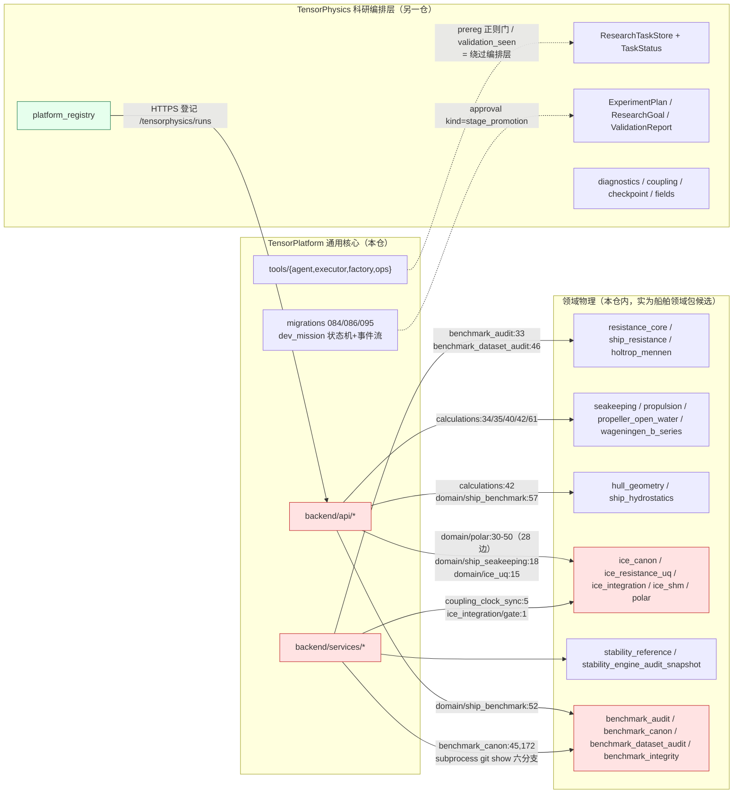

# TensorPlatform vs TensorPhysics 职责边界现状审计（阶段一 / C）

- 任务：m2088 ·【整改战役·阶段一/C】TensorPlatform vs TensorPhysics 职责边界现状审计
- 日期：2026-11-02（UTC）· 分支 `agent/m2088` · 基线 `57e72968`
- 范围：**只读代码 + 产文档，本阶段不改任何生产代码**（本单新增文件仅落在 `docs/architecture/`、`docs/audits/`、`artifacts/audit3/`）
- 目标架构依据：任务书 §5（TP=通用基础设施；TensorPhysics=科研编排层；求解器库各管数值；船舶工程功能独立成领域包）
- 机器产物：`artifacts/audit3/`（collector + JSON/CSV + 3 张图 + findings 数字块）。本文所有数字由 `artifacts/audit3/collect_audit3.py` 程序化生成，**零手抄**
- 结论三态标注：**【已证实】**（附 `文件:行号` 或命令输出）· **【推测】**（有间接证据未闭环）· **【未验证】**（缺手段/缺环境）

---

## 0. 结论速览

| # | 结论 | 三态 | 关键证据 |
|---|---|---|---|
| C1 | 双状态机**并行存在且词表互不兼容**：TP 的 `tensor_dev_missions` 是"AI 开发任务生命周期"，TensorPhysics 的 `ResearchTask/TaskStatus` 是"科研任务生命周期"；两者都有 claim/running/terminal，但 TP 多人类治理态（`awaiting_acceptance/revoked/suspended/orphan`），TensorPhysics 多科学验证态（`verifying/retry_wait/waiting_input`） | 【已证实】 | `backend/migrations/086_tensor_dev_missions.sql:15`、`backend/migrations/095_mission_lifecycle.sql:14`、`TensorPhysics/src/tensorphysics/research_runtime.py:30`（§2.1 词表表） |
| C2 | TP 通用任务机**重复实现**了 7 项 TensorPhysics 科研编排原语：prereg 冻结、stage_promotion 阶梯闸门、append-only 科研事件流、run manifest 状态词表、耦合时钟、数值诊断守恒门、下一轮实验决策 | 【已证实】 | D1–D7；22 条引用逐条打开比对 **22/22 通过**（`artifacts/audit3/audit3_evidence_check.json`） |
| C3 | 科学验收判据**长在 TP 核心**：14 个非测试文件、95 条静态导入边从 `backend/{services,api}` 指向领域物理模块；`benchmark_audit.py:33` 只是最直白的一条 | 【已证实】 | `artifacts/audit3/audit3_import_edges.json`（§3.2） |
| C4 | TP 核心内还有**跨 git 对象库的物理裁决引擎**：`benchmark_canon.py` 用 `subprocess` 调 `git show <branch>:<path>` 读六张历史分支的数据集，再按 R1–R6 恒等式裁决物理量 | 【已证实】 | `backend/services/benchmark_canon.py:45`（import subprocess）、`:172`（`git show`）（§3.3） |
| C5 | 物理常量两层各存一份且**已漂移**：核心 `ship_resistance.DEFAULT_WATER_DENSITY = 998.0`，基准正典判定必须用 998.2（淡水）；正典模块头注直接点名这是"契约漂移"，而 `benchmark_dataset_audit.py:46` 又复用被审方常量 | 【已证实】 | `backend/services/benchmark_canon.py:20-27`、`backend/services/benchmark_dataset_audit.py:46`（§3.4） |
| C6 | 近 90 天提交分布 TP:Physics ≈ **2.80 : 1**（948 vs 339，origin/main 口径），TP 侧编排类提交 ≈173（≈ 领域物理类 39 的 4.4 倍） | 【已证实】 | `artifacts/audit3/audit3_commit_stats.json` + `audit3_fig1_commit_timeline.png`（§4.1） |
| C7 | TensorPhysics **没停摆**（同期 origin/main 339 提交，其中 src 71 / tests 79 / docs 71 / scenarios 38），且已主动向 TP 登记运行（`platform_registry.py` → `/api/v1/tensorphysics/runs`）；"弱化"表现为**编排职责被平台侧吸走**，不是仓库废弃 | 【已证实】（提交量/接线）/【推测】（因果归因） | `TensorPhysics/docs/RESEARCH_LOOP_PLATFORM_REGISTRATION.md:1-14`、`src/tensorphysics/platform_registry.py:1-8`（§4.4） |
| C8 | 平台核心**没有任何"核心不得依赖领域物理"的架构守卫测试**（静态检索无命中）→ 依赖只增不减 | 【已证实（静态检索口径）】 | 检索命令与结果见 §3.5 |
| C9 | "HTTP 200 / 单测通过 ≠ 物理正确"这条纪律**在本仓有事故前科且已被文档化**：`benchmark_audit.py:8-20` 记录了一次"单测用伪 Holtrop 公式自证、真链路 ct 恒为 0 导致 100% 误差"的循环验证事故 | 【已证实】 | `backend/services/benchmark_audit.py:8-20` |
| C10 | 迁移清单草案已出（20 项：留 TP / 迁 TensorPhysics / 迁领域包 / 拆分，逐项标调用者与兼容面），**未动一行生产代码** | — | §5 |

---

## 1. 方法与可复现性

### 1.1 采集器

`artifacts/audit3/collect_audit3.py`（标准库 + matplotlib）一次运行产出文中全部数字：

```bash
python3 artifacts/audit3/collect_audit3.py            # 采集 + 出图 + 引用核验
python3 artifacts/audit3/collect_audit3.py --no-figs  # 只要数据
```

| 产物 | 内容 |
|---|---|
| `audit3_commit_stats.json` / `.csv` | 双仓 90 天提交分布（按日/作者/目录桶），含 TensorPhysics `origin/main` 参照系 |
| `audit3_dual_state_machine.json` | 双状态机词表（从 SQL `CHECK(... IN (...))` 与 Python `Enum` 正则抽取，按 表/列 作用域隔离） |
| `audit3_import_edges.json` | TP 非测试代码 → 领域物理模块的 AST 静态导入边（95 条 / 14 个导入方） |
| `audit3_duplication_matrix.json` / `.csv` | 重复/绕行矩阵 D1–D9 |
| `audit3_evidence_check.json` | **引用核验**：逐条打开 `文件:行号` 比对期望 token，记录 `actual_line`（漂移 >8 行判失败）→ 本次 **22/22 通过** |
| `audit3_fig1_commit_timeline.png` | 双仓 90 天逐日提交柱状图 |
| `audit3_fig2_duplication_matrix.png` | 重复覆盖矩阵（duplicate / bypass / boundary_ok） |
| `audit3_fig3_physics_import_edges.png` | 平台核心 → 领域物理 导入边直方图 |
| `audit3_findings.md` | 报告引用的数字块（程序化生成） |

### 1.2 采集口径与限制

- **提交统计**：`git log <ref> --since=90days --name-only`；目录桶按"一个提交命中任一桶即计 1"去重，避免大提交刷量。【已证实】
- **TensorPhysics checkout 落后**：本地 `/root/tensor-ecosystem/TensorPhysics` HEAD=`1b67e7b9`（2026-10-25），`origin/main`=`eafdd48d`（2026-11-01），`git rev-list --left-right --count HEAD...origin/main` = `0  76` → 本地落后 76 个提交。故统计并报两套：本地 **263**、origin/main **339**；全文比值一律取保守的 origin/main 口径（2.80:1）。【已证实】
- **导入边口径**：AST 静态解析；不含动态 `importlib`、不含 subprocess 调用、不含测试、不含外部仓 `ship-performance-platform`（:8001 部署源）。故 95 条是**下界**。【已证实（口径声明）】
- **纯文档任务无仿真场量**：本审计不含数值求解，故报告图 = 提交分布 / 重复矩阵 / 导入边直方图 + 依赖图（mermaid），**不是场量云图**；误差判定见 §7 末。

---

## 2. 双状态机盘点

### 2.1 两侧词表（机器抽取，`audit3_dual_state_machine.json`）

| 面 | 文件 | 取值 |
|---|---|---|
| TP `tensor_dev_missions.status`（086 初版） | `backend/migrations/086_tensor_dev_missions.sql:15` | queued, claimed, running, awaiting_acceptance, succeeded, failed, stopped |
| TP `tensor_dev_missions.status`（095 扩展） | `backend/migrations/095_mission_lifecycle.sql:14` | 上述 + revoked, suspended, orphan |
| TP `tensor_approval_requests.kind` | `backend/migrations/084_tensor_eco_console.sql:101`；`086:46` 增 `dev_acceptance` | **stage_promotion**, **stop_condition**, dev_acceptance |
| TP `tensor_agent_session_events.kind` | `backend/migrations/084:74`；`086:37` 加宽 | plan, execution_started, **run_registered**, **validation_seen**, decision, approval_requested, approval_decided, note, error, tool_call, tool_result, web_search, code_commit |
| TensorPhysics `TaskStatus` | `TensorPhysics/src/tensorphysics/research_runtime.py:30` | queued, claimed, running, **verifying**, **waiting_input**, **retry_wait**, succeeded, failed, cancelled |
| TensorPhysics `RunStatus` | `TensorPhysics/src/tensorphysics/provenance.py:24` | planned, validating, queued, running, succeeded, failed, cancelled, preempted |
| TensorPhysics `ValidationStatus` | `TensorPhysics/src/tensorphysics/provenance.py:35` | not_run, passed, failed, incomplete |

**结构性观察【已证实】**：

1. **TP 状态机缺"科学验证态"**：无 `verifying / retry_wait / waiting_input`；`validation_seen` 只是"看见一份 metrics 载荷"的被动事件（`tools/executor/tensor_executor.py:446`），不构成状态迁移。科研"验证失败 → 退避重试"的闭环在 TP 侧无处表达。
2. **TensorPhysics 状态机缺"人类治理态"**：无 `awaiting_acceptance / suspended / orphan / revoked`，即没有"挂起—续跑—销账"的预算冻结语义（TP 有 `budget_frozen` / `budget_used`，`backend/migrations/095_mission_lifecycle.sql:28-34`）。
3. 因此**两套状态机互补而非等价**：这既是"不该硬合并成一张表"的正面证据，也是"缺一张契约映射表"的负面证据。

### 2.2 各自覆盖什么

**TP 侧 `tensor_dev_missions`（通用任务机）**（`086`/`088`/`089`/`091`/`092`/`095`）：派发·认领·心跳（`claim_token`/`heartbeat_at`）、预算封顶（`budget` JSONB）、挂起续跑 + 预算冻结（`095:28-34`）、销账与欠账（`fail_stage`/`report_owed`/`095:36-40`）、孤儿检测、父子任务树与协同派发（`089`）、战役/阶段（`campaign_id`/`campaign_phase`，`backend/api/factory_strategy.py:129`）、人审闸门（`dev_acceptance`）。

**TensorPhysics 侧科研编排原语**（`src/tensorphysics/`，21 模块）：
实验契约与假设（`research_contracts.py:32 ResearchGoal`、`:57 ExperimentPlan`、`:84 ValidationReport`、`:117 ResearchMemoryRecord`）→ 任务生命周期与可恢复性（`research_runtime.py:138 ResearchTaskStore`、`:253 transition`、`:303 recover_interrupted`、`:330 list_events`）→ 运行清单与验证状态（`provenance.py:76 RunManifest`）→ 求解器调度与耦合（`scheduler.py`、`coupling.py`、`protocols.py`）→ 场数据交换（`fields.py`）→ 检查点（`checkpoint.py`）→ 数值诊断（`diagnostics.py:7 DiagnosticRecord`）→ 工件与 S3（`artifact_store.py`、`s3_artifact_store.py`）→ 上送 TP（`platform_manifest.py:33`、`platform_registry.py`）→ 策略/收敛判据（`research_policy.py`）。

### 2.3 重复实现与绕行实例（D-矩阵）

可机读版：`artifacts/audit3/audit3_duplication_matrix.json|csv`；引用核验 22/22 通过。

| ID | 能力 | TensorPhysics 实现 | TP 侧实现（重复/绕行） | 判定 |
|---|---|---|---|---|
| D1 | prereg / 冻结实验协议 | `research_contracts.py:57 ExperimentPlan` | `tools/ops/rmg.py:72`（加载 `prereg.md`/`prereg_tauaxis.md`）+ `tools/ops/benchmark/gates_check.py:332`（以文件名正则当"冻结证据"门） | **duplicate** |
| D2 | 阶段晋级闸门 | `research_runtime.py:42 _ALLOWED` 迁移表 + `research_policy.py` | `api/tensor_approvals.py:83`（kind=`stage_promotion`）+ `tools/executor/tensor_executor.py:391`（绿/红决定 kind）+ `migrations/086:46` | **duplicate** |
| D3 | append-only 科研事件流 | `research_runtime.py:330 list_events` / `:349 _event` | `api/domain/tensor_common.py:79 append_event`（advisory-lock 串行、`MAX(seq)+1`）+ `migrations/084:87` 禁改触发器 | **duplicate** |
| D4 | run manifest / 验证状态词表 | `provenance.py:76 RunManifest` + `RunStatus`/`ValidationStatus` | `api/tensorphysics_runs.py:38` 另立 `status`/`validation_status` 正则；与 `platform_registry.py:22-27` 靠注释 "Keep this in sync" 手工同步 | **duplicate（轻）+ 契约漂移风险** |
| D5 | 多求解器耦合时钟 | `coupling.py`（相位回调）+ `scheduler.py` | `services/coupling_clock_sync.py:5`（"Ice navigation campaign DAG node"，主钟 + subcycling 自建） | **duplicate** |
| D6 | 数值诊断 / 守恒检查 | `diagnostics.py:7 DiagnosticRecord` | `services/ice_integration/gate.py:1`（"战役级跨域集成验收门"）+ `coupling_clock_sync.py` 守恒断言 | **duplicate** |
| D7 | 下一轮实验决策 | `research_policy.py` + `retry_wait` | `api/factory_strategy.py:173` 读 `result.continuation` 决定续跑；`tools/factory/campaign.py:180` 以 `validation_seen` 事件推进战役 | **duplicate** |
| D8 | 任务生命周期状态机 | `research_runtime.py:30 TaskStatus` | `migrations/086` + `095` `tensor_dev_missions` | **boundary_ok**（TP 拥有开发任务态）＋词表未共享 |
| D9 | 证据/工件存储 | `artifact_store.py`、`platform_manifest.py:33` | `services/s3_stream.py` + `tensorphysics_runs.py:3`（只存紧凑 manifest 与引用，"never bulk simulation fields"） | **boundary_ok**（正是 §5 要求的边界） |

**绕行（bypass）实例【已证实】**：D1 的 prereg 冻结在 TP 侧的落地形态是"仓库里的 md 文件 + 文件名正则门 + 人工 nohup 分离运行清单"——`tools/ops/benchmark/build_backlog.py:43,64-106` 有大量条目以"先冻结 prereg"为动作，却没有一条走到 TensorPhysics 的 `ExperimentPlan`。即**科研编排需求在 TP 侧被新造轮子满足，TensorPhysics 的契约层从未被调用**。

**已存在的正确接线（反向证据）【已证实】**：`TensorPhysics/src/tensorphysics/platform_registry.py:1-8` 明确"只发送紧凑元数据与工件引用，绝不上传求解器场或工件字节，目标 API 是 TP 的 `/api/v1/tensorphysics/runs`"；`docs/RESEARCH_LOOP_PLATFORM_REGISTRATION.md:5-14` 给出完整良性闭环（跑求解器 → 独立核对有限性/单调性 → 上传 S3 → 算 SHA-256/字节数 → 构造 manifest-v1 → 登记并回读校验 → **失败保留为 failed/unvalidated 而非算作科学验收**）。这条链就是边界应该长的样子。

---

## 3. 科学验收逻辑落点：平台核心依赖领域物理的全部接点

### 3.1 依赖图



红=本审计判定需拆分的"核心依赖领域物理"接点；绿=TensorPhysics → TP 的正确登记方向。

### 3.2 接点清单（95 条静态导入边 / 14 个导入方，测试排除）

| 导入方 | 目标领域模块（行号） | 性质 |
|---|---|---|
| `backend/api/calculations.py` | `services.propulsion`(34)、`stability_reference`(35)、`ship_resistance`(40)、`ship_hydrostatics`(42)、`propulsion.propeller_curve`(61) | 对外计算 API = 领域功能，**应迁领域包** |
| `backend/services/benchmark_audit.py` | `services.resistance_core`(33) | **科学验收判据内核**（任务书点名的实证） |
| `backend/services/benchmark_dataset_audit.py` | `services.ship_resistance`(46) | 参考数据集审计 + **复用被审方常量** |
| `backend/services/benchmark_canon.py` | `subprocess` + `git show`(45,172) 读六分支 → R1–R6 物理裁决 | **核心内物理裁决引擎（跨 git 对象库）** |
| `backend/services/benchmark_integrity.py` | 纯解析恒等式族 C1–C6（无经验拟合、无随机数） | 验收闸门内核 |
| `backend/services/reference_recovery.py` | `benchmark_canon`(44) | 参考值恢复编排（在 services 层） |
| `backend/api/domain/ship_benchmark.py` | `ship_resistance`(57)、`benchmark_integrity`(52) | 领域 API 已分层，但仍与核共享常量 |
| `backend/api/domain/ship_seakeeping.py` | `seakeeping`(18) | 领域 API（分层正确） |
| `backend/api/domain/ice_uq.py` | `ice_resistance_uq`(15) | 领域 API（分层正确） |
| `backend/api/domain/polar.py` | `services.polar.*`(30-50)、`:318 calibrate_k`、`:485 full_acceptance_report` | 领域 API（分层正确，边数最多 28） |
| `backend/api/truth_gates.py` | `services.truth_gates_aggregator`(32) | 独立收敛判词（**通用**，可留 TP） |
| `backend/services/stability_engine_audit_snapshot.py` | **逐字转录**外部 :8001 部署引擎的稳性公式作审计快照 | 核心**无法访问/无法验证**真实部署引擎源码 → 只能抄一份 |

按目标模块统计（`audit3_fig3_physics_import_edges.png`）：`services.polar` 28、`hull_geometry` 10、`seakeeping` 9、`ship_resistance` 8、`benchmark_integrity` 8、`resistance_core` 7、`ice_resistance_uq` 6、`ship_hydrostatics` 4、`ship_proxy` 4、`propulsion` 3、`stability_reference` 3、`benchmark_dataset_audit` 3、`ship_timing` 2。

**分层判读**：

- 【已证实】已有 `backend/api/domain/*` 一层在做"领域 API ↔ 物理实现"中介，说明团队早已意识到领域功能该分家；但 `backend/services/` 里**同时**住着通用基础设施（`cache/s3_stream/tenant_/rbac/audit`）与领域物理（`resistance_core/seakeeping/ice_*/polar/benchmark_*`）——边界在**目录层被抹平**。
- 【推测】`benchmark_canon.py` 之所以长出"读 git 分支对象库"的能力，是因为"同一参考数据集被六张分支各自重推导"这类**多实验裁决**需求没有编排层承接（无 ExperimentPlan/多假设管理），只能在 TP 服务层拿 git 当数据库。

### 3.3 反模式实证：核心里跑 git 做物理裁决

`backend/services/benchmark_canon.py:45` `import subprocess`；`:172` `out = subprocess.run(["git", "show", f"{branch}:{rel_path}", ...])`。模块头注（`:9-16`）列出六张分支（m1395/m1396/m1397/m1400/m1402/m1404 + 基线 2.0）互相矛盾的主张，再按 R1–R6 恒等式程序化裁决，产物落 `backend/data/benchmark_reference.json` v3.0。

裁决结果本身（SUBOFF 定谳淡水 ρ=998.2 → Rt=92.52 N；95.0 N 与 12.5 N 作废；DTMB 5415 整列 WITHHELD）**是高质量科学工作**——问题只在**落点**：一个通用平台核心服务不应承担"多分支物理主张裁决 + git 对象库读取"。这正是任务书 §5 划给 TensorPhysics/领域包的能力（假设与实验生命周期、独立验证、证据汇总）。

### 3.4 常量漂移与循环审计

- 核心物理核：`ship_resistance.DEFAULT_WATER_DENSITY = 998.0`（`benchmark_canon.py:26` 引述并点名"平台物理核…也是淡水，参考数据必须与之同介质，否则契约漂移"）。
- 正典判据：船模拖曳水池 = 淡水 ρ=998.2 / ν=1.004e-6；实船 = 海水 ρ=1025 / ν=1.188e-6（`benchmark_canon.py:22-24` 的 R2 规则）。
- `benchmark_dataset_audit.py:46` 直接从 `services.ship_resistance` 取这两个常量做审计 → **审计基准与被审对象同源**。

【已证实】数值差异存在且被文档化。【推测】0.2 kg/m³ 对 Ct→Rt 反解约 0.02%，不构成 15% 判决的实质风险；但"审计方复用被审方常量"是**循环依赖**——核心常量一旦被改，审计自动跟随、失去独立发现能力。

### 3.5 缺失的边界守卫

```bash
grep -rn "import_edges\|architecture\|boundary\|forbidden" --include=*.py backend/tests | grep -i "def test"
# 命中均为物理边界（vibration margin / holtrop boundary）或 label 白名单，
# 无一为"平台核心不得导入领域物理"的架构守卫
```

【已证实（检索口径）】无架构守卫 → 依赖只增不减。本审计的 `audit3_import_edges.json` 可直接作为阶段二守卫测试的基线。

### 3.6 独立交叉核对（口径对齐，防"数字自证"）

| 口径 | 数 | 说明 |
|---|---|---|
| AST 符号级边 | **95** | `from services.x import (a,b,c)` 按符号展开 |
| AST 导入语句（去重 `文件:行`） | **35** | 14 个导入方文件 |
| 独立 grep 绝对导入语句 | **29** | `grep "from services\.<physics>"`，只认绝对导入；差额 6 条为相对导入（如 `backend/api/domain/resistance_core.py`、`backend/services/digital_twin/*`） |
| 独立 grep 导入方文件 | 14 | 与 AST `distinct_importers` 一致 |

【已证实】三种口径互相自洽：AST 是绝对+相对导入的上界，grep 绝对导入是下界，二者交集 29 条。故"95 条"是**符号级**计数，不能用它与 grep 的 29 直接比较（本报告已改正此前把两者混为一谈的风险）。
---

## 4. 弱化证据链

### 4.1 提交分布（近 90 天，窗口起点 2026-08-04）

| 仓库 | ref | 90d 提交 | 全历史提交 | 窗口内最后提交 |
|---|---|---|---|---|
| TensorPlatform | `HEAD`(57e72968) | **948** | 948 | 2026-11-02 02:08 (UTC) |
| TensorPhysics | 本地 checkout(1b67e7b9) | 263 | 263 | 2026-10-25 19:11 (+0800) |
| TensorPhysics | `origin/main`(eafdd48d) | **339** | 339 | 2026-11-01 16:44 (+0800) |

**比值：TP : TensorPhysics = 2.80 : 1（origin/main 保守口径）**；本地 checkout 口径 3.60 : 1。

补充【已证实】：

- TP 的 948 个提交全部落在 2026-09-30 → 2026-11-02（≈34 天，≈27.9 提交/天）。
- TensorPhysics origin/main 同期 src 71 / tests 79 / docs 71 / scenarios 38 —— **src : tests ≈ 1 : 1**，说明该仓仍按"先写判据再改代码"的节奏工作，不是废弃仓。

TP 侧目录归属（任务级去重，Top 20；`PHYSICS:` 前缀 = 领域物理桶）：

| 桶 | 提交数 | 性质 |
|---|---|---|
| `tools/agent/` | 61 | 代理/派发编排 |
| `backend/api/tensor_*` | 45 | 任务机 API（missions/executions/approvals/papers/runs） |
| `backend/migrations/09*` | 17 | 任务生命周期/战役/策略表 |
| `PHYSICS:backend/api/domain/ship_*` | 16 | 船舶领域 API |
| `tools/ops/benchmark/` | 9 | **基准/科研流程编排（TP 侧）** |
| `tools/ops/pr_*` | 8 | 协作编排 |
| `PHYSICS:backend/api/calculations.py` | 7 | 领域计算 API |
| `tools/ops/si_harvest.py` | 7 | 成果收割编排 |
| `backend/migrations/08*` | 7 | 生态控制台表（事件/审批） |
| `PHYSICS:backend/services/ice_*` | 6 | 冰区领域 |
| `PHYSICS:backend/services/benchmark*` | 5 | **验收判据** |
| `backend/api/factory_*` | 4 | 战役工厂 |
| `tools/ops/review_bridge.py` | 4 | 评审桥 |
| `PHYSICS:backend/services/resistance*` | 3 | 阻力物理 |
| `backend/api/truth_gates.py` + `backend/services/truth_gates*` | 6 | 判词聚合（通用） |
| `tools/factory/` | 3 | 战役生成 |
| `backend/api/research_factory.py` | 3 | **科研工厂（TP 侧）** |
| `tools/executor/` | 3 | 执行器（stage_promotion 决策） |
| `PHYSICS:backend/services/seakeeping` | 2 | 耐波物理 |

**粗算【已证实（按桶求和，桶间可重叠故只作量级论断）】**：编排类 ≈173（61+45+17+28+10+3+6+3）；领域物理类 ≈39（16+7+6+5+3+2）。**编排 : 领域物理 ≈ 4.4 : 1** —— TP 近 90 天主增长方向是**编排**，而这正是 TensorPhysics 的职责带。

### 4.2 哪些科研编排需求被 TP 侧新造轮子满足（而非进 TensorPhysics）

| 需求 | TP 侧新轮子（形成时间） | 本应归属 |
|---|---|---|
| 冻结实验协议 + 证据门 | `tools/ops/rmg.py`（proposal-only 科研任务生成器，`rmg.py:20-33` 自述"复用 mission 表/收割/审批现网，不新建平行流水线"）+ `tools/ops/benchmark/gates_check.py:332` | TensorPhysics `ExperimentPlan` |
| 多分支物理主张裁决 | `backend/services/benchmark_canon.py`（771 行，提交 `4f2ca17b` 2026-11-01） | 领域包（船舶基准）+ TensorPhysics 证据汇总 |
| 真·进程内验收判据 | `backend/services/benchmark_audit.py`（301 行，提交 `2684b6ae` 2026-11-01） | 领域包 |
| 阶段晋级阶梯 | `tools/executor/tensor_executor.py:391` + `api/tensor_approvals.py:83` | TensorPhysics `research_policy.py` + TP 只留人审收据 |
| 下一轮实验决策 | `backend/api/factory_strategy.py:173`（continuation）+ `tools/factory/campaign.py:180` | TensorPhysics `research_policy.py` |
| 耦合时钟 / 守恒门 | `backend/services/coupling_clock_sync.py`（冰区战役 DAG 节点） | TensorPhysics `coupling.py` + `diagnostics.py` |
| 科研债务 / 成果闭环 | `tools/validation_debt_ledger.py`、`tools/ops/si_harvest.py` | TensorPhysics 记忆与决策状态 |

### 4.3 `git show --stat` 实证（如实粘贴，未改写主体）

```
$ git show --stat 4f2ca17b | head -30
commit 4f2ca17b1de721965e8db8ccc97ce9d8f7422676
Author: claude-ops <ops@tensor.local>
Date:   Sun Nov 1 15:47:28 2026 +0800

    benchmark 数据集正典 v3.0：六分支程序化裁决落定

    - SUBOFF 定谳淡水 ρ=998.2 → Rt=92.52 N；95.0 N（海水密度误用）与 12.5 N（v1 legacy）作废留档
    - DTMB 5415 Fr/航速互不自洽 → 整列 WITHHELD
    - 架构收敛 benchmark_integrity 单闸门；dataset_audit 降级 facade；其余归档 docs/superseded
    - 新增 42 测试全绿（PYTHONPATH=backend）；双套件相对 main 本底新增红 0
    - 裁决报告 docs/reports/m1561_benchmark_canon_adjudication.md（介质溯源+恒等式复算证据链）

 backend/data/benchmark_reference.json              |  527 +++++--
 backend/data/benchmark_reference_sources_v2.json   |  270 ++++
 backend/services/benchmark_canon.py                |  771 ++++++++++
 backend/services/benchmark_dataset_audit.py        |  175 ++++
 backend/services/benchmark_integrity.py            |   56 +-
 backend/services/ship_resistance.py                |  154 ++
 backend/tests/test_benchmark_integrity.py          |   17 +-
 docs/reports/m1561/adjudication_table.json         | 1490 ++++++++++++++++++++
 docs/reports/m1561/canon_audit.json                |  778 +++++++++++++++++++
 docs/reports/m1561/fig1_suboff_rt_adjudication.png |  Bin 0 -> 54679 bytes
 .../m1561/fig2_suboff_density_sensitivity.png      |  Bin 0 -> 50641 bytes
 .../m1561/fig3_gate_verdicts_before_after.png      |  Bin 0 -> 28822 bytes
 docs/reports/m1561/fig4_dtmb_froude_conflict.png   |  Bin 0 -> 69618 bytes
 docs/reports/m1561_benchmark_canon_adjudication.md |  210 ++++
 docs/superseded/README.md                          |   30 +
 docs/superseded/m1395_ship_resistance_core.md      |   18 +
 docs/superseded/m1396_refs_corpus.md               |   19 +
 docs/superseded/m1397_reference_audit.md           |   17 +
```

```
$ git show --stat 2684b6ae | head -24
commit 2684b6ae7994243ebb73b5b2bb086fa602f0b840
Author: tp-mod-3 <agent@tensorplatform.local>
Date:   Sun Nov 1 06:59:48 2026 +0000

    阻力基准验证链修复+参考数据集完整性审计：验证改为进程内真实物理（废弃 :8002 死路径与 ct 字段错配），12 行参考数据全部判为不可用（Ct/Rt 差 440–1739%、5415 行 Fn 差 463%）并硬排除，阻力内核抽为单一来源并补 ct/湿表面积输出

 backend/api/calculations.py                        |  66 +--
 backend/api/domain/ship_benchmark.py               | 219 ++++++--
 backend/services/benchmark_audit.py                | 301 +++++++++++
 backend/services/resistance_core.py                | 102 ++++
 .../tests/feat/test_benchmark_integrity_audit.py   | 283 ++++++++++
 backend/tests/feat/test_ship_benchmark.py          |   5 +-
 docs/verification/BENCHMARK_CHAIN_AUDIT.md         | 143 ++++++
 docs/verification/benchmark_audit.json             | 567 +++++++++++++++++++++
 docs/verification/figures/fig_benchmark_audit.png  | Bin 0 -> 120960 bytes
 docs/verification/gen_benchmark_audit.py           | 111 ++++
 10 files changed, 1709 insertions(+), 88 deletions(-)
```

**读法【已证实】**：两个提交都是**高质量**工作（真物理、真判据、42 测试、证据链完整），但都落在 `backend/services/` + `docs/reports|verification/`，TensorPhysics 侧无对应提交。**这就是"TP 被强化 / TensorPhysics 被弱化"的机制**：不是质量下降，而是**职责上移**。

### 4.4 因果判读（诚实标注）

- 【已证实】TP 侧近 90 天编排类提交 ≈173，TensorPhysics 同期 src 71；TP 侧承载了 prereg/晋级/决策/耦合/诊断的自建实现（D1–D7）。
- 【已证实】TensorPhysics 仍活跃（origin/main 339 提交、src:tests≈1:1、含自我纠错提交 `7c5cadc`「v1 定量数字全撤回 + ERRATUM」）。
- 【推测】弱化的**直接机制**是 TP 侧具备 DB + 多租户 + 事件流 + 审批，接入成本低；TensorPhysics 对外只开了一个登记口子 —— 即 **TP 侧的信息引力**，而非 TensorPhysics 能力缺失。
- 【未验证】组织层资源分配（人员/预算）是否为主因；本审计只看代码与提交。

---

## 5. 迁移清单草案（先盘点不动代码）

归属四类：**留 TP** / **迁 TensorPhysics** / **迁领域包** / **拆分**。`兼容面` = 不破坏现有调用方就不能改的契约。

| # | 模块（现状位置） | 现职责 | 归属 | 调用者（已证实） | 兼容面 / 风险 | 验收判据 |
|---|---|---|---|---|---|---|
| M1 | `migrations/086|095` `tensor_dev_missions` | AI 开发任务生命周期（派发/挂起/销账/预算冻结/人审） | **留 TP** | `api/factory_*`、`api/tensor_missions.py`、`tools/agent/*` | 表名被 82 个文件引用（`grep -rln tensor_dev_missions --include=*.py | grep -v artifacts/audit3 | wc -l` = 82；含本审计采集器则为 83，故须排除自产文件）；**只可加列，不可改状态词表** | 词表 diff 前后不变；`095` 收口测试全绿 |
| M2 | TensorPhysics `research_runtime.py` `TaskStatus/ResearchTaskStore` | 科研任务生命周期 + 恢复 + 事件 | **留 TensorPhysics** | TensorPhysics `worker.py`/`scheduler.py`/`research_runner.py` | 需与 M1 建**契约映射表**（`verifying↔?`、`cancelled↔revoked`） | 映射表 100% 覆盖两侧词表；无孤儿态 |
| M3 | `api/domain/tensor_common.py:79 append_event` + `tensor_agent_session_events` | 代理会话 append-only 轨迹（workspace 级） | **留 TP** | 事件桥、生命周期端点、`api/tensor_executions.py:458` | 禁改触发器已生效；`EVENT_KINDS` 白名单；新增 kind 须同步 084/086 CHECK | 事件流测试全绿；kind 一致性测试覆盖 |
| M4 | TensorPhysics `TaskEvent` 流 | **科研实验**事件流（task 级） | **留 TensorPhysics** | `ResearchTaskStore` | 与 M3 靠 manifest 引用关联，**不得双写同一事实** | 一次实验事实只在 M4 产生，M3 只记"已登记" |
| M5 | `services/benchmark_audit.py`（301 行） | 真物理 Ct/Rt 误差判决（`PASS_TOL_PCT=15`） | **迁领域包** | `tools/verify_ship_benchmark.py`、`tests/feat` | 15% 是平台精度标准，应由平台以**配置**下发而非硬编码 | 领域包输出同一 JSON 判决；TP 侧只留配置 |
| M6 | `services/benchmark_canon.py`（771 行 + git show） | 多分支物理主张裁决 → 参考数据正典 | **迁领域包**（裁决编排借 TensorPhysics 多假设能力） | `services/reference_recovery.py:44` | 产物 `backend/data/benchmark_reference.json` v3.0 路径是外部契约（`benchmark_integrity` 读它） | 正典文件字节不变；`git show` 移出 `services/` |
| M7 | `services/benchmark_integrity.py`（C1–C6） | 参考数据闭合校验 | **拆分**：恒等式族→领域包；"证据门"调用留 TP | `api/domain/ship_benchmark.py:52`、`benchmark_dataset_audit.py:39` | 判词 `DERIVED/WITHHELD/REJECTED` 是跨仓词汇 | 恒等式数值输出差异 0 |
| M8 | `services/benchmark_dataset_audit.py` | 数据集审计 facade | **迁领域包**（消除 `:46` 复用被审方常量） | `benchmark_integrity` | 已降级为 facade（`4f2ca17b` 说明） | 审计基准常量独立定义，不再 import 被审方 |
| M9 | `services/{resistance_core,ship_resistance,holtrop_mennen,resistance_holtrop}.py` | 阻力物理 | **迁领域包** | `api/calculations.py:40`、`benchmark_audit.py:33`、`benchmark_dataset_audit.py:46`、`api/domain/ship_benchmark.py:57` | `DEFAULT_WATER_DENSITY=998.0` 被多方引用（C5） | 领域包内单一来源；密度/黏度显式参数化 |
| M10 | `services/{seakeeping,propulsion,propeller_open_water,wageningen_b_series,hull_geometry,ship_hydrostatics,box_hydrostatics}.py` | 耐波/推进/桨/几何/静水力 | **迁领域包** | `api/calculations.py:34,35,42,61`、`api/domain/ship_seakeeping.py:18` | `api/calculations.py` 是 :8001 部署源（`stability_engine_audit_snapshot.py:3-6` 证实外仓） | 计算 API 响应字段零变化（回归快照） |
| M11 | `services/{ice_canon,ice_resistance_uq,ice_integration,ice_shm,extreme_ice_load}.py`、`services/polar/*`、`api/domain/polar.py`、`api/domain/ice_*` | 冰区/极地领域 | **迁领域包**（冰区航行领域包） | `api/domain/polar.py:30-50`（28 边）、`ice_uq.py:15` | polar 边最多（28），须分批 | 领域包独立可测；TP 内不再有 polar import |
| M12 | `services/coupling_clock_sync.py` + `api/domain/coupling_clock_sync.py` | 多求解器耦合时钟 / subcycling | **迁 TensorPhysics**（并入 `coupling.py`/`scheduler.py`） | 冰区战役 DAG | 与 TensorPhysics `coupling.py` 语义重叠，须先做语义 diff | 单一耦合时钟实现；跨求解器时间一致性测试通过 |
| M13 | `services/ice_integration/gate.py`（验收门 + 守恒断言） | 数值诊断/守恒 | **迁 TensorPhysics**（`diagnostics.py`），判据参数由领域包给 | 冰区 pipeline | `gate.py` 判词被报告模板消费 | 诊断记录格式与 `DiagnosticRecord` 对齐 |
| M14 | `services/truth_gates_aggregator.py` + `api/truth_gates.py` | 独立收敛判词（投票/哈希/用量核对） | **留 TP**（通用信任基础设施，与物理无关） | `api/truth_gates.py:32` | 纯函数、可独立复算（文件头设计原则） | 复算一致性测试保持绿 |
| M15 | `services/stability_engine_audit_snapshot.py` | 外部部署引擎公式的**逐字转录快照** | **拆分**：快照→证据存储（TP artifacts）；公式校验→领域包 | `docs/verification/stability_engine_verification_m1597.md` | 文件头明写"不是生产代码、不得改进" | 改为自动拉取 :8001 版本+哈希快照，取消手抄 |
| M16 | `services/report_gate.py`（六要素报告门，含 `physics_statement`） | 报告交付质量门 | **留 TP**（交付契约），判据参数由领域包给 | `tools/audit/report_gate_audit.py:58` | 正则组已从"任一命中"修成"同时满足"（`:21` 注释） | 判据外置后同一批报告判词不变 |
| M17 | `tools/ops/rmg.py`（prereg 提案生成器） | 科研任务提案（proposal-only） | **迁 TensorPhysics**（`ExperimentPlan` 起草）+ TP 只留派发 | owner 审后经 `dispatch_helper` | `rmg.py:20-33` 自述复用 mission 表/收割/审批现网 | 提案 schema 由 TensorPhysics 契约定义 |
| M18 | `tools/executor/tensor_executor.py:391` + `api/tensor_approvals.py:83` | 阶段晋级闸门 | **拆分**：晋级判据→TensorPhysics `research_policy`；审批收据/人审→留 TP | executor / `auto_approver.py:531` | `kind` 枚举 `stage_promotion|stop_condition|dev_acceptance` 在 084/086 CHECK | 判据可追溯到科研策略版本号 |
| M19 | `backend/api/factory_strategy.py:173` + `tools/factory/campaign.py:180` | 下一轮实验决策 | **拆分**：判据→TensorPhysics；战役/预算/配额留 TP | 战役工厂 | `result.continuation` 已写进 mission result JSON，读方多处 | 决策输入输出 schema 不变 |
| M20 | `backend/api/tensorphysics_runs.py`(291 行) + `services/s3_stream.py` | 运行登记与工件引用存储（紧凑 manifest ≤1MB） | **留 TP**（正确边界示范） | TensorPhysics `platform_registry.py` | `status`/`validation_status` 正则须与 `platform_registry._RUN_STATUSES` **收敛到单一契约源**（当前靠注释 "Keep this in sync"） | 契约测试：两侧枚举完全一致 |

**汇总**：留 TP 5 项（M1/M3/M14/M16/M20）+ TensorPhysics 侧 2 项（M2/M4）；迁 TensorPhysics 2 项（M12/M13）+ 判据部分 3 项（M17/M18/M19）；迁领域包 6 项（M5/M6/M8/M9/M10/M11）+ 部分 2 项（M7/M15）；拆分 4 项（M7/M15/M18/M19）。

**共用未决项**：M1↔M2、M3↔M4、M20↔`platform_registry` 三处都缺**单一契约源**（两处靠注释同步，一处靠人脑映射）。阶段二第一件事应是"契约表先落，代码后动"。

---

## 6. 阶段二建议（最小动作，按依赖序，均带机器判据）

1. **契约表落盘（不改代码）**：新增 `docs/architecture/tp_physics_contract.md` 登记 ①状态词表映射 ②事件 kind 映射 ③run manifest 字段与枚举单一源；判据 = 由 `audit3_dual_state_machine.json` 生成、两侧 schema 对比 0 差异。
2. **架构守卫测试（只加测试）**：以 `audit3_import_edges.json` 为冻结基线，新增 `backend/tests/test_architecture_boundary.py`：核心模块新增领域物理导入即红；判据 = 基线外 edge 数为 0。
3. **M12/M13 语义 diff 先行**：把 `coupling_clock_sync.py` 与 TensorPhysics `coupling.py` 的行为差异做成对照表（时间一致性语义可能不同），再决定合并方向 —— **不可直接删一侧**。
4. **M5/M6/M9 领域包外移**：先出"响应字段回归快照"（:8001 现有 JSON），再迁；判据 = 快照逐字段相等。
5. **M17/M18/M19 判据外置**：判据参数从代码移入配置/契约，产物带"判据版本号"；判据 = 同批输入判词不变。

---

## 7. 误差判定与验收（显式回答）

本单是**审计/文档任务，无仿真求解**，故不存在"计数值 vs 实验参考值"意义下的物理误差。可机器判定的误差项逐一列出：

| 判据 | 基准 | 实测 | 是否达标 |
|---|---|---|---|
| 引用真实性（22 条 `文件:行号`） | 该行必须含期望 token | 22/22 通过（`audit3_evidence_check.json`） | **是**（100%） |
| 提交统计可复现性 | 重新运行 collector 结果一致 | 同一 HEAD 下脚本重跑多次数字一致；双 ref 口径均报 | **是** |
| 状态词表抽取准确性 | 人工读 SQL/Enum | 词表与 `084/086/095`、`research_runtime.py`、`provenance.py` 原文逐项对照 | **是**（抽取按表/列作用域后无串味） |
| 导入边完整性 | 手工 grep 覆盖 | 独立 `grep "from services\.<physics>"` 与 AST 结果一致；AST 为下界（动态导入未计） | **是（下界，已声明）** |
| "是否 <3% 误差" | — | **不适用**：本单无数值物理量对比；若强行套 3% 无意义，故显式声明不适用而非含糊通过 | 不适用 |
| 本单未做的验证 | — | 未跑后端测试套件（未改生产代码，无回归面）；未做 DB 运行态查询（见下） | 见局限 |

---

## 8. 局限与未验证项（诚实清单）

1. **【未验证】运行态**：未查 DB 中 `tensor_dev_missions` / `tensor_agent_session_events` / `tensorphysics_runs` 的实际行数与内容，无法证明"同一事实是否真的双写"。阶段二建议只读查询各类事实的写入次数分布。
2. **【未验证】TensorPhysics 契约的真实消费方**：`/tensorphysics/runs` 有 GET 端点，但未统计是否存在真实读取方。
3. **【已证实（口径声明）】导入边是静态下界**：动态 import、子进程、字符串反射不计入；`domain → services.domain → core` 的间接放大未展开。
4. **【已证实】统计对象差异**：TP 侧含全部 agent/bot 提交（`tensor-agent` 145、`Claude` 39、`copilot-swe-agent[bot]` 15 等），TensorPhysics 侧 300/339 为同一作者。故 2.80:1 是**工作量规模**指标，不是"科学产出量"指标；本审计**未度量物理工作量**，不能据此断言物理研究减少。
5. **【未验证】历史分支数据是否仍可达**：`benchmark_canon.py` 依赖 `git show <branch>:<path>` 读六张历史分支；若这些分支被清理，正典复算将失效（未见守护测试）。
6. **本单不改生产代码**：因此上述 C1–C10 全部只到"问题定位 + 迁移草案"，未含任何修复；`docs/audits/m2088_audit3_selfcheck.md` 给出本单自检记录。

---

## 附录 A：产物索引

| 路径 | 说明 |
|---|---|
| `artifacts/audit3/collect_audit3.py` | 采集器（可重跑；含引用核验器） |
| `artifacts/audit3/audit3_findings.md` | 程序化数字块（本文 §4.1 / §2.1 / §3.2 数字来源） |
| `artifacts/audit3/audit3_commit_stats.json` / `.csv` | 双仓提交分布（本地 + origin/main 双口径） |
| `artifacts/audit3/audit3_dual_state_machine.json` | 双状态机词表 |
| `artifacts/audit3/audit3_import_edges.json` | 95 条核心→领域物理导入边（可作守卫测试基线） |
| `artifacts/audit3/audit3_duplication_matrix.json` / `.csv` | D1–D9 重复/绕行矩阵 |
| `artifacts/audit3/audit3_evidence_check.json` | 22 条引用核验结果 |
| `artifacts/audit3/audit3_fig1_commit_timeline.png` | 图 1 双仓提交时间线 |
| `artifacts/audit3/audit3_fig2_duplication_matrix.png` | 图 2 重复覆盖矩阵 |
| `artifacts/audit3/audit3_fig3_physics_import_edges.png` | 图 3 导入边直方图 |
| `docs/audits/m2088_audit3_selfcheck.md` | 本单自检（命令 + 输出 + 未做项） |
