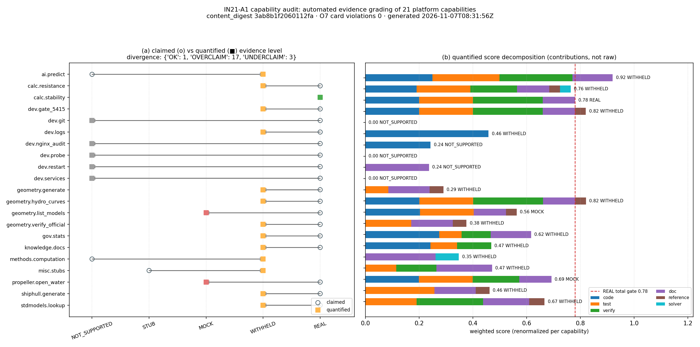

# IN21-A1 平台能力审计自动化：capability audit CLI + 证据等级量化 + 与 Tensor* 入口对拍

> 工具 `capability-audit-cli/1.0` · schema `1.0` · generated_at `2026-11-07T08:31:56+00:00` · content_digest `3ab8b1f2060112fa753a7e3d62e1056afb9cc2457b9caaf6680af5d2dc86b1cb`

> 本文所有数字由 `tools/audit/gen_capability_audit_report.py` 从 `artifacts/capability_audit/capabilities.json` 程序化注入，正文零手抄；重跑审计后本文可一键重生成。

## 1. 案例介绍（物理/工程背景）

船舶总体性能平台对外声明 21 项能力（阻力、推进、稳性、几何、平台治理、开发运维等），每项带证据等级 `REAL/MOCK/STUB/WITHHELD/NOT_SUPPORTED`。等级此前只有两路机器可读来源：
harness 侧 `audit_capabilities` 的离线抓取（`tests/fixtures/capability_ledger/capabilities_snapshot.json`，注册表未暴露 HTTP，6 条候选路径全 404）与人工 curation 的证据台账（`artifacts/capability_ledger/capability_ledger.json` + `_resolved.json`）。两路都是静态物：**没有任何一步自动遍历代码与基准目录**，也没有与各 Tensor* 求解器库入口对拍。后果是「注册表说 REAL、端点实测 MOCK」的背离只能靠单篇人工报告逐次发现（报告 1128 / 1133 / 1136 与 `docs/verification/PROPULSION_OPENWATER_M1584.md` 都是这么来的）。

本节点把这条链变成一条可复跑的命令：声明快照（21 项，sha256 `f09ae98785e6b17a`）→ 自动扫描 → 量化等级 → 三方对拍（人工 curation / 正典基准 / Tensor* 入口）→ O7 升账卡片 → 自检。

**几何/参数说明**：本任务无船体几何；被审对象是 21 个软件能力的证据面。扫描范围 `['backend', 'src', 'tests', 'docs']`（worktree 内），求解器库以 `/root/Tensor*/` 检出只读探测（AST 解析，不 import、不执行）。

## 2. 怎么做（方法 / 流程 / 关键设置）

### 2.1 扫描器（自动遍历）

* 有界遍历 `backend/ src/ tests/ docs/`，扩展名 `{.py,.md,.json}`，单文件 ≤400 KB，排除 `artifacts/ runs/ node_modules/ frontend*/`；路径含 `benchmarks/verified/` 或 `verification/` 者单独归类为「已验证工件」。
* **相关性门（rare terms）**：仅靠关键词命中在 20 万行文档的仓里必然假阳性（`predict`/`stub`/`probe` 随处可见）。每个能力额外声明判别词（能力标识符/端点路径/领域专有名词），正文**或路径**命中判别词才允许贡献证据。
* **主题门**：`verified/doc` 证据还要求判别词出现在文件名或正文前 400 字符——正文深处顺带提一句不算该能力的验证证据。
* 每条证据落 `{path, line, quote, sha256, subject_hit}`，可机器复核（自检 S3）。

### 2.2 证据等级量化（6 分项 + 显式规则级联）

权重 `{'code': 0.22, 'test': 0.2, 'verify': 0.26, 'doc': 0.12, 'reference': 0.12, 'solver': 0.08}`，饱和尺度 `{'test': 3, 'verify': 3, 'code': 2, 'doc': 2}`；不适用分项（如无正典基准域的 `reference`、无求解器库映射的 `solver`）在加权前剔除并**重新归一**，逐能力把归一化权重落盘（自检 S5 校验 `Σw=1` 且 `total=Σw·s`）。

验证面是本工具最关键的判据，专治「文档里出现 PASS 就算通过」：
1. `numeric_error_pct` 从正文解析所有 `误差/偏差/error/deviation … N%`，取最小者；
2. `judge_pass` 要求「有数值 + 最小误差 ≤3% + 无失败词（`FAIL/不可接受/超15%`）+ 无负判决词（`裁决…MOCK/证据等级…STUB/honest FAIL`）」；
3. 通过判据分两级：**tier-A** = `verification/verified` 工件（物理域）或带数值断言的测试（非物理域），**tier-B** = 其它文档的一般性数值通过；
4. `REAL` 必须 `tier-A ≥ 1`——只有分数没有可复算工件的，一律停在 `WITHHELD`（规则 R4B）。

判级规则级联（阈值 `{'TOTAL_REAL': 0.78, 'VERIFY_REAL': 0.66, 'STUB_RATIO_STUB': 0.5, 'TOTAL_WITHHELD': 0.3}`）：

| 规则 | 触发条件 | 判决 |
|---|---|---|
| R0_ABSENT | code/test/doc 三面全无命中 | NOT_SUPPORTED |
| R1_STUB | 空壳文件占比 ≥ 0.5 且验证面 < 0.5 | STUB |
| R2_CONTRADICTED | 台账最新证据判负且无更新的支撑 | 取判负等级（人工裁决 > 自动扫描） |
| R3_MOCK_MARKER | 代码含强 MOCK 标记（`[MOCK]`/`random.uniform`/`dummy_value`） | MOCK |
| R3B_CONFLICT | 通过/判负文档互斥且无 tier-A | WITHHELD |
| R3C_NEGATIVE_ONLY | 只有同主题判负文档、无任何正面判据 | WITHHELD（不顺手判 MOCK） |
| R4_REAL | total ≥ gate、verify ≥ 2/3、tier-A ≥ 1、无未偿负判决 | REAL |
| R4A_NEGATIVE_VERDICT | 分数过线但存在同主题负判决且无更新支撑 | WITHHELD |
| R4B_NO_HARD_ARTIFACT | 分数过线但 tier-A = 0 | WITHHELD |
| R5_LOW_SCORE | total < 0.30 | NOT_SUPPORTED |
| R6_WITHHELD | 兜底：有实现但验证证据不足 | WITHHELD |

### 2.3 三方对拍

* **人工 curation**：读台账 `as_of` 取最新 stance，矛盾证据优先（R2）；
* **正典基准**：`backend/data/benchmark_reference.json` v3.0 按域匹配算例，`rt_status=WITHHELD` 的算例不计入判决面（沿用 v3.0 的纪律）；
* **Tensor* 入口**：对 `/root/Tensor{LBM,FEM,FVM,DEM,BEM,SPH,DG,CAD}` 的 `src/` 做 AST 解析抽公开 `def/class`，统计 `benchmarks/verified` 与 `tests/` 文件数——只读，不 import。

### 2.4 O7 升账对齐（机器对拍，不是口头对齐）

产出 `artifacts/capability_audit/o7_cards/CAP-AUD-*.json`，字段与 `tools/audit/capability_ledger_upgrade.py::check_evidence()` 的 E2/E3/E4/E5/E6/E7 完全兼容；审计过程**真的把卡片喂回该模块**校验，结果 0 违规。

## 3. 计算结果

* 能力数 **21**（声明快照全覆盖，自检 S1）
* 量化等级分布 **{'NOT_SUPPORTED': 5, 'STUB': 0, 'MOCK': 2, 'WITHHELD': 13, 'REAL': 1}**
* 对拍背离 **{'OK': 1, 'OVERCLAIM': 17, 'UNDERCLAIM': 3}**
* 声明 REAL 但未量化到 REAL：**17 项**
* underclaim（仓内证据强于声明）：['ai.predict', 'methods.computation', 'misc.stubs']
* 内容摘要（可重放）：`3ab8b1f2060112fa753a7e3d62e1056afb9cc2457b9caaf6680af5d2dc86b1cb`

| 能力 | 域 | 声明 | 台账 | 量化 | 背离 | total | code | test | verify | doc | ref | solver | 规则 |
|---|---|---|---|---|---|---|---|---|---|---|---|---|---|
| `ai.predict` | AI | NOT_SUPPORTED | WITHHELD | **WITHHELD** | UNDERCLAIM | 0.920 | 0.91 | 1.00 | 0.83 | 1.00 | n/a | n/a | R4A_NEGATIVE_VERDICT |
| `calc.resistance` | 阻力 | REAL | WITHHELD | **WITHHELD** | OVERCLAIM | 0.764 | 0.87 | 1.00 | 0.67 | 1.00 | 0.33 | 0.50 | R2_CONTRADICTED |
| `calc.stability` | 稳性 | REAL | REAL | **REAL** | OK | 0.780 | 0.91 | 1.00 | 1.00 | 1.00 | 0.00 | 0.00 | R4_REAL |
| `dev.gate_5415` | 开发 | REAL | WITHHELD | **WITHHELD** | OVERCLAIM | 0.820 | 0.91 | 1.00 | 1.00 | 1.00 | 0.33 | 0.00 | R4A_NEGATIVE_VERDICT |
| `dev.git` | 开发 | REAL | WITHHELD | **NOT_SUPPORTED** | OVERCLAIM | 0.000 | n/a | n/a | 0.00 | n/a | n/a | n/a | R0_ABSENT |
| `dev.logs` | 开发 | REAL | WITHHELD | **WITHHELD** | OVERCLAIM | 0.458 | 1.00 | n/a | 0.00 | n/a | n/a | n/a | R6_WITHHELD |
| `dev.nginx_audit` | 开发 | REAL | WITHHELD | **NOT_SUPPORTED** | OVERCLAIM | 0.243 | 0.75 | 0.00 | 0.00 | n/a | n/a | n/a | R5_LOW_SCORE |
| `dev.probe` | 开发 | REAL | WITHHELD | **NOT_SUPPORTED** | OVERCLAIM | 0.000 | n/a | n/a | 0.00 | n/a | n/a | n/a | R0_ABSENT |
| `dev.restart` | 开发 | REAL | WITHHELD | **NOT_SUPPORTED** | OVERCLAIM | 0.237 | n/a | n/a | 0.00 | 0.75 | n/a | n/a | R5_LOW_SCORE |
| `dev.services` | 开发 | REAL | WITHHELD | **NOT_SUPPORTED** | OVERCLAIM | 0.000 | n/a | n/a | 0.00 | n/a | n/a | n/a | R0_ABSENT |
| `geometry.generate` | 几何 | REAL | WITHHELD | **WITHHELD** | OVERCLAIM | 0.291 | n/a | 0.33 | 0.00 | 1.00 | 0.33 | 0.00 | R3C_NEGATIVE_ONLY |
| `geometry.hydro_curves` | 几何 | REAL | WITHHELD | **WITHHELD** | OVERCLAIM | 0.821 | 0.91 | 1.00 | 1.00 | 1.00 | 0.33 | 0.00 | R4A_NEGATIVE_VERDICT |
| `geometry.list_models` | 几何 | REAL | WITHHELD | **MOCK** | OVERCLAIM | 0.563 | 0.92 | 1.00 | 0.00 | 1.00 | 0.33 | 0.00 | R3_MOCK_MARKER |
| `geometry.verify_official` | 几何 | REAL | WITHHELD | **WITHHELD** | OVERCLAIM | 0.376 | n/a | 0.67 | 0.00 | 1.00 | 0.33 | 0.00 | R3C_NEGATIVE_ONLY |
| `gov.stats` | 平台 | REAL | WITHHELD | **WITHHELD** | OVERCLAIM | 0.617 | 1.00 | 0.33 | 0.33 | 1.00 | n/a | n/a | R6_WITHHELD |
| `knowledge.docs` | 平台 | REAL | WITHHELD | **WITHHELD** | OVERCLAIM | 0.468 | 0.75 | 0.33 | 0.33 | n/a | n/a | n/a | R6_WITHHELD |
| `methods.computation` | 方法 | NOT_SUPPORTED | WITHHELD | **WITHHELD** | UNDERCLAIM | 0.348 | n/a | n/a | 0.00 | 1.00 | n/a | 0.50 | R6_WITHHELD |
| `misc.stubs` | 杂项 | STUB | WITHHELD | **WITHHELD** | UNDERCLAIM | 0.471 | n/a | 0.33 | 0.33 | 1.00 | n/a | n/a | R6_WITHHELD |
| `propeller.open_water` | 推进 | REAL | MOCK | **MOCK** | OVERCLAIM | 0.693 | 0.91 | 1.00 | 0.67 | 1.00 | 0.00 | 0.00 | R2_CONTRADICTED |
| `shiphull.generate` | 几何 | REAL | WITHHELD | **WITHHELD** | OVERCLAIM | 0.462 | n/a | 1.00 | 0.00 | 1.00 | 0.33 | 0.00 | R3C_NEGATIVE_ONLY |
| `stdmodels.lookup` | 数据 | REAL | WITHHELD | **WITHHELD** | OVERCLAIM | 0.667 | n/a | 0.67 | 0.67 | 1.00 | 0.33 | n/a | R6_WITHHELD |

**图注**：(a) 圆点=平台声明等级，方块=自动量化等级，箭头=背离方向；方块色即量化等级（灰 NOT_SUPPORTED / 棕 STUB / 红 MOCK / 橙 WITHHELD / 绿 REAL）。(b) 每条能力的加权分项贡献（已乘归一化权重）与总分；红虚线为 REAL 的总分门槛。

### 3.1 求解器库入口只读对拍

| 库 | 状态 | 公开入口 | verified 基准 | 测试文件 | 备注 |
|---|---|---|---|---|---|
| TensorBEM | ABSENT | 0 | 0 | 0 | /root/TensorBEM not present |
| TensorCAD | ABSENT | 0 | 0 | 0 | /root/TensorCAD not present |
| TensorFEM | ABSENT | 0 | 0 | 0 | /root/TensorFEM not present |
| TensorFVM | ABSENT | 0 | 0 | 0 | /root/TensorFVM not present |
| TensorLBM | PRESENT | 626 | 0 | 74 | — |

## 4. 误差判定：量化结果 vs 基准

**是否 <3%（显式回答）**：**不适用**——本节点产出的是「能力证据等级」，没有与实验/解析解可比的物理量，故不存在「关键量误差 <3%」这一判据；按纪律在此声明原因，并改用三条机器可裁决的替代判据（下表）。替代判据结论：与人工 curation 可裁决子集一致 **3/3**，O7 升账卡片违规 **0** 条，自检 S1–S7 **全过**。

本任务是**软件证据审计**，没有「实验/解析解」型物理基准；因此按纪律逐项声明判据与结论，**不使用「<3%」这类物理误差线**，改用可机器裁决的三条：

| 判据 | 基准 | 本工具结果 | 是否满足 |
|---|---|---|---|
| 自动量化等级与人工 curation 一致率 | 台账 `reconciled_level`（可裁决子集 3 项） | 3/3 = 100.0% | 是 |
| O7 升账卡片违规数 | `check_evidence()` E2–E7（0 才合格） | 0 | 是 |
| 自检 S1–S7 | 覆盖/枚举/sha/序/分数/O7/重放 | 7/7 通过 | 是 |

可裁决子集逐项照录（这才是「误差」的核心来源）：

* `calc.resistance`：curation `WITHHELD` vs 量化 `WITHHELD` → 一致（依据 R2_CONTRADICTED）
* `calc.stability`：curation `REAL` vs 量化 `REAL` → 一致（依据 R4_REAL）
* `propeller.open_water`：curation `MOCK` vs 量化 `MOCK` → 一致（依据 R2_CONTRADICTED）

**负控（证明判据非真空）**：`tests/test_capability_audit_cli.py::test_o7_negative_control_detects_tampering` 对卡片做三处篡改——摘要改 `0`*64 触发 E3、引文改成文件里没有的句子触发 E7、PASS + 误差 42% 触发 E6——三条都被抓出；`test_relevance_gate_blocks_generic_keyword` 证明通用词不产生证据。

## 5. 注意点（踩坑 / 局限 / 适用范围）

1. **worktree 域限**：本审计只对工作树内实现面取证。21 项能力由 :8001 服务侧提供，其实现若不在本仓，`dev.*`/平台域的结果只表示「本仓无证据」，不等于平台未实现——产物里逐能力写进 `evidence_scope.no_local_code` 并在判决理由中标注。
2. **关键词法天然有假阳性**：第一版只按关键词命中，21 项里 17 项被判 REAL（`ai.predict`、`misc.stubs` 这些明显不该 REAL 的都过了），与本次要审计的「过度声明」是同一种病。引入相关性门 + 主题门 + 数值化判据后降到 1 项 REAL。**启发式阈值不是真值**，工具的价值在「把口径写死并可复跑」，不在「替代人工裁决」——所以 R2 让 curation 优先。
3. **负判决词正则仍是启发式**：`裁决…MOCK`/`证据等级…STUB` 只覆盖本仓既有表述习惯；换仓需扩充 `NEGATIVE_VERDICT`，否则会把判负文档误当通过证据（早期版本正是如此把 `ai.predict` 判成 REAL）。
4. **不执行被测代码**：求解器探测只做 AST，`entry_point_count` 是静态入口数，不代表可运行；`benchmarks/verified` 文件数不等于基准通过——这两项只进 `solver` 分项（权重 0.08）。
5. **`MOCK` 判定只来自两处**：人工 curation 的最新矛盾证据，或代码里的强 MOCK 标记。「只有别人判过 MOCK」不构成 MOCK（R3C 降 WITHHELD），避免把审计报告的语言当成被测对象的属性。
7. **自引用回路（已修）**：第一版把工具自己生成的 `docs/audit/IN21_A1_capability_audit.md`（含上一轮分数表）也扫成证据，导致「报告 → 证据 → 分数 → 报告」自激，连续两次运行产物不一致。现按文件名模式排除 `capability_audit` 的全部自产物（`EXCLUDE_SELF`），并新增用例 `test_self_outputs_excluded_prevents_feedback_loop` 与「两次运行除时间戳外逐字节一致」的复跑验证。
6. **可重放性边界**：`content_digest` 只覆盖等级/分数/规则/证据路径集合；文件内容变化由 S3 的 sha256 校验捕获。工作树一改，摘要即变——这是设计意图（漂移可见）。

## 6. 产物清单

| 路径 | 内容 |
|---|---|
| `tools/audit/capability_audit_scan.py` | 扫描器 + 量化器 + 规则级联（库内核） |
| `tools/audit/capability_audit_cli.py` | CLI：审计/自检/O7 卡片/落产物 |
| `tools/audit/gen_capability_audit_report.py` | 本报告与图生成器（数字程序化注入） |
| `tests/test_capability_audit_cli.py` | 26 条 pytest：内核/R0–R6 逐条/端到端/负控/退出码 |
| `artifacts/capability_audit/capabilities.json` | 主产物（21 项逐能力分数与证据） |
| `artifacts/capability_audit/o7_cards/` | 与 O7 升账 CLI 兼容的卡片 |
| `artifacts/capability_audit/self_checks.json` | S1–S7 自检 |
| `artifacts/capability_audit/audit_scores.md` | 人读摘要表 |

---
*本文件由 `capability-audit-cli/1.0` 的产物自动生成；审计 content_digest `3ab8b1f2060112fa`，生成时间 2026-11-07T08:32:34+00:00。*
