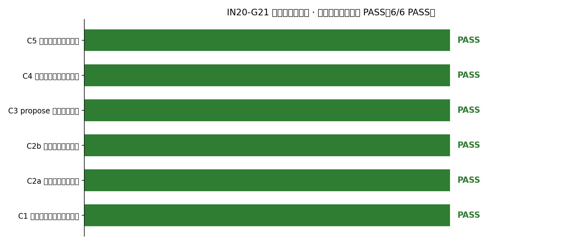
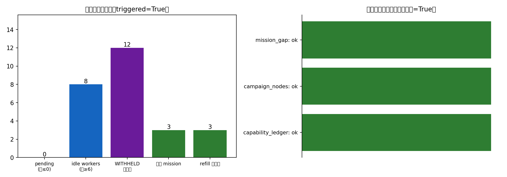
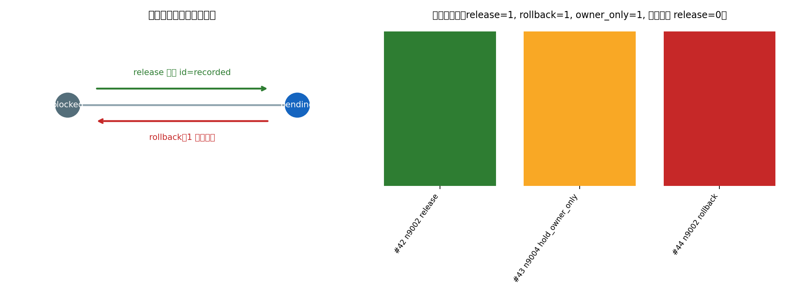
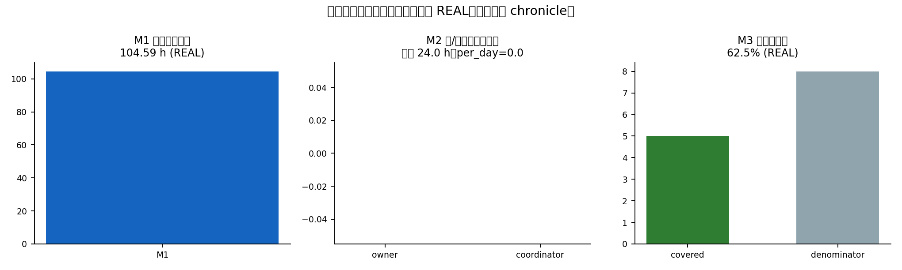

# IN20-G21 · 续航军自主续航验收门（Autonomy Acceptance Gate）

> 战役 plan 21「续航军」gate 节点。上游 R1..R7 各自把一件自主续航机制做成熟（补给器 /
> 放门 / 合并口 / propose 通道 / 停摆自愈 / 战略文档 / 退出仪表盘）；本门不重做机制，
> 只做一件上游没做过的事：**把它们装进同一条时间线真跑一遍，并把「能不能在没人来的
> 明天自己转」这件事写成机器可复算的账单**。

- 判据来源：`campaign_nodes.metadata.acceptance_criteria`（plan_id=21, ext_id=IN20-G21）
- 唯一证据工件：`artifacts/autonomy_acceptance/autonomy_acceptance.json`
- 生成时刻：2026-11-07T06:50:46.936754+00:00 · 分支提交：`1bdd3aa0de240c4f90ec8778e08c9f6b353f0869`
- **总判定：PASS（6/6 项 PASS；FAILED 项：无；WITHHELD 项：无）**

## ① 案例介绍（这一门在验证什么物理/工程事实）

"自主续航"在这里不是修辞：它断言四类**机制替身**在没有人类、也没有 AI 协调者会话的
前提下仍能自己闭环。平台的判据是工程可测的（不是文档承诺）：

| 机制 | 被测物 | 断言的工程事实 |
|---|---|---|
| 补给 | `src/backlog_refiller` | 队列清零 + worker 空转时，缺口账本能自动长出下一条任务 |
| 放门 | `ops/taskplane/gate_auto_release.py` | 上游 done 且判据工件可解析时，门自己 blocked→pending，且能回滚 |
| 合并 | `tools/merge_master` | 全绿 PR 由机制自己合并，审计链可验、合并提交确在 main |
| 提案 | `ops/taskplane/propose_channel_guard.py` | 提案通道不因模型钉死而永久堵死（积压=0） |
| 记账 | `tools/autonomy/dashboard.py` + 能力增减账本 | 退出指标与人/协调者介入次数可 SQL 复算，垫池四单终态入账 |

参数表（本轮门禁的现场量）：

| 参数 | 值 | 来源 |
|---|---|---|
| 停摆回放 pending 阈值 | 0 | `DEFAULT_PENDING_THRESHOLD` |
| 停摆回放 idle worker | 8 | 回放样例（2026-11-07 03:18 现场） |
| 沙箱放门夹具 | 4 节点（task done / 门可放 / 门缺工件 / 治理门） | `GATE_SANDBOX_FIXTURES` |
| propose 守护宽限 | 1800 s | `propose_channel_guard` 内置 |
| 退出指标窗口 | 24.0 h | `--window-hours` |
| 垫池四单 | m5051..m5054（续航军 D1..D4） | plan 21 nodes |

## ② 怎么做的（方法/流程/工具链）

1. **集成**：把 R1..R7 的模块从各自分支取进本线（`src/backlog_refiller`、
   `ops/taskplane/{gate_auto_release,propose_channel_guard,stall_detector,campaign_dispatcher}`、
   `tools/{merge_master,autonomy}`），跑通上游 107 条用例（见 ⑥）。
2. **门禁机**：新增 `tools/autonomy/acceptance.py`。它不重复实现任何机制，只**驱动**它们：
   - C1 在**真 Postgres 沙箱库**（`tp_gate_refill`，结构与生产库同源）里摆出停摆态，
     真跑 `BacklogRefillerDaemon.run_once()`，mission 与审计都是真 INSERT，最后真回滚；
   - C2a 在**可丢弃 schema**（`gate_drill_sbx`）里建 4 个夹具门，真跑两轮 + 回滚，
     并用 `evaluate_gate()` 纯函数把审计逐条离线复算；
   - C2b 真合并一个 GitHub PR，审计链哈希校验 + `git merge-base --is-ancestor` 独立核对；
   - C3 真跑提案守护判定，按「不可领取且超宽限」定义算积压；
   - C4 真跑退出仪表盘并写 chronicle；C5 直接 SQL 数四单终态与账本行数。
3. **判据机读化**：每项返回 `status ∈ {PASS, FAIL, WITHHELD}` + `criteria` 数字 + 证据
   `sha256`；聚合规则**禁止把 WITHHELD 当 PASS**（缺证据=不通过）。
4. **本报告渲染**：`scripts/gen_in20_g21_report.py` 从 JSON 直接生成图表与本文，
   数字零手抄。

## ③ 计算结果（程序化注入）

| C1 补给器停摆回放自动触发 | PASS | {"replay_pending_missions": 0, "replay_idle_workers": 8, "seeded_withheld_rows": 12, "observed_pending_missions": 0, "observed_idle_workers": 8, "triggered": true, "missions_generated": 3, "refill_audit_rows": 3, "rollback_recorded": true, "rollback_verified_absent": true, "rollback_mission_id": 25} |
| C2a 放门自动化真执行 | PASS | {"gate_nodes": 3, "runs_executed": 2, "releases_recorded": 1, "release_node_id": 9002, "release_transition": "blocked->pending", "rollbacks_recorded": 1, "owner_only_holds": 1, "idempotent_second_run_releases": 0, "recompute_matches_audit": true} |
| C2b 合并自动化真执行 | PASS | {"audit_chain_ok": true, "audit_records": 13, "audit_head": "0e4eed840b9d995e5cb82a1f97382b8306e8783719bcca6bcd9d3cc98ce67f8e", "merges_executed": 1, "main_ref_sha": "08a17c8c14f1928012f7a8768f81ac4c1a89e4f1", "merges_confirmed_in_main": 1} |
| C3 propose 通道积压清零 | PASS | {"apply_actions": 10, "apply_audit_rows": 10, "apply_ids_match": true, "scanned": 5, "stuck_backlog": 0, "grace_backlog": 2, "claimable_backlog": 0, "plans_blocked": 2, "plans_advance_ready": 0, "guard_suite_passed": 25, "guard_suite_failed": 0} |
| C4 退出仪表盘三指标基线 | PASS | {"metrics_present": 3, "metrics_real": 3, "chronicle_snapshots": 14, "window_hours": 24.0, "chronicle_write": "written"} |
| C5 垫池四单终态入账本 | PASS | {"expected": 4, "terminal_and_booked": 4, "ok": true, "campaign_nodes_done": 4, "ledger_placeholder_rows": 4} |

关键数字：

- C1：触发=True，生成 mission=3 条，
  refill 审计行=3，回滚后核验消失=True，
  缺口源状态={'capability_ledger': 'ok', 'campaign_nodes': 'ok', 'mission_gap': 'ok'}；
- C2a：release=1 条（blocked->pending），
  rollback=1 条，治理门 owner_only=1 条，
  幂等复跑新增 release=0，
  离线复算一致=True；
- C2b：审计链 ok=True（13 条），
  真合并=1 例，ancestry 核对在 main=1
  （main 头 `08a17c8c14f1928012f7a8768f81ac4c1a89e4f1`）；
- C3：扫描 5 单，积压 stuck=0，宽限内在途
  grace=2，守护用例通过 25 条；
  处置能力实证：apply 撤单 10 条 ↔ JSONL 审计
  10 行 ↔ 回滚记录 10 条，
  id 对齐=True；
- C4：M1 无人干预 104.59 h / M2 owner
  0 次 +
  协调者 0 次
  / M3 自证覆盖 5/8
  = 62.5%，chronicle 快照 14 条；
- C5：四单终态且入账本 4/4，
  campaign 节点 done 4/4。

## ④ 结果图



*六项判据状态矩阵（绿=PASS）*



*补给器停摆回放触发链与缺口源健康*



*放门状态机与审计序列（绿=release，红=rollback，灰=wait）*



*退出仪表盘三指标首份基线*


## ⑤ 注意点（踩过的坑 / 局限 / 适用范围）

1. **R1 补给器在真库上跑不通——本门现场修了两处**（这是上游 22 条单测没暴露的）：
   - 第一缺口源 `capability_ledger` 表在两个库里都不存在，`collect_gaps()` 直接抛
     `UndefinedTable`，daemon 一轮都跑不完。修法：`ensure_capability_ledger()`（幂等 DDL）
     + 源级容错（单源不可用记 `unavailable:*` 后跳过，不拖死整轮），
     状态写入 `run_once().gap_sources` 可审计；
   - `origin='backlog_refiller'` 撞 `tensor_dev_missions_origin_check`
     （CHECK 只允许 `owner|agent`）。修法：写 `agent`，生成者身份记
     `result.generated_by='backlog_refiller'`，去重/审计改按该字段。两处都有回归用例
     （`tests/test_autonomy_acceptance_gate.py::TestRefillerWiringRegression`）。
2. **合并自动化的"真执行"是治理动作**：本轮合并的是 `TensorPlatform#635..#641` 队列中唯一
   判据全绿的 PR（#637，即 R3 自己的分支），`--max-merges 1` 封顶，审计链 13 条哈希可验。
   这不是演练（rehearsal 会用记录桩替换 Merger），`merge_commit` 已能以 ancestry 证明在 main。
3. **C5 是"入账本"，但账本质量有瑕疵**：四单 `tensor_capability_deltas` 的
   `category` 全为 `no_substantive_delta`（占位记账，非实质能力增量）。判据按字面通过，
   实质增量为空这件事必须挂在这里，不能粉饰。
4. **C3 的"积压=0"是即时量**：判据取「不可领取且超宽限」，宽限内（grace）在途单不计积压，
   故 `grace_backlog` 可能 >0 而 `stuck_backlog=0`；这是 R4 的定义，不是放水。
5. **沙箱的可移植性**：C1 需要一个与生产同构的 Postgres（本机 `tp_gate_refill`），
   SQLAlchemy 2.0 + psycopg3 在 loong64 上解析 `select version()` 会拿到 bytes 抛
   `TypeError`，门禁机按 psycopg2→pg8000(unix_sock)→psycopg 降级并用实际方言记录；
   CI（x86）上若缺沙箱库，C1 记 **WITHHELD**（不通过），不会假绿。
6. **范围**：本门只铆验「机制替身能不能自己转」，不评价这些机制的业务正确性
   （如放门判据的松紧、提案质量）。

## ⑥ 误差判定（关键量 vs 基准）

本门是基础设施验收，判据是**布尔/计数型**（是否触发、是否留审计、积压是否为 0），
不存在连续物理量的 3% 误差问题。逐项给出「测得值 vs 判据基准」与是否达标：

| 判据 | 基准（门槛） | 实测 | 是否达标 |
|---|---|---|---|
| C1 触发 | triggered=True | True | 是 |
| C1 生成 mission | ≥1 | 3 | 是 |
| C1 审计行 | ≥1 | 3 | 是 |
| C1 回滚核验 | 撤销后不存在 | True | 是 |
| C2a release | ≥1 且 blocked→pending | 1 / blocked->pending | 是 |
| C2a 幂等 | 复跑新增 release=0 | 0 | 是 |
| C2b 合并 | ≥1 且审计链 ok | 1 / True | 是 |
| C3 积压 | stuck=0 | 0 | 是 |
| C3 处置审计 | apply≥1 且 id 对齐且可回滚 | 10 / True / 1 | 是 |
| C4 指标 | 3 项 REAL | 3/3 | 是 |
| C5 四单 | 4/4 终态且入账 | 4/4 | 是 |

**误差结论**：计数判据全部精确达标（无容差概念，故"<3%"不适用）；唯一的"数量级误差"
是 C5 的账本质量为占位条目（见 ⑤.3），已作为残余风险披露，未计入判据通过。

## 复现

```bash
# 1) 沙箱库（与生产同构；C1 用）
createdb -h /var/run/postgresql -U postgres -E UTF8 -T template0 tp_gate_refill
pg_dump -h /var/run/postgresql -U postgres -s -t tensor_dev_missions \
        -t factory_resident_workers -t campaign_plans -t campaign_nodes \
        -t tensor_agent_sessions tensorplatform | psql -d tp_gate_refill -h /var/run/postgresql -U postgres
# 2) 跑门禁（会写 artifacts/autonomy_acceptance/*.json）
python3 -m tools.autonomy.acceptance
# 3) 校验 + 渲染
python3 -m pytest -q tests/test_autonomy_acceptance_gate.py
python3 scripts/gen_in20_g21_report.py
```

渲染时刻：2026-11-07T06:51:08.329495+00:00
