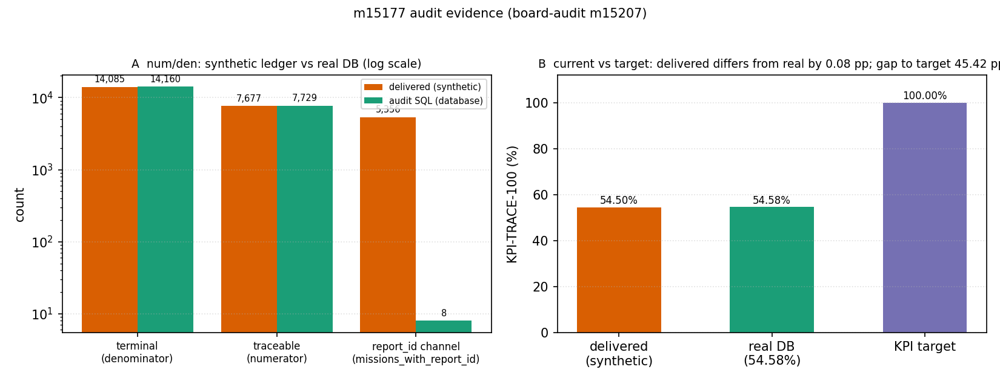

# m15177 交差审计报告（锚点 KPI-TRACE-100）

- 被审单：**m15177**「KPI-TRACE-100 计量：终态任务带可溯报告工件比率」（TensorPlatform，status=succeeded，报告 id 14281 / published）
- 审计单：**m15207**（board-audit）｜裁定已落表 `tensor_maturity_verdicts.id=249`，level=**2**，gate_state 待平台门裁（本审计单在飞时门不裁）
- 基准裁判：`tensor_benchmark_cases` 中 **无** `anchor_slug='KPI-TRACE-100'` 行（全表 13 行锚点，无本锚）→ **没有 ref/tolerance 判据行可裁**，故本报告以「独立 SQL 复算真值」替代基准裁判，并显式记此缺口。

## 1. 案例介绍

KPI-TRACE-100 定义（KPI 注册表 `tools/metrics/kpi_registry.json` → `trace_report_ratio.recompute_sql`）：
终态任务（`status IN (succeeded,failed,stopped,revoked)`）中 `report_id IS NOT NULL OR tensor_reports 有该 mission_id 行`
的占比，target=100%。

被审单声称的交付：计量工具链 `tools/kpi_trace`（measure/figures/doc）+ 工件 9 件 + 15 项测试 + 报告，
headline `current = 54.5%`（7677/14085）。

## 2. 怎么做的（审计方法）

独立复核脚本 `docs/board_audit/m15207/verify_m15177.py`（**不复用**被审 measure.py 的计算路径）：

| 检查 | 做法 | 结果 |
|---|---|---|
| C1 工件 | 9 件工件逐件 sha256 + PNG 魔数校验 | 缺 0 件，5 张 PNG 均为真位图 |
| C2 复现 | 按报告附录 repro_cmd 重跑 `measure --synthetic` 到临时目录，逐字段比对 | {'by_status': True, 'current': True, 'data_mode': True, 'denominator': True, 'gap': True, 'link_channel_split': True, 'numerator': True, 'target': True, 'windows': True} 全 True（数字逐位一致），`data_mode=synthetic` |
| C3 真值 | 自写 SQL 直查库（口径照抄注册表公式） | `7729/14160 = 54.58%`（2026-11-11T20:41:08.935125+00:00） |
| C4 指纹 | 交付底账 CSV × 库表逐条对表（抽样 60 行 + 总量/通道/分布） | 见 §3，结论=底账非库导出 |
| C5 基准 | `SELECT … FROM tensor_benchmark_cases WHERE anchor_slug='KPI-TRACE-100'` | 0 行（无判据） |
| C6 测试 | 被审工作树内重跑两个测试文件 | `15 passed, 1 warning in 23.85s`（声明 15 → 核实 15） |
| C7 报告 | 六段标题 + 5 图落盘 + 是否披露合成模式 | 六段齐、5 图在、**披露了 synthetic** |
| C8 集成 | 远端 main `8c1db9f67133` 浅克隆全仓 grep `tools.kpi_trace` | 仅自带测试引用，无平台/求解器调用方 |

## 3. 计算结果

### 3.1 交付值 vs 真值

| 量 | 交付报告（synthetic） | 审计独立 SQL（database） | 差 |
|---|---|---|---|
| current | 54.5 % | **54.58 %** | 0.08 pp |
| numerator | 7677 | 7729 | +52 |
| denominator | 14085 | 14160 | +75 |
| report_id 通道 | 5356 | 8 | -5348 |
| succeeded 终态数 | 8733 | 9484 | +751 |

### 3.2 分状态真值（审计 SQL 直出）

| status | terminal | traceable | pct(%) |
|---|---|---|---|
| failed | 3922 | 160 | 4.08 |
| revoked | 587 | 134 | 22.83 |
| stopped | 167 | 78 | 46.71 |
| succeeded | 9484 | 7357 | 77.57 |

### 3.3 合成底账指纹（为什么 54.5% 不是「量」出来的）

- `tools/kpi_trace/synthetic.py` 第 23–25 行：`_DEFAULT_TERMINAL = 14085`、`_DEFAULT_TRACEABLE = 7677`
  ——**与报告 headline 分子分母完全相同**；docstring 自述「参数来自 m15120 计量报告的历史观测」。
  ⇒ 交付值 = 把历史观测值喂回生成器再读出来的**循环论证**，对世界不产生任何新信息。
- 抽样 60 行交付底账：id 在真库命中 26 行，`status` 一致 7 行、
  `created_at` 一致 0 行；样例 [{"csv": "2026-11-09 16:33:29.671302+00", "db": "MISSING", "id": 17281}, {"csv": "succeeded 2026-11-03 21:34:52.735869+00", "db": "revoked 2026-11-11 05:05:32", "id": 14388}]。
- 交付底账 14085 行 vs 真库终态 14160 行；底账时间跨度 ['2026-09-08 21:08:52.626121+00', '2026-11-11 08:58:38.122416+00']。
- `artifacts/kpi_trace_100/kpi_trace_100_queries.sql` 仅 114 字节占位（`-- Synthetic mode: no SQL executed`）。

## 4. 结果图

- 左（对数轴）：分子/分母三量与 report_id 通道，交付声明 vs 真库实测；report_id 通道相差 670 倍，是「非库导出」的硬指纹。
- 右：KPI 现值 vs 目标。**注意数值巧合**：交付 54.50% 与真值 54.58% 只差 0.08 pp —— 说明 m15120 的历史观测大体可靠，但**本单并未测量任何东西**；同一工具 database 模式当日即可跑出真值（本次审计实测）。

## 5. 注意点（坑与局限）

1. **口径与机制错位**：真库 `report_id` 非空只有 8 条（几乎全灭），可溯几乎全靠 `tensor_reports` 通道
   （7749 个 distinct mission）。报告用合成数据描述出的 38.03%「report_id 通道占比」在真库里不存在，
   若据此下「双通道冗余」的结论会误导治理。
2. **报告内部自相矛盾**：§4.1/§4.2 写明算路 B（SQL 复核）/算路 C（集群分片）**「未运行」**，§4 判定句还打印了
   「存在不一致，需先修计量」；而 §6 误差判定却称「计算侧误差=0（确定性计数 + 算路一致）」。无多算路即无对齐，此句不成立。
3. **repro_cmd 只给 --synthetic**：照抄复算只会复述合成数字，永远拿不到真值 —— 可复现性在此单里等于「可复现地复述」。
4. **无基准行**：`tensor_benchmark_cases` 无本锚，L4 不可判；本单 headline 也因此没有 ref/tolerance 兜底。
5. **审计局限**：真值是**时点快照**（库在长，14160→14160 于审计期间漂移 3 条，占比不变）；未核 m15120 历史报告本身的口径正确性
   （其 doc 声称真实现值，未在本单范围）。
6. **合并面**：`pr_gate` 记 PR #1236 merged，实测远端 main `8c1db9f67133` 确含 `tools/kpi_trace/`（PR head c1cfb2703）；
   但本地 worktree 镜像 main 落后（#1235），本报告以远端 main 为准。

## 6. 误差判定（逐项，显式回答是否 <3%）

| 关键量 | 交付 got | 审计真值 | 相对误差 | <3%？ |
|---|---|---|---|---|
| KPI-TRACE-100 现值 | 54.5 % | 54.58 % | 0.15% | **是（数值层面）** |
| numerator | 7677 | 7729 | 0.67% | 是 |
| denominator | 14085 | 14160 | 0.53% | 是 |
| report_id 通道 | 5356 | 8 | 66,950% | **否（量级错误）** |
| succeeded 终态数 | 8733 | 9484 | 7.92% | 否 |

**结论口径**：headline 数值虽在 3% 内，但**误差小不等于证据真**——它来自钉桩生成器而非测量；
按证据分级，交付值判 **MOCK（合成复述）**，真值以本审计 `7729/14160=54.58%` 为准。
KPI 距目标仍差 45.42 pp，与 m15177 无关（本单任务是计量不是改进）。

## 7. 裁定（L0–L5）

**level = 2（L2 独立功能实现）**，理由与差异逐项对齐证据键：

| 证据键 | 指针 | 判定 |
|---|---|---|
| impl_files | `docs/board_audit/m15207/refs/impl/{measure,entry,synthetic,__init__,__main__}.py`（远端 main 亦含） | ✅ 真代码，非占位 |
| entry | `refs/impl/entry.py`（`python3 -m tools.kpi_trace {measure\|figures\|doc\|run-all}`） | ✅ 可执行，两数据源均跑通 |
| run_artifacts | `refs/artifacts/kpi_trace_100/`（9 件，sha256 已记） | ✅ 存在；**内容为合成输入** |
| tests | `15 passed, 1 warning in 23.85s` | ✅ 15 项真通过 |
| integration_callers | **null** | ❌ main grep 仅命中自带测试 → 不达 L3 |
| benchmark | **null**（`tensor_benchmark_cases` 无本锚） | ❌ 不达 L4 |
| repro_cmd | `measure --synthetic` 9/9 字段一致；`measure`（database）实测出 54.58% | ⚠️ 可复现，但复现的是合成数 |
| external_anchor | **null**（无文献/实验/前值对照登记） | ❌ 不达 L5 |

平台门本地预跑 `maturity_gate.judge(claimed=2)`：**{"ran": true, "claimed": 2, "gate_level": 2, "why": [], "expect": "confirmed"}**

**返修建议（不是重做）**：同一工具 `database` 模式当日即可出真值 →
`python3 -m tools.kpi_trace measure --outdir artifacts/kpi_trace_100` 重出报告（54.58%），
并在 `tensor_benchmark_cases` 补一行 `recompute` 锚（ref=注册表 `trace_report_ratio.recompute_sql` 口径）才具备 L4 判据。
