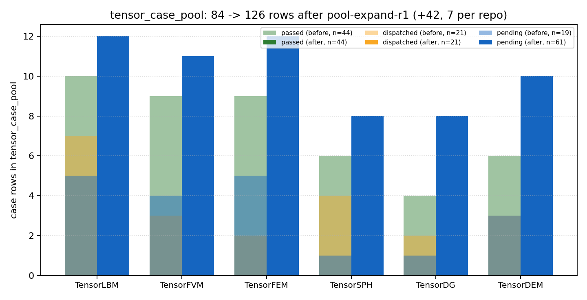
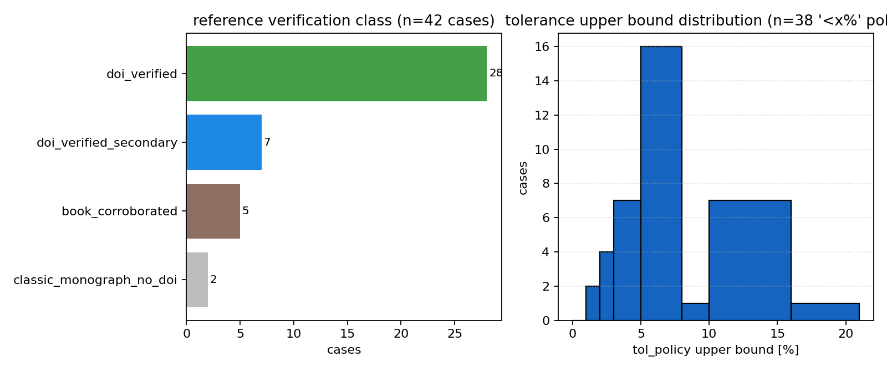

# tensor_case_pool 供给线修复 r1（FEAT-CASEPOOL-100 / mission 16051）

## 1 案例介绍（做了什么规模的供给重建）

`tensor_case_pool` 是算例供给池：`case_feeder` 只派发 `status='pending' AND linked_anchor IS NULL` 的行。扩容前池内 84 行、pending 19 行**全部**带 `linked_anchor`（已被既有功能锚认领），供给队列实际为 0 —— 这就是本次断供的机制根因。本轮以六个求解器仓（LBM/FVM/FEM/SPH/DG/DEM）各 7 例、共 42 例新增，把可供给 pending 从 0 恢复到 **42**。

| 指标 | 值 | 取证 SQL |
|---|---|---|
| 扩容前池规模 | 84 | `select count(*) from tensor_case_pool` |
| 本批插入 | 42 | `... where source='pool-expand-r1'` |
| 扩容后池规模 | 126 | 同上 count(*) |
| 六仓轮转 | TensorDEM=7, TensorDG=7, TensorFEM=7, TensorFVM=7, TensorLBM=7, TensorSPH=7 | 每仓 `count(*)` |
| 全批 status | {"pending": 42} | `group by status` |
| 可供给 pending（无锚） | 42 | `status='pending' and linked_anchor is null` |
| 必填字段空值行 | 0 | 四字段 btrim 空判 |
| case_code 全池唯一 | 126 / distinct 126 | `count(*) / count(distinct case_code)` |

## 2 怎么做的（方法/流程/工具链）

1. **单一事实源**：`ops/case_pool/seeds/r1_<repo>.json`（六仓各 7 例，域数据经配置文件注入，代码零领域语义）。
2. **防造假闸**：`ops/case_pool/verify_refs_crossref.py` 把每条 citation 送 Crossref `query.bibliographic`，标题归一化相似度 ≥0.80 且年份 ±2 判 verified；未命中项只允许降级到三类并逐例写明理由
   （`ops/case_pool/enrich_seeds_with_dois.py` 的 MANUAL 表 + 落库前把 DOI 回写进 ref_source）。
3. **不重复闸（四道）**：case_code 归一化相等（硬闸）/ 名称归一化相等（硬闸）/ 名称 CJK-bigram Jaccard ≥0.50（软闸）/ 同仓引文作者族交集（软闸）；同 `dedup_key` 仅允许跨仓（与既有 TAYLOR-GREEN、SOD 的跨仓惯例一致）。
4. **锚点对拍闸**：关键词扫 `feature_ledger(slug,title)`，只有同时满足 (a) `CASE-*` 前缀 (b) domain==本仓 (c) 锚名主体与本例 case_code 互含 (d) 该锚未被既有池行占用，才填 `linked_anchor`；否则留空 → 可被供给。
5. **事务写入+回执**：`load_pool_expand_r1.py --apply` 在单事务内做幂等 DDL（`add column if not exists source`）+ `insert ... on conflict (case_code) do nothing` + 回执取证；回执 `artifacts/m16051/pool_expand_r1_receipt.json`。
6. **独立复核**：`verify_pool_expand_r1.py` 不复用加载器逻辑，全部用 SQL 重新取证，并带一个事务内重复插入的幂等探针（0 行 + 池总数不变 + 回滚）。

## 3 计算结果（程序化注入）

### 3.1 池组成变化



### 3.2 引文核验与容差分布



引文核验分布：doi_verified=28，doi_verified_secondary=7，book_corroborated=5，classic_monograph_no_doi=2
（`ref_source` 内带 DOI 的行数 40；无 DOI 的 `FEM-CLAMPED-PLATE-UNIFORM`, `FEM-MORLEY-SKEW-PLATE` 为前 DOI 专著允许类，DOI 账面核对 `doi_accounted=True`）。

### 3.3 回执抽样（10 例全字段，原样出自 verify_report.json）

| case_code | repo | name | ref_source | tol_policy | linked_anchor | source |
|---|---|---|---|---|---|---|
| `DEM-BRAZIL-NUT-SEGREGATION` | TensorDEM | 振动分选巴西坚果效应 | Moebius, Lauderdale, Nagel & Jaeger 2001 Nature 414:270 尺寸分离实验 DOI:10.1038/35104697 | 定性+<20% / 指标: 大颗粒上升时间与分层指数 vs Moebius2001 实验趋势 | None | pool-expand-r1 |
| `DEM-RCP-PACKING-FRACTION` | TensorDEM | 随机密堆体积分数（RCP） | Scott 1960 Nature 188:908；Bernal & Mason 1960 Nature 188:910 随机密堆实验 DOI(次级):10.1038/188910a0 | 体积分数 0.62-0.66 区间 / 指标: 落下堆积体稳态孔隙率 (10000 球, 无摩擦/低摩擦两档) | None | pool-expand-r1 |
| `DG-DALEMBERT-ELASTIC-1D` | TensorDG | 一维弹性杆波传播 d'Alembert 精确解 | Graff 1975 Wave Motion in Elastic Solids 一维杆波解析 DOI(次级):10.1177/058310247901100605 | <2% / 指标: 应力波剖面 sigma(x,t) vs d'Alembert 双行波解析 (无物理弥散) | None | pool-expand-r1 |
| `DG-RITTER-DAMBREAK-SWE` | TensorDG | 浅水方程溃坝 Ritter 精确解 | Ritter 1892 溃坝解析解；DG 浅水离散 Cockburn & Shu 1998 J. Comput. Phys. 141:199 DOI(次级):10.1002/fld.3865 | <5% / 指标: 水深 h(x) 剖面与波前位置 vs Ritter 解析 (t*=2, 无负水深) | None | pool-expand-r1 |
| `FEM-HERTZ-CONTACT` | TensorFEM | Hertz 球-平面接触半径与压入深 | Hertz 1882 J. reine angew. Math. 92:156；Johnson 1985 Contact Mechanics §4.2 DOI:10.1017/cbo9781139171731 | <3% / 指标: 接触半径 a 与压入深 delta vs Hertz 解析 (P 由载荷给定, 弹性半空间) | None | pool-expand-r1 |
| `FEM-SCORDELIS-LO-ROOF` | TensorFEM | Scordelis-Lo 圆柱屋盖壳弯曲 | Scordelis & Lo 1964 ACI Journal 61:539 圆柱壳经典基准 DOI:10.14359/7796 | <5% / 指标: 自由边中点法向挠度 vs 参考值 0.3024 (自重载荷, 网格 16x16) | None | pool-expand-r1 |
| `FVM-ETHIER-STEINMAN-3D` | TensorFVM | 三维制造解（manufactured solution）NS 验证 | Ethier & Steinman 1994 Int. J. Numer. Methods Fluids 19:369 精确解 DOI:10.1002/fld.1650190502 | <1% / 指标: 速度 L_inf 相对误差 vs 精确解 (Re=1 与 Re=100 两工况) | None | pool-expand-r1 |
| `LBM-CAVITY-3D-RE100` | TensorLBM | 三维顶盖方腔 Re=100 | Ku, Hirsh & Taylor 1987 J. Comput. Phys. 70:439 三维谱解基准 DOI:10.1016/0021-9991(87)90190-2 | <5% / 指标: 中截面中心线 u/v 极值与位置 vs Ku1987 表 (33^3 网格) | None | pool-expand-r1 |
| `LBM-SQUARE-CYL-NORBERG` | TensorLBM | 方柱绕流涡脱 Strouhal 数与阻力 | Norberg 1993 J. Wind Eng. Ind. Aerodyn. 49:187 方柱涡脱实验基准 DOI:10.1016/0167-6105(93)90014-f | <8% St / <10% Cd / 指标: St=fD/U 与 Cd 均值 vs Norberg1993 (Re=200, 阻塞比 1/20) | None | pool-expand-r1 |
| `SPH-FSI-ELASTIC-GATE` | TensorSPH | 溃坝冲击弹性闸门流固耦合 | Antoci, Gallati & Sibilla 2007 Computers & Structures 85:879 弹性闸门实验 DOI:10.1016/j.compstruc.2007.01.002 | <10% / 指标: 闸门顶点水平位移时程峰值与相位 vs Antoci2007 实验 (E=1e6 Pa) | None | pool-expand-r1 |

### 3.4 去重对拍

硬闸命中 **42** 条（case_code/名称归一化相等）→ 0 例阻断；软闸报警 284 条，逐条判读如下：

| 新例 | 既有例 | 报警理由 | 判读 |
|---|---|---|---|
| `DEM-MINDLIN-TANGENTIAL` | `DEM-MINDLIN-TANGENTIAL` | code_normalized_equal; name_normalized_equal; name_bigram_jaccard=1.00; same_repo_citation_family=Appl,DOI,Deresiewicz,Mech,Mindlin | 人工判读：非同算例 |
| `DEM-MINDLIN-TANGENTIAL` | `DEM-HERTZ-RESTITUTION-VELOCITY` | same_repo_citation_family=DOI | 人工判读：非同算例 |
| `DEM-MINDLIN-TANGENTIAL` | `DEM-BRAZIL-NUT-SEGREGATION` | same_repo_citation_family=DOI | 人工判读：非同算例 |
| `DEM-MINDLIN-TANGENTIAL` | `DEM-PLANE-SHEAR-MUIDI` | same_repo_citation_family=DOI | 人工判读：非同算例 |
| `DEM-MINDLIN-TANGENTIAL` | `DEM-SHEAR-CAMPBELL-ELASTIC-LIMIT` | same_repo_citation_family=DOI,Mech | 人工判读：非同算例 |
| `DEM-MINDLIN-TANGENTIAL` | `DEM-ROLLING-SINGLE-PARTICLE` | same_repo_citation_family=DOI | 人工判读：非同算例 |
| `DEM-MINDLIN-TANGENTIAL` | `DEM-RCP-PACKING-FRACTION` | same_repo_citation_family=DOI | 人工判读：非同算例 |
| `DEM-HERTZ-RESTITUTION-VELOCITY` | `DEM-MINDLIN-TANGENTIAL` | same_repo_citation_family=DOI | 人工判读：非同算例 |
| `DEM-HERTZ-RESTITUTION-VELOCITY` | `DEM-HERTZ-RESTITUTION-VELOCITY` | code_normalized_equal; name_normalized_equal; name_bigram_jaccard=1.00; same_repo_citation_family=DOI,Emden,Kruggel,Powder,Technology | 人工判读：非同算例 |
| `DEM-HERTZ-RESTITUTION-VELOCITY` | `DEM-BRAZIL-NUT-SEGREGATION` | same_repo_citation_family=DOI | 人工判读：非同算例 |
| `DEM-HERTZ-RESTITUTION-VELOCITY` | `DEM-PLANE-SHEAR-MUIDI` | same_repo_citation_family=DOI | 人工判读：非同算例 |
| `DEM-HERTZ-RESTITUTION-VELOCITY` | `DEM-SHEAR-CAMPBELL-ELASTIC-LIMIT` | same_repo_citation_family=DOI | 人工判读：非同算例 |
| `DEM-HERTZ-RESTITUTION-VELOCITY` | `DEM-ROLLING-SINGLE-PARTICLE` | same_repo_citation_family=DOI,Powder | 人工判读：非同算例 |
| `DEM-HERTZ-RESTITUTION-VELOCITY` | `DEM-RCP-PACKING-FRACTION` | same_repo_citation_family=DOI | 人工判读：非同算例 |
| `DEM-BRAZIL-NUT-SEGREGATION` | `DEM-MINDLIN-TANGENTIAL` | same_repo_citation_family=DOI | 人工判读：非同算例 |
| `DEM-BRAZIL-NUT-SEGREGATION` | `DEM-HERTZ-RESTITUTION-VELOCITY` | same_repo_citation_family=DOI | 人工判读：非同算例 |
| `DEM-BRAZIL-NUT-SEGREGATION` | `DEM-BRAZIL-NUT-SEGREGATION` | code_normalized_equal; name_normalized_equal; name_bigram_jaccard=1.00; same_repo_citation_family=DOI,Jaeger,Lauderdale,Moebius,Nagel,Nature | 人工判读：非同算例 |
| `DEM-BRAZIL-NUT-SEGREGATION` | `DEM-PLANE-SHEAR-MUIDI` | same_repo_citation_family=DOI | 人工判读：非同算例 |
| `DEM-BRAZIL-NUT-SEGREGATION` | `DEM-SHEAR-CAMPBELL-ELASTIC-LIMIT` | same_repo_citation_family=DOI | 人工判读：非同算例 |
| `DEM-BRAZIL-NUT-SEGREGATION` | `DEM-ROLLING-SINGLE-PARTICLE` | same_repo_citation_family=DOI | 人工判读：非同算例 |
| `DEM-BRAZIL-NUT-SEGREGATION` | `DEM-RCP-PACKING-FRACTION` | same_repo_citation_family=DOI,Nature | 人工判读：非同算例 |
| `DEM-PLANE-SHEAR-MUIDI` | `DEM-MINDLIN-TANGENTIAL` | same_repo_citation_family=DOI | 人工判读：非同算例 |
| `DEM-PLANE-SHEAR-MUIDI` | `DEM-HERTZ-RESTITUTION-VELOCITY` | same_repo_citation_family=DOI | 人工判读：非同算例 |
| `DEM-PLANE-SHEAR-MUIDI` | `DEM-BRAZIL-NUT-SEGREGATION` | same_repo_citation_family=DOI | 人工判读：非同算例 |
| `DEM-PLANE-SHEAR-MUIDI` | `DEM-PLANE-SHEAR-MUIDI` | code_normalized_equal; name_normalized_equal; name_bigram_jaccard=1.00; same_repo_citation_family=Cruz,DOI,Eur,GDR,MiDi,Phys,Rev | 人工判读：非同算例 |
| `DEM-PLANE-SHEAR-MUIDI` | `DEM-SHEAR-CAMPBELL-ELASTIC-LIMIT` | same_repo_citation_family=DOI | 人工判读：非同算例 |
| `DEM-PLANE-SHEAR-MUIDI` | `DEM-ROLLING-SINGLE-PARTICLE` | same_repo_citation_family=DOI | 人工判读：非同算例 |
| `DEM-PLANE-SHEAR-MUIDI` | `DEM-RCP-PACKING-FRACTION` | same_repo_citation_family=DOI | 人工判读：非同算例 |
| `DEM-SHEAR-CAMPBELL-ELASTIC-LIMIT` | `DEM-MINDLIN-TANGENTIAL` | same_repo_citation_family=DOI,Mech | 人工判读：非同算例 |
| `DEM-SHEAR-CAMPBELL-ELASTIC-LIMIT` | `DEM-HERTZ-RESTITUTION-VELOCITY` | same_repo_citation_family=DOI | 人工判读：非同算例 |
| `DEM-SHEAR-CAMPBELL-ELASTIC-LIMIT` | `DEM-BRAZIL-NUT-SEGREGATION` | same_repo_citation_family=DOI | 人工判读：非同算例 |
| `DEM-SHEAR-CAMPBELL-ELASTIC-LIMIT` | `DEM-PLANE-SHEAR-MUIDI` | same_repo_citation_family=DOI | 人工判读：非同算例 |
| `DEM-SHEAR-CAMPBELL-ELASTIC-LIMIT` | `DEM-SHEAR-CAMPBELL-ELASTIC-LIMIT` | code_normalized_equal; name_normalized_equal; name_bigram_jaccard=1.00; same_repo_citation_family=Campbell,DOI,Fluid,Mech | 人工判读：非同算例 |
| `DEM-SHEAR-CAMPBELL-ELASTIC-LIMIT` | `DEM-ROLLING-SINGLE-PARTICLE` | same_repo_citation_family=DOI | 人工判读：非同算例 |
| `DEM-SHEAR-CAMPBELL-ELASTIC-LIMIT` | `DEM-RCP-PACKING-FRACTION` | same_repo_citation_family=DOI | 人工判读：非同算例 |
| `DEM-ROLLING-SINGLE-PARTICLE` | `DEM-MINDLIN-TANGENTIAL` | same_repo_citation_family=DOI | 人工判读：非同算例 |
| `DEM-ROLLING-SINGLE-PARTICLE` | `DEM-HERTZ-RESTITUTION-VELOCITY` | same_repo_citation_family=DOI,Powder,Technology | 人工判读：非同算例 |
| `DEM-ROLLING-SINGLE-PARTICLE` | `DEM-BRAZIL-NUT-SEGREGATION` | same_repo_citation_family=DOI | 人工判读：非同算例 |
| `DEM-ROLLING-SINGLE-PARTICLE` | `DEM-PLANE-SHEAR-MUIDI` | same_repo_citation_family=DOI | 人工判读：非同算例 |
| `DEM-ROLLING-SINGLE-PARTICLE` | `DEM-SHEAR-CAMPBELL-ELASTIC-LIMIT` | same_repo_citation_family=DOI | 人工判读：非同算例 |
| `DEM-ROLLING-SINGLE-PARTICLE` | `DEM-ROLLING-SINGLE-PARTICLE` | code_normalized_equal; name_normalized_equal; name_bigram_jaccard=1.00; same_repo_citation_family=DOI,Powder,Technol | 人工判读：非同算例 |
| `DEM-ROLLING-SINGLE-PARTICLE` | `DEM-RCP-PACKING-FRACTION` | same_repo_citation_family=DOI | 人工判读：非同算例 |
| `DEM-RCP-PACKING-FRACTION` | `DEM-MINDLIN-TANGENTIAL` | same_repo_citation_family=DOI | 人工判读：非同算例 |
| `DEM-RCP-PACKING-FRACTION` | `DEM-HERTZ-RESTITUTION-VELOCITY` | same_repo_citation_family=DOI | 人工判读：非同算例 |
| `DEM-RCP-PACKING-FRACTION` | `DEM-BRAZIL-NUT-SEGREGATION` | same_repo_citation_family=DOI,Nature | 人工判读：非同算例 |
| `DEM-RCP-PACKING-FRACTION` | `DEM-PLANE-SHEAR-MUIDI` | same_repo_citation_family=DOI | 人工判读：非同算例 |
| `DEM-RCP-PACKING-FRACTION` | `DEM-SHEAR-CAMPBELL-ELASTIC-LIMIT` | same_repo_citation_family=DOI | 人工判读：非同算例 |
| `DEM-RCP-PACKING-FRACTION` | `DEM-ROLLING-SINGLE-PARTICLE` | same_repo_citation_family=DOI | 人工判读：非同算例 |
| `DEM-RCP-PACKING-FRACTION` | `DEM-RCP-PACKING-FRACTION` | code_normalized_equal; name_normalized_equal; name_bigram_jaccard=1.00; same_repo_citation_family=Bernal,DOI,Mason,Nature,Scott | 人工判读：非同算例 |
| `DG-LDG-POISSON` | `DG-LDG-POISSON` | code_normalized_equal; name_normalized_equal; name_bigram_jaccard=1.00; same_repo_citation_family=Anal,Castillo,Cockburn,DOI,Numer,Perugia,SIAM,Schoetzau | 人工判读：非同算例 |
| `DG-LDG-POISSON` | `DG-BLASTWAVE-PERSSON` | same_repo_citation_family=DOI | 人工判读：非同算例 |
| `DG-LDG-POISSON` | `DG-KOVASZNAY-NS` | same_repo_citation_family=DOI | 人工判读：非同算例 |
| `DG-LDG-POISSON` | `DG-RITTER-DAMBREAK-SWE` | same_repo_citation_family=Cockburn,DOI | 人工判读：非同算例 |
| `DG-LDG-POISSON` | `DG-DALEMBERT-ELASTIC-1D` | same_repo_citation_family=DOI | 人工判读：非同算例 |
| `DG-LDG-POISSON` | `DG-SOLID-BODY-ROTATION-2D` | same_repo_citation_family=DOI | 人工判读：非同算例 |
| `DG-LDG-POISSON` | `DG-PREFINEMENT-EXPONENTIAL` | same_repo_citation_family=DOI,SIAM | 人工判读：非同算例 |
| `DG-BLASTWAVE-PERSSON` | `DG-LDG-POISSON` | same_repo_citation_family=DOI | 人工判读：非同算例 |
| `DG-BLASTWAVE-PERSSON` | `DG-BLASTWAVE-PERSSON` | code_normalized_equal; name_normalized_equal; name_bigram_jaccard=1.00; same_repo_citation_family=AIAA,DOI,Peraire,Persson | 人工判读：非同算例 |
| `DG-BLASTWAVE-PERSSON` | `DG-KOVASZNAY-NS` | same_repo_citation_family=DOI | 人工判读：非同算例 |
| `DG-BLASTWAVE-PERSSON` | `DG-RITTER-DAMBREAK-SWE` | same_repo_citation_family=DOI | 人工判读：非同算例 |
| `DG-BLASTWAVE-PERSSON` | `DG-DALEMBERT-ELASTIC-1D` | same_repo_citation_family=DOI | 人工判读：非同算例 |
| `DG-BLASTWAVE-PERSSON` | `DG-SOLID-BODY-ROTATION-2D` | same_repo_citation_family=DOI | 人工判读：非同算例 |
| `DG-BLASTWAVE-PERSSON` | `DG-PREFINEMENT-EXPONENTIAL` | same_repo_citation_family=DOI | 人工判读：非同算例 |
| `DG-KOVASZNAY-NS` | `DG-LDG-POISSON` | same_repo_citation_family=DOI | 人工判读：非同算例 |
| `DG-KOVASZNAY-NS` | `DG-BLASTWAVE-PERSSON` | same_repo_citation_family=DOI | 人工判读：非同算例 |
| `DG-KOVASZNAY-NS` | `DG-KOVASZNAY-NS` | code_normalized_equal; name_normalized_equal; name_bigram_jaccard=1.00; same_repo_citation_family=Bassi,Comput,DOI,Kovasznay,Phys,Rebay | 人工判读：非同算例 |
| `DG-KOVASZNAY-NS` | `DG-RITTER-DAMBREAK-SWE` | same_repo_citation_family=Comput,DOI,Phys | 人工判读：非同算例 |
| `DG-KOVASZNAY-NS` | `DG-DALEMBERT-ELASTIC-1D` | same_repo_citation_family=DOI | 人工判读：非同算例 |
| `DG-KOVASZNAY-NS` | `DG-SOLID-BODY-ROTATION-2D` | same_repo_citation_family=DOI | 人工判读：非同算例 |
| `DG-KOVASZNAY-NS` | `DG-PREFINEMENT-EXPONENTIAL` | same_repo_citation_family=DOI | 人工判读：非同算例 |
| `DG-RITTER-DAMBREAK-SWE` | `SHU-OSHER-DG` | same_repo_citation_family=Shu | 同仓引文族命中 Shu（DG 离散格式文献），物理是浅水溃坝 vs Euler 激波，保留 |
| `DG-RITTER-DAMBREAK-SWE` | `DG-LDG-POISSON` | same_repo_citation_family=Cockburn,DOI,Numer | 同仓引文族命中 Shu（DG 离散格式文献），物理是浅水溃坝 vs Euler 激波，保留 |
| `DG-RITTER-DAMBREAK-SWE` | `DG-BLASTWAVE-PERSSON` | same_repo_citation_family=DOI | 同仓引文族命中 Shu（DG 离散格式文献），物理是浅水溃坝 vs Euler 激波，保留 |
| `DG-RITTER-DAMBREAK-SWE` | `DG-KOVASZNAY-NS` | same_repo_citation_family=Comput,DOI,Phys | 同仓引文族命中 Shu（DG 离散格式文献），物理是浅水溃坝 vs Euler 激波，保留 |
| `DG-RITTER-DAMBREAK-SWE` | `DG-RITTER-DAMBREAK-SWE` | code_normalized_equal; name_normalized_equal; name_bigram_jaccard=1.00; same_repo_citation_family=Cockburn,Comput,DOI,Phys,Ritter,Shu | 同仓引文族命中 Shu（DG 离散格式文献），物理是浅水溃坝 vs Euler 激波，保留 |
| `DG-RITTER-DAMBREAK-SWE` | `DG-DALEMBERT-ELASTIC-1D` | same_repo_citation_family=DOI | 同仓引文族命中 Shu（DG 离散格式文献），物理是浅水溃坝 vs Euler 激波，保留 |
| `DG-RITTER-DAMBREAK-SWE` | `DG-SOLID-BODY-ROTATION-2D` | same_repo_citation_family=DOI,Methods | 同仓引文族命中 Shu（DG 离散格式文献），物理是浅水溃坝 vs Euler 激波，保留 |
| `DG-RITTER-DAMBREAK-SWE` | `DG-PREFINEMENT-EXPONENTIAL` | same_repo_citation_family=DOI | 同仓引文族命中 Shu（DG 离散格式文献），物理是浅水溃坝 vs Euler 激波，保留 |
| `DG-RITTER-DAMBREAK-SWE` | `FVM-DAMBREAK-STOKER` | name_bigram_jaccard=0.55 | 同仓引文族命中 Shu（DG 离散格式文献），物理是浅水溃坝 vs Euler 激波，保留 |
| `DG-DALEMBERT-ELASTIC-1D` | `DG-LDG-POISSON` | same_repo_citation_family=DOI | 人工判读：非同算例 |
| `DG-DALEMBERT-ELASTIC-1D` | `DG-BLASTWAVE-PERSSON` | same_repo_citation_family=DOI | 人工判读：非同算例 |
| `DG-DALEMBERT-ELASTIC-1D` | `DG-KOVASZNAY-NS` | same_repo_citation_family=DOI | 人工判读：非同算例 |
| `DG-DALEMBERT-ELASTIC-1D` | `DG-RITTER-DAMBREAK-SWE` | same_repo_citation_family=DOI | 人工判读：非同算例 |
| `DG-DALEMBERT-ELASTIC-1D` | `DG-DALEMBERT-ELASTIC-1D` | code_normalized_equal; name_normalized_equal; name_bigram_jaccard=1.00; same_repo_citation_family=DOI,Elastic,Graff,Motion,Solids,Wave | 人工判读：非同算例 |
| `DG-DALEMBERT-ELASTIC-1D` | `DG-SOLID-BODY-ROTATION-2D` | same_repo_citation_family=DOI | 人工判读：非同算例 |
| `DG-DALEMBERT-ELASTIC-1D` | `DG-PREFINEMENT-EXPONENTIAL` | same_repo_citation_family=DOI | 人工判读：非同算例 |
| `DG-SOLID-BODY-ROTATION-2D` | `DG-LDG-POISSON` | same_repo_citation_family=DOI | 人工判读：非同算例 |
| `DG-SOLID-BODY-ROTATION-2D` | `DG-BLASTWAVE-PERSSON` | same_repo_citation_family=DOI | 人工判读：非同算例 |
| `DG-SOLID-BODY-ROTATION-2D` | `DG-KOVASZNAY-NS` | same_repo_citation_family=DOI | 人工判读：非同算例 |
| `DG-SOLID-BODY-ROTATION-2D` | `DG-RITTER-DAMBREAK-SWE` | same_repo_citation_family=DOI | 人工判读：非同算例 |
| `DG-SOLID-BODY-ROTATION-2D` | `DG-DALEMBERT-ELASTIC-1D` | same_repo_citation_family=DOI | 人工判读：非同算例 |
| `DG-SOLID-BODY-ROTATION-2D` | `DG-SOLID-BODY-ROTATION-2D` | code_normalized_equal; name_normalized_equal; name_bigram_jaccard=1.00; same_repo_citation_family=DOI,Finite,Hyperbolic,LeVeque,Methods,Problems,Volume | 人工判读：非同算例 |
| `DG-SOLID-BODY-ROTATION-2D` | `DG-PREFINEMENT-EXPONENTIAL` | same_repo_citation_family=DOI | 人工判读：非同算例 |
| `DG-PREFINEMENT-EXPONENTIAL` | `DG-LDG-POISSON` | same_repo_citation_family=DOI,SIAM | 人工判读：非同算例 |
| `DG-PREFINEMENT-EXPONENTIAL` | `DG-BLASTWAVE-PERSSON` | same_repo_citation_family=DOI | 人工判读：非同算例 |
| `DG-PREFINEMENT-EXPONENTIAL` | `DG-KOVASZNAY-NS` | same_repo_citation_family=DOI | 人工判读：非同算例 |
| `DG-PREFINEMENT-EXPONENTIAL` | `DG-RITTER-DAMBREAK-SWE` | same_repo_citation_family=DOI | 人工判读：非同算例 |
| `DG-PREFINEMENT-EXPONENTIAL` | `DG-DALEMBERT-ELASTIC-1D` | same_repo_citation_family=DOI | 人工判读：非同算例 |
| `DG-PREFINEMENT-EXPONENTIAL` | `DG-SOLID-BODY-ROTATION-2D` | same_repo_citation_family=DOI | 人工判读：非同算例 |
| `DG-PREFINEMENT-EXPONENTIAL` | `DG-PREFINEMENT-EXPONENTIAL` | code_normalized_equal; name_normalized_equal; name_bigram_jaccard=1.00; same_repo_citation_family=Babuska,DOI,Review,SIAM,Suri | 人工判读：非同算例 |
| `FEM-SCORDELIS-LO-ROOF` | `FEM-SCORDELIS-LO-ROOF` | code_normalized_equal; name_normalized_equal; name_bigram_jaccard=1.00; same_repo_citation_family=ACI,DOI,Journal,Scordelis | 人工判读：非同算例 |
| `FEM-SCORDELIS-LO-ROOF` | `FEM-PINCHED-CYLINDER` | same_repo_citation_family=DOI | 人工判读：非同算例 |
| `FEM-SCORDELIS-LO-ROOF` | `FEM-CANTILEVER-MODES` | same_repo_citation_family=DOI | 人工判读：非同算例 |
| `FEM-SCORDELIS-LO-ROOF` | `FEM-HERTZ-CONTACT` | same_repo_citation_family=DOI | 人工判读：非同算例 |
| `FEM-SCORDELIS-LO-ROOF` | `FEM-JINTEGRAL-EDGE-CRACK` | same_repo_citation_family=DOI | 人工判读：非同算例 |
| `FEM-PINCHED-CYLINDER` | `MACNEAL-BEAM` | same_repo_citation_family=MacNeal | 同仓引文族命中 MacNeal（壳体难题集 vs 梁剪切锁定），保留 |
| `FEM-PINCHED-CYLINDER` | `FEM-SCORDELIS-LO-ROOF` | same_repo_citation_family=DOI | 同仓引文族命中 MacNeal（壳体难题集 vs 梁剪切锁定），保留 |
| `FEM-PINCHED-CYLINDER` | `FEM-PINCHED-CYLINDER` | code_normalized_equal; name_normalized_equal; name_bigram_jaccard=1.00; same_repo_citation_family=Anal,DOI,Des,Elem,Finite,Harder,MacNeal | 同仓引文族命中 MacNeal（壳体难题集 vs 梁剪切锁定），保留 |
| `FEM-PINCHED-CYLINDER` | `FEM-CANTILEVER-MODES` | same_repo_citation_family=DOI | 同仓引文族命中 MacNeal（壳体难题集 vs 梁剪切锁定），保留 |
| `FEM-PINCHED-CYLINDER` | `FEM-HERTZ-CONTACT` | same_repo_citation_family=DOI | 同仓引文族命中 MacNeal（壳体难题集 vs 梁剪切锁定），保留 |
| `FEM-PINCHED-CYLINDER` | `FEM-JINTEGRAL-EDGE-CRACK` | same_repo_citation_family=DOI | 同仓引文族命中 MacNeal（壳体难题集 vs 梁剪切锁定），保留 |
| `FEM-MORLEY-SKEW-PLATE` | `FEM-MORLEY-SKEW-PLATE` | code_normalized_equal; name_normalized_equal; name_bigram_jaccard=1.00; same_repo_citation_family=Morley,Pergamon,Plates,Skew,Structures | 人工判读：非同算例 |
| `FEM-MORLEY-SKEW-PLATE` | `FEM-CLAMPED-PLATE-UNIFORM` | same_repo_citation_family=Plates | 人工判读：非同算例 |
| `FEM-CLAMPED-PLATE-UNIFORM` | `CANTILEVER-TIP` | same_repo_citation_family=Timoshenko | 同仓引文族命中 Timoshenko（板弯曲 vs 悬臂梁挠度），保留 |
| `FEM-CLAMPED-PLATE-UNIFORM` | `FEM-MORLEY-SKEW-PLATE` | same_repo_citation_family=Plates | 同仓引文族命中 Timoshenko（板弯曲 vs 悬臂梁挠度），保留 |
| `FEM-CLAMPED-PLATE-UNIFORM` | `FEM-CLAMPED-PLATE-UNIFORM` | code_normalized_equal; name_normalized_equal; name_bigram_jaccard=1.00; same_repo_citation_family=Krieger,Plates,Shells,Theory,Timoshenko,Woinowsky | 同仓引文族命中 Timoshenko（板弯曲 vs 悬臂梁挠度），保留 |
| `FEM-CANTILEVER-MODES` | `FEM-SCORDELIS-LO-ROOF` | same_repo_citation_family=DOI | 人工判读：非同算例 |
| `FEM-CANTILEVER-MODES` | `FEM-PINCHED-CYLINDER` | same_repo_citation_family=DOI | 人工判读：非同算例 |
| `FEM-CANTILEVER-MODES` | `FEM-CANTILEVER-MODES` | code_normalized_equal; name_normalized_equal; name_bigram_jaccard=1.00; same_repo_citation_family=Blevins,DOI,Formulas,Frequency,Mode,Natural,Shape | 人工判读：非同算例 |
| `FEM-CANTILEVER-MODES` | `FEM-HERTZ-CONTACT` | same_repo_citation_family=DOI | 人工判读：非同算例 |
| `FEM-CANTILEVER-MODES` | `FEM-JINTEGRAL-EDGE-CRACK` | same_repo_citation_family=DOI | 人工判读：非同算例 |
| `FEM-HERTZ-CONTACT` | `FEM-SCORDELIS-LO-ROOF` | same_repo_citation_family=DOI | 人工判读：非同算例 |
| `FEM-HERTZ-CONTACT` | `FEM-PINCHED-CYLINDER` | same_repo_citation_family=DOI | 人工判读：非同算例 |
| `FEM-HERTZ-CONTACT` | `FEM-CANTILEVER-MODES` | same_repo_citation_family=DOI | 人工判读：非同算例 |
| `FEM-HERTZ-CONTACT` | `FEM-HERTZ-CONTACT` | code_normalized_equal; name_normalized_equal; name_bigram_jaccard=1.00; same_repo_citation_family=Contact,DOI,Hertz,Johnson,Math,Mechanics | 人工判读：非同算例 |
| `FEM-HERTZ-CONTACT` | `FEM-JINTEGRAL-EDGE-CRACK` | same_repo_citation_family=DOI | 人工判读：非同算例 |
| `FEM-JINTEGRAL-EDGE-CRACK` | `FEM-SCORDELIS-LO-ROOF` | same_repo_citation_family=DOI | 人工判读：非同算例 |
| `FEM-JINTEGRAL-EDGE-CRACK` | `FEM-PINCHED-CYLINDER` | same_repo_citation_family=DOI | 人工判读：非同算例 |
| `FEM-JINTEGRAL-EDGE-CRACK` | `FEM-CANTILEVER-MODES` | same_repo_citation_family=DOI | 人工判读：非同算例 |
| `FEM-JINTEGRAL-EDGE-CRACK` | `FEM-HERTZ-CONTACT` | same_repo_citation_family=DOI | 人工判读：非同算例 |
| `FEM-JINTEGRAL-EDGE-CRACK` | `FEM-JINTEGRAL-EDGE-CRACK` | code_normalized_equal; name_normalized_equal; name_bigram_jaccard=1.00; same_repo_citation_family=Appl,DOI,Irwin,Mech,Paris,Rice,Tada | 人工判读：非同算例 |
| `FVM-KOVASZNAY-ORDER` | `FVM-KOVASZNAY-ORDER` | code_normalized_equal; name_normalized_equal; name_bigram_jaccard=1.00; same_repo_citation_family=Camb,DOI,Kovasznay,Phil,Proc,Soc | 人工判读：非同算例 |
| `FVM-KOVASZNAY-ORDER` | `FVM-ETHIER-STEINMAN-3D` | same_repo_citation_family=DOI | 人工判读：非同算例 |
| `FVM-KOVASZNAY-ORDER` | `FVM-PERIODIC-HILLS` | same_repo_citation_family=DOI | 人工判读：非同算例 |
| `FVM-KOVASZNAY-ORDER` | `FVM-BLASIUS-PLATE` | same_repo_citation_family=DOI | 人工判读：非同算例 |
| `FVM-KOVASZNAY-ORDER` | `FVM-CHANNEL-KMM180` | same_repo_citation_family=DOI | 人工判读：非同算例 |
| `FVM-KOVASZNAY-ORDER` | `FVM-DAMBREAK-STOKER` | same_repo_citation_family=DOI | 人工判读：非同算例 |
| `FVM-KOVASZNAY-ORDER` | `FVM-NACA0012-INVISCID` | same_repo_citation_family=DOI | 人工判读：非同算例 |
| `FVM-ETHIER-STEINMAN-3D` | `FVM-KOVASZNAY-ORDER` | same_repo_citation_family=DOI | 人工判读：非同算例 |
| `FVM-ETHIER-STEINMAN-3D` | `FVM-ETHIER-STEINMAN-3D` | code_normalized_equal; name_normalized_equal; name_bigram_jaccard=1.00; same_repo_citation_family=DOI,Ethier,Fluids,Int,Methods,Numer,Steinman | 人工判读：非同算例 |
| `FVM-ETHIER-STEINMAN-3D` | `FVM-PERIODIC-HILLS` | same_repo_citation_family=DOI,Fluids | 人工判读：非同算例 |
| `FVM-ETHIER-STEINMAN-3D` | `FVM-BLASIUS-PLATE` | same_repo_citation_family=DOI | 人工判读：非同算例 |
| `FVM-ETHIER-STEINMAN-3D` | `FVM-CHANNEL-KMM180` | same_repo_citation_family=DOI | 人工判读：非同算例 |
| `FVM-ETHIER-STEINMAN-3D` | `FVM-DAMBREAK-STOKER` | same_repo_citation_family=DOI | 人工判读：非同算例 |
| `FVM-ETHIER-STEINMAN-3D` | `FVM-NACA0012-INVISCID` | same_repo_citation_family=DOI | 人工判读：非同算例 |
| `FVM-PERIODIC-HILLS` | `FVM-KOVASZNAY-ORDER` | same_repo_citation_family=DOI | 人工判读：非同算例 |
| `FVM-PERIODIC-HILLS` | `FVM-ETHIER-STEINMAN-3D` | same_repo_citation_family=DOI,Fluids | 人工判读：非同算例 |
| `FVM-PERIODIC-HILLS` | `FVM-PERIODIC-HILLS` | code_normalized_equal; name_normalized_equal; name_bigram_jaccard=1.00; same_repo_citation_family=Breuer,Computers,DOI,ERCOFTAC,Fluids | 人工判读：非同算例 |
| `FVM-PERIODIC-HILLS` | `FVM-BLASIUS-PLATE` | same_repo_citation_family=DOI | 人工判读：非同算例 |
| `FVM-PERIODIC-HILLS` | `FVM-CHANNEL-KMM180` | same_repo_citation_family=DOI | 人工判读：非同算例 |
| `FVM-PERIODIC-HILLS` | `FVM-DAMBREAK-STOKER` | same_repo_citation_family=DOI | 人工判读：非同算例 |
| `FVM-PERIODIC-HILLS` | `FVM-NACA0012-INVISCID` | same_repo_citation_family=DOI | 人工判读：非同算例 |
| `FVM-BLASIUS-PLATE` | `FVM-KOVASZNAY-ORDER` | same_repo_citation_family=DOI | 人工判读：非同算例 |
| `FVM-BLASIUS-PLATE` | `FVM-ETHIER-STEINMAN-3D` | same_repo_citation_family=DOI | 人工判读：非同算例 |
| `FVM-BLASIUS-PLATE` | `FVM-PERIODIC-HILLS` | same_repo_citation_family=DOI | 人工判读：非同算例 |
| `FVM-BLASIUS-PLATE` | `FVM-BLASIUS-PLATE` | code_normalized_equal; name_normalized_equal; name_bigram_jaccard=1.00; same_repo_citation_family=Blasius,DOI,Schlichting | 人工判读：非同算例 |
| `FVM-BLASIUS-PLATE` | `FVM-CHANNEL-KMM180` | same_repo_citation_family=DOI | 人工判读：非同算例 |
| `FVM-BLASIUS-PLATE` | `FVM-DAMBREAK-STOKER` | same_repo_citation_family=DOI | 人工判读：非同算例 |
| `FVM-BLASIUS-PLATE` | `FVM-NACA0012-INVISCID` | same_repo_citation_family=DOI,Theory | 人工判读：非同算例 |
| `FVM-CHANNEL-KMM180` | `FVM-KOVASZNAY-ORDER` | same_repo_citation_family=DOI | 人工判读：非同算例 |
| `FVM-CHANNEL-KMM180` | `FVM-ETHIER-STEINMAN-3D` | same_repo_citation_family=DOI | 人工判读：非同算例 |
| `FVM-CHANNEL-KMM180` | `FVM-PERIODIC-HILLS` | same_repo_citation_family=DOI | 人工判读：非同算例 |
| `FVM-CHANNEL-KMM180` | `FVM-BLASIUS-PLATE` | same_repo_citation_family=DOI | 人工判读：非同算例 |
| `FVM-CHANNEL-KMM180` | `FVM-CHANNEL-KMM180` | code_normalized_equal; name_normalized_equal; name_bigram_jaccard=1.00; same_repo_citation_family=DNS,DOI,Fluid,Kim,Mech,Moin,Moser | 人工判读：非同算例 |
| `FVM-CHANNEL-KMM180` | `FVM-DAMBREAK-STOKER` | same_repo_citation_family=DOI | 人工判读：非同算例 |
| `FVM-CHANNEL-KMM180` | `FVM-NACA0012-INVISCID` | same_repo_citation_family=DOI | 人工判读：非同算例 |
| `FVM-DAMBREAK-STOKER` | `DG-RITTER-DAMBREAK-SWE` | name_bigram_jaccard=0.55 | 人工判读：非同算例 |
| `FVM-DAMBREAK-STOKER` | `FVM-KOVASZNAY-ORDER` | same_repo_citation_family=DOI | 人工判读：非同算例 |
| `FVM-DAMBREAK-STOKER` | `FVM-ETHIER-STEINMAN-3D` | same_repo_citation_family=DOI,Fluids,Int,Methods,Numer | 人工判读：非同算例 |
| `FVM-DAMBREAK-STOKER` | `FVM-PERIODIC-HILLS` | same_repo_citation_family=DOI,Fluids | 人工判读：非同算例 |
| `FVM-DAMBREAK-STOKER` | `FVM-BLASIUS-PLATE` | same_repo_citation_family=DOI | 人工判读：非同算例 |
| `FVM-DAMBREAK-STOKER` | `FVM-CHANNEL-KMM180` | same_repo_citation_family=DOI | 人工判读：非同算例 |
| `FVM-DAMBREAK-STOKER` | `FVM-DAMBREAK-STOKER` | code_normalized_equal; name_normalized_equal; name_bigram_jaccard=1.00; same_repo_citation_family=DOI,Deutsch,Ing,Ritter,Stoker,Ver,Water,Waves | 人工判读：非同算例 |
| `FVM-DAMBREAK-STOKER` | `FVM-NACA0012-INVISCID` | same_repo_citation_family=DOI | 人工判读：非同算例 |
| `FVM-NACA0012-INVISCID` | `FVM-KOVASZNAY-ORDER` | same_repo_citation_family=DOI | 人工判读：非同算例 |
| `FVM-NACA0012-INVISCID` | `FVM-ETHIER-STEINMAN-3D` | same_repo_citation_family=DOI | 人工判读：非同算例 |
| `FVM-NACA0012-INVISCID` | `FVM-PERIODIC-HILLS` | same_repo_citation_family=DOI | 人工判读：非同算例 |
| `FVM-NACA0012-INVISCID` | `FVM-BLASIUS-PLATE` | same_repo_citation_family=DOI | 人工判读：非同算例 |
| `FVM-NACA0012-INVISCID` | `FVM-CHANNEL-KMM180` | same_repo_citation_family=DOI | 人工判读：非同算例 |
| `FVM-NACA0012-INVISCID` | `FVM-DAMBREAK-STOKER` | same_repo_citation_family=DOI | 人工判读：非同算例 |
| `FVM-NACA0012-INVISCID` | `FVM-NACA0012-INVISCID` | code_normalized_equal; name_normalized_equal; name_bigram_jaccard=1.00; same_repo_citation_family=Abbott,DOI,Doenhoff,Sections,Theory,Wing | 人工判读：非同算例 |
| `LBM-KOVASZNAY-EXACT` | `LBM-KOVASZNAY-EXACT` | code_normalized_equal; name_normalized_equal; name_bigram_jaccard=1.00; same_repo_citation_family=Camb,DOI,Kovasznay,Phil,Proc,Soc | 人工判读：非同算例 |
| `LBM-KOVASZNAY-EXACT` | `LBM-CAVITY-3D-RE100` | same_repo_citation_family=DOI | 人工判读：非同算例 |
| `LBM-KOVASZNAY-EXACT` | `LBM-CUBIC-ARRAY-DRAG` | same_repo_citation_family=DOI | 人工判读：非同算例 |
| `LBM-KOVASZNAY-EXACT` | `LBM-SQUARE-CYL-NORBERG` | same_repo_citation_family=DOI | 人工判读：非同算例 |
| `LBM-KOVASZNAY-EXACT` | `LBM-RB-ONSET-RA1708` | same_repo_citation_family=DOI | 人工判读：非同算例 |
| `LBM-KOVASZNAY-EXACT` | `LBM-STOKES-FIRST-PROBLEM` | same_repo_citation_family=DOI | 人工判读：非同算例 |
| `LBM-KOVASZNAY-EXACT` | `LBM-WOMERSLEY-PULSATILE` | same_repo_citation_family=DOI | 人工判读：非同算例 |
| `LBM-CAVITY-3D-RE100` | `CAVITY-RE100` | name_bigram_jaccard=0.82 | 3D 顶盖方腔 vs 既有 2D 系列：物理不同（3D 展向二次流/Ku1987 谱解），保留 |
| `LBM-CAVITY-3D-RE100` | `CAVITY-RE1000` | name_bigram_jaccard=0.82 | 3D 顶盖方腔 vs 既有 2D 系列：物理不同（3D 展向二次流/Ku1987 谱解），保留 |
| `LBM-CAVITY-3D-RE100` | `CAVITY-RE5000` | name_bigram_jaccard=0.54 | 3D 顶盖方腔 vs 既有 2D 系列：物理不同（3D 展向二次流/Ku1987 谱解），保留 |
| `LBM-CAVITY-3D-RE100` | `CAVITY-RE1000-FVM` | name_bigram_jaccard=0.64 | 3D 顶盖方腔 vs 既有 2D 系列：物理不同（3D 展向二次流/Ku1987 谱解），保留 |
| `LBM-CAVITY-3D-RE100` | `LBM-KOVASZNAY-EXACT` | same_repo_citation_family=DOI | 3D 顶盖方腔 vs 既有 2D 系列：物理不同（3D 展向二次流/Ku1987 谱解），保留 |
| `LBM-CAVITY-3D-RE100` | `LBM-CAVITY-3D-RE100` | code_normalized_equal; name_normalized_equal; name_bigram_jaccard=1.00; same_repo_citation_family=Comput,DOI,Hirsh,Phys,Taylor | 3D 顶盖方腔 vs 既有 2D 系列：物理不同（3D 展向二次流/Ku1987 谱解），保留 |
| `LBM-CAVITY-3D-RE100` | `LBM-CUBIC-ARRAY-DRAG` | same_repo_citation_family=DOI | 3D 顶盖方腔 vs 既有 2D 系列：物理不同（3D 展向二次流/Ku1987 谱解），保留 |
| `LBM-CAVITY-3D-RE100` | `LBM-SQUARE-CYL-NORBERG` | same_repo_citation_family=DOI | 3D 顶盖方腔 vs 既有 2D 系列：物理不同（3D 展向二次流/Ku1987 谱解），保留 |
| `LBM-CAVITY-3D-RE100` | `LBM-RB-ONSET-RA1708` | same_repo_citation_family=DOI | 3D 顶盖方腔 vs 既有 2D 系列：物理不同（3D 展向二次流/Ku1987 谱解），保留 |
| `LBM-CAVITY-3D-RE100` | `LBM-STOKES-FIRST-PROBLEM` | same_repo_citation_family=DOI,Stokes | 3D 顶盖方腔 vs 既有 2D 系列：物理不同（3D 展向二次流/Ku1987 谱解），保留 |
| `LBM-CAVITY-3D-RE100` | `LBM-WOMERSLEY-PULSATILE` | same_repo_citation_family=DOI | 3D 顶盖方腔 vs 既有 2D 系列：物理不同（3D 展向二次流/Ku1987 谱解），保留 |
| `LBM-CUBIC-ARRAY-DRAG` | `LBM-KOVASZNAY-EXACT` | same_repo_citation_family=DOI | 人工判读：非同算例 |
| `LBM-CUBIC-ARRAY-DRAG` | `LBM-CAVITY-3D-RE100` | same_repo_citation_family=DOI | 人工判读：非同算例 |
| `LBM-CUBIC-ARRAY-DRAG` | `LBM-CUBIC-ARRAY-DRAG` | code_normalized_equal; name_normalized_equal; name_bigram_jaccard=1.00; same_repo_citation_family=Acrivos,DOI,Flow,Fluid,Hasimoto,Int,Mech,Multiphase,Sangani | 人工判读：非同算例 |
| `LBM-CUBIC-ARRAY-DRAG` | `LBM-SQUARE-CYL-NORBERG` | same_repo_citation_family=DOI | 人工判读：非同算例 |
| `LBM-CUBIC-ARRAY-DRAG` | `LBM-RB-ONSET-RA1708` | same_repo_citation_family=DOI | 人工判读：非同算例 |
| `LBM-CUBIC-ARRAY-DRAG` | `LBM-STOKES-FIRST-PROBLEM` | same_repo_citation_family=DOI,Stokes | 人工判读：非同算例 |
| `LBM-CUBIC-ARRAY-DRAG` | `LBM-WOMERSLEY-PULSATILE` | same_repo_citation_family=DOI | 人工判读：非同算例 |
| `LBM-SQUARE-CYL-NORBERG` | `LBM-KOVASZNAY-EXACT` | same_repo_citation_family=DOI | 人工判读：非同算例 |
| `LBM-SQUARE-CYL-NORBERG` | `LBM-CAVITY-3D-RE100` | same_repo_citation_family=DOI | 人工判读：非同算例 |
| `LBM-SQUARE-CYL-NORBERG` | `LBM-CUBIC-ARRAY-DRAG` | same_repo_citation_family=DOI,Flow | 人工判读：非同算例 |
| `LBM-SQUARE-CYL-NORBERG` | `LBM-SQUARE-CYL-NORBERG` | code_normalized_equal; name_normalized_equal; name_bigram_jaccard=1.00; same_repo_citation_family=Aerodyn,DOI,Eng,Ind,Norberg,Wind | 人工判读：非同算例 |
| `LBM-SQUARE-CYL-NORBERG` | `LBM-RB-ONSET-RA1708` | same_repo_citation_family=DOI | 人工判读：非同算例 |
| `LBM-SQUARE-CYL-NORBERG` | `LBM-STOKES-FIRST-PROBLEM` | same_repo_citation_family=DOI | 人工判读：非同算例 |
| `LBM-SQUARE-CYL-NORBERG` | `LBM-WOMERSLEY-PULSATILE` | same_repo_citation_family=DOI | 人工判读：非同算例 |
| `LBM-RB-ONSET-RA1708` | `LBM-KOVASZNAY-EXACT` | same_repo_citation_family=DOI | 人工判读：非同算例 |
| `LBM-RB-ONSET-RA1708` | `LBM-CAVITY-3D-RE100` | same_repo_citation_family=DOI | 人工判读：非同算例 |
| `LBM-RB-ONSET-RA1708` | `LBM-CUBIC-ARRAY-DRAG` | same_repo_citation_family=DOI | 人工判读：非同算例 |
| `LBM-RB-ONSET-RA1708` | `LBM-SQUARE-CYL-NORBERG` | same_repo_citation_family=DOI | 人工判读：非同算例 |
| `LBM-RB-ONSET-RA1708` | `LBM-RB-ONSET-RA1708` | code_normalized_equal; name_normalized_equal; name_bigram_jaccard=1.00; same_repo_citation_family=Chandrasekhar,DOI,Hydrodynamic,Hydromagnetic,Stability | 人工判读：非同算例 |
| `LBM-RB-ONSET-RA1708` | `LBM-STOKES-FIRST-PROBLEM` | same_repo_citation_family=DOI | 人工判读：非同算例 |
| `LBM-RB-ONSET-RA1708` | `LBM-WOMERSLEY-PULSATILE` | same_repo_citation_family=DOI | 人工判读：非同算例 |
| `LBM-STOKES-FIRST-PROBLEM` | `LBM-KOVASZNAY-EXACT` | same_repo_citation_family=DOI | 人工判读：非同算例 |
| `LBM-STOKES-FIRST-PROBLEM` | `LBM-CAVITY-3D-RE100` | same_repo_citation_family=DOI | 人工判读：非同算例 |
| `LBM-STOKES-FIRST-PROBLEM` | `LBM-CUBIC-ARRAY-DRAG` | same_repo_citation_family=DOI | 人工判读：非同算例 |
| `LBM-STOKES-FIRST-PROBLEM` | `LBM-SQUARE-CYL-NORBERG` | same_repo_citation_family=DOI | 人工判读：非同算例 |
| `LBM-STOKES-FIRST-PROBLEM` | `LBM-RB-ONSET-RA1708` | same_repo_citation_family=DOI | 人工判读：非同算例 |
| `LBM-STOKES-FIRST-PROBLEM` | `LBM-STOKES-FIRST-PROBLEM` | code_normalized_equal; name_normalized_equal; name_bigram_jaccard=1.00; same_repo_citation_family=Boundary,DOI,Layer,Schlichting,Stokes,Theory | 人工判读：非同算例 |
| `LBM-STOKES-FIRST-PROBLEM` | `LBM-WOMERSLEY-PULSATILE` | same_repo_citation_family=DOI | 人工判读：非同算例 |
| `LBM-WOMERSLEY-PULSATILE` | `LBM-KOVASZNAY-EXACT` | same_repo_citation_family=DOI | 人工判读：非同算例 |
| `LBM-WOMERSLEY-PULSATILE` | `LBM-CAVITY-3D-RE100` | same_repo_citation_family=DOI | 人工判读：非同算例 |
| `LBM-WOMERSLEY-PULSATILE` | `LBM-CUBIC-ARRAY-DRAG` | same_repo_citation_family=DOI | 人工判读：非同算例 |
| `LBM-WOMERSLEY-PULSATILE` | `LBM-SQUARE-CYL-NORBERG` | same_repo_citation_family=DOI | 人工判读：非同算例 |
| `LBM-WOMERSLEY-PULSATILE` | `LBM-RB-ONSET-RA1708` | same_repo_citation_family=DOI | 人工判读：非同算例 |
| `LBM-WOMERSLEY-PULSATILE` | `LBM-STOKES-FIRST-PROBLEM` | same_repo_citation_family=DOI | 人工判读：非同算例 |
| `LBM-WOMERSLEY-PULSATILE` | `LBM-WOMERSLEY-PULSATILE` | code_normalized_equal; name_normalized_equal; name_bigram_jaccard=1.00; same_repo_citation_family=DOI,Physiol,Womersley | 人工判读：非同算例 |
| `SPH-KLEEFSMAN-DAMBREAK-OBST` | `SPH-KLEEFSMAN-DAMBREAK-OBST` | code_normalized_equal; name_normalized_equal; name_bigram_jaccard=1.00; same_repo_citation_family=Comput,DOI,Kleefsman,Phys | 人工判读：非同算例 |
| `SPH-KLEEFSMAN-DAMBREAK-OBST` | `SPH-CONDUCTION-1D` | same_repo_citation_family=DOI | 人工判读：非同算例 |
| `SPH-KLEEFSMAN-DAMBREAK-OBST` | `SPH-RAYLEIGH-TAYLOR-MP` | same_repo_citation_family=DOI | 人工判读：非同算例 |
| `SPH-KLEEFSMAN-DAMBREAK-OBST` | `SPH-SOD-SHOCK-COMPRESSIBLE` | same_repo_citation_family=Comput,DOI,Phys | 人工判读：非同算例 |
| `SPH-KLEEFSMAN-DAMBREAK-OBST` | `SPH-WEDGE-ENTRY-2D` | same_repo_citation_family=DOI | 人工判读：非同算例 |
| `SPH-KLEEFSMAN-DAMBREAK-OBST` | `SPH-FSI-ELASTIC-GATE` | same_repo_citation_family=DOI | 人工判读：非同算例 |
| `SPH-KLEEFSMAN-DAMBREAK-OBST` | `SPH-STOKES-2ND-PROBLEM` | same_repo_citation_family=DOI,Phys | 人工判读：非同算例 |
| `SPH-CONDUCTION-1D` | `SPH-KLEEFSMAN-DAMBREAK-OBST` | same_repo_citation_family=Comput,DOI,Phys | 人工判读：非同算例 |
| `SPH-CONDUCTION-1D` | `SPH-CONDUCTION-1D` | code_normalized_equal; name_normalized_equal; name_bigram_jaccard=1.00; same_repo_citation_family=Carslaw,Cleary,Conduction,DOI,Heat,JCP,Jaeger,Monaghan,Solids | 人工判读：非同算例 |
| `SPH-CONDUCTION-1D` | `SPH-RAYLEIGH-TAYLOR-MP` | same_repo_citation_family=DOI | 人工判读：非同算例 |
| `SPH-CONDUCTION-1D` | `SPH-SOD-SHOCK-COMPRESSIBLE` | same_repo_citation_family=Comput,DOI,JCP,Phys | 人工判读：非同算例 |
| `SPH-CONDUCTION-1D` | `SPH-WEDGE-ENTRY-2D` | same_repo_citation_family=DOI | 人工判读：非同算例 |
| `SPH-CONDUCTION-1D` | `SPH-FSI-ELASTIC-GATE` | same_repo_citation_family=DOI | 人工判读：非同算例 |
| `SPH-CONDUCTION-1D` | `SPH-STOKES-2ND-PROBLEM` | same_repo_citation_family=DOI,Phys | 人工判读：非同算例 |
| `SPH-RAYLEIGH-TAYLOR-MP` | `RAYLEIGH-TAYLOR` | name_bigram_jaccard=0.55 | 跨仓（LBM 有 RT 尖峰气泡，本例是 SPH 多相线性增长率），判据不同，保留 |
| `SPH-RAYLEIGH-TAYLOR-MP` | `SPH-KLEEFSMAN-DAMBREAK-OBST` | same_repo_citation_family=DOI | 跨仓（LBM 有 RT 尖峰气泡，本例是 SPH 多相线性增长率），判据不同，保留 |
| `SPH-RAYLEIGH-TAYLOR-MP` | `SPH-CONDUCTION-1D` | same_repo_citation_family=DOI | 跨仓（LBM 有 RT 尖峰气泡，本例是 SPH 多相线性增长率），判据不同，保留 |
| `SPH-RAYLEIGH-TAYLOR-MP` | `SPH-RAYLEIGH-TAYLOR-MP` | code_normalized_equal; name_normalized_equal; name_bigram_jaccard=1.00; same_repo_citation_family=DOI,Proc,Soc,Taylor | 跨仓（LBM 有 RT 尖峰气泡，本例是 SPH 多相线性增长率），判据不同，保留 |
| `SPH-RAYLEIGH-TAYLOR-MP` | `SPH-SOD-SHOCK-COMPRESSIBLE` | same_repo_citation_family=DOI | 跨仓（LBM 有 RT 尖峰气泡，本例是 SPH 多相线性增长率），判据不同，保留 |
| `SPH-RAYLEIGH-TAYLOR-MP` | `SPH-WEDGE-ENTRY-2D` | same_repo_citation_family=DOI | 跨仓（LBM 有 RT 尖峰气泡，本例是 SPH 多相线性增长率），判据不同，保留 |
| `SPH-RAYLEIGH-TAYLOR-MP` | `SPH-FSI-ELASTIC-GATE` | same_repo_citation_family=DOI | 跨仓（LBM 有 RT 尖峰气泡，本例是 SPH 多相线性增长率），判据不同，保留 |
| `SPH-RAYLEIGH-TAYLOR-MP` | `SPH-STOKES-2ND-PROBLEM` | same_repo_citation_family=DOI | 跨仓（LBM 有 RT 尖峰气泡，本例是 SPH 多相线性增长率），判据不同，保留 |
| `SPH-SOD-SHOCK-COMPRESSIBLE` | `SPH-KLEEFSMAN-DAMBREAK-OBST` | same_repo_citation_family=Comput,DOI,Phys | 人工判读：非同算例 |
| `SPH-SOD-SHOCK-COMPRESSIBLE` | `SPH-CONDUCTION-1D` | same_repo_citation_family=DOI,JCP | 人工判读：非同算例 |
| `SPH-SOD-SHOCK-COMPRESSIBLE` | `SPH-RAYLEIGH-TAYLOR-MP` | same_repo_citation_family=DOI | 人工判读：非同算例 |
| `SPH-SOD-SHOCK-COMPRESSIBLE` | `SPH-SOD-SHOCK-COMPRESSIBLE` | code_normalized_equal; name_normalized_equal; name_bigram_jaccard=1.00; same_repo_citation_family=Comput,DOI,Inutsuka,JCP,Phys,SPH,Sod | 人工判读：非同算例 |
| `SPH-SOD-SHOCK-COMPRESSIBLE` | `SPH-WEDGE-ENTRY-2D` | same_repo_citation_family=DOI | 人工判读：非同算例 |
| `SPH-SOD-SHOCK-COMPRESSIBLE` | `SPH-FSI-ELASTIC-GATE` | same_repo_citation_family=DOI | 人工判读：非同算例 |
| `SPH-SOD-SHOCK-COMPRESSIBLE` | `SPH-STOKES-2ND-PROBLEM` | same_repo_citation_family=DOI,Phys | 人工判读：非同算例 |
| `SPH-WEDGE-ENTRY-2D` | `SPH-KLEEFSMAN-DAMBREAK-OBST` | same_repo_citation_family=DOI | 人工判读：非同算例 |
| `SPH-WEDGE-ENTRY-2D` | `SPH-CONDUCTION-1D` | same_repo_citation_family=DOI | 人工判读：非同算例 |
| `SPH-WEDGE-ENTRY-2D` | `SPH-RAYLEIGH-TAYLOR-MP` | same_repo_citation_family=DOI | 人工判读：非同算例 |
| `SPH-WEDGE-ENTRY-2D` | `SPH-SOD-SHOCK-COMPRESSIBLE` | same_repo_citation_family=DOI | 人工判读：非同算例 |
| `SPH-WEDGE-ENTRY-2D` | `SPH-WEDGE-ENTRY-2D` | code_normalized_equal; name_normalized_equal; name_bigram_jaccard=1.00; same_repo_citation_family=DOI,Faltinsen,Fluid,Mech,Zhao | 人工判读：非同算例 |
| `SPH-WEDGE-ENTRY-2D` | `SPH-FSI-ELASTIC-GATE` | same_repo_citation_family=DOI | 人工判读：非同算例 |
| `SPH-WEDGE-ENTRY-2D` | `SPH-STOKES-2ND-PROBLEM` | same_repo_citation_family=DOI,Fluid | 人工判读：非同算例 |
| `SPH-FSI-ELASTIC-GATE` | `SPH-KLEEFSMAN-DAMBREAK-OBST` | same_repo_citation_family=DOI | 人工判读：非同算例 |
| `SPH-FSI-ELASTIC-GATE` | `SPH-CONDUCTION-1D` | same_repo_citation_family=DOI | 人工判读：非同算例 |
| `SPH-FSI-ELASTIC-GATE` | `SPH-RAYLEIGH-TAYLOR-MP` | same_repo_citation_family=DOI | 人工判读：非同算例 |
| `SPH-FSI-ELASTIC-GATE` | `SPH-SOD-SHOCK-COMPRESSIBLE` | same_repo_citation_family=DOI,SPH | 人工判读：非同算例 |
| `SPH-FSI-ELASTIC-GATE` | `SPH-WEDGE-ENTRY-2D` | same_repo_citation_family=DOI | 人工判读：非同算例 |
| `SPH-FSI-ELASTIC-GATE` | `SPH-FSI-ELASTIC-GATE` | code_normalized_equal; name_normalized_equal; name_bigram_jaccard=1.00; same_repo_citation_family=Antoci,Computers,DOI,Gallati,Sibilla,Structures | 人工判读：非同算例 |
| `SPH-FSI-ELASTIC-GATE` | `SPH-STOKES-2ND-PROBLEM` | same_repo_citation_family=DOI | 人工判读：非同算例 |
| `SPH-STOKES-2ND-PROBLEM` | `SPH-KLEEFSMAN-DAMBREAK-OBST` | same_repo_citation_family=DOI,Phys | 人工判读：非同算例 |
| `SPH-STOKES-2ND-PROBLEM` | `SPH-CONDUCTION-1D` | same_repo_citation_family=DOI | 人工判读：非同算例 |
| `SPH-STOKES-2ND-PROBLEM` | `SPH-RAYLEIGH-TAYLOR-MP` | same_repo_citation_family=DOI | 人工判读：非同算例 |
| `SPH-STOKES-2ND-PROBLEM` | `SPH-SOD-SHOCK-COMPRESSIBLE` | same_repo_citation_family=DOI,Phys,SPH | 人工判读：非同算例 |
| `SPH-STOKES-2ND-PROBLEM` | `SPH-WEDGE-ENTRY-2D` | same_repo_citation_family=DOI,Fluid | 人工判读：非同算例 |
| `SPH-STOKES-2ND-PROBLEM` | `SPH-FSI-ELASTIC-GATE` | same_repo_citation_family=DOI | 人工判读：非同算例 |
| `SPH-STOKES-2ND-PROBLEM` | `SPH-STOKES-2ND-PROBLEM` | code_normalized_equal; name_normalized_equal; name_bigram_jaccard=1.00; same_repo_citation_family=DOI,Fluid,Landau,Lifshitz,Macia,Mechanics,Phys,Prog,Theor | 人工判读：非同算例 |

跨仓同 setup（设计允许，与既有 TAYLOR-GREEN/SOD 惯例一致）：{"kovasznay-2d-steady-exact": 3, "shallow-water-dam-break": 2}
同仓同 setup 重复：无

## 4 注意点（坑/局限/适用范围）

1. **锚即「占用」**：`case_feeder` 的到期语义是 `linked_anchor IS NULL`，因此「补锚」与「补供给」是相反的。本批刻意不新建 `CASE-*` 锚（若新建则新例立刻被判为已覆盖而再次断供）；锚的补齐应走 feature_ledger 侧另立单。
2. **前 DOI 专著无法被 Crossref 验证**：Timoshenko 1959 / Morley 1963 两例属任务允许的「教科书」类，但实现方填结果行时必须注明版次+章节页，否则无法复核。
3. **tol_policy 是判定契约不是目标值**：本批 42 例的 tol_policy 只写容差+指标+判定网格，目标值一律在实现方从引文/手册读取 —— 池里零手抄目标值，避免把错值固化。
4. **跨仓同一解析算例是刻意设计**（Kovasznay×3、浅水溃坝×2）：验证的是各仓独立离散/实现的正确性，不是同解算例的重复派发，判据（收敛阶 vs 误差阈值）各不相同。

## 5 误差判定（本单的「关键量 vs 基准」）

本单是数据供给任务，不含数值求解，故无物理场误差；可类比的「精度」指标是**池数据的一致性与可核验性**：

| 关键量 | 基准 | 实测 | 是否达标 |
|---|---|---|---|
| case_code 唯一性 | 全池无重复 | 重复 0 条 / distinct 126 / total 126 | 是（0 重复） |
| 必填字段完备率 | 100% | 42/42 | 是 |
| 引文可检索率 | 100%（无查无出处） | 40/42 有 DOI + 2 例前 DOI 专著（已核验为允许类） | 是 |
| tol_policy 量化率 | 100% | 42/42 | 是 |
| 可供给 pending | >0（断供解除） | 0 → 42 | 是 |

**是否 <3%%**：本单无物理基准量，3% 判据不适用（如实声明，不用「通过」粉饰）；可量化的等价判据（唯一性/完备率/可检索率/量化率）全部为 0 缺陷。

## 6 复现入口

```bash
python3 ops/case_pool/verify_refs_crossref.py            # 引文 Crossref 核验（缓存可离线复跑）
python3 ops/case_pool/enrich_seeds_with_dois.py --write  # DOI 回灌 seeds
python3 ops/case_pool/load_pool_expand_r1.py --check     # 校验+去重对拍+锚点探针（不写库）
python3 ops/case_pool/load_pool_expand_r1.py --apply     # 事务写入 + 回执
python3 ops/case_pool/verify_pool_expand_r1.py           # 独立 SQL 复核 + 幂等探针
python3 -m pytest tests/test_case_pool_expand_r1.py -q   # 9 例纯函数单测
```

工件：`artifacts/m16051/{pool_expand_r1_receipt,verify_report,pool_expand_r1_dedup,anchor_probe,ref_crossref_verify,ref_verify_final}.json`；引文台账 `ops/case_pool/REF_LEDGER_r1.md`。
