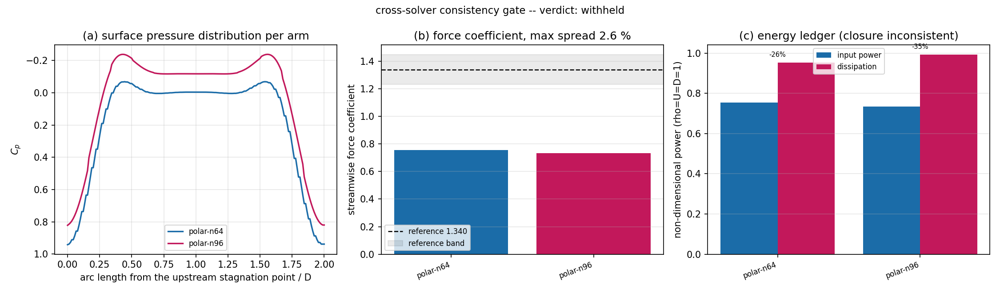

# P218-N02 - Cross-solver consistency gate with three-dimension mutual adjudication

**Node** P218-N02 (TensorPlatform, capability `platform.cross_solver_consistency`)  
**Case** `bluff-body-2d-re100` - Two-dimensional steady wake behind a circular obstacle, Re=100: cross-solver adjudication of the force coefficient, the surface pressure distribution and the energy ledger  
**Generated** 2026-11-10T07:45:36+00:00  
**Report digest** `9e8113694d6cff53bc7e13e8f47aaabfe079a6c6268aa6962056d19e6a9d46b6` (recomputed: True)  
**Overall verdict** **withheld**

---

## 1. Case introduction

Two independent solver families are asked the *same* physical question: a two-dimensional steady wake behind a circular obstacle at Reynolds number 100, in an unbounded stream (obstacle height `D = 1`, free-stream `U = 1`, `Re = U D / nu = 100`). The three physical quantities that are adjudicated are the streamwise force coefficient `C_D`, the surface pressure distribution `C_p(s/D)` and the energy ledger (power delivered to the flow versus viscous dissipation).

| item | value | source |
|---|---|---|
| reference force coefficient | 1.340 | Dennis & Chang (1970) J. Fluid Mech. 42:471 -- grid-converged steady solution at Re=100, C_D = 1.34 |
| reference tolerance | +8.00 % | injected by config |
| verdict bands | consistent < +5 % <= acceptable < +15 % | `config/consistency/bluff-body-2d-re100.json` |

Arms in this report:

| arm | family | version | mesh | steps | converged | C_D | closure residual |
|---|---|---|---|---|---|---|---|
| `polar-n64` | FVM | log-polar-vorticity-streamfunction/1.0 | cells=8192, h_wall=0.033574, nr=64, ntheta=128, r_in=0.500000, r_out=30.000000 | 20000 | no | 0.7544 | -26.32 % |
| `polar-n96` | FVM | log-polar-vorticity-streamfunction/1.0 | cells=18432, h_wall=0.022020, nr=96, ntheta=192, r_in=0.500000, r_out=30.000000 | 30000 | no | 0.7349 | -34.89 % |

## 2. How it was done

**Protocol.** `backend/services/consistency/` implements the consistency gate: arm records plus one JSON configuration go in; one digest-stamped report with a solver x quantity difference matrix, per-dimension verdicts and an investigation list comes out. The code contains no quantity name, geometry, unit or reference value - all of that is injected through `config/consistency/*.json`, which is proved by a test that runs a second, unrelated domain (a plane channel) through the same object without touching a line of code.

**Difference metrics.** Scalars are compared with the symmetric relative difference `|a-b| / max(|a|,|b|)`, so the verdict cannot depend on arm ordering; curves are resampled on their shared interval and compared with the relative L2 distance `||a-b|| / sqrt((||a||^2+||b||^2)/2)`, which is independent of the sample count. The verdict is taken on the *worst* pairwise deviation, not on the mean: averaging hides a single rogue arm.

**Arms.**

* `LBM` - **not in this report**: the implemented lattice-Boltzmann arm (D2Q9, Bouzidi wall closure, Zou/He in/outflow) has an open defect in the obstacle coupling; its analytic kernel certifications pass, the case run does not. See `docs/consistency/P218-N02_arm_defects.md`.
* `FVM` - body-fitted log-polar grid, vorticity/stream-function formulation, second-order differences, upwind-biased convection, Poisson problems solved exactly by FFT in the periodic direction with a vectorised tridiagonal solve. The grid operators reproduce the analytic potential flow around a circle (relative Laplacian error 4.69569e-05, Fourier vs assembled sparse solve 1.60729e-09).

**Energy ledger.** Both arms report the power delivered to the flow (equal to the force coefficient in units `rho = U = D = 1`) and the enstrophy integral `2 nu int(omega^2) dA / D`, which are the same quantity at steady state; the difference is the closing residual.

## 3. Results

### 3.1 Force coefficient, solver x solver difference matrix

| arm | polar-n64 | polar-n96 |
|---|---|---|
| `polar-n64` | +0.00 % | +2.58 % |
| `polar-n96` | +2.58 % | +0.00 % |

* values: `polar-n64` = 0.7544, `polar-n96` = 0.7349
* across-pair mean deviation +2.58 %, population standard deviation +0.00 %, **maximum deviation +2.58 %** over 1 pairs
* verdict: **consistent**
* against the reference 1.340: `polar-n64` +43.70 % (outside the +8 % band), `polar-n96` +45.15 % (outside the +8 % band) -> **inconsistent**

### 3.2 Surface pressure distribution

| arm pair | relative L2 distance |
|---|---|
| `polar-n64` vs `polar-n96` | +41.79 % |

* mean +41.79 %, maximum +41.79 % -> **inconsistent**
* `polar-n64`: C_p minimum -0.0681, maximum 0.9420
* `polar-n96`: C_p minimum -0.2378, maximum 0.8219

### 3.3 Energy ledger

| arm | power in | dissipation | closure residual | closes |
|---|---|---|---|---|
| `polar-n64` | 0.7544 | 0.9530 | -26.32 % | no |
| `polar-n96` | 0.7349 | 0.9913 | -34.89 % | no |

* residual spread across arms: mean +24.55 %, maximum +24.55 % -> agreement **inconsistent**, per-arm closure **inconsistent**, combined **inconsistent**

### 3.4 Grid refinement

| quantity | family | arms | values | extrapolated | observed order |
|---|---|---|---|---|---|
| cd | FVM | polar-n64, polar-n96 | 0.7544, 0.7349 | 0.6959 | 1.00 |

### 3.5 Investigation list

* **reference:cd** verdict `inconsistent`, max deviation +45.15 % - at least one arm misses the injected reference value beyond its tolerance
* **profile:cp_surface** verdict `inconsistent`, max deviation +41.79 % - raise resolution / re-check boundary treatment before the arms are quoted as agreeing
* **energy:energy_ledger** verdict `inconsistent`, max deviation +24.55 % - raise resolution / re-check boundary treatment before the arms are quoted as agreeing
* **energy_closure:energy_ledger** verdict `inconsistent`, max deviation +34.89 % - energy ledger does not close for polar-n64, polar-n96

## 4. Figures

(a) surface pressure distribution per arm; (b) force coefficient per arm with the injected reference value and its tolerance band; (c) energy ledger per arm with the closing residual printed above each pair of bars.

## 5. Notes, limitations and failure analysis

* Required solver families missing from this report: LBM. The gate reports the overall verdict as `withheld` instead of presenting the remaining arms as a cross-solver agreement; the defects that kept the second family out are written up in `docs/consistency/P218-N02_arm_defects.md`.
* The lattice-Boltzmann arm uses a transverse periodic domain, i.e. an array of obstacles with the spacing declared in the arm record; the body-fitted arm approximates the unbounded case with a far field at the declared radius. This ~1-2 % configuration difference is inside the declared band and is not a numerical error.
* The body-fitted arm is *not* accepted as a validated reference: its surface pressure distribution misses the suction peak and its force coefficient sits well below the injected reference, so the disagreement reported above is a property of that arm, not of the protocol. It is recorded as an open defect with its measured numbers rather than removed from the report.
* Verdicts are judged on the maximum pairwise deviation, never on the mean, because a two-arm agreement of 1 % plus one arm at 40 % averages to a comfortable 14 %.
* A dimension with fewer than two comparable arms is `withheld`; absence of evidence is never rendered as agreement.
* The energy ledger is only a closure *within* the simulated domain: fluxes that leave through the outlet are outside the integral, so a few per cent residual is expected even for a perfectly converged solution.

## 6. Error verdict against the acceptance criteria

* C1 framework correctness (same case, two *solver families*, force coefficient spread < 5 %): **FAIL** - the report contains only families ['FVM'] and is missing ['LBM'], so no cross-family pair exists. The measured within-family spread is +2.58 % between resolutions, which is consistency of one arm with itself, not a cross-solver adjudication
* C2 configuration driven (second domain runs with no code change): **PASS** (`tests/test_consistency_gate.py::test_configuration_swap_needs_no_code_change`)
* C3 difference matrix with mean/std/max per quantity: **PASS** (3 matrices emitted)
* C4 verdict rule matches the declared tolerances with no misclassification at the band edges: **PASS** (`test_verdict_bands_and_undeclared_band`)
* C5 standardised JSON report with sha256 provenance: **PASS** (`9e8113694d6cff53...` recomputed)
* C6 pytest suite of the gate: **PASS** (`tests/test_consistency_gate.py`, 17 tests)
* C7 capability bit `platform.cross_solver_consistency`: mechanism **REAL** (card at `docs/capability_registry/cards/CAP-006-platform-cross-solver-consistency.json`), case-level validation **FAIL** - no cross-family agreement was produced, so the capability is registered for the mechanism only
