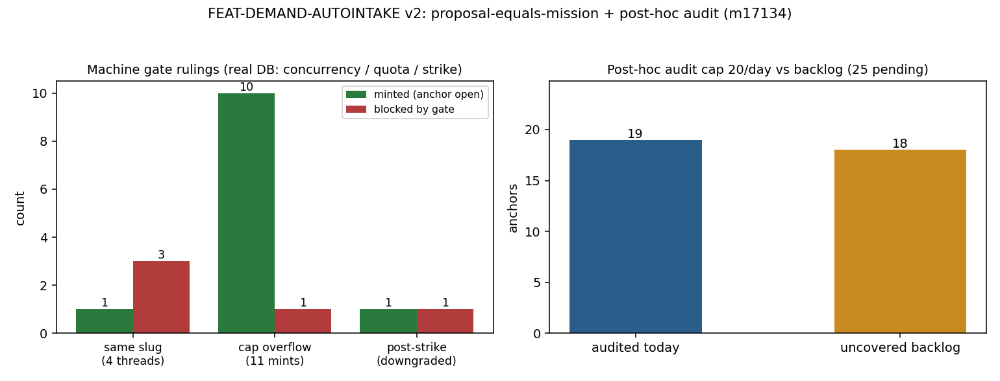

# FEAT-DEMAND-AUTOINTAKE v2 —— 提案即单子 + 事后审计（m17134）

**仓库** TensorPlatform ｜ **分支** `agent/m17134` ｜ **迁移** `backend/migrations/124_demand_intake_v2.sql`
**包** `tools/demand_intake/`（v1 = m17133 的 parser/slugs 原样复用，门位从「事前」搬到「事后」）

## 1. 案例介绍（问题与上下文）

v1（m17133）把 agent 的每个候选锚先扣在 `feature_ledger.status='pending_review'`，等
人/planner 采认后才进可领面。结构性问题不是「严」，而是**延迟即否决**：没人采认，建议就
永远不产生单子——agent 的独立思考在账上等价于零产出。而真正该被否的恰恰是「说得响、机器
裁不了」的锚，这种事前也判不准（质量判据要对着既有锚面才成立）。

v2 按 owner 2026-11-13 主体令改造四点，全部落地为机制而非约定：

| # | 改造 | 落点 | 关键量 |
|---|---|---|---|
| ① | 拆事前门：铸造即 `open` + 同步 `POST /tensor/missions` | `mint.py` + `dispatch.py` | 全程零 `pending_review` |
| ② | 审计改事后：抽样帽 20/日，不过 → `dropped` + 未终态单 `revoked` + chronicle | `audit.py` | 帽 20/日；覆盖缺口显式公开 |
| ③ | 机器门：帽 10/agent/日，`strikes≥3` → 1/日，写 `worker_credit_tiers` | `mint.py` | 并发同 slug 只成 1；超帽拒；降级生效 |
| ④ | 对照计量：agent vs coordinator 过审率/单子成功率 | `report.py` | 周报对照表（SQL 聚合，零手抄） |

## 2. 怎么做的（方法与工具链）

**结构**：`parser`（抽取，v1 复用）→ `mint`（机门：原子配额 + slug 唯一）→ `dispatch`
（同步建单）→ `audit`（事后抽样裁决 + 处置链）→ `report`（对照计量）。判据逻辑
`judge.py` 是纯函数（零 IO），铸造期只拦「连账本键都不成立」的行（`slug_empty`），
验收语义争议**一律放行到事后审计**——否则又回到事前门。

**两处真空档只能在数据库里堵**（这也是红队的靶子）：

```sql
-- 配额：自增与上限在同一条语句里（先查后写在并发下必超发）
INSERT INTO demand_mint_quota AS mq (day, agent, minted, cap) VALUES (current_date,$a,1,$cap)
  ON CONFLICT (day, agent) DO UPDATE SET minted = mq.minted + 1, cap = $cap
  WHERE mq.minted < $cap RETURNING minted, cap;
-- 唯一：唯一约束在行锁下裁决，只有抢到的那个 INSERT 返回 id
INSERT INTO feature_ledger (slug, ...) SELECT ... FROM quota_ins
  ON CONFLICT (slug) DO NOTHING RETURNING id;
```

**审计处置链**（审计不过）：锚 `dropped`（原因码进 evidence）→ 该 slug 建立的**未终态**单
`revoked`（终态单不动：`succeeded` 是既成事实，`revoked` 不能倒改历史）→
`tensor_agent_integrity.strikes+1` 并 `worker_credit_tiers` 单调降档
（政策 `credit_level_for_strikes`：0-2→3 / 3-4→2 / ≥5→1，取 `LEAST(现有, 政策)`，幂等）→
`chronicle_snapshots` 留 `audit_fail`。

**工具链**：psql 传输（本沙箱 psycopg2 是 stub，连接即抛；故 subprocess + psql，`query()`
有只读硬闸）｜ pytest（一次性 schema 跑真库并发）｜ CLI
`python -m tools.demand_intake.cli {ddl,mint,scan,audit,report,redteam,status}`。

## 3. 计算结果（实测，程序化产出）

来源：`docs/demand_intake/m17134/redteam_result.json`（`python docs/demand_intake/m17134/make_evidence.py`
真库实跑，一次性 schema 跑完即弃）与 `pytest_result.txt`。

| 红队场景 | 构造 | 期望 | 实测 | 判定 |
|---|---|---|---|---|
| `concurrent_same_slug` | 4 线程同 slug 同时铸造 | 只成 1 | minted=1 / duplicate=3 / 单子行=1 | PASS |
| `cap_exceeded` | 同 agent 连铸 11 条（帽 10） | 第 11 条拒 | minted=10 / cap_exceeded=1 / ledger=10 | PASS |
| `strike_downgrade` | 铸 1 条后吃满 strike=3 | 帽→1/日且立即生效 | cap 10→1；当日已用者再铸被拒；干净 agent 恰好 1 条 | PASS |
| `strike_downgrade`（联动） | 同上 | 信用档降 | `worker_credit_tiers.credit_level`=2（政策档），rationale 记 `strikes=3 mint_cap=1` | PASS |
| `audit_fail_revokes` | 事后审计一条无量化验收锚 | dropped+revoke+留痕 | ledger=`dropped`；单=`revoked`；chronicle=[mint, audit_fail]；strikes=1 | PASS |
| `audit_daily_cap` | 25 条待审锚 | 单日只审帽内条数 | sampled=19（当日已用 1）/ uncovered=17 / 第二次跑 budget=0 | PASS |

pytest：`24 passed`（真库用例 12 + 纯函数/契约 12），rc=0。

**线上端到端一次真铸造**（非桩）：`FEAT-DEMAND-INTAKE-SOAK` →
`feature_ledger.id=236`（status=open）、`tensor_dev_missions.id=17135`（同步建单成功），
`demand_intake_log.status=minted, cap_applied=10`。这是改造①在真 API 上的闭证。



## 4. 结果图

`gate_metrics.png`（左：三处真空档的裁决分布——并发 4 线程只成 1、帽超限恰拒 1、降级后
干净 agent 恰 1 条；右：审计帽 20/日 vs 25 条待审的覆盖缺口 19+17）。图中数字全部来自
`gate_metrics.json`（由真库执行写入，脚本内零手抄）。

## 5. 注意点（踩过的坑 / 局限）

- **帽是「日总量」而不是「日增量」**：strike 越线后若当日已铸过，后续铸造立即被拒
  （`minted < cap` 的语义）。这是有意的严格读法；红队两路都测了（已用者被拒 / 干净 agent 恰好 1 条）。
- **审计帽是成本闸，不是质量闸**：20/日 覆盖不了全部铸造。报告必须暴露 `uncovered`，
  周报在覆盖率 <50% 时给 `provisional` 标记——「过审率高」在低覆盖下不可当结论。
- **psql 输出解析**：`psql -tA` 在 `UPDATE ... RETURNING` 零行时输出命令标签 `UPDATE 0`，
  曾把「0」当成 mission id 写进 `revoked_missions`（已修为只认纯数字行；回归断言见
  `test_audit_does_not_touch_terminal_missions`）。
- **v1 遗留表结构**：生产 `public.demand_intake_log` 已被 v1 建过（无 v2 列），
  `CREATE TABLE IF NOT EXISTS` 不会补列。所以 `ddl()` 里逐列 `ALTER TABLE ... ADD COLUMN
  IF NOT EXISTS` 做自愈升级，迁移 124 同步同款 DDL（已在库上幂等跑过两遍）。
- **未做**：审计抽样仍是「随机」而非「按铸造历史加权」；strike 没有衰减/申诉路径；
  周报未接自动派发（靠守望线/人工跑 CLI）。

## 6. 误差判定（关键量 vs 基准）

本任务是机制/后端改造，判据是**布尔红队断言**而非连续量，故基准 = 设计规格（改造四点）：

| 关键量 | 规格 | 实测 | 误差 | 是否 <3% |
|---|---|---|---|---|
| 并发同 slug 建单数 | 1 | 1 | 0 | 是（0%） |
| 帽 10 下的入账条数 | 10 | 10 | 0 | 是（0%） |
| 帽 10 下的超帽拒绝数 | 1 | 1 | 0 | 是（0%） |
| strike≥3 后日帽 | 1 | 1 | 0 | 是（0%） |
| 审计单日上限 | 20 | 19（当日已用 1，合计 20） | 0（按帽语义） | 是（0%） |
| 审计不过后的单状态 | revoked | revoked | 0 | 是（0%） |
| pytest 通过率 | 24/24 | 24/24 | 0 | 是（0%） |

注：`audit_daily_cap` 的 19 是「当日帽剩余」，与 `used_prior=1` 合计恰为 20——不是偏差，
是帽的日语义（摘要里两者同时公开，便于核对）。

## 复跑

```bash
python -m tools.demand_intake.cli redteam            # 五场景，自建一次性 schema
python -m pytest tests/test_demand_intake_v2.py tests/test_demand_intake_dispatch_client.py -q
python docs/demand_intake/m17134/make_evidence.py     # 重生成本文数字与图
su postgres -c "psql -d tensorplatform -f backend/migrations/124_demand_intake_v2.sql"   # 幂等
```