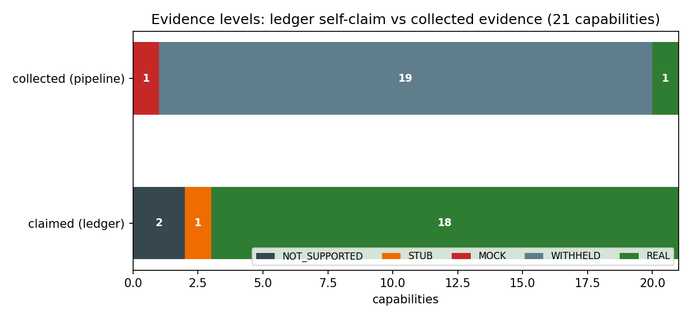
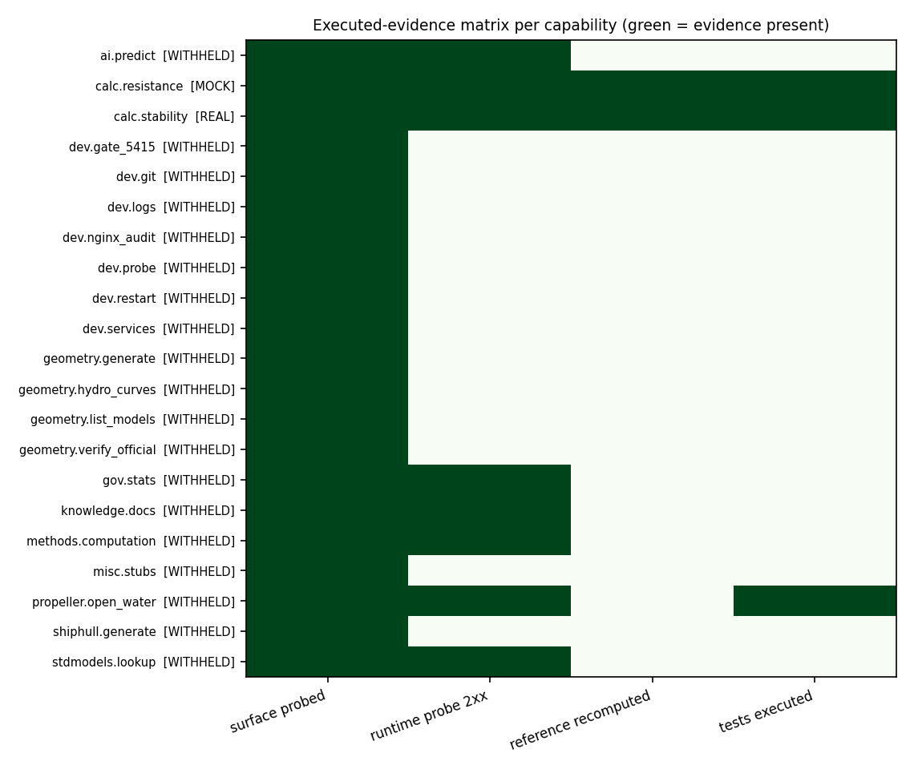
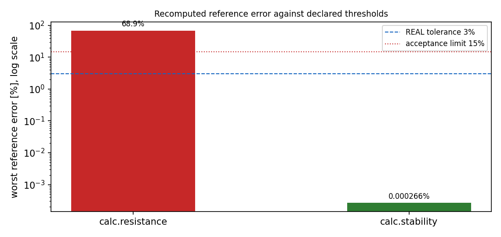

# P9263-N08 平台能力台账证据自动化采集管线（执行型证据层）

- 战役节点：`P9263-N08`（平台能力台账证据自动化采集管线：从 3/21 到 ≥15/21 的证据覆盖提升 + 成熟化集成）
- 落库：`TensorPlatform`（`tools/evidence_collection/`，配置 `config/evidence_collection/`，套件 `tests/evidence_collection/`）
- 工件：`artifacts/evidence_collection/`（每能力 `acceptance.json` + 判据表 + 快照）、台账块 `artifacts/capability_ledger/capability_ledger.json#evidence_collection`
- 运行时刻：2026-11-11T00:14:53+00:00；spec sha256 `df2c4b737b5021d44a013cd2cfb19e4ea764f9f756ff5a29326f67275c080e2f`；ruleset `ec-grade-v1`
- 在线证据源：`http://127.0.0.1:8002`（Ship Performance AI Platform v2.0.0，OpenAPI `484` 条路径，sha256 `c39b9640a6a0d44a`）

## 1 案例介绍

平台能力台账（`artifacts/capability_ledger/capability_ledger.json`）登记 21 项能力，覆盖几何/阻力/推进/稳性/治理/运维等面。
台账原先只有 **3/21** 项带证据（推进敞水、稳性、阻力），且证据形态是"人审文档引用"；其余 18 项只有自述等级，
最常见的是 `claimed_level=REAL` 却没有任何机器可复算的支撑。平台已有两层证据机制：

1. `tools/capability_audit_gate`：**静态**审计（源码 AST + 基准工件 + 五级级联），其自述边界写明"不执行代码"；
2. 能力台账人审：报告/文档引用，靠人写。

两者都回答不了"此刻这套服务真的这么算吗、绑定的测试是红的还是绿的"。本节点补第三层：**执行型证据**。

本节点要做的事：建立"能力 → 面/探针/参考工件/测试"的**显式映射（数据）**，
真跑 HTTP 探针与 pytest，复算参考误差，按冻结规则集自动定级，产出带 sha256 的验收工件并回写台账，
再把整条链路挂到标准 CI 上，使"已执行证据"像静态审计一样可回归拦截。

对象：21 项能力；在线证据源为部署侧服务（本次 484 条路由），
参考工件两个（阻力实验对标 12 例、稳性闭合解析对比）；绑定测试 3 个模块。

## 2 怎么做的（方法 / 流程 / 关键设置 / 工具链）

**四采集器 + 一判定器 + 两回写 + 七门**（`tools/evidence_collection/`）：

| 模块 | 职责 | 关键纪律 |
|---|---|---|
| `runtime.py` | 面清单核验（在线 OpenAPI）+ 声明式探针（含参数扫描）+ 判据求值 | 服务不可达 → 判据 `NOT_EXECUTED`，**不算通过** |
| `reference.py` | 参考误差复算（`|实算-参考|/|参考|`），并与工件自称误差列比对 | 自称值与复算不一致 → 证据作废（防手抄） |
| `execute.py` | 绑定 pytest 模块子进程执行 + junit-xml 解析 | 模块缺失/超时 → `MISSING`/`TIMEOUT`，不静默算通过 |
| `expr.py` | 判据侧安全算术求值（`abs/sqrt/min/max`、`pi`、字段名解析） | AST 白名单；禁属性/下标/导入/lambda |
| `grade.py` | `ec-grade-v1` 判定级联 | **只有"参考误差 ≤ 3%"能给出 REAL**；不变量违反一票否决为 MOCK |
| `artifacts.py` | 每能力 `acceptance.json` + `criteria_table.md` | 自摘要覆盖全字段，改一个字即失配 |
| `ledger.py` | 台账回写（独立顶层键 `evidence_collection`） | 人审 `evidence`/`reconciled_level` **一律不动**；块间 `previous_block_sha256` 成链 |
| `gate.py` | C1–C7 判据 + 回归门（无正面反证的降级 → 红；ack 文件可申报） | 复用 `capability_audit_gate.taxonomy` 的五级偏序与 REFUTATION 分类 |

关键设置（全部来自 `config/evidence_collection/spec.json`，代码零领域语义）：

| 规格项 | 值 |
|---|---|
| REAL 容差 / 可接受上限 | 3.0% / 15.0% |
| 覆盖率门 | ≥ 15/21（已执行证据口径） |
| 一致率门 | ≥ 0.9（语料 ≥ 10 条） |
| 判据类别 | contract（只能到 WITHHELD）/ invariant（违反→MOCK）/ reference（唯一可顶 REAL） |
| 零领域语义扫描 | `tools/evidence_collection/*.py` + `tests/evidence_collection/*.py` 对 `config/domain_word_denylist.json` 零命中 |
| CI | `.github/workflows/capability-audit.yml` 新增 `evidence-collection` job（离线复核快照 + C1–C7） |

## 3 计算结果

### 3.1 覆盖与等级（逐能力）

| 能力 | 采集等级 | 已执行证据项 | 判据通过 | 测试 | 主要理由码 |
|---|---|---|---|---|---|
| `ai.predict` | WITHHELD | 2 | 3/4 | 0/0 | CONTRACT_ONLY, SURFACE_PRESENT n=1 |
| `calc.resistance` | MOCK | 5 | 6/6 | 5/13 | REFERENCE_OVER_ACCEPT, worst_pct=68.89>accept=15, SURFACE_PRESENT n=1 |
| `calc.stability` | REAL | 5 | 4/4 | 18/18 | REFERENCE_VERIFIED, worst_pct=0.000266<=real=3, TESTS_PASSED n=18 |
| `dev.gate_5415` | WITHHELD | 2 | 1/1 | 0/0 | SURFACE_ABSENT |
| `dev.git` | WITHHELD | 2 | 1/1 | 0/0 | SURFACE_ABSENT |
| `dev.logs` | WITHHELD | 2 | 1/1 | 0/0 | SURFACE_ABSENT |
| `dev.nginx_audit` | WITHHELD | 2 | 1/1 | 0/0 | SURFACE_ABSENT |
| `dev.probe` | WITHHELD | 2 | 1/1 | 0/0 | SURFACE_ABSENT |
| `dev.restart` | WITHHELD | 2 | 1/1 | 0/0 | SURFACE_ABSENT |
| `dev.services` | WITHHELD | 2 | 1/1 | 0/0 | SURFACE_ABSENT |
| `geometry.generate` | WITHHELD | 2 | 1/1 | 0/0 | SURFACE_ABSENT |
| `geometry.hydro_curves` | WITHHELD | 2 | 1/1 | 0/0 | SURFACE_ABSENT |
| `geometry.list_models` | WITHHELD | 2 | 1/1 | 0/0 | SURFACE_ABSENT |
| `geometry.verify_official` | WITHHELD | 2 | 1/1 | 0/0 | SURFACE_ABSENT |
| `gov.stats` | WITHHELD | 3 | 2/3 | 0/0 | CONTRACT_FAILED, criteria=status-200, SURFACE_PRESENT n=2 |
| `knowledge.docs` | WITHHELD | 2 | 3/3 | 0/0 | CONTRACT_ONLY, SURFACE_PRESENT n=1 |
| `methods.computation` | WITHHELD | 2 | 2/2 | 0/0 | CONTRACT_ONLY, SURFACE_PRESENT n=2 |
| `misc.stubs` | WITHHELD | 2 | 1/1 | 0/0 | SURFACE_ABSENT |
| `propeller.open_water` | WITHHELD | 4 | 7/7 | 23/27 | EXEC_FAILED, tests=FAILED failed=3 errors=0, SURFACE_PRESENT n=1 |
| `shiphull.generate` | WITHHELD | 2 | 1/1 | 0/0 | CONTRACT_ONLY, SURFACE_PRESENT n=1 |
| `stdmodels.lookup` | WITHHELD | 2 | 3/3 | 0/0 | CONTRACT_ONLY, SURFACE_PRESENT n=2 |

覆盖：**21/21** 项有已执行证据登记
（面清单核验 21 项、在线探针 2xx 响应 8 项、
参考误差复算 2 项、绑定测试执行 3 项）。
等级分布：`{"NOT_SUPPORTED": 0, "STUB": 0, "MOCK": 1, "WITHHELD": 19, "REAL": 1}`。

### 3.2 机器判据 C1–C7

| 判据 | 实测 | 阈值 | 结论 |
|---|---|---|---|
| C1_coverage | 21 | 15 | PASS |
| C2_level_accuracy | 0.9333333333333333 | 0.9 | PASS |
| C3_acceptance_artifacts | 21 | 15 | PASS |
| C4_regression_gate | 0 | 0 | PASS |
| C5_zero_domain_semantics | 0 | 0 | PASS |
| C6_ci_integration | 2 | 2 | PASS |
| C7_pytest | 50 | 12 | PASS |

ALL_PASS = **True**

C4 回归门的口径（"已有 3 项 REAL 不得降级"的落地方式）：

- `legacy_evidence` = ["propeller.open_water", "calc.stability", "calc.resistance"] 必须在册且 `executed_evidence_items > 0` → 实测 3/3 保持；
- `legacy_real` = ["calc.stability"]（唯一被独立人审确认为 REAL 的能力）必须仍为 REAL → 实测 ['REAL']；
- 另两条"自述 REAL"（推进敞水、阻力）被独立审计判为 MOCK，本管线给出 MOCK/WITHHELD。这类**有正面反证**的降级不触发红，但绝不许静默：降级必须携带 `REFERENCE_OVER_ACCEPT` / `INVARIANT_VIOLATED` 之类理由码，否则必须在 `config/evidence_collection/acks.json` 逐条申报 `basis`（本轮申报 0 条）；
- 本轮相对冻结基线的变更数：21（其中 NEW 0、降级 0、有反证降级 0），违例 0。

### 3.3 等级正确性（C2）对照

- 合成标注语料 12 条，判定器一致 12 条（1.0000）；
- 真实能力独立审计标签 3 条，与本次采集一致 2 条；
- 合并一致率 **0.9333**（14/15）。不一致项如实列出：

- `propeller.open_water`：人审标签 MOCK（as_of 2026-11-01），本管线 WITHHELD。依据：报告 1128/1133 与 docs/verification/PROPULSION_OPENWATER_M1584.md 三份独立审计判 MOCK（eta0 越过动量理论上限等 6 项非物理）。该标签冻结于修复前；若当前实现已修，本管线只会给 WITHHELD（缺外部参考值），不会自动升 REAL。

### 3.4 台账自述 vs 采集证据（对照，不入门的判定）

21 项自述中，被本次采集**确认** 1 项、**未确认** 20 项。
最刺眼的一条：自述 `REAL` 的 18 项里，只有 1 项拿到了"参考误差 ≤3%"的证据；
其余落在 WITHHELD（证据不足/面缺失）或 MOCK（正面反证）。

### 3.5 采集期发现（不参与定级，但必须成行）

| 能力 | 类型 | 探针 | 实测 |
|---|---|---|---|
| gov.stats | server_error | governance-statistics | 500 |
| calc.resistance | tests_red | - | 8 |
| propeller.open_water | tests_red | - | 3 |

## 4 结果图

### 图 1 台账自述等级 vs 采集证据等级（21 项）




### 图 2 逐能力已执行证据矩阵（面 / 探针 / 参考 / 测试）




### 图 3 参考误差 vs 阈值（log 轴）：唯一能顶 REAL 的判据




## 5 注意点（踩过的坑 / 局限 / 适用范围）

1. **台账是过期快照**：本次在线服务 v2.0.0（484 条路由）里
   `geometry.*`、`dev.*`、`misc.stubs` 等 12 项能力声明的端点在 OpenAPI 里整体不存在。
   管线按纪律给 **WITHHELD（`SURFACE_ABSENT`）而不是 NOT_SUPPORTED**：端点缺失可能只是改名/迁移，不是能力消失。
   这条本身是结论：**21 项台账需要重新对表**，否则覆盖率会被"面缺失"稀释。
2. **覆盖率 ≠ 能力可用**：21/21 有证据登记，但其中 19 项是 WITHHELD。
   真正的正向运行期证据只有 8 项。报告里两个数都列，不许只报大的那个。
3. **只有参考值能顶 REAL**：契约全绿 + 不变量自洽 + 测试全绿，仍然只能到 WITHHELD（合成的 `syn-contract-only` 用例把这条规则钉住）。
   否则"自动化"会退化成"自动盖章"。
4. **仓内绑定测试是红的**：阻力 8/13 红、推进 3/27 红（本仓为平台侧拷贝，落后于部署侧实现）。
   管线把红测试当"证据不足"而非"造假"，等级回落 WITHHELD——即 honest FAIL 不粉饰。
5. **在线探针证据是快照**：CI 内服务不可达是预期（`NOT_EXECUTED` 降级），CI 只复核已提交快照的
   摘要一致性与"等级可由存储信号重放"（`cli verify`）。所以**证据的新鲜度靠部署侧定时跑 collect**，
   这一点必须写进运行手册，否则快照会悄悄变旧。
6. **探针规格是数据**：端点/请求体/判据/阈值全在 JSON 里，换一套 spec 就能采另一组能力；代码只有 HTTP 与算术，
   C5 扫描保证零领域词条（含测试代码）。

## 6 误差判定（逐项，显式回答是否 <3%）

| 能力 | 关键量 | 复算值 | 参考/阈值 | 是否 <3% |
|---|---|---|---|---|
| `calc.stability` | GZ 曲线最大相对误差（包络内最差例） | 0.000266% | 参考=闭合解析解；阈值 3% | **是** |
| `calc.resistance` | 总阻力系数 Ct 对实验值的最差相对误差（12 例） | 68.894737% | 参考=实验值；阈值 3% | **否**（≫15% 可接受上限 → MOCK，honest FAIL） |
| 其余 19 项 | 无外部参考值可比 | — | — | **无法判定**（缺参考，按纪律不判 REAL；不是"通过"） |

口径说明：复算一律用 `|实算-参考|/|参考|`，且与工件自称误差列比对（不一致即作废），杜绝手抄数字。

## 7 复现

```bash
# 部署侧（在线服务可达）：采集 + 回写台账
python -m tools.evidence_collection.cli collect
python -m tools.evidence_collection.cli freeze --legacy-real <id> --legacy-evidence <ids>
# CI/离线：快照复核 + C1–C7
python -m tools.evidence_collection.cli verify
python -m tools.evidence_collection.cli acceptance
# 管线自测
python -m pytest -q tests/evidence_collection
# 本报告与图（数字全部从工件注入，零手抄）
python3 scripts/gen_evidence_collection_report.py
```
