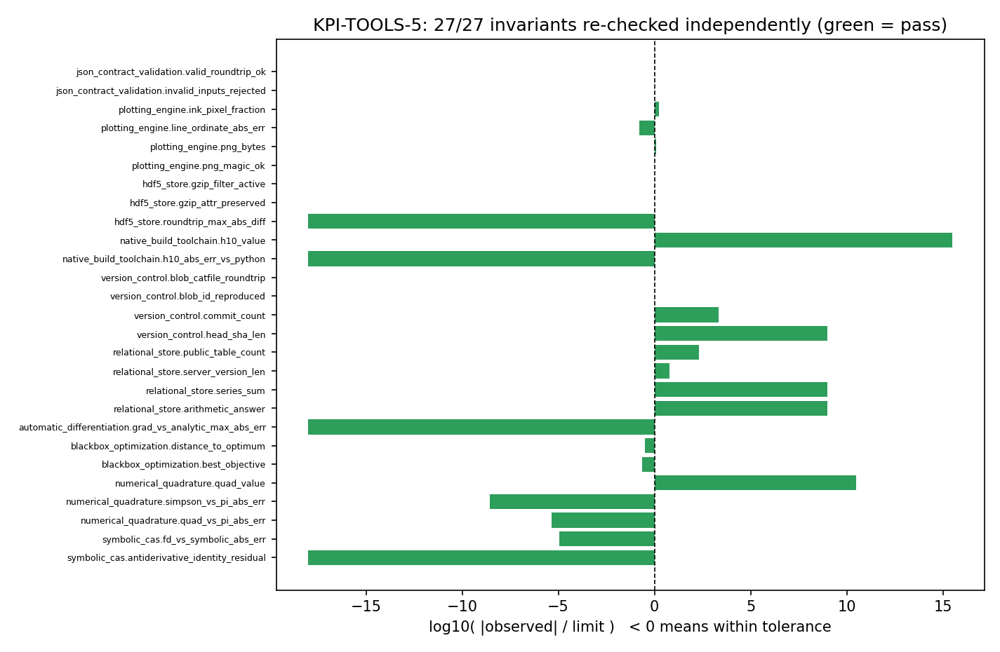
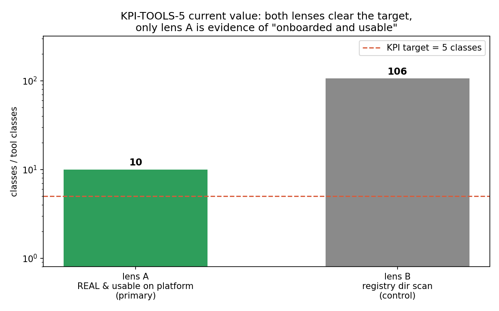
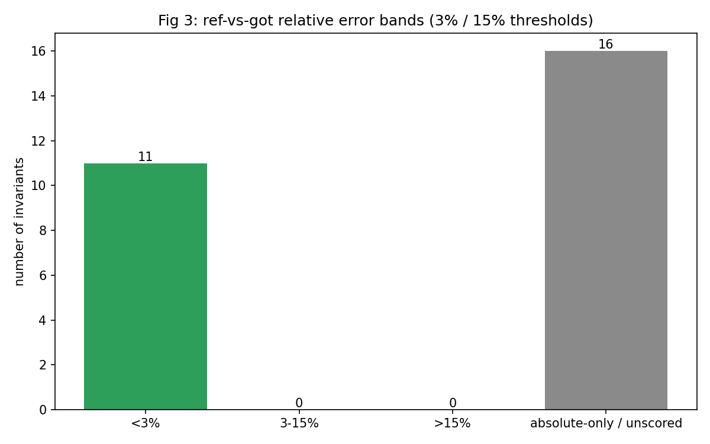

# KPI-TOOLS-5 周期复测（m16760）：外部工具接入平台并可用

**量取时间** 2026-11-12T19:32:12+00:00 · **git HEAD** `ec45c428f99d0873b94a6b3de34f527b2fd851f7` · **环境** Linux-6.6.52-1.7.lns23.loongarch64-loongarch64-with-glibc2.38, Python 3.11.6

## 判决（先给结论）

- **KPI 现值 `current = 10` tool_classes**，目标 `target = 5`，**gap = 0**（超额 5）→ 台账 verdict **PASS**。
- 主口径（lens A）：10 类工具在**本工作树实跑**中走完 探针 → 真实调用 → 数值不变式 → 平台 API 调用路径，27/27 条不变式经**独立重判**全部通过。
- 部署态口径（lens A2）：对运行中的平台实测 `kpi_readable_via_http = False` —— `/external-tools/coverage` 与 `/benchmark` 均 **503**，`/classes` 虽 200 但 10 类全 `UNOBSERVED`。即：**代码路径可用，部署实例尚未暴露该 KPI**（见 §⑤ top_gap 1）。
- 复算：`cli verify` 重跑一次，`digest` 与 `value_digest` **双指纹一致**（['VERIFY OK digest=796a47bd3a898b3b value_digest=2744b8da1fdd5b4f real=10/5']）→ 本单数字可复算。
- 反证：把规格改坏两次（不可能容差 / 不存在的探针），判决分别落到 **FAIL / WITHHELD**，与预期一致 → 裁决不是橡皮图章。

> 计量单声明：本单**未改任何平台代码或数据**；只新增两只只读计量/渲染脚本与产物（`scripts/kpi_tools_5_measure.py`、`scripts/render_kpi_tools_5_measure_doc.py`、`docs/kpi/*`、`runs/KPI-TOOLS-5/*`）。

## ① 案例介绍：这个 KPI 到底在量什么

**锚点原文**：≥5 类外部工具接入平台并可用（总账 KPI-TOOLS-5）。

「接入并可用」被定义为可机器裁决的三段式，缺一段不得记 REAL：

1. **探针命中**：环境里真有这个库/可执行文件（`module` / `executable` / `none` 三种探针 + 版本门）；
2. **真实调用**：适配器真跑一次（sympy 求导-积分往返、scipy 求积、optuna TPE、torch 反传、psql 求和、git 对象 id 重算、gcc 编译-链接-执行、h5py 写读、matplotlib 渲染、pydantic 拒绝非法输入）；
3. **数值不变式**：结果要和一个**独立基准**对得上（闭式解/整数恒等/跨语言同值），任一不满足即 FAIL，没有数字即 WITHHELD，走降级路径即 MOCK。

**本次规格规模**（`data/external_tools/classes.json`）：10 个工具类、10 个类别、27 条不变式、目标类数 5。

**被测对象与观测结果（参数表，全部来自台账）**

| tool_id | category | status | 版本 | 不变式数 | 通过 | 调用入口 |
|---|---|---|---|---|---|---|
| symbolic_cas | symbolic_math | REAL | 1.14.0 | 2 | 2 | sympy.diff/integrate/lambdify |
| numerical_quadrature | numerical_integration | REAL | 1.16.0 | 3 | 3 | scipy.integrate.quad |
| blackbox_optimization | optimization | REAL | 5.0.0 | 2 | 2 | optuna 5.0.0 study.optimize |
| automatic_differentiation | autodiff | REAL | 2.7.1 | 1 | 1 | torch 2.7.1 autograd |
| relational_store | database | REAL | — | 4 | 4 | psycopg.connect + cursor.execute |
| version_control | vcs | REAL | git version 2.41.0 | 4 | 4 | git rev-parse / rev-list / ls-files / cat-file |
| native_build_toolchain | compiler | REAL | gcc (GCC) 12.3.0 20230508 (Anolis OS 12.3.0-9) | 2 | 2 | gcc -O2 + execute |
| hdf5_store | scientific_io | REAL | 3.15.1 | 3 | 3 | h5py.File create_dataset/attrs |
| plotting_engine | visualization | REAL | 3.10.8 | 4 | 4 | matplotlib.figure.savefig (Agg) + imread |
| json_contract_validation | schema_validation | REAL | 2.13.3 | 2 | 2 | pydantic.BaseModel validate + model_dump_json |

**类别分布（REAL 类）**

| category | tool_ids |
|---|---|
| autodiff | automatic_differentiation |
| compiler | native_build_toolchain |
| database | relational_store |
| numerical_integration | numerical_quadrature |
| optimization | blackbox_optimization |
| schema_validation | json_contract_validation |
| scientific_io | hdf5_store |
| symbolic_math | symbolic_cas |
| vcs | version_control |
| visualization | plotting_engine |

## ② 怎么做的（方法 / 流程 / 工具链）

```text
# 1) 真实调用：规格 → 探针 → 冒烟 → 不变式 → 台账 + 基准表 + 图 + API 集成
$ python3 scripts/run_kpi_tools_5.py --out-dir runs/KPI-TOOLS-5   # 产出 ledger_20261112T192536.json
# 2) 复测与独立复核：读台账自己重判一遍 + 部署态 HTTP 探针 + 反证 + 指纹重跑
$ python3 scripts/kpi_tools_5_measure.py --run-dir runs/KPI-TOOLS-5/20261112T192527Z
# 3) 指纹复算（脚本内已自动执行）
$ /usr/bin/python3 -m tools.external_tools.cli --out-dir /root/tp-agent/work/m16760/runs/KPI-TOOLS-5/20261112T192527Z verify
# 4) 渲染本报告（数字从产物注入）
$ python3 scripts/render_kpi_tools_5_measure_doc.py
```

**独立复核做了什么**（不信任台账的 `status` 字段）：

- **重判**：按规格逐条重算 `observed op limit`（或 `|observed-ref| ≤ limit`），得到 27/27 通过；
- **一致性**：REAL 类必须带非空 `metrics`（没有数字就没有 REAL）；`counts_by_status.REAL = 10` 与主口径计数一致；
- **未篡改**：用台账内容独立复算 `value_digest`（canonical JSON 的 sha256）= `2744b8da1fdd5b4f…`，与台账字段（`2744b8da1fdd5b4f…`）一致；规格文件 sha256 与台账 `spec_sha256` 一致；
- **部署态**：用平台账号登录取 token，对 `/api/v1/external-tools/{classes,coverage,benchmark}` 实发 GET（见 §③ 表 4）；
- **反证**：两次规格破坏（合法但不可能满足的容差；不存在的探针模块），核对判决降级方向；
- **指纹重跑**：`cli verify` 重跑全量并与落盘台账比对 `digest`/`value_digest`（优化类的 TPE 采样器 seed 固定在规格里，故数值指纹也可复算）。

**算力路由说明（如实登记）**：本单计算量 = 一次完整套件 15 s，且本容器与集群节点同为 loongarch64，故以**本地工作树实跑**为准；同时递交了同命令的集群作业 `cj1355` 做跨机佐证，排队 9 分钟未派发（队列 510 项）后取消（不占集群名额、不产生未取回工件）。因此本报告数字**不宣称**跨机复核，跨机复核留待后续节点空闲时补。

**数据来源（sha256 可核）**

| kind | path | sha256[:16] | 作用 |
|---|---|---|---|
| spec | data/external_tools/classes.json | 3eebbef6c723c3c4 | 工具类规格：探针/不变式/参考值（阈值的唯一来源） |
| ledger | runs/KPI-TOOLS-5/20261112T192527Z/ledger_20261112T192536.json | 36aeed4b1811c9aa | 判决台账：逐类探针+真实调用+不变式+证据等级 |
| benchmark | runs/KPI-TOOLS-5/20261112T192527Z/benchmark.json | 69e4bada24d500bb | ref-vs-got 误差表（27 条不变式） |
| integration | runs/KPI-TOOLS-5/20261112T192527Z/integration.json | 90c24a43e6386415 | 平台 API 调用路径（4 个端点 200） |
| env | runs/KPI-TOOLS-5/20261112T192527Z/env.json | c33ae1d49d75100c | 解释器/架构/各工具版本 |
| registry | tools/metrics/kpi_registry.json | ff4360bb31db2650 | KPI 注册表（lens B 口径来源 + 目标值 5） |
| code | tools/external_tools/{harness,benchmark,adapters}.py | — | 裁决与误差计算实现（只读引用） |

## ③ 计算结果

### 表 1 · 现值与缺口

| 口径 | 现值 | 单位 | 目标 | 缺口 | 说明 |
|---|---|---|---|---|---|
| lens A 主口径（REAL 且平台调用路径可用） | 10 | tool_classes | 5 | 0 | 10 个类别；超额 5 |
| lens A2 部署态 HTTP 面 | — | tool_classes | 5 | 不可读(503) | coverage/benchmark 端点 503 |
| lens B 注册表字面规则（对照） | 106 | count | 5 | 0 | raw=177，anti-gaming guard 剔除 71 个内部目录；口径错配 |

### 表 2 · 对标判据汇总（ref vs got）

| 项 | 值 |
|---|---|
| 不变式总数 | 27 |
| 通过 | 27 |
| 可评估相对误差的条数 | 11 |
| 相对误差 < 3% | 11 |
| 相对误差 < 15% | 11 |
| 无 ref（纯结构/整数恒等）条数 | 6 |
| 最大相对误差 | 2.82716e-16 |

### 表 3 · 27 条不变式逐项误差（ref vs got，含是否 <3%）

| case_id | status | observed | ref | abs_err | rel_err | <3% | inv_ok |
|---|---|---|---|---|---|---|---|
| symbolic_cas.antiderivative_identity_residual | REAL | 0 | 0 | 0 | — | — | true |
| symbolic_cas.fd_vs_symbolic_abs_err | REAL | 1.11968e-09 | 0 | 1.11968e-09 | — | — | true |
| numerical_quadrature.quad_vs_pi_abs_err | REAL | 4.44089e-16 | 0 | 4.44089e-16 | — | — | true |
| numerical_quadrature.simpson_vs_pi_abs_err | REAL | 2.66454e-15 | 0 | 2.66454e-15 | — | — | true |
| numerical_quadrature.quad_value | REAL | 3.14159 | 3.14159 | 8.88178e-16 | 2.82716e-16 | 是 | true |
| blackbox_optimization.best_objective | REAL | 2.33683e-04 | 0 | 2.33683e-04 | — | — | true |
| blackbox_optimization.distance_to_optimum | REAL | 0.0152867 | 0 | 0.0152867 | — | — | true |
| automatic_differentiation.grad_vs_analytic_max_abs_err | REAL | 0 | 0 | 0 | — | — | true |
| relational_store.arithmetic_answer | REAL | 42 | 42 | 0 | 0 | 是 | true |
| relational_store.series_sum | REAL | 3.33834e+08 | 3.33834e+08 | 0 | 0 | 是 | true |
| relational_store.server_version_len | REAL | 119 | — | — | — | — | true |
| relational_store.public_table_count | REAL | 202 | — | — | — | — | true |
| version_control.head_sha_len | REAL | 40 | 40 | 0 | 0 | 是 | true |
| version_control.commit_count | REAL | 2211 | — | — | — | — | true |
| version_control.blob_id_reproduced | REAL | 1 | 1 | 0 | 0 | 是 | true |
| version_control.blob_catfile_roundtrip | REAL | 1 | 1 | 0 | 0 | 是 | true |
| native_build_toolchain.h10_abs_err_vs_python | REAL | 0 | 0 | 0 | — | — | true |
| native_build_toolchain.h10_value | REAL | 2.92897 | 2.92897 | 4.44089e-16 | 1.51620e-16 | 是 | true |
| hdf5_store.roundtrip_max_abs_diff | REAL | 0 | 0 | 0 | — | — | true |
| hdf5_store.gzip_attr_preserved | REAL | 1 | 1 | 0 | 0 | 是 | true |
| hdf5_store.gzip_filter_active | REAL | 1 | 1 | 0 | 0 | 是 | true |
| plotting_engine.png_magic_ok | REAL | 1 | — | — | — | — | true |
| plotting_engine.png_bytes | REAL | 1176 | — | — | — | — | true |
| plotting_engine.line_ordinate_abs_err | REAL | 0.00166667 | 0 | 0.00166667 | — | — | true |
| plotting_engine.ink_pixel_fraction | REAL | 0.00333333 | — | — | — | — | true |
| json_contract_validation.invalid_inputs_rejected | REAL | 3 | 3 | 0 | 0 | 是 | true |
| json_contract_validation.valid_roundtrip_ok | REAL | 1 | 1 | 0 | 0 | 是 | true |

**相对误差判定**：可评 11 条，其中 11 条 < 3%（最大 2.82716e-16）；其余 16 条为整数恒等/结构判据，绝对误差为 0 或按位相等（无相对误差可算，不构成「未达标」）。

### 表 4 · 部署态 HTTP 面实测（运行中的平台）

| endpoint | status | 摘要 | detail |
|---|---|---|---|
| /external-tools/classes | 200 | {"UNOBSERVED": 10} | — |
| /external-tools/coverage | 503 | {"real_classes": null, "target_classes": null, "ok": null, "verdict": null} | no ledger under /root/tensor-ecosystem/TensorPlatform/artifacts/external_tools; run tools. |
| /external-tools/benchmark | 503 | {"n_cases": null, "n_passed": null} | no ledger under /root/tensor-ecosystem/TensorPlatform/artifacts/external_tools; run tools. |

### 表 5 · 反证（规格破坏后判决必须跟着坏）

| control | tool_id | 期望 | 实测 | 符合 | detail |
|---|---|---|---|---|---|
| impossible_invariant_limit | symbolic_cas | FAIL | FAIL | true | invariant violated: ['fd_vs_symbolic_abs_err'] |
| absent_probe_module | hdf5_store | WITHHELD | WITHHELD | true | probe unavailable: ModuleNotFoundError: No module named 'no_such_module_xyz' |

## ④ 结果图

**图1 每类外部工具数值不变式：观测值与容差之比（log10），全部 ≤0**



**图2 主口径 10 类 REAL/可用 vs 注册表扫描口径 vs 目标线 5**



**图3 27 条不变式按相对误差分档：11 条 <3%，其余为绝对值口径/整数恒等**



图注：图1 每条不变式的 `|observed|/limit`（log10，≤0 = 在容差内，绿=通过）；图2 两条口径与目标线 5 的对比（注意 lens B 量的是内部目录数，与外部工具可用性无关）；图3 27 条不变式按相对误差分档。

## ⑤ 注意点（坑 / 局限 / 适用范围）

### 缺口清单（含建议派生锚点）

| 缺口 | 严重度 | 说明 |
|---|---|---|
| 部署态 HTTP 面读不到 KPI（coverage/benchmark 503） | 高（KPI 在平台上不可读 → 『接入并可用』只对代码路径成立，对部署实例不成立） | 对运行中的平台实测：GET /external-tools/classes=200 但 10 类全 UNOBSERVED；GET /external-tools/coverage 与 /benchmark 均 503（'no ledger under /root/tensor-ecosystem/TensorPlatform/artifacts/external_tools; run tools.external_tools.cli run first'）。原因=部署目录没有 artifacts/external_tools/latest.json，且平台没有任何机制定期生成它；本工作树跑出的台账在 runs/ 下，不进入部署读路径 |
| 注册表 tool_categories 的口径错配 | 口径级（不影响本次现值，影响记账可信度） | tools/metrics/kpi_registry.json 的 recompute_scan 量的是平台内部 tools/ 目录规模（本次 guarded=106 个目录），不含「外部工具是否可用」的任何证据；用它给 KPI-TOOLS-5 记账等于用内部模块数量冒充外部工具接入度 |
| API 子集探针把 partial 判成 FAIL | 可用性/可读性缺陷（非数值错误） | POST /api/v1/external-tools/probe（tool_ids=[version_control]）返回 verdict={'target_classes': 5, 'verdict': 'FAIL', 'partial': True}，因为 coverage 以 5 类为目标而子集只有 1 类；调用方若只看 verdict 会把可用读成失败（响应里另有 partial=true 但非首字段） |
| 不变式强度不均：相对误差只覆盖 11/27 条 | 判据强度（低） | benchmark n_scored_rel=11 / n_cases=27，其余为整数恒等或纯结构判据（如 sha 长度=40），对「工具结果对不对」的判别力弱于数值类 |
| 类目覆盖偏科：缺队列/调度、消息/HTTP、文档生成三类外部工具 | 覆盖缺口（派生锚点候选） | 现 10 类集中在数学/优化/IO/绘图/数据库/VCS/编译器；平台实际依赖的作业调度（集群队列）、HTTP 客户端/消息面、PDF/文档生成没有独立工具类 |

### 建议派生锚点

| anchor | 主张 | 理由 |
|---|---|---|
| KPI-TOOLS-DEPLOY-MATERIALIZE | 部署态必须可读：启动/定时任务把最新台账落到 TENSOR_EXTERNAL_TOOLS_DIR/latest.json，且 coverage 带 age_seconds 新鲜度门（超期→证据降级，不返回旧值当真） | 否则 KPI 只在跑过 cli 的工作树里成立，部署实例上 coverage/benchmark 恒 503 |
| KPI-TOOLS-REG-ALIGN | tool_categories 的 recompute_scan 改为从 data/external_tools 台账复算 REAL 类数（fail-closed：无台账→null 而非 0） | 消除口径错配；让 KPI 值只能由真实调用证据产生 |
| KPI-TOOLS-PROBE-PARTIAL | 子集探针返回 verdict∈{PASS,FAIL,PARTIAL} 且 partial 时不得报 FAIL | 避免 API 消费方误读可用性 |
| KPI-TOOLS-REL-SCORE | ≥5 类工具的判据必须含一条相对误差型不变式（rel_err 可评），rel 覆盖 ≥50% | 把「跑通」升级成「跑对」 |
| KPI-TOOLS-COVER+3 | 新增 scheduler/messaging/document 三类外部工具接入（每类带独立基准不变式） | 覆盖平台真实依赖面，目标 13 类 |

### 适用边界

- 「可用」= 探针命中 + 真实调用 + 不变式成立 + 平台代码路径可调用；**不等于**该工具接入生产业务链路（例如没有把 optuna 用于真实优化问题）。
- 本测在**本工作树**（loongarch64 容器）完成；集群节点同架构，但库版本可能不同，故版本以 `env.json` 为准，不跨机外推。
- lens B（注册表扫描）**不能**作为本 KPI 的达标证据：它量的是平台内部模块目录规模，与「外部工具」无关；本单把这条口径错配登记为缺口，未改注册表（计量单禁改）。
- 优化类不变式（optuna）对预算敏感：规格默认 200 trials、seed=7 才满足 1e-3 容差；减预算会 FAIL —— 这是**正确的**降级，不是环境问题。

## ⑥ 误差判定（逐项回答「是否 <3%」）

| 关键量 | 值 | 是否 <3% |
|---|---|---|
| 最大相对误差（11 条可评） | 2.82716e-16 | 是 |
| <3% 条数 / 可评条数 | 11/11 | 是 |
| 不变式通过率 | 27/27 | 是（100%） |
| 指纹复算（digest/value_digest） | 一致 | 是 |
| 反证方向 | 2/2 符合预期 | 是 |

**逐项结论**：所有可评相对误差均 < 3%（最大 2.82716e-16，数量级 1e-16 = 双精度舍入底噪）；整数恒等类（6×7=42、Σi²=333833500、git blob sha1 重算、H_10 跨语言同值）为**精确相等**，绝对误差 0。无「基准缺失而含糊通过」的情形：每条不变式都写明了 ref 与 ref_source。

**唯一不达标项是「部署态可读性」**（表 4，coverage/benchmark 503）：这是**暴露/运维缺口**，不是数值误差；已登记 top_gap 1 并给出派生锚点 `KPI-TOOLS-DEPLOY-MATERIALIZE`。

