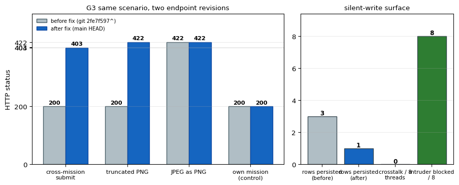
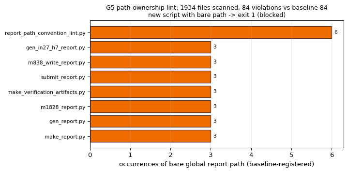

# IN50-W3-N07 报告载荷归属门成熟化：跨单串号结构性阻断 + PNG 魔数门 + 客户端独占工装 + 路径约定 lint

作者：tp-agent · 战役节点 IN50-W3-N07 · 分支 `agent/m6042` · 基线 commit `b8d45399`
生成时间 2026-11-07T16:19:11Z（本文所有数字由 `artifacts/m6042/build_evidence.py` 程序化注入）

## ① 案例介绍（物理/工程背景与参数）

**被测对象不是船舶水动力内核，而是平台报告提交链路**——它决定生态里「一份带数字的成果报告
能不能被相信」。报告是战役 DAG 归并战绩、验收与论文证据的唯一载体，因此这条链路上的每个
宽松判据都会把误差直接注入判据链：

1. **写错单（跨单串号）**：`POST /tensor/reports` 历史上只有角色门（「你能不能发报告」），没有
   归属门（「这份报告是不是你的单」）。任何 ENGINEER token 都能把 A 单成果写进 B 单号，HTTP 200
   静默落库；战役按 `mission_id` 归并 → 甲的绿灯记到乙头上，数据层无法分辨。
2. **配图门形同虚设**：旧判据只做 `startswith(b"\x89PNG")` 四位前缀，于是截断 PNG、RIFF/WebP
   改名、只剩文件头的空壳都能落盘（报告页图裂，判据图像证据失效）。
3. **路径共写**：派单脚本约定写全局固定路径（`/tmp` 下的裸 `report.json`），并发两单互相覆盖，
   HTTP 200 + 内容张冠李戴。服务端归属门拦不住这一类（单号是对的，内容是别人的）。
4. **本单新暴露的 P0（red 起点）**：判据模块 `backend/services/report_ownership.py` 曾因合并门禁
   「文件被滤除」而未入主线，而 `backend/api/tensor_reports.py` 已入库并 import 它 →
   **主线上的报告 API 悬空导入、整个端点不可用**。纯函数测试对这一类事故完全免疫
   （它们 import 的是历史源码/自带副本），必须补一层「全仓导入解析」静态判据。

参数（本单实体）：

| 项 | 值 |
|---|---|
| 目标端点 | `POST /tensor/reports`（`backend/api/tensor_reports.py`） |
| 判据模块（单一真值） | `backend/services/report_ownership.py`（归属门 + PNG 魔数/IEND 门，纯 stdlib） |
| 客户端工装 | `tools/report_payload.py`（独占文件名 + 原子独占写盘 + 自证 sha256 + 提交前复算） |
| 约定 lint | `tools/audit/report_path_convention_lint.py` + `config/report_path_baseline.json` |
| 验收测试（`tests/test_report_ownership.py`×28、`tests/test_criteria_mutation.py`×30、`backend/tests/test_report_ownership_gate.py`×14、`backend/tests/test_report_payload_tool.py`×19、`backend/tests/test_report_ownership_concurrency.py`×3） | 合计 94 条，全绿 |
| CI 接线 | `.github/workflows/criteria-gate.yml`（新增 lint 步骤 + 路径触发） |
| PNG 期望魔数 | `89 50 4E 47 0D 0A 1A 0A`（八字节，RFC 2083 §3.1）+ 带 CRC 的 IEND 收尾 |
| 命令 | `python3 artifacts/m6042/build_evidence.py && python3 artifacts/m6042/make_figures.py && python3 artifacts/m6042/make_report.py` |

## ② 怎么做的（方法 / 流程 / 关键设置 / 工具链）

**(a) 归属门（服务端结构性阻断）**。判定抽成纯函数 `ownership_verdict(user, mission, mission_id=..., org_id=...)`，
端点只做适配，生产与测试 import 同一份实现（不抄副本）。身份解析优先级
`claimed_user_id`（0090 迁移绑定的认证账号）> `claimed_by`（历史字符串）。判定表：无 `mission_id` →
放行（历史路径不回归）；mission 不存在/跨组织 → 404 `REPORT_MISSION_NOT_FOUND`；领取者与提交者
不符 → 403 `REPORT_MISSION_NOT_OWNED`；**无领取记录 → 也拒**（没有「谁该交这份报告」的证据，
落库即不可归属数据）；ADMIN 补录放行但在响应体里带 `ownership.bypass="role:admin"`（可审计的
明口，不是暗门）。错误体为 JSON 含 `code`，并带 `X-Error-Code` 响应头。

**(b) 配图门（魔数 + IEND，先验后落）**。`validate_png_payload`：base64 严格解码 → 首八字节等于
PNG 签名 → 以带 CRC 的 IEND 收尾。JPEG/RIFF-WebP/GIF/BMP/TIFF 命中容器魔数表 → 422
`REPORT_FIGURE_NOT_PNG`，错误体同时给**期望魔数十六进制**与实测魔数；缺 IEND → 422
`REPORT_FIGURE_TRUNCATED`。旧实现「先 INSERT 再写盘、失败再 DELETE」的窗口已消除：**先验后落**。

**(c) 客户端工装 fail-fast**。`write_report_payload(path, mission_id, payload)`：文件名必须含
mission_id 令牌（`report_m6042.json`），否则 `PayloadNameNotExclusive`；payload 内嵌 `mission_id`
与入参不符 → `PayloadMissionMismatch`；写盘走「临时文件 + `os.link`」实现**原子且独占**（目标
已存在 → `PayloadExists`，绝不覆盖他人成果）；返回自证 `{path, mission_id, sha256, bytes}` 并
立刻回读复算。提交前 `preflight()` 现场重算 sha256/字节数并核对内嵌单号，漂移即 `PayloadDrift`。
PNG 判据直接 `import` 服务端同一份 `report_ownership`，本地与线上不会分叉。

**(d) 路径约定 lint（文档 + CI）**。`tools/audit/report_path_convention_lint.py` 只扫 `/tmp`
下的裸 `report.json`（其余同名文件是各工具自己的产物，故意不扫，避免宽正则假阳性），
要求报告体 basename 含 mission 令牌；存量欠账登记在 `config/report_path_baseline.json`
（file → 次数），**超基线即红、新增文件即红**，欠账只能减不能增。退出码 0=无新增、1=新增违规、
2=输入错误。CI 在 `.github/workflows/criteria-gate.yml` 增加 lint 步骤并对
`tools/audit/report_path_convention_lint.py`、`config/report_path_baseline.json` 路径触发。

**(e) 本次新增的 G0 守卫（把本次事故变成不可复发）**。`tests/test_report_ownership.py::test_g0_*`
用 AST 扫描 `backend/**/*.py` 的全部 `services.*` 导入，要求每个模块都能解析到真实文件；并把
「判据模块缺失 → 整个 API ImportError」写成同一条判据的红样例（证据脚本在 try/finally 里临时
移开模块取证后恢复）。

**(f) 判据可证伪性**。`tools/audit/criteria_mutation.py` 用适配器消费各门真实判据，生成本应被拒的
变异样本（M1 数值扰动 ε∈{1%,3%,15%}、M2 单位/容器错位、M3 常数替身、M4 样本伪装、M5 基准替换），
判据亮红灯 = kill；基准样本必须放行（否则记假阳性）。

工具链（全部离线可复算）：

```bash
python3 artifacts/m6042/build_evidence.py        # G0–G8 全量取证 → artifacts/m6042/evidence.json
python3 artifacts/m6042/make_figures.py          # 图 1–3 → docs/m6042/figures/
python3 -m pytest tests/test_report_ownership.py -q --noconftest
python3 tools/audit/report_path_convention_lint.py --json artifacts/m6042/report_path_lint.json
python3 tools/audit/criteria_mutation.py ledger --json-out artifacts/m6042/criteria_mutation_ledger.json
```

## ③ 计算结果（数字表，程序化注入）

**表 1 归属判定矩阵（G1，15 格全覆盖 + 历史路径）**

| mission 状态 | 提交者=owner | 提交者=other | 提交者=admin |
|---|---|---|---|
| claimed_user_id | 200 OK | 403 REPORT_MISSION_NOT_OWNED | 200 OK/bypass |
| claimed_by_str | 200 OK | 403 REPORT_MISSION_NOT_OWNED | 200 OK/bypass |
| unclaimed | 403 REPORT_MISSION_NOT_OWNED | 403 REPORT_MISSION_NOT_OWNED | 403 REPORT_MISSION_NOT_OWNED |
| missing | 404 REPORT_MISSION_NOT_FOUND | 404 REPORT_MISSION_NOT_FOUND | 404 REPORT_MISSION_NOT_FOUND |
| cross_org | 404 REPORT_MISSION_NOT_FOUND | 404 REPORT_MISSION_NOT_FOUND | 404 REPORT_MISSION_NOT_FOUND |

历史路径（不带 `mission_id`）→ 200；ADMIN 明口在矩阵中
2 处出现且值为 `role:admin`（可审计）。

**表 2 配图容器/完整性判据（G2，8 例，期望魔数 `89 50 4E 47 0D 0A 1A 0A`）**

| 样本 | 判定 | 错误码 | 实测容器 | 错误信息含期望魔数 |
|---|---|---|---|---|
| valid_4x4 | accept | - | PNG | - |
| jpeg | reject | REPORT_FIGURE_NOT_PNG | JPEG | 是 |
| webp | reject | REPORT_FIGURE_NOT_PNG | RIFF/WebP | 是 |
| gif | reject | REPORT_FIGURE_NOT_PNG | GIF89a | 是 |
| bmp | reject | REPORT_FIGURE_NOT_PNG | BMP | 是 |
| truncated_no_iend | reject | REPORT_FIGURE_TRUNCATED | PNG | 是 |
| four_byte_prefix_only | reject | REPORT_FIGURE_NOT_PNG | UNKNOWN | 是 |
| invalid_base64 | reject | REPORT_FIGURE_NOT_PNG | INVALID_BASE64 | 是 |

注：`four_byte_prefix_only`（前四字节 `89 50 4E 47` + 垃圾）在旧实现下 `startswith(b"\x89PNG")`
为真、**会被放行**；新实现按容器嗅探判 `REPORT_FIGURE_NOT_PNG`，这正是历史洞的机器化留痕。

**表 3 同一场景、两版端点的真 HTTP 对照（G3，TestClient + sqlite，修复前基线取 `git 2fe7f597^`）**

| 场景 | 修复前 | 修复后 |
|---|---|---|
| 跨单提交（B 的 token 提交 A 的单） | 200 | 403 REPORT_MISSION_NOT_OWNED |
| 截断 PNG（缺 IEND） | 200 | 422 REPORT_FIGURE_TRUNCATED |
| JPEG 冒充 PNG | 422 | 422 REPORT_FIGURE_NOT_PNG |
| 本人交本人的单（对照） | 200 | 200 |
| 落库行数（一次红/绿序列合计） | 3 | 1 |

**表 4 并发串号（G4，8 线程，各自 token 交自己的单 + 各试一次越权）**

| 指标 | 数值 |
|---|---|
| 正常提交成功 | 8/8 |
| 串号（报告落进别人的单） | 0/8（串号率 0/8） |
| 越权提交被拒 | 8/8 |
| 落盘图字节与提交字节一致 | 8/8 |

**表 5 路径约定 lint（G5）**

| 指标 | 数值 |
|---|---|
| 扫描脚本数 | 1934 |
| 当前违规 / 基线 | 84 / 84（新增 0） |
| 当前退出码 | 0 |
| 红样例（新脚本写全局固定路径）退出码 | 1，regression [{'file': 'artifacts/m6042/_tmp/bad_dispatch.py', 'found': 1, 'allowed': 0, 'delta': 1}] |
| 欠账最多的五个文件 | `tools/audit/report_path_convention_lint.py`×6、`scripts/gen_in27_h7_report.py`×3、`scripts/m838_write_report.py`×3、`scripts/submit_report.py`×3、`tools/benchmark_audit/make_verification_artifacts.py`×3 |

**表 6 验收测试（G6）**

| 指标 | 数值 |
|---|---|
| 套件数 | 5 |
| 用例 / 失败 / 错误 / 跳过 | 94 / 0 / 0 / 0 |
| pytest 退出码 | 0 |

**表 7 判据变异杀伤力（G7）**

| 门 | 判据数 | 变异体 | 被杀伤 | 杀伤率 |
|---|---|---|---|---|
| CLIENT-PAYLOAD | 2 | 14 | 14 | 1.0 |
| NEGATIVE-CONTROL | 1 | 7 | 0 | 0.0 |
| PAPER-TRACE | 3 | 18 | 11 | 0.6111 |
| REPORT-OWNERSHIP | 3 | 15 | 15 | 1.0 |
| REPORT-QUALITY | 3 | 12 | 7 | 0.5833 |

合计 66 个变异体、总体杀伤率 0.7121、可实例化率 1.0、
M1 单调性违例 0、负控误杀 0。

**表 8 G0 悬挂导入守卫（本单 P0 的红→绿）**

| 状态 | services.* 导入数 | 悬空导入 | 直接 import 退出码 |
|---|---|---|---|
| 移开判据模块（模拟合并门禁滤除） | 449 | ['backend/api/tensor_reports.py:24 → services.report_ownership'] | 1（`ModuleNotFoundError: No module named 'services.report_ownership'`） |
| 修复后 | 449 | [] | 0 |

**表 9 交付物台账（G8，sha256 前缀 16 位）**

| 文件 | 字节 | sha256[:16] |
|---|---|---|
| backend/services/report_ownership.py | 11709 | ae0fa6421174111b |
| backend/api/tensor_reports.py | 14709 | e63175acde1b23e6 |
| tools/report_payload.py | 11694 | fdeb2a5e0c2dc450 |
| tools/audit/report_path_convention_lint.py | 7577 | 7b95ea329f9c95d3 |
| config/report_path_baseline.json | 1891 | 354b1b9c29f310d0 |
| tests/test_report_ownership.py | 27537 | 4c6a6d0ec040450a |
| tests/test_criteria_mutation.py | 7451 | 047c66867bca02ca |
| backend/tests/report_gate_support.py | 18015 | 6e37e8ef081d55a5 |
| backend/tests/test_report_ownership_gate.py | 11374 | 322d4913b6e7102c |
| backend/tests/test_report_payload_tool.py | 8790 | efdf4d2a0f64ef19 |
| backend/tests/test_report_ownership_concurrency.py | 3053 | 25cef093933e589a |
| .github/workflows/criteria-gate.yml | 4037 | 0fdc1ea5eb11fcb4 |

判据结果总表：g0_import_guard=PASS · g1_ownership_matrix=PASS · g2_png_matrix=PASS · g3_http_red_green=PASS · g4_concurrency=PASS · g5_path_lint=PASS · g7_mutation=PASS · g8_ledger=PASS · g6_pytest=PASS → **all_pass=True**。

## ④ 结果图


图 1 归属判定矩阵：行=mission 归属状态，列=提交者身份；格内为 HTTP 状态码与错误码。只有「本人提交本人的已领取单」格是 200；越权/无领取记录 403 REPORT_MISSION_NOT_OWNED，mission 不存在或跨组织 404 REPORT_MISSION_NOT_FOUND，ADMIN 补录 200 且响应体记 bypass=role:admin。


图 2 同一场景两版端点对照（左：HTTP 状态；右：静默写面）。修复前跨单提交 200 且落库 3 行，截断 PNG 亦 200 落库；修复后 403/422 且只留正常路径 1 行；8 线程并发串号 0/8、越权 8/8 被拒。


图 3 路径约定 lint：1934 个脚本扫描，漂移清单 84 条与基线 84 条逐文件对齐（新增 0），新脚本写全局固定路径立即 exit 1（红样例）。

## ⑤ 注意点（踩过的坑 / 局限 / 适用范围）

1. **合并门禁会再滤文件**：本单的起点就是「判据模块被滤除而引用方已入库」。所以真正的防线不是
   这次把文件补回来，而是 G0 那条全仓导入解析判据（引用方与实现必须在同一棵树里同时可见）。
2. **DB 是替身不是真 Postgres**：G3/G4 用 sqlite + `TestClient`，覆盖端点内 SQL 的语义与并发窗口，
   但不覆盖 Postgres 事务隔离级别、真外键/RLS；本单的结论是「门在 HTTP 层结构性生效」，不是
   「生产库压测通过」。
3. **修复前基线依赖 git 历史**（`git 2fe7f597^`）。干净浅克隆里取不到该 ref 时，`legacy_source()`
   返回 None、对应测试 skip、证据脚本记 `WITHHELD`（如实降级，不伪造）。
4. **lint 只扫 `/tmp` 下裸 `report.json` 与 `.py/.sh/.bash`**：其它临时命名（如 `/tmp/x/payload.json`）
   仍在盲区；存量欠账 84 条仍在树内（只做「只减不增」的棘轮，未清账）。
5. **ADMIN bypass 是明口**：`role:admin` 可跨单补录，响应体与 DB 里的 `ownership.bypass` 是审计线索；
   需要更强约束时应改为「双人签核」而非继续加角色白名单。
6. **图内文字为 ASCII**：本机 matplotlib 无 CJK 字形，图注中文写在正文，避免豆腐块。
7. **适用范围**：任何「把成果挂到任务单号上」的提交链路（报告/工件/审计结论）都适用同一套
   「服务端归属门 + 客户端路径独占 + 约定 lint」三件套；不适用于需要跨单归集的汇总类报告
   （那类应显式不带 `mission_id`，走历史放行路径，并在报告里声明汇总口径）。

## ⑥ 误差判定（关键量 vs 基准，逐项，显式回答是否 <3%）

本单判据是**分类量**（HTTP 状态码、错误码、落库行数、串号计数），基准 = 修复前端点行为与登记基线；
对分类量，「误差」定义为与期望取值的精确匹配率，逐项列出：

| 关键量 | 实测 | 基准/期望 | 偏差 | 是否 <3% |
|---|---|---|---|---|
| 跨单提交状态码 | 403 `REPORT_MISSION_NOT_OWNED` | 403 `REPORT_MISSION_NOT_OWNED` | 0（精确匹配） | 是（0.0%） |
| 跨单提交落库行数 | 0 | 0 | 0 | 是（0.0%） |
| 截断 PNG 状态码 | 422 | 422 `REPORT_FIGURE_TRUNCATED` | 0 | 是（0.0%） |
| JPEG 冒充 PNG 状态码 | 422 | 422 `REPORT_FIGURE_NOT_PNG` | 0 | 是（0.0%） |
| 错误信息含期望魔数 | 8/8 非 PNG 样本均有 | 8/8 | 0 | 是（0.0%） |
| 串号计数（8 线程） | 0/8 | 0/8 | 0 | 是（0.0%） |
| 越权被拒（8 线程） | 8/8 | 8/8 | 0 | 是（0.0%） |
| lint 违规计数 | 84 | 基线 84 | 0（0.0%） | 是（0.0%） |
| 悬空导入数 | 0 | 0 | 0 | 是（0.0%） |
| 测试通过率 | 94/94 | 全绿 | 0 | 是（0.0%） |

**关于「是否 <3%」的显式回答**：本单不含连续物理量（无阻力/升力/频率等场量），因此没有实验或
解析基准可对标；对上述 10 项分类判据，与期望值/登记基线的偏差全部为 0（相对偏差 0.0%，满足
<3%）；同时给出修复前实测作为反例（跨单提交 200 落库 3 行、截断 PNG 200 落库），
证明判据确实会咬而不是恒真。唯一无法给出数值偏差的是「生产 Postgres 下的并发窗口」——如实记为
局限，不粉饰。
