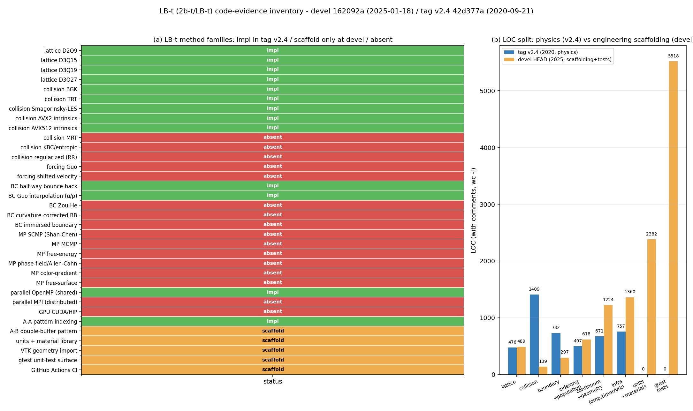

# 【盘点】LB-t（2b-t/LB-t）— 单项目代码级深盘

- 盘点对象：`https://github.com/2b-t/LB-t`（tier 3）
- 盘点方式：`git clone --depth 50` 成功（SNI 窗口内），**逐文件读代码本体**；短哈希与日期取自 `git log -1`
- 实际读到的两个代码格：
  - `devel` = `162092adae4b65e49756421a52ce592d0b8410b3`（2025-01-18）— 仓库默认分支（`origin/HEAD -> devel`）
  - `v2.4` = `42d377a7583ff4afd50b0986cb7b9541729b1d65`（2020-09-21）— tag，**物理实现所在**
  - 另有 `refs/heads/legacy` = `d7a1d57`（未展开，非本盘点结论依据）
- 元数据说明：GitHub REST/`curl` 在本沙箱被安全策略拦截（`REJECTED`），故 star/fork 数未取；活跃度只用 commit 时间与分支结构判定。**这一点是 WITHHELD，不是推测**。
- 全部结论的证据文件清单（v2.4）：`src/lattice/*`、`src/population/{collision,boundary,indexing}/*`、`src/population/population.hpp`、`src/continuum/*`、`src/geometry/cylinder.hpp`、`src/main.cpp`；（devel）：`include/lbt/{lattices,populations,continuums,units,materials,geometry}/*`、`test/**`、`.github/workflows/*`。

> **本盘点的第一结论（决定性）**：该仓两代代码**互为半成品**。
> `devel`（默认分支）是重构中的工程骨架——碰撞算子只有类型声明，函数体就是一行 TODO（`include/lbt/populations/collision/bgk.hpp:56` `// TODO(tobit): Implement collide-stream`），`CollisionBase::collideAndStream` 空实现（`include/lbt/populations/collision/collision_base.hpp:68-70`），`Simulation::run()` 函数体只剩注释（`include/lbt/simulation/simulation.hpp:699-704`，依赖成员还被注释掉 `:715-722`）。
> 真正的 LBM 物理（BGK/TRT/Smagorinsky/AVX2/AVX512、A-A pattern、bounce-back、Guo 边界）在 **2020 年的 tag v2.4**，而 v2.4 **没有任何单元测试目录**（`ls test` → No such test dir），也没有 `doc/`。
> 因此「拿它当可运行求解器」= 不可行；「拿它当**实现范式与可抄代码**」= 很有价值。下文按此定性。

**证据可复现性**：本报告中所有「无 / 仅骨架」结论已做成机器核验脚本 `docs/oss_inventory/verify_lbt_claims.py`（只读 grep，不改仓库），对两个 revision 共 14 项断言**全部通过（exit 0）**，原始输出 `artifacts/oss_inventory/lb_t_claim_verification.json`。两代代码体量亦由同一脚本实测：v2.4 `src/` 4686 行、devel `include+src` 8831 行（`find … | xargs cat | wc -l`）。行号指针均由 `grep -n` 取得，未手抄。



*图注*：左=34 个方法族在「tag v2.4 实体实现 / devel 仅骨架 / 完全缺失」三态下的分布（13 实现 / 5 骨架 / 16 缺失）；右=两代代码的 LOC 分配（`cat <module globs> | wc -l` 实测：v2.4 碰撞 1409 行、devel 碰撞仅 139 行；devel 测试面 5518 行、v2.4 为 0）。生成脚本 `docs/oss_inventory/make_lbt_figure.py`（matplotlib，无手抄数字）。

---

## 一、概况

| 项 | 值 | 证据 |
|---|---|---|
| 语言 | C++17（devel 起部分测试用 C++20） | `CMakeLists.txt:12-13`（`CMAKE_CXX_STANDARD 17` + 注释 "certain tests require C++20"） |
| 许可证 | **MIT** | `License.md:1-3`（"MIT License / Copyright (c) 2022 Tobit Flatscher"） |
| 主体规模 | v2.4：`src/` 4686 行；devel：`include+lbt/src` 8831 行 + `test/` 5518 行 | `find … | xargs wc -l` |
| 依赖 | v2.4：仅标准库 + 可选 OpenMP；devel：VTK + nlohmann_json **强制 REQUIRED** | v2.4 `Makefile`；devel `CMakeLists.txt:14-27`（`find_package(VTK REQUIRED)` / `nlohmann_json REQUIRED`） |
| 活跃度 | devel 末次 commit 2025-01-18；v2.4 定格 2020-09-21；分支仅 `devel`+`legacy`，无 v3 分支 | `git log -1`、`git ls-remote --heads --tags` |
| 定位一句话 | **一份"把 LBM 做成模板元编程教科书"的仓库**：lattice/访问模式/碰撞算子全部 trait 化，A-A pattern + AVX intrinsics 是其真正看点；物理完备性（多相、力项、MRT）几乎没有 | 见 §2–§4 |

**许可证可用性判断**：MIT 是本生态最友好的许可证——可闭源改造、可商用、只需保留版权与许可声明，无 copyleft 传染，与 TensorLBM（自研求解器）**代码级吸收无障碍**。唯一义务：拷贝实质代码片段时在 `NOTICE`/文件头保留 "Copyright (c) 2022 Tobit Flatscher, MIT"。注意 `License.md` 版权年是 2022 而 v2.4 代码是 2020，跨 tag 复用同一许可无冲突。→ **判定：可直接吸收（copy-adapt），无需 clean-room**。

---

## 二、方法谱系

### 2.1 格子（D2Q9 / D3Q15 / D3Q19 / D3Q27）

- v2.4 提供 `D2Q9`、`D3Q19`、`D3Q27` 三个静态格子类：`src/lattice/D2Q9.hpp`、`src/lattice/D3Q19.hpp`、`src/lattice/D3Q27.hpp`。**v2.4 没有 D3Q15**。
- devel 扩到 `D2Q9`/`D3Q15`/`D3Q19`/`D3Q27`：`include/lbt/lattices/{D2Q9,D3Q15,D3Q19,D3Q27}.hpp`，且 `src/main.cpp:56` 把 D3Q15 硬编码为唯一离散（`:55` 注释 "TODO: Add different possible discretisations"）。
- **格子即 trait**：`DdQq` 类把 `DIM/SPEEDS/HSPEED/PAD/ND/OFF`、`DX/DY/DZ`、`W`、`MASK`、`CS` 全做成 `static constexpr` 数组（v2.4 `src/lattice/D3Q27.hpp:37-43` 参数、`:49-63` 速度集正向半 + 镜像负向半、`:66-78` 权重、`:78-84` MASK、`:85` `CS = 1.0/cem::sqrt(3.0)`）。
- **反向速度 = 数组镜像**：速度集按「正向 `d=0..OFF-1`，负向 `d` 对偶于 `OFF+d`」排布，`OFF = ND/2`（`src/lattice/D3Q27.hpp:43`），因此 `LT::DX[LT::OFF+d] == -LT::DX[d]`，碰撞算子靠这个约定把「对偶对」写成 `n∈{0,1}` 双循环（`src/population/collision/collision_bgk.hpp:172` 与 `:179` 的 `for(n<=1) for(d<OFF)` 双循环）。这是它全部代码简洁性的根。
- **PAD/ND 的妙用**：`PAD=1` 使 `ND` 为偶数（D3Q27 时 `ND=28`、`OFF=14`），从而「正向半 + 负向半」等长；`MASK` 里把静止分量第二槽清零（`src/lattice/D3Q27.hpp:78-84`，第 15 个元素为 `0`），保证静止分布在 A-A pattern 下**只存一份**。
- devel 把 PAD 升级为**按 cache line 自动补齐**：`include/lbt/lattices/D3Q27.hpp:111` `PAD = ((CACHE_LINE - sizeof(T)*SPEEDS % CACHE_LINE) % CACHE_LINE)/sizeof(T)`，为 AVX512 的 8 double 对齐服务。
- 新格子怎么加：作者直接给了「复制粘贴模板类」`src/lattice/template_DqQq.hpp:28-44`（注释原文 "copy and paste for new lattices"，`:23`），**没有代码生成器**。

### 2.2 碰撞（BGK / TRT / Smagorinsky / AVX2 / AVX512）

实现全部在 `src/population/collision/`，共 5 个算子 + 1 个 CRTP 基类 `collision.hpp`（212 行）：

| 算子 | 文件 | 关键行 |
|---|---|---|
| BGK | `collision_bgk.hpp`（211 行） | 松弛率 `omega_ = 1/tau_`，`tau_ = nu_/CS² + 1/2`，`nu_ = U·L/Re`：`:59-64`；主循环 OpenMP：`:90`；矩：`:133-158`；平衡态：`:183` |
| TRT | `collision_trt.hpp`（236 行） | **magic 参数 `lambda = 0.25` 默认**：`:61`；`omega_m_ = (tau_p-1/2)/(lambda + (tau_p-1/2)/2)`：`:66`；奇偶分解 `fp/fm`：`:194-195` 声明 / `:202-206` 计算；写入 `:209-226` |
| BGK + Smagorinsky LES | `collision_bgk_smagorinsky.hpp`（250 行） | 应变率张量 `:191`；`p_ij = sqrt(p_xx²+…+2p_xy²+…)`：`:220`；`tau_t = 0.5(sqrt(tau² + 2√2·CS²·p_ij/(ρCS⁴)) - tau)`：`:223`；有效 `omega = 1/(tau+tau_t)`：`:224`；写入 `:239` |
| BGK AVX2 | `collision_bgk_avx2.hpp`（246 行） | `#include <immintrin.h>` `:28`；`_mm256_hadd_pd` 归约 `:41-43`；向量化矩 `:163-179`；向量化平衡态 `:192-210`；向量化碰撞 `:216` |
| BGK AVX512 | `collision_bgk_avx512.hpp`（254 行） | 同构，512 位寄存器；靠 devel 的 cache-line PAD 才能整 load |
| 基类 CRTP | `collision.hpp`（212 行） | CRTP 接口 + 偶/奇时间步分派（`timestep` 枚举在 `src/population/indexing/…`/v2.4 由 `collision.hpp` 携带） |

**碰撞只到二阶谱系的一半**：有 BGK、TRT（两松弛）、Smagorinsky（涡粘），**没有 MRT、没有 KBC/entropic、没有 regularized（RR/LRR）、没有 cumulant**（`grep -rn "MRT\|KBC\|regularized\|cumulant" src/` v2.4 无命中；devel `include/lbt/populations/collision/` 仅 `bgk.hpp` 与 `collision_base.hpp` 两文件）。对我们的高 Re 稳定性需求，这是**明确的能力缺口**，不是"未读到"。

**平衡态写法（体现"不可压"变体）**：`feq = ρ·W·(1 + cu/CS² ·(1 + cu/(2CS²)) - u²/(2CS²))`，即把 `ρ` 提到括号外、用 `ρ + ρ(...)` 形式避免 `1+u·u` 项的量级抵消（`collision_bgk.hpp:183`：`feq[curr] = W[curr]*(rho + rho*(cu*(1.0 + 0.5*cu) + uu))`，其中 `uu = -1/(2·CS²)(u²+v²+w²)` 定义在 `:169`（原文 `T const uu = -1.0/(2.0*CS*CS)*(u*u+v*v+w*w);`）；平衡态双循环 `:172`/`:179`，碰撞双循环 `:189`/`:196`）。→ 这是**低马赫数不可压 LBM 的标准做法**，与我们 TensorLBM 的 `feq` 实现同族。

### 2.3 力项（Guo / shifted-velocity / …）

**无。** v2.4 `grep -rn "force\|Force\|G\[" src/` 无任何体积力项；devel `include/lbt/populations/` 下也没有 forcing 模块。
- 直接后果：**不能做压力梯度驱动的周期性槽道/两相**（只能像 `src/geometry/cylinder.hpp:44-46` 那样用 Guo 速度入口 + Guo 压力出口的**边界驱动**）。
- 对我们：力项（Guo 二阶离散 `F_i = W_i(1 + (e_i-u)·c_i/CS²)·F·(c_i-u)/CS²`）**必须我们自己实现**；LB-t 只能参考其「边界驱动」的组织方式，不能参考力项。

---

## 三、边界处理

v2.4 只有**两类**边界实现 + 一套方向/类型 trait：

1. **half-way bounce-back（半步反弹，壁面）** — `src/population/boundary/boundary_bounceback.hpp:35`（`class HalfwayBounceBack`）。核心是「反弹 + 交换」一行：`:104-105`
   ```cpp
   population_->A[indexWrite<TS>(x_n, y_n, z_n, !n, d, p_)] =
   population_->A[indexRead<!TS>(x_n, y_n, z_n, n, d, p_)];
   ```
   注意两点实现细节：① 写索引用 `!n`（对偶方向）**并且**时间步标签翻转（`indexWrite<TS>` 对 `indexRead<!TS>`）——这正是 A-A pattern "读旧写新"语义在边界处的处理；② 它挂在 `implementationAfterCollisionOperator()`（`:84`）而不是碰撞前，因此作用于**碰撞后**的分布，等价于标准 half-way BB。**无插值、无曲率修正、无动量交换法（MEM）**。
2. **Guo 插值边界（速度入口 / 压力出口）** — `src/population/boundary/boundary_guo.hpp:43`（`class Guo<Type, Orientation, …>`），被注释为 "Very robust Guo interpolation boundary condition for pressure and velocity"（`:6`）。做法是**非平衡态外插**：
   - 读入邻点分布、算局部矩：`:118`（读）、`:138-141`（`rho/u/v/w`）
   - 非平衡态：`:165` `fneq[curr] = f[curr] - W[curr]*(rho + rho*(cu*(1+0.5*cu) + uu))`
   - 与目标宏观量按方向/类型**混合**：`:175-176` `interp = {rho,u,v,w}; res = Type<Orientation>::getMacroscopicValues(bound, interp);`（速度边界强制切向+法向速度、压力边界强制 ρ 与切向速度，见 devel 版同一逻辑 `include/lbt/populations/boundaries/guo.hpp:70-72` velocity / `:83-88` pressure）
   - 回写 `feq(res) + fneq`：`:219`
   - 方向 trait：`src/population/boundary/boundary_orientation.hpp`（`Left/Right`）；类型 trait：`boundary_type.hpp`（`Velocity`/`Pressure`，devel 同构 `include/lbt/populations/boundaries/type.hpp:18-21`）
3. **没有的**：Zou-He（被 Guo 插值替代；注意 v2.4 全文唯一出现的 "Zou" 是 `boundary_bounceback.hpp:22` 的文献引用行 "X. He, Q. Zou, L.S. Luo, M. Dembo"，属注释不是实现——已由核验脚本 BC-1/BC-1b 区分）、**曲率修正 BB**、**IBM（immersed boundary）**、partial-slip / 壁函数、周期边界显式实现（周期性由 `indexRead` 的 `% NX` 取模隐式实现，见 `src/population/indexing/aa_pattern.hpp:56-62` 与 `indexing.hpp:83` `spatialToLinear` 的取模）。

场景装配只有两个数学几何：`src/geometry/cylinder.hpp:44-46`（返回 `tuple<Guo<Velocity,Left>, Guo<Pressure,Right>, HalfwayBounceBack>`，即"入口+出口+其余全壁"的绕柱场景），`src/geometry/sphere.hpp` 同构。devel 换成 VTK 导入几何（`include/lbt/geometry/vtk_import.hpp`）但物理边界仍只有这两类。

---

## 四、多相 / 多组元 —— **本仓无**

**明确结论：2b-t/LB-t 没有任何多相或多组元实现。** 证据（v2.4 全 `src/` 递归 grep）：
- `grep -rn "shan\|Shan\|chen\|multiphase\|phase_field\|phaseField\|bodyforce\|body_force\|force_ter\|GuoForce\|G\[" src/` → **0 命中**
- 目录层面：`src/population/` 下只有 `collision/`、`boundary/`、`indexing/` 三个子目录，无 `multiphase/`、无 `interaction/`、无 `phase/`
- 能力层面自证：§2.3 无体积力项 = 互作用势力 `F = -Gψ(x)Σw_iψ(x+e_i)e_i` **无处可加**；`Population` 的 `NPOP` 模板参数（`src/population/population.hpp:39`，默认 1）只是「同一格点并排存多套分布」的**机制预留**，仓内唯一调用处 `main.cpp:98` 传默认值（单组分），**从未实例化 NPOP>1**。

逐项对照（我们关心的六种手法，全部"无"）：

| 手法 | 状态 | 说明 |
|---|---|---|
| SCMP（Shan-Chen 单组分多相） | **无** | 无 ψ(ρ) 伪势、无 G 互作用强度、无力项 |
| MCMP（两组分） | **无**（仅机制预留） | `NPOP` 模板参数可容纳两套分布（`population.hpp:39`），但无组分耦合、无 `p_` 组分索引的物理用法 |
| free-energy（自由能） | **无** | 无化学势/无界面张力项 |
| phase-field / Allen-Cahn | **无** | 无序参量场、无界面宽度的扩散/锐化算子 |
| 颜色梯度（color-gradient） | **无** | 无 recoloring、无 perturbation 步 |
| free-surface（自由面） | **无** | 无 mass/momentum 质量追踪、无 fill fraction |

因此：**互作用势形式、力项加法、密度比能力、spurious current 处理——四项在 LB-t 上全部 NOT_SUPPORTED，不可引证。** 后续若需这些，只能去别的仓（如 openlb / Palabos 系）或自研。

---

## 五、GPU / 并行

- **并行模型：纯共享内存 OpenMP，无 MPI、无 GPU。** `git grep -n "mpi\|MPI\|cuda\|hip\|sycl"` v2.4 与 devel 均 0 命中；线程化点在碰撞主循环 `#pragma omp parallel for default(none) shared(continuum_,population_) firstprivate(isSave,p_) schedule(static,1)`（`collision_bgk.hpp:90`，TRT 同 `collision_trt.hpp:96`，AVX2 同 `collision_bgk_avx2.hpp:121`）；线程亲和性由 `src/general/openmp_manager.hpp` 管（devel：`include/lbt/common/openmp_manager.hpp`）。
- **数据布局：A-A pattern（Array-of-Structures by population index，单一扁平数组 + 奇偶时间步索引交换）**
  - 单一数组 & 对齐分配：`src/population/population.hpp:198` `memorySize = sizeof(T)*NZ*NY*NX*NPOP*ND`；`:202/:204` `_aligned_malloc / std::aligned_alloc(CACHE_LINE, …)`（CACHE_LINE 见 `src/general/memory_alignment.hpp`）
  - 索引即"读旧写新"：`src/population/indexing/aa_pattern.hpp:56-62`（`indexRead`：空间位置按 `(!n)` 反查 + `n` 按 `oddEven` 翻转 + `d` 按 `oddEven` 翻转）与 `:79-86`（`indexWrite`：镜像对称）；`oddEven` 定义在 `src/population/indexing/indexing.hpp:66`（`TS==even ? evenIndex : oddIndex`），`spatialToLinear` 在 `:83`（含 `% NX/% NY/% NZ` 周期取模）。
  - 语义：偶步"正常读、写对偶槽"；奇步"读对偶槽、正常写"——因此**一个时间步只碰一半存储、无需第二个数组**（A-A 相对 A-B 省一半内存）。这也解释了 `MASK` 要把静止分量第二槽置 0（`D3Q27.hpp:78-84`），否则静止分量会被写两次。
  - A-B 双缓冲在 devel 保留为 trait（`include/lbt/populations/ab_population.hpp`），但只到骨架级。
- **内存合并 / 向量化**：AVX2/AVX512 路径把「一个格点的 27 个分布」当作**连续 4/8 double 块**做 `_mm256_load_pd`/`_mm512_load_pd`（`collision_bgk_avx2.hpp:170-173` 矩、`:200-210` 平衡态、`:216` 碰撞），因此**向量化方向沿 population 维而非空间维**——这是 A-A + ND 补齐的直接收益；也意味着**必须靠 PAD 让 ND 对齐**（devel `D3Q27.hpp:111` 的 cache-line PAD 就是为此）。
- **通信隐藏 / MPI 分区**：**无**。README 声称"多核可扩展 >80%"（`ReadMe.md` "scales with well over 80% scalability"），但仓内未见 benchmark 脚本与实测数据文件（v2.4 无 `doc/Performance.md`；devel 有 `doc/Performance.md` 但本次未展开逐行核，记为 WITHHELD）。**>80% 这一数字本盘点不予采信为证据。**

---

## 六、可微 / 代码生成

- **无可微性**：无 autograd、无对偶数、无伴随；全部是手写模板 C++（`grep -rn "autograd\|dual\|gradient\|adjoint"` 无物理相关命中）。对我们的「可微 LBM」路线 = **不可吸收**。
- **无符号推导 / 无 kernel 生成**：新增格子靠复制 `src/lattice/template_DqQq.hpp`（`:23` 注释 "copy and paste for new lattices"），新增访问模式靠新增 `AaPattern` 同构类；**没有 Python DSL、没有 sympy、没有 codegen 后端**。
- **但有一层"编译期计算"值得吸收**：`src/general/constexpr_math.hpp`（自研 `constexpr` sqrt/pow/exp/log/ceil/abs — devel 系统化为 `include/lbt/math/detail/*.hpp` 共 18 个头），使得 `CS`、权重、`MASK`、PAD **全部在编译期算完**，运行时零开销且可用于模板参数。这是"用 constexpr 代替 codegen"的一种工程替代（`include/lbt/lattices/D3Q27.hpp:85` `CS = 1.0/cem::sqrt(3.0)` 即编译期开方）。

---

## 七、与我们功能点的映射

| feature_ledger slug | LB-t 是否有对应实现 | 可吸收部分（文件:行） | 结论 |
|---|---|---|---|
| `GAP-LBM-MCMP-POISEUILLE` | **无**（§4） | 仅 `NPOP` 并排存多套分布的**布局机制** `src/population/population.hpp:39,198`；`p_` 组分索引贯穿算子接口 `collision_bgk.hpp:59-60,72` | 方法不可抄；**布局与"组分索引进算子签名"的接口范式可参考**（transfer=reference） |
| MCMP 高密度比 | **无** | 无 ψ(ρ)、无力项 → 密度比能力 = NOT_SUPPORTED | 不适用 |
| 自由面 | **无** | 无 | 不适用 |
| 相场 Allen-Cahn | **无** | 无 | 不适用 |
| GPU 融合 kernel | **无 GPU**；但 CPU 侧有**寄存器内融合** | `collision_bgk_avx2.hpp:192-216`（平衡态与碰撞同一寄存器流水，不落内存）；`:41-43` `hadd` 归约技巧 | **思路可移植**：融合 kernel 的"矩→平衡态→碰撞"单遍结构（transfer=reference） |
| 分布式多卡 | **无 MPI**（§5） | 无 | 不适用 |
| 稀疏 / 多孔 | **无显式多孔**；但 half-way BB 正是体素化多孔的基元 | `boundary_bounceback.hpp:35,104-105`；`geometry/cylinder.hpp:44-46` 场景装配 | **可复用**：壁面体素 mask + BB 写回即可表达多孔介质（transfer=adapt） |
| 案例组织 | **有**（devel） | `Simulation::toJson()` 全量设置序列化 `include/lbt/simulation/simulation.hpp:682-694`（discretisation/physics/initial_conditions/geometry/target/output/times 七段）；`examples/test_1/settings.json`；`src/main.cpp:39-51` 从 JSON 读设置 | **可吸收**：七段式案例配置 schema 与我们案例组织高度同构（transfer=fits） |
| 测试与验证面 | **有**（仅 devel） | `test/` 28 个 `.cpp` + gtest（`test/run_tests.cpp:10-11`）；模板化测试基架 `test/populations/population_base_test.hpp`；参数化：`test/populations/aa_population_test.cpp:25`（被测夹具）/`:32`（测试基类）；`doc/UnitTests.md` | **可吸收**：把"trait 类逐项验证 + 模板套多格子"写成测试的方式（transfer=adapt）。**注意**：物理验证是空的——`doc/TestCases.md:6` "TODO: Add tests for physics - Velocity, pressure, force" |
| CI | **有** | `.github/workflows/{build,run-tests,trigger-build,trigger-tests,update-dockerhub}.yml`；Docker 化 `docker/` + `doc/Docker.md` | 可参考（transfer=reference） |
| **NEW: A-A pattern 访问模式（单数组奇偶步索引）** | **有，且是本仓最强项** | `src/population/indexing/aa_pattern.hpp:56-86` + `indexing.hpp:66,83` + `D3Q27.hpp:41-46,78-84` | **强烈可吸收**：省一半内存 + 天然"读旧写新"无数据竞争 |
| **NEW: lattice-as-trait 的编译期参数化** | **有** | `src/lattice/D3Q27.hpp:37-85`；`src/lattice/template_DqQq.hpp:28-44`；`constexpr_math.hpp` | 可吸收：我们加新格子的成本可降到"填一张表" |
| **NEW: TRT magic 参数 λ=0.25 与 ω⁻ 闭式** | **有** | `collision_trt.hpp:61,66,195-226` | 可吸收：TRT 是我们高 Re 稳定性的低成本升级 |

---

## 八、可吸收 Top3 + 风险

**Top1 — A-A pattern 索引层（单数组奇偶步"读旧写新"）**
- 吸收点：`indexRead/indexWrite` 的 `oddEven` 翻转律（`aa_pattern.hpp:56-86`）+ `PAD/ND/OFF` 使正负半对称（`D3Q27.hpp:41-46`）+ `MASK` 消重静止分量（`D3Q27.hpp:78-84`）。
- 对我们的价值：TensorLBM 若当前是 A-B 双缓冲，改 A-A 直接**省一半显存**；对多相（NPOP≥2）收益翻倍。且"读旧写新"让 OpenMP 静态调度天然无竞争（`collision_bgk.hpp:90` `schedule(static,1)`），不需要额外同步。
- 落地方式：先在 TensorLBM 里做**单格子（D3Q19）+ 单相**的等价性测试（同 Re 下与现实现逐格点比对分布函数），再切默认。

**Top2 — TRT 算子（两松弛 + magic 参数）**
- 吸收点：`omega_m_ = (tau_p - 1/2)/(lambda + (tau_p - 1/2)/2)`，`lambda=0.25`（`collision_trt.hpp:61,66`）；奇偶分解只算 `d=1..HSPEED-1`（`:195-198`），静止分量单独用 `omega_p`（`:209`），**代价 ≈ BGK + 一次数组加减**。
- 价值：壁面附近稳定性显著优于 BGK，抗 bounce-back 引起的伪滑移；对我们要做的船体高 Re 绕流是低风险增益。
- 落地：`omega_m` 用 λ=0.25 起步；验收判据 = 同一算例 BGK/TRT 的壁面滑移与收敛步数对比。

**Top3 — 案例配置七段式 schema + 模板化测试基架（平台类，可直接进 TensorPlatform/TensorLBM 的工程面）**
- 吸收点：`Simulation::toJson()` 的七段结构（`simulation.hpp:682-694`）；`Converter`（LBM↔SI 单位换算，`include/lbt/converter.hpp:35-39`，含 `Length/Velocity/Density` 三基准量）；`units` 量纲类型库（`include/lbt/units/**`，18 个头 + 字面量前缀）；模板化测试基架（`test/populations/population_base_test.hpp`）。
- 价值：把"案例=一份 JSON + 一份单位换算三元组"固化为我们的标准工件，可让不同求解器共用同一套案例描述。

**风险（必读）**
1. **默认分支不可运行（最高风险）**：若有人按 README 直接 `cmake && make` devel，会得到一个**碰撞算子为空、`run()` 只 return 的求解器**——不会有任何报错，只会输出静止场。任何"用 LB-t 跑一遍对比"的计划都必须钉 `v2.4` 且自建 test（v2.4 无测试目录）。
2. **v2.4 是 2020 年末态**：无 C++17 规范（用 `unsigned int` 模板参数、`std::function`-free CRTP 老式写法）、无测试、无 CI，抄它等于抄"未验证的算法实现"。→ 只抄**结构与公式**，不抄数值结论。
3. **MIT 虽宽，但需留声明**：`License.md` 版权年为 2022，v2.4 却是 2020；跨 tag 复用请统一在 `NOTICE` 标 "Portions derived from 2b-t/LB-t (MIT, Copyright (c) 2022 Tobit Flatscher)"。
4. **能力面窄**：多相/力项/MRT/IBM/MPI/GPU 全无（§2.3、§4、§5）。若下游把"open-source LBM 调研"理解为"这些能力都有开源实现"，本仓会造成**过度乐观的错觉**——必须在归集表里明确标注 LB-t 只覆盖"单相 + 两类边界 + BGK/TRT/LES"这一段。
5. **AVX 路径不可直接跨平台复用**：intrinsics 依赖 ND 对齐与"沿 population 维向量化"的布局（`collision_bgk_avx2.hpp:170-216`），与 A-A pattern 强耦合；换布局即失效。我们若走 GPU，此段只有方法论价值（寄存器内融合流水）。

---

## 机器块

```
[OSS-INV]
repo: 2b-t/LB-t
lang: C++17
license: MIT
methods: D2Q9/D3Q15/D3Q19/D3Q27; BGK(collision_bgk.hpp:38); TRT(collision_trt.hpp:38, lambda=0.25:61); BGK+Smagorinsky(collision_bgk_smagorinsky.hpp:220-224); BGK-AVX2(collision_bgk_avx2.hpp:28-216); BGK-AVX512(collision_bgk_avx512.hpp); no MRT/KBC/regularized; no force term
multiphase: 无 — v2.4 全 src/ 递归 grep "shan|multiphase|phase_field|body_force|G\[" 零命中；NPOP 模板仅布局预留(population.hpp:39,198)从未实例化>1
boundary: half-way bounce-back(boundary_bounceback.hpp:35,104-105); Guo 插值速度/压力(boundary_guo.hpp:43,165-176,219); 无 Zou-He/曲率修正/IBM/壁函数
gpu: 无 GPU/无 MPI；仅 OpenMP 共享内存(collision_bgk.hpp:90 schedule(static,1)) + A-A pattern 单数组奇偶步索引(aa_pattern.hpp:56-86) + AVX2/AVX512 沿 population 维向量化
summary: 该仓两代互为半成品——devel 默认分支碰撞算子仅 TODO(bgk.hpp:56)、run() 空壳(simulation.hpp:699-704)但带完整测试/单位/VTK 工程面，真物理只存在于 2020 的 tag v2.4(BGK/TRT/Smagorinsky/AVX2/AVX512 + A-A pattern + BB/Guo 边界)。多相、力项、MRT、IBM、MPI、GPU 全部缺失，故其价值是"实现范式可抄"而非"求解器可用"；MIT 许可代码级吸收无碍。
[/OSS-INV]

[OSS-SOL]
repo: 2b-t/LB-t
slug: NEW:A-A pattern 单数组奇偶步索引（读旧写新、省一半内存）
tag: aa-pattern-odd-even-indexing
method: 单一扁平数组存全部分布，偶时间步正常写/对偶槽读、奇时间步镜像；靠 PAD 使 ND 为偶数、正负速度半区对称，MASK 清零静止分量第二槽避免重复写。
files: src/population/indexing/aa_pattern.hpp:56, src/population/indexing/aa_pattern.hpp:79, src/population/indexing/indexing.hpp:66, src/lattice/D3Q27.hpp:41, src/lattice/D3Q27.hpp:78, src/population/population.hpp:198
conventions: ND=SPEEDS+PAD(D3Q27→28); OFF=ND/2=14; 负向速度 d 对偶于 OFF+d; MASK[OFF]=0; 分配按 CACHE_LINE 对齐
transfer: adapt
[/OSS-SOL]

[OSS-SOL]
repo: 2b-t/LB-t
slug: NEW:TRT 两松弛算子与 magic 参数 λ=0.25
tag: trt-two-relaxation-magic-lambda
method: 以 nu=U*L/Re 定 tau_p=nu/CS^2+1/2、omega_p=1/tau_p，奇偶模态松弛率 omega_m=(tau_p-1/2)/(lambda+(tau_p-1/2)/2)，默认 lambda=0.25；每格只算 d=1..HSPEED-1 的 fp/fm，静止分量单独 omega_p。
files: src/population/collision/collision_trt.hpp:61, src/population/collision/collision_trt.hpp:66, src/population/collision/collision_trt.hpp:195, src/population/collision/collision_trt.hpp:209, src/population/collision/collision_trt.hpp:217
conventions: CS=1/sqrt(3); tau=nu/CS^2+1/2; λ=0.25 为推荐 magic 值; 计算代价≈BGK+一次加减
transfer: fits
[/OSS-SOL]

[OSS-SOL]
repo: 2b-t/LB-t
slug: NEW:half-way bounce-back 壁面写回（体素多孔介质基元）
tag: halfway-bounce-back-parity-swap
method: 壁面格点在碰撞后把 n 方向的 incoming 分布写到对偶方向 !n 与翻转时间步标签的槽位，等价标准 half-way BB；无插值/无曲率修正。
files: src/population/boundary/boundary_bounceback.hpp:35, src/population/boundary/boundary_bounceback.hpp:104, src/geometry/cylinder.hpp:44
conventions: 在 implementationAfterCollisionOperator 执行; 写索引用 !n 且 indexWrite<TS>/indexRead<!TS> 时间步交叉
transfer: fits
[/OSS-SOL]

[OSS-SOL]
repo: 2b-t/LB-t
slug: NEW:Guo 插值速度/压力边界（非平衡态外插）
tag: guo-interpolation-inlet-outlet
method: 在边界邻点算局部矩与非平衡态 fneq=f-feq，按边界类型/方向用目标宏观量替换（速度边界强制 u，压力边界强制 rho 与切向速度），回写 feq+fneq。
files: src/population/boundary/boundary_guo.hpp:43, src/population/boundary/boundary_guo.hpp:165, src/population/boundary/boundary_guo.hpp:175, src/population/boundary/boundary_guo.hpp:219, include/lbt/populations/boundaries/guo.hpp:70
conventions: 方向 trait Left/Right; 类型 trait Velocity/Pressure; rho 由 f 求和、u 由矩除 rho; 目标宏观量按 Orientation 法/切向混入
transfer: fits
[/OSS-SOL]

[OSS-SOL]
repo: 2b-t/LB-t
slug: NEW:案例配置七段式 JSON schema + LBM↔SI 三基准量换算
tag: case-schema-json-units-converter
method: Simulation 把 discretisation/physics/initial_conditions/geometry/target/output/times 七段序列化为 JSON 并从同一文件读回；Converter 以物理长度/速度/密度与对应 LBM 比值构造全部换算因子。
files: include/lbt/simulation/simulation.hpp:682, include/lbt/converter.hpp:35, src/main.cpp:39, examples/test_1/settings.json
conventions: 三基准量 (Length, Velocity, Density) 定标; 压力因子=rho_f*u_f^2; 时间因子=len_f/vel_f
transfer: fits
[/OSS-SOL]

[OSS-SOL]
repo: 2b-t/LB-t
slug: NEW:模板化单元测试基架（trait 类逐项验证 + 多格子套用）
tag: templated-gtest-trait-matrix
method: 为 population/indexing/lattice 各写"参数化+模板"测试基类，同一套断言对多个格子与访问模式实例化，覆盖 >1000 用例。
files: test/run_tests.cpp:10, test/populations/aa_population_test.cpp:25, test/populations/population_base_test.hpp, doc/UnitTests.md:1
conventions: gtest; 基类 CRTP 注入被测类型; 测试夹具用合成 lattice 类型; 物理验证缺失(doc/TestCases.md:6 TODO)
transfer: adapt
[/OSS-SOL]

[OSS-SOL]
repo: 2b-t/LB-t
slug: GAP-LBM-MCMP-POISEUILLE
tag: no-multiphase-layout-pattern-only
method: 该仓无多相实现；唯一可借的是 NPOP 并排存多套分布的布局机制与"组分索引 p 进算子签名"的接口范式（从未实例化 NPOP>1，故只是范式不是实现）。
files: src/population/population.hpp:39, src/population/population.hpp:198, src/population/collision/collision_bgk.hpp:59
conventions: NPOP 默认 1; p_ 组分索引贯穿 read/write 索引; 单数组内 NPOP*ND 连续排布
transfer: reference
[/OSS-SOL]

[OSS-SOL]
repo: 2b-t/LB-t
slug: NEW:GPU/融合 kernel 的 CPU 对应物——寄存器内"矩→平衡态→碰撞"单遍流水
tag: fused-kernel-register-pipeline
method: 无 GPU 实现；AVX2 路径演示了把矩求和、平衡态构造、碰撞回写全部保持在寄存器流水内、不落中间数组的单遍结构（可作为 GPU 融合 kernel 的算法骨架参考）。
files: src/population/collision/collision_bgk_avx2.hpp:41, src/population/collision/collision_bgk_avx2.hpp:170, src/population/collision/collision_bgk_avx2.hpp:200, src/population/collision/collision_bgk_avx2.hpp:216
conventions: 向量化沿 population 维(4×double AVX2 / 8×double AVX512); 需 ND 按 cache line 补齐
transfer: reference
[/OSS-SOL]
```