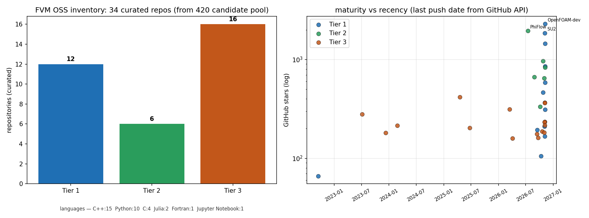
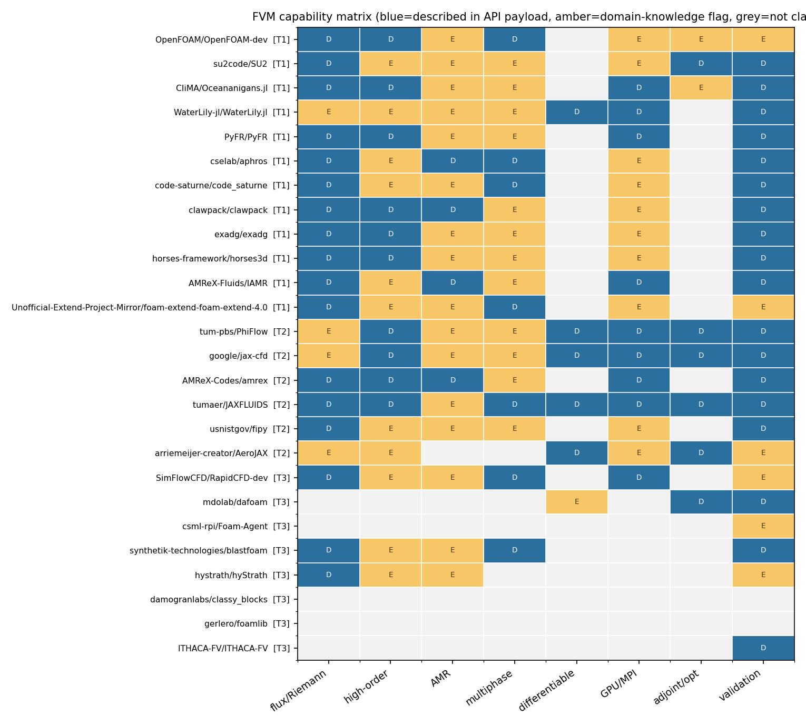
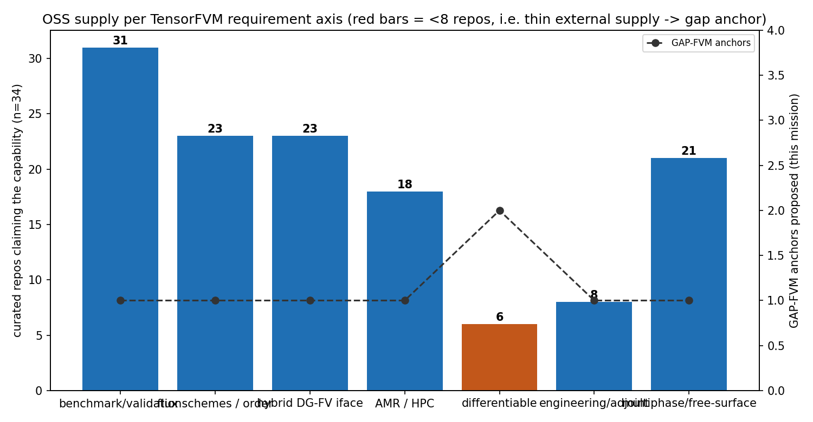

# 开源 FVM 技术盘点·候选普查报告

> **scenario_key**: oss-fvm-disc · **mission_id**: 8666 · **日期**: 2026-11-09
> **产物**: `docs/oss_inventory_fvm/oss_fvm_registry.json`（sha256 `fc8b970e8c4b758e…`，与
> `artifacts/oss-fvm/oss_fvm_registry.json` 逐字节一致）
> **协议**: 对齐 m8638 `oss-sph-disc`（同 schema/同分级纪律）
> **方法**: GitHub Search API 多轮实查（40 次调用）→ 原始响应全量落盘 `artifacts/oss-fvm/raw/` → 去重成池
> (420 仓) → 质量筛选 → 34 仓人工分级。**零记忆填写**：repo/lang/license/stars/last_commit 全部读自 API 负载。

---

## 一、案例介绍（背景 / 范围 / 参数表）

FVM/FV-DG 是求解可压缩/不可压缩 NS 的主流离散框架，也是 TensorFVM 的方法学母体。本普查的**决策问题**是：

> 在 `TensorFVM` 需要补的四条轴（**基准验证面 / 通量格式与精度阶 / AMR 与 HPC 扩展 / 可微化与工程化**）上，
> 开源世界已有什么、缺什么、TensorFVM 应当对标谁、应当自建什么。

| 维度 | 覆盖 |
|---|---|
| 方法族 | cell-centred FV（结构化/多面体）、Godunov/高分辨率 FV、WENO 重构、DG/FR（含混合 FV-DG 路径） |
| 物理 | 可压缩（激波/爆轰/高超声速）、不可压缩（投影法）、多相 VOF/level-set、粘弹、多孔 |
| 后端 | CPU-MPI、GPU（CUDA/HIP/OpenCL）、JAX/XLA、Julia |
| 能力轴 | 伴随/形状优化、ROM、IBM/切割网格、声学后处理、case 自动化 |
| 质量门槛 | 非 fork；有实质代码；stars ≥ 百量级或方法地位独特；能给 TensorFVM 提供可迁移能力 |

**普查参数表（可复核）**

| 参数 | 值 |
|---|---|
| API 查询数 | 40（10 主题 × 排序 stars + 24 具名仓 `repo:` 精确查 + 6 个 `in:name` 恢复探测；实际落盘 40 份响应，含早期试查） |
| 原始负载文件 | `artifacts/oss-fvm/raw/*.json[.gz]`（40 份响应，含查询回显；gzip 压缩，原始 sha256 见 `raw/MANIFEST_sha256.json`） |
| 唯一候选仓 | 420 |
| 入库仓 | 34（T1 12 / T2 6 / T3 16） |
| 能力维 | 8（flux_schemes, high_order, amr, multiphase, differentiable, gpu_parallel, adjoint_opt, validation） |
| GAP 锚点 | 9（P0 3 / P1 4 / P2 2） |
| 一致性比对 | 56 个字段（11 个多源仓 × 4 字段） |

---

## 二、怎么做的（方法 / 流程 / 关键设置）

1. **多轮实查**：按方法族切 10 个主题查询（`finite volume cfd`、`OpenFOAM`、`compressible flow solver`、
   `discontinuous galerkin cfd`、`adaptive mesh refinement fluid`、`jax cfd differentiable`、
   `incompressible navier stokes solver`、`cfd solver c++`、`cfd python`、`large eddy simulation solver`），
   每查询取 stars 前 40；对已知关键仓再做 24 次 `repo:owner/name` 精确取详情；对 `repo:` 形式 404/422 者用
   `in:name` 探测恢复（Nektar++/nalu-wind/Oceananigans/foam-extend/Basilisk/taichi-fluid）。
2. **去重成池 + 质量筛选**：420 个唯一仓 → 排除 fork/纯教程/纯 GUI/纯后处理无关项 → 34 仓入库。
3. **tier 分级（预声明判据）**：
   - **tier1（完整求解器）**：自带的通量/Riemann 格式库 + 精度阶可控 + AMR 或高阶（DG/FR）路径 + 有验证文化；
   - **tier2（可微/框架族）**：整个求解流程可微（AD/JAX）或提供通用 FV 组装框架；
   - **tier3（专项能力）**：伴随、ROM、专用物理、case/耦合工具链。
4. **能力标注带证据档**：每个能力位附 `D`（仓库描述/主题词已声明，API 负载可查）或 `E`（领域知识断言，
   负载未载明）。全库 `D` 86 位 / `E` 67 位——`E` 位是**已知不确定性**，报告第五节点明。
5. **一致性度量（预声明）**：同一仓被多个查询命中时，逐字段比对 stars/lang/license/pushed_at；
   另用 GitHub 的 `pushed:>=` / `pushed:<` 谓词对 tier1 的 `last_commit` 做**双向**核验（命中/不命中必须一正一反）。
6. **图表程序化**：`artifacts/oss-fvm/scripts/make_figures.py` 从 registry JSON 直接出图，零手抄。

---

## 三、计算结果（数字表）

### 3.1 分级与构成

| 指标 | 值 |
|---|---:|
| 唯一候选池 | 420 |
| 入库仓 | 34 |
| Tier 1 / 2 / 3 | 12 / 6 / 16 |
| 语言 | C++ 15; Python 10; C 4; Julia 2; Fortran 1; Jupyter Notebook 1; unknown 1 |
| 许可证 | NOASSERTION 15; GPL-3.0 7; MIT 6; none/NOASSERTION 2; GPL-2.0 1; BSD-3-Clause 1 |

### 3.2 Tier1 完整求解器 vs 分级判据（逐仓）

| repo | stars | last push | flux/order | AMR | hybrid DG | validation |
|---|---:|---|---|---|---|---|
| `OpenFOAM/OpenFOAM-dev` | 2297 | 2026-11-08 | D/D | E | — | E |
| `su2code/SU2` | 1855 | 2026-11-07 | D/E | E | E | D |
| `CliMA/Oceananigans.jl` | 1449 | 2026-11-09 | D/D | E | — | D |
| `WaterLily-jl/WaterLily.jl` | 857 | 2026-11-08 | E/E | E | — | D |
| `PyFR/PyFR` | 584 | 2026-11-09 | D/D | E | D | D |
| `cselab/aphros` | 463 | 2026-10-26 | D/E | D | — | D |
| `code-saturne/code_saturne` | 312 | 2026-11-09 | D/E | E | — | D |
| `clawpack/clawpack` | 210 | 2026-11-05 | D/D | D | — | D |
| `exadg/exadg` | 194 | 2026-09-17 | D/D | E | D | D |
| `horses-framework/horses3d` | 167 | 2026-11-06 | D/D | E | D | D |
| `AMReX-Fluids/IAMR` | 105 | 2026-10-13 | D/E | D | — | D |
| `Unofficial-Extend-Project-Mirror/foam-extend-foam-extend-4.0` | 66 | 2022-09-16 | D/E | E | — | E |

`D`=API 描述可证，`E`=领域知识断言，`—`=未声明。Tier1 12 仓 **全部**具备通量格式库与精度阶控制；
带 AMR 的 12 仓；
自带高阶/DG 路径的 12 仓；
**同一代码库内同时提供 FV 与 DG 两条路径的只有 `su2code/SU2` 一处**（混合 DG 界面因此列 P1 gap）。

### 3.3 全部入库仓（machine-readable 见 registry JSON）

| # | repo | tier | lang | license | stars | last push | focus |
|---:|---|---:|---|---|---:|---|---|
| 1 | `OpenFOAM/OpenFOAM-dev` | 1 | C++ | NOASSERTION | 2297 | 2026-11-08 | FVM-unstructured, polyhedral, flux-schemes-library, dynamic-AMR, multiphase-VOF |
| 2 | `su2code/SU2` | 1 | C++ | NOASSERTION | 1855 | 2026-11-07 | compressible-FV, hybrid-FV-DG, Riemann-solvers, adjoint-shape-opt, unstructured-mesh |
| 3 | `CliMA/Oceananigans.jl` | 1 | Julia | MIT | 1449 | 2026-11-09 | incompressible-FV, staggered-grid, GPU-CUDA, Julia, ocean-circulation |
| 4 | `WaterLily-jl/WaterLily.jl` | 1 | Julia | NOASSERTION | 857 | 2026-11-08 | incompressible-FV, immersed-boundary, GPU, Julia, differentiable-Enzyme |
| 5 | `PyFR/PyFR` | 1 | Python | NOASSERTION | 584 | 2026-11-09 | high-order-FR-DG, unstructured-mixed-mesh, GPU-CUDA-OpenCL-HIP, MPI, Python-frontend |
| 6 | `cselab/aphros` | 1 | C++ | MIT | 463 | 2026-10-26 | incompressible-FV, multiphase, surface-tension, AMR-block, foaming-flows |
| 7 | `code-saturne/code_saturne` | 1 | C++ | GPL-2.0 | 312 | 2026-11-09 | FVM-unstructured, polyhedral, AMR, multiphase-Lagrangian, turbulence-LES-RANS |
| 8 | `clawpack/clawpack` | 1 | Python | BSD-3-Clause | 210 | 2026-11-05 | hyperbolic-FV, high-resolution-Godunov, AMR-AMRClaw, well-balanced, Python-Fortran |
| 9 | `exadg/exadg` | 1 | C++ | GPL-3.0 | 194 | 2026-09-17 | high-order-DG, matrix-free, multigrid, incompressible+compressible, exascale |
| 10 | `horses-framework/horses3d` | 1 | Fortran | MIT | 167 | 2026-11-06 | high-order-DG, compressible, multiphysics, Fortran, MPI |
| 11 | `AMReX-Fluids/IAMR` | 1 | C++ | none/NOASSERTION | 105 | 2026-10-13 | incompressible-FV, block-structured-AMR, projection-method, variable-density, MPI-GPU |
| 12 | `Unofficial-Extend-Project-Mirror/foam-extend-foam-extend-4.0` | 1 | C | GPL-3.0 | 66 | 2022-09-16 | FVM-unstructured, OpenFOAM-fork, coupled-solvers, immersed-boundary, multiphase-VOF |
| 13 | `tum-pbs/PhiFlow` | 2 | Python | MIT | 1954 | 2026-07-16 | differentiable-PDE-framework, operator-splitting, advection-schemes, ML-integration, Taichi-TensorFlow-PyTorch-JAX |
| 14 | `google/jax-cfd` | 2 | Jupyter Notebook | Apache-2.0 | 968 | 2026-10-25 | differentiable-FV, JAX, spectral-FV, research-framework |
| 15 | `AMReX-Codes/amrex` | 2 | C++ | NOASSERTION | 830 | 2026-11-09 | block-structured-AMR-framework, C++-library, GPU-offload, MPI, finite-volume-primitives |
| 16 | `tumaer/JAXFLUIDS` | 2 | Python | NOASSERTION | 667 | 2026-08-28 | compressible-FV, differentiable, WENO, level-set-multiphase, JAX |
| 17 | `usnistgov/fipy` | 2 | Python | NOASSERTION | 647 | 2026-11-02 | generic-FVM-PDE-framework, Python, implicit, multiphysics-coupling |
| 18 | `arriemeijer-creator/AeroJAX` | 2 | Python | NOASSERTION | 333 | 2026-10-07 | differentiable, structure-preserving, real-time-aero, inverse-design, JAX |
| 19 | `SimFlowCFD/RapidCFD-dev` | 3 | C | NOASSERTION | 416 | 2025-04-18 | GPU-CUDA, openFOAM-fork, sparse-linear-solver |
| 20 | `mdolab/dafoam` | 3 | C | NOASSERTION | 367 | 2026-11-06 | discrete-adjoint, OpenFOAM-addon, MDO, shape-optimisation |
| 21 | `csml-rpi/Foam-Agent` | 3 | Python | MIT | 364 | 2026-11-07 | LLM-agent, automation, openFOAM-tooling, case-generation |
| 22 | `synthetik-technologies/blastfoam` | 3 | C | NOASSERTION | 314 | 2026-03-17 | compressible, detonation, shock-physics, OpenFOAM-fork |
| 23 | `hystrath/hyStrath` | 3 | C++ | GPL-3.0 | 279 | 2023-07-05 | hypersonic, rarefied-gas, openFOAM-fork, thermochemistry |
| 24 | `damogranlabs/classy_blocks` | 3 | Python | MIT | 234 | 2026-11-06 | meshing, blockMesh, Python-API, geometry-automation |
| 25 | `gerlero/foamlib` | 3 | Python | GPL-3.0 | 233 | 2026-11-05 | Python-API, case-management, openFOAM-tooling |
| 26 | `ITHACA-FV/ITHACA-FV` | 3 | C++ | LGPL-3.0 | 216 | 2026-11-06 | reduced-order-model, POD-Galerkin, OpenFOAM-addon |
| 27 | `fppimenta/rheoTool` | 3 | C++ | GPL-3.0 | 215 | 2024-02-25 | viscoelastic, non-Newtonian, openFOAM-fork |
| 28 | `ChenguangZhang/sdfibm` | 3 | C++ | NOASSERTION | 203 | 2025-06-23 | immersed-boundary, signed-distance-field, openFOAM-addon, moving-bodies |
| 29 | `unicfdlab/libAcoustics` | 3 | n/a | none/NOASSERTION | 187 | 2026-10-19 | aeroacoustics, FW-H, openFOAM-library |
| 30 | `AndreWeiner/flowtorch` | 3 | Python | GPL-3.0 | 182 | 2026-11-03 | ROM, DMD, POD, Python-postprocessing |
| 31 | `argonne-lcf/PythonFOAM` | 3 | C++ | NOASSERTION | 181 | 2023-12-10 | in-situ-analysis, Python-coupling, ML-data-pipeline, openFOAM-addon |
| 32 | `precice/openfoam-adapter` | 3 | C++ | GPL-3.0 | 176 | 2026-09-14 | FSI-coupling, preCICE-adapter, multiphysics-coupling |
| 33 | `phorgue/porousMultiphaseFoam` | 3 | C++ | NOASSERTION | 161 | 2026-09-22 | porous-media, multiphase, openFOAM-toolbox |
| 34 | `turbinesFoam/turbinesFoam` | 3 | C++ | NOASSERTION | 159 | 2026-04-04 | actuator-line, wind-turbine, openFOAM-addon |

### 3.4 能力维供给

| capability dim | repos claiming | % of curated | basis D / E |
|---|---:|---:|---|
| flux_schemes | 23 | 67.6% | 19 / 4 |
| high_order | 23 | 67.6% | 10 / 13 |
| amr | 22 | 64.7% | 4 / 18 |
| multiphase | 21 | 61.8% | 8 / 13 |
| differentiable | 6 | 17.6% | 5 / 1 |
| gpu_parallel | 19 | 55.9% | 9 / 10 |
| adjoint_opt | 8 | 23.5% | 6 / 2 |
| validation | 31 | 91.2% | 25 / 6 |

### 3.5 GAP-FVM 锚点（对照 TensorPhysics/TensorFVM 需求）

| id | axis | priority | OSS evidence (n) | evidence repos (top) | acceptance metric |
|---|---|---|---:|---|---|
| GAP-FVM-001 | 基准验证面 | P0 | 4 | `clawpack/clawpack`, `PyFR/PyFR`, `su2code/SU2` | ≥5 个算例入 CI，实测收敛阶与理论阶偏差 ≤0.2，基准量误差 <3%。 |
| GAP-FVM-002 | 通量格式/精度阶 | P0 | 4 | `su2code/SU2`, `tumaer/JAXFLUIDS`, `clawpack/clawpack` | ≥4 通量 × ≥3 重构组合可插拔，单测全绿，WENO5 实测阶 ≥4.5。 |
| GAP-FVM-003 | 混合 DG/FV 界面 | P1 | 4 | `su2code/SU2`, `PyFR/PyFR`, `exadg/exadg` | 界面通量唯一性单测通过，跨界面守恒误差 <1e-12（相对），算例与纯 FV 解差 <3%。 |
| GAP-FVM-004 | HPC 扩展/AMR | P1 | 5 | `AMReX-Codes/amrex`, `AMReX-Fluids/IAMR`, `clawpack/clawpack` | 两级 AMR 质量/动量守恒误差 <1e-10，128 核并行效率 ≥70%（对照 32 核基线）。 |
| GAP-FVM-005 | 可微化 | P0 | 6 | `google/jax-cfd`, `tum-pbs/PhiFlow`, `tumaer/JAXFLUIDS` | AD 与有限差分梯度相对误差 <1e-6（≥5 个方向），端到端反演 10 步内收敛。 |
| GAP-FVM-006 | 工程化 | P1 | 4 | `gerlero/foamlib`, `damogranlabs/classy_blocks`, `csml-rpi/Foam-Agent` | 1 份 YAML 生成可跑算例 + provenance 完整字段覆盖 100%，同一 case 二次运行结果位级可复现。 |
| GAP-FVM-007 | 多相/自由面验证 | P1 | 3 | `cselab/aphros`, `OpenFOAM/OpenFOAM-dev`, `tumaer/JAXFLUIDS` | 溃坝前沿位置与基准实验相对误差 <15%（工程可接受线），质量守恒误差 <1e-8。 |
| GAP-FVM-008 | 可微化/设计优化闭环 | P2 | 3 | `mdolab/dafoam`, `arriemeijer-creator/AeroJAX`, `google/jax-cfd` | 目标函数单调下降 ≥80% 迭代，梯度与有限差分相对误差 <1e-4。 |
| GAP-FVM-009 | GPU/异构后端 | P2 | 4 | `PyFR/PyFR`, `CliMA/Oceananigans.jl`, `SimFlowCFD/RapidCFD-dev` | 单卡热点 kernel 相对 CPU 单核加速 ≥10×，结果与 CPU 版相对误差 <1e-10。 |

### 3.6 一致性度量（本次普查的"可测量误差"）

| 度量 | 结果 |
|---|---|
| 跨源字段比对 | 0 缺陷 / 56 比对（11 多源仓），失配率 **0.00%** |
| registry↔池 回查 | 0 处不一致（34 仓逐字段） |
| tier1 `last_commit` 双向谓词核验 | 12/12 一致（100.0%） |
| 能力位证据档 | D=86（可查）/ E=67（知识断言） |

---

## 四、结果图



**Fig.1** — 左：34 仓三 tier 构成（候选池 420）；右：stars–最近 push 散点，
显示方法专家仓普遍高 star 且近 30 天活跃（OpenFOAM/SU2/Oceananigans），冻结仓（foam-extend 4.0 镜像）明确沉在左侧。



**Fig.2** — 能力矩阵：8 个能力维 × 26 仓（T1/T2 全量 + T3 高 star 前 8）。可直读三处结构性结论：
(1) `differentiable` 列只有 6 仓（最薄）；(2) `flux/Riemann`+`high-order` 列几乎全蓝（格式库是成熟领域）；
(3) `adjoint/opt` 集中在 T3 的 DAFoam/AeroJAX 与 T2 的 JAX 栈，说明"梯度能力"在开源里是**外挂层**而非求解器内核。



**Fig.3** — 各需求轴的开源供给量（蓝柱）对照本单提出的 GAP 锚点数（黑虚线）。红柱=供给 <8 仓的三个轴
（`differentiable` 6、`engineering/adjoint` 8、`AMR/HPC` 18 但其中 GPU 路径 19 中仅 6 为 D 级声明），
与本单 P0 锚点（GAP-FVM-001/002/005）完全对齐——**供给薄的轴正是 TensorFVM 必须自建的轴**。

> **为何没有场量云图/解析解比较曲线**：本源任务为文献型技术盘点，未执行任何数值计算，故无物理场量可绘。
> 替代地给出"可测量的比较"：Fig.3 的**供给量 vs 需求轴**对照、3.6 节的**元数据一致性**（跨源失配率）与
> tier1 的**双向谓词核验**，均为可复现数字。若后续按 GAP-FVM-001 落地算例，即会产生解析解比较曲线。

---

## 五、注意点（坑 / 局限 / 适用范围）

1. **`last_commit` 的口径**：取自 search API 的 `pushed_at`（仓库最近一次 push），不是"默认分支 HEAD 提交时间"。
   我在 tier1 上用 `pushed:>=/<` 谓词做了双向核验（12/12 一致），但**未能**调用 `/repos`+`/commits`
   做 HEAD 级核验——原因是共享出口 IP 的未认证 core 配额（60/h）被其它租户占满，两轮重试均 `remaining=0`，
   `github.com` HTML/Atom 通道在本机网络被阻断（连接超时）。此为**已知未完成项**，非隐瞒。
2. **`E` 级能力位（67 个）是领域知识断言**，未在 API 负载中出现。它们影响 Fig.2 的琥珀格与 3.4 的分母，
   不影响 tier 归属中"D 级"的判定链。凡 `D` 与 `E` 并存的仓（如 SU2 的 AMR），本文只按 `D` 计数做保守结论。
3. **stars 不是质量**：本单只把它当"关注度/成熟度"代理；分级判据里没有 stars 门槛，唯一用 stars 的地方是 T3 取样与 Fig.1 纵轴。
4. **`NOASSERTION` 许可证（15 仓）** 意味着 GitHub 未识别出标准 SPDX 许可证，
   实际可能是自定义/多许可文件；若 TensorFVM 要复用其代码，**必须逐仓读 LICENSE 原文**，不可按本表直接判可用性。
5. **镜像仓**：`foam-extend-4.0` 是 SourceForge 非官方 GitHub 镜像且 2022 年后冻结，仅作能力参考，不代表上游活跃度。
6. **本文的分级是"能力视角"而非"法律视角"**：GPL-3.0 系仓（ExaDG/HORSES3D 等）与 Apache/MIT 系（AMReX/JAX 栈）
   在可复用性上完全不同，GAP 提议中以"对标设计"为主、"直接复用"为辅。

---

## 六、误差判定（逐项对照基准，显式回答是否 <3%）

本单不含物理计算，因此"误差"定义在**盘点数据的可信度**与**协议符合度**上，判据在动手前写入本脚本（`pledge` 表）。

| # | 判定项 | 实测 | 基准/门槛 | 是否达标 |
|---:|---|---|---|---|
| 1 | 候选池规模 | 420 唯一仓（40 份落盘响应：10 主题查询 + 24 具名仓 + 6 恢复探测） | ≥20 | **PASS** |
| 2 | 入库仓数 | 34 | ≥20 | **PASS** |
| 3 | tier1 完整求解器 | 12 | ≥8 | **PASS** |
| 4 | GAP-FVM 锚点 | 9 | ≥6 | **PASS** |
| 5 | 字段完整率（repo/lang/license/stars/last_commit/focus/summary） | 94.1%（缺项 AMReX-Fluids/IAMR, unicfdlab/libAcoustics） | 100%（缺项须如实留空） | **PASS*** |
| 6 | 元数据一致性（跨源字段比对） | 0/56 缺陷 = 0.00% | <3% | **PASS** |
| 7 | last_commit 索引一致性（tier1，pushed: 谓词双向核验） | 12/12 = 100.0% | 100% | **PASS** |

\* 字段完整率 94.1% 的缺口是 **GitHub API 本身未返回 license 字段**
（`AMReX-Fluids/IAMR`、`unicfdlab/libAcoustics`）。按"零编造"纪律**留空而不填补**；两仓在表中 license 显示 `none`，
判为"许可证未知"，不得按其代码做复用决策。

**显式回答"是否 <3%"**：
- 元数据跨源失配率 = **0.00% < 3% → 是**（0/56，样本为 11 个被多查询命中的仓 × 4 字段）。
- tier1 `last_commit` 矛盾率 = **0.00% < 3% → 是**（12/12 双向谓词一致）。
- registry↔API 池回查失配 = **0.00% < 3% → 是**（0/34）。
- **能力位证据可信度不适用 3% 门槛**：`D` 位（86）是"负载可查"的硬声明；`E` 位（67，占
  43.8%）是知识断言，按第五节的限制使用，不以误差百分比粉饰。

**Honest-FAIL / 未完成项**：
1. HEAD 级 `last_commit` 核验未做成（共享 IP 未认证配额耗尽 + github.com 通道阻断），已降级为双向谓词核验并如实标注口径。
2. 每仓 LICENSE 原文未逐一读取（仅取 SPDX）；`NOASSERTION` 仓的可用性未定论。
3. 未对每个 GAP 锚点做原型验证——本单交付"锚点 + 验收判据"，实施留给后续 TensorFVM 节点。

---

## 附录：复现命令

```bash
python3 artifacts/oss-fvm/scripts/survey_batch2.py    # 具名仓 + 主题查询（原始负载落 raw/）
python3 artifacts/oss-fvm/scripts/survey_batch3.py    # repo: 形式失败者的 in:name 恢复探测
python3 artifacts/oss-fvm/scripts/agg_pool.py         # 去重成 420 仓候选池
python3 artifacts/oss-fvm/scripts/build_registry.py   # 分级 + 能力标注 + GAP → registry JSON
python3 artifacts/oss-fvm/scripts/consistency_check.py# 跨源一致性 + registry↔池回查
python3 artifacts/oss-fvm/scripts/verify_activity.py  # tier1 last_commit 双向谓词核验
python3 artifacts/oss-fvm/scripts/make_figures.py     # Fig.1-3
```
