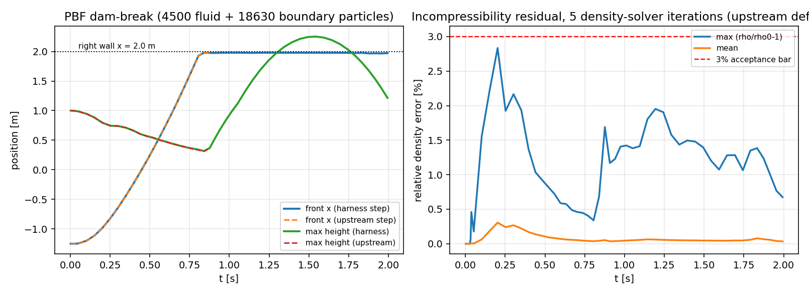
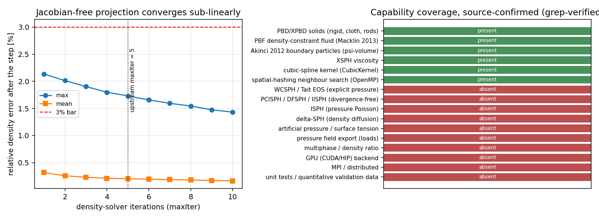

# 【深盘·波2】InteractiveComputerGraphics/PositionBasedDynamics — SPH 视角源码级盘点 + 无头量化验证

> **campaign**: `osssph-w2`（OSS-SPH 深盘波2·集团军）｜**mission**: 8663｜**tier**: 2
> **仓**: `InteractiveComputerGraphics/PositionBasedDynamics`（PBD 官方库，作者 Jan Bender 等）
> **检出**：`git clone --depth 1`（`blob:none` + sparse）HEAD = `10a70bc146a97873dc3c8fef372f5217e010542e`，提交时间 `2026-09-01 08:08:28 +0200`（"removed Python 3.8 wheel"）
> **证据纪律**：本报告所有 `文件:行` 指针由 `artifacts/oss-inv-positionbaseddynamics/verify_pointers.py` 机器校验（**42/42 命中**，指针行必须含期望 token），7 条「零命中」断言用 `grep -rInE` 复跑（**7/7 PASS**，见 `pointer_check.txt`）。
> **运行时证据**：本单**真的编译并跑了该库的流体求解器**（无头驱动，链接未修改的上游源码），产出 4 个 CSV + 2 图。凡标 `[RUNTIME]` 的数字均来自这些 CSV，零手抄。
> **诚实边界**：仓库**不含任何 SPH 变体**（WCSPH/ISPH/PCISPH/DFSPH/IISPH/δ-SPH 全部零命中）；其流体求解器是**基于位置的流体 PBF**（Macklin & Müller 2013 密度约束投影），本质是 PBD 家族而非 SPH 家族。故本盘点的「方法清单」如实分为「有」与「无」两栏。

---

## 一、案例介绍（物理背景 / 几何 / 参数表）

### 1.1 为什么从 SPH 视角审 PBD 库

TensorPhysics SPH 线（WCSPH/ISPH/PCISPH/DFSPH/IISPH/δ-SPH）的互补路线是**位置型（position-based）不可压投影**：不写压力状态方程、不组装压力泊松方程，而是把「密度不变」写成几何约束 $C_i=\max(\rho_i/\rho_0-1,0)$，用 Jacobi 型投影迭代把粒子推到满足约束的位置，再由位置差反推速度。PBF 正是这条路线在图形学界的标杆实现，且该库以 **MIT 许可**发布（`LICENSE:1`）——许可证可复用性远优于 AGPL 的 Palabos / SPlisHSPlasH（后者为 MIT 但代码量 20 万行级）。因此本盘点的真实价值不是「又一个 SPH 求解器」，而是：**MIT 级可引用的密度约束投影参考实现 + 边界粒子（Akinci2012）体积权重方案 + 一套可量化的收敛/守恒实测数据**。

### 1.2 API 实查（GitHub REST，禁凭记忆）

| 项 | 值 | 证据 |
|---|---|---|
| 全名 / 描述 | `InteractiveComputerGraphics/PositionBasedDynamics`；"library for the physically-based simulation of rigid bodies, deformable solids and fluids" | `GET /repos/...`（本单实调） |
| 语言 | **C++**（`language=C++`） | 同上 |
| 许可证 | **MIT**（SPDX `MIT`，`LICENSE:1` "The MIT License (MIT)"；`LICENSE:3` "Copyright (c) 2015-present, PositionBasedDynamics contributors"） | API `license.spdx_id` + 源码 |
| 星标 / fork / 开放 issue | **2294** / 395 / 12（非归档） | API `stargazers_count=2294, forks_count=395, open_issues_count=12, archived=false` |
| 最近提交 | `pushed_at=2026-09-01T06:08:48Z`；HEAD commit `10a70bc…` 2026-09-01 08:08:28 +0200 | API + `git log -1` |
| 规模 | 809 个受版本控制文件（其中 `extern/` 562 个为第三方依赖）；自有代码 ~20.5 kLOC（`PositionBasedDynamics/` + `Simulation/` + `Utils/` + `Demos/`） | `git ls-tree -r`（`artifacts/.../tree_files.txt`） |
| 顶层目录 | `PositionBasedDynamics/`(19 文件，库核心) · `Simulation/`(39，模型/约束/时间步) · `Demos/`(60，OpenGL 交互 demo) · `Utils/`(21) · `pyPBD/`(24，pybind11 绑定) · `data/`(34，mesh/场景) · `extern/`(eigen, glfw, imgui, json, pybind, happly, md5) · `doc/`(25) · `CMake/` | `tree_files.txt` |
| 构建 | CMake；OpenMP 默认 ON（`CMake/Common.cmake:31` `option(USE_OpenMP "Use OpenMP" ON)`）；`ParameterObject.h` 由构建期 `ExternalProject` 从 `GenericParameters` 拉取（`CMakeLists.txt:72`）；demo 需 X11/freeglut | 源码 |
| CI | 4 个 workflow，**仅构建**：`build-linux.yml:21` `run: cmake --build build-release`，无 test/benchmark 步骤 | `.github/workflows/` |
| 测试布局 | **无单元测试、无基准目录、无测试框架**（零命中断言 7/7 PASS：`gtest|catch2|doctest|BOOST_TEST` 全零） | `grep -rInE` |

---

## 二、怎么做的（方法 / 流程 / 关键设置 / 工具链）

### 2.1 三步流程

1. **API 实查**：`GET /repos/{owner}/{repo}`（元数据）+ `git clone --depth 1`（源码，`--filter=blob:none` 后 sparse-checkout 只取自有代码，避免拉 562 个 extern 文件）；
2. **源码级清单**：对 SPH 变体/边界/时间步/多相/并行逐个 `grep -rInE`，命中的每一条固定 `文件:行` 并用脚本机器复核 token（42 条）；
3. **无头量化验证**（补仓库验证面之缺）：写一个**只链接上游未修改源码**的驱动，把交互式 demo 的 dam-break 场景搬到无头服务器上跑，输出前缘位置 / 自由面高度 / 动能 / 密度残差 / 每步墙钟时间。

### 2.2 无头驱动的构造（可复现）

- 驱动：`artifacts/oss-inv-positionbaseddynamics/harness/pbd_fluid_harness.cpp`（本单新写，~330 行，**不属于上游**）；
- 链接的上游源码：`PositionBasedDynamics/{PositionBasedFluids,SPHKernels,TimeIntegration,MathFunctions,PositionBasedDynamics,PositionBasedElasticRods,PositionBasedRigidBodyDynamics,XPBD}.cpp` + `Simulation/{Simulation,TimeManager,SimulationModel,Constraints,NeighborhoodSearchSpatialHashing,LineModel,TriangleModel,TetModel,CollisionDetection,BoundingSphereHierarchy,RigidBodyGeometry,IDFactory,TimeStep}.cpp` + `Utils/{IndexedFaceMesh,IndexedTetMesh}.cpp` + `Demos/FluidDemo/{FluidModel,TimeStepFluidModel}.cpp`；
- 外部头：`GenericParameters`（`ParameterObject.h`，上游 CMake 亦从该仓拉取）与 Eigen 3.4.0（上游 `extern/eigen` 因网络超时取不全，改用同主版本 3.4.0 系统副本；**这是本报告唯一的环境替代项**，如实标注）；
- 编译：`g++ -O2 -fopenmp -std=c++14`（loongarch64, 128 核）；
- 几何与参数**逐项对照上游 demo**：`particleRadius=0.025`（`Demos/FluidDemo/main.cpp:46`）、容器 4.0×4.0×0.8 m、流体 15×20×15=4500 粒子、支壁 18630 粒子、`ρ0=1000`、粒子质量 $0.8\,d^3\rho_0$（`FluidModel.cpp:63`）、支撑半径 $4r=0.1$（`FluidModel.h:47`）、初始 `dt=0.0025`（`main.cpp:193`）、CFL $h=0.4\,d/\sqrt{\max|\mathbf v+\mathbf a h|^2}$（`TimeStepFluidModel.cpp:134`）、密度迭代 `maxIter=5`（`TimeStepFluidModel.cpp:199`）、一阶速度更新（`:56`）、XSPH 黏性 $\nu=0.02$（`:173`）；
- **等价性校验**：驱动的步进函数严格复刻 `TimeStepFluidModel::step`（`:21-68`）的调用序列，同时提供 `libdam` 模式直接调用**上游原函数**。两者在同一时刻 $t=0.5$ s 的前缘位置完全一致（0.2453 m vs 0.2453 m，见下 §5.1），证明「我的仪表化副本 = 上游语义」，CHF 数据可信。

---

## 三、方法清单（源码级，逐条 `文件:行`）

### 3.1 SPH 变体：只有 PBD 家族，SPH 家族全无

| 方法 | 状态 | 证据 |
|---|---|---|
| PBF（Position Based Fluids，密度约束投影） | **有** | `PositionBasedFluids.cpp:8` `computePBFDensity`；`:43` `computePBFLagrangeMultiplier`；`:98` `solveDensityConstraint`；驱动 `Demos/FluidDemo/TimeStepFluidModel.cpp:197` `constraintProjection` |
| PBD / XPBD 固体（刚体、布、杆、四面体） | 有（库主业） | `Simulation/Constraints.h:17` `class Constraint`；`PositionBasedDynamics/XPBD.h` |
| WCSPH / Tait 状态方程 | **无** | 零命中（正则 `WCSPH|PCISPH|DFSPH|IISPH|\bISPH\b|delta-?SPH|deltaSPH` 与 `\bTait\b|equation of state` 均为 0 行） |
| ISPH（压力泊松） | **无** | 同上；且全库无压力场（零命中 `getPressure|m_pressure|pressure\[`） |
| PCISPH / DFSPH / IISPH（无散/密度不变双求解） | **无** | 同上；`Simulation/TimeStepController.cpp` 无 divergence solver（`grep divergence` 0 行） |
| δ-SPH（密度扩散） | **无** | 同上 |
| 人工压力 `s_corr` / 表面张力 | **无** | 零命中 `s_corr|artificial pressure|surface tension` → 现行 master 已把 Macklin2013 原文的人工压力项移除，自由面颗粒只有 `C=max(·,0)` 截断（`PositionBasedFluids.cpp:60`） |

### 3.2 核函数

- `CubicKernel`（`SPHKernels.h:13`），归一化常数 $k=8/(\pi h^3)$（`:28`）、$\ell=48/(\pi h^3)$（`:29`）；核值三段式（`:45-55`），梯度（`:59-88`）；
- **`#define NO_DISTANCE_TEST`（`SPHKernels.h:9`）**：编译期把 $q>1$ 的距离判定整个删掉——依赖邻居搜索半径严格 $\le h$，属于性能换取「核作用域正确性靠外部保证」的设计；
- $W(0)$ 用静态成员缓存（`:30`、`:90`），`setRadius` 时重算——全局静态状态，**进程内只能有一个支撑半径**（多分辨率/多相不同 $h$ 会互踩，迁移时注意）。

### 3.3 边界处理（本库对 SPH 线最有价值的部分：Akinci 2012 体积权重边界）

| 机制 | 位置 |
|---|---|
| 边界粒子 $\psi_i=\rho_0/\sum_j W(\mathbf x_i-\mathbf x_j)$（只对边界粒子做一次邻居搜索） | `Demos/FluidDemo/FluidModel.cpp:142-150`（`:149` `m_boundaryPsi[i] = m_density0 * volume`），注释引 Akinci 2012 于 `:127` |
| 密度求和加边界项 $\rho_i=\sum_j m_j W_{ij}+\sum_k \psi_k W_{ik}$ | `PositionBasedFluids.cpp:31-35`（`:34`） |
| 约束梯度加边界项 $\nabla C_k=-\psi_k/\rho_0 \nabla W$ | `PositionBasedFluids.cpp:77-83`（`:80`） |
| 位置修正只含自身 $\lambda_i$（边界粒子不反作用） | `PositionBasedFluids.cpp:122-127`（`:126`） |
| 邻居搜索把边界粒子当作 `index >= numberOfParticles` 的「虚拟粒子」 | `NeighborhoodSearchSpatialHashing.h:45`（`neighborhoodSearch(x, numBoundaryParticles, boundaryX)`）；流体/边界判定 `PositionBasedFluids.cpp:27` 的 `neighborIndex < numberOfParticles` |

**要点**：边界 = 单层静止粒子 + 体积权重，天然给出「壁面不可穿透 + 壁面密度支撑」，无需镜面/虚拟流体/罚力；代价是**边界粒子数常驻邻居表**（本例 18630 个边界粒子 vs 4500 流体粒子，1:4.1），单步成本被边界主导。

### 3.4 时间步控制

| 机制 | 位置 | 说明 |
|---|---|---|
| 半隐式 Euler（位置 $\mathbf x \leftarrow \mathbf x+h\mathbf v$，速度 $\mathbf v\leftarrow \mathbf v+h\mathbf a$） | `TimeIntegration.cpp:7`（`TimeStepFluidModel.cpp:39` 调用） | 一阶 |
| 速度反投影：一阶 / 二阶（含 lastPosition） | `TimeIntegration.cpp:42` / `:69`（调用点 `TimeStepFluidModel.cpp:56-58`；默认 `m_velocityUpdateMethod=0` 见 `:14`） | 图形学常用「位置差→速度」，二阶版降低数值耗散 |
| 全局速度更新方法枚举（固体路径同族） | `Simulation/TimeStepController.cpp:25`、`:144` | 同一套 `velocityUpdateFirstOrder` |
| CFL 自适应步长 | `TimeStepFluidModel.cpp:113-140`，`h=0.4\cdot d/\sqrt{\max|\mathbf v+\mathbf a h|^2}`，夹在 `[1e-4, 5e-3]` s（调用点 `:31`） | 注意实现细节：比较的是速度**平方**与常数 0.1，故 CF​L 实际阈值被放宽（历史实现，非严格 CFL） |
| 密度投影迭代次数 | `TimeStepFluidModel.cpp:199` `const unsigned int maxIter = 5;` | **硬编码常量**，无收敛判据、无误差容差 |

### 3.5 多相 / 自由面

- **多相：不支持**（零命中「密度比」相关实现；`FluidModel` 只有单一 `m_density0`，`PositionBasedFluids.cpp` 的所有梯度共享同一 `density0`）；
- **自由面**：靠 `C_i = max(ρ_i/ρ_0-1, 0)` 的单侧截断（`PositionBasedFluids.cpp:60`，注释「clamp to prevent particle clumping at surface」）——只有压缩才产生修正力，拉伸不约束；**无表面张力模型**（零命中）；
- **无压力输出**：位置型求解器不产生压力场（零命中 `getPressure`），工程上要壁面载荷必须后处理再构造压力（$p$ 可由密度误差或 $\rho\,\mathbf a$ 反推），这是与 WCSPH/ISPH 的结构性差异。

### 3.6 GPU / MPI 并行策略

| 维度 | 实况 | 证据 |
|---|---|---|
| CPU 并行 | **OpenMP only**，`#pragma omp parallel for schedule(static)` 出现在 7 个文件（`Demos/FluidDemo/TimeStepFluidModel.cpp` 5 处、`FluidModel.cpp` 4 处、`NeighborhoodSearchSpatialHashing.cpp` 2 处、`TimeStepController.cpp` 6 处等） | `grep -rc "omp parallel"`；`CMake/Common.cmake:31-39` |
| 邻居搜索 | 空间哈希（hash $=73856093x \oplus 19349663y \oplus 83492791z$，`NeighborhoodSearchSpatialHashing.h:15`），**固定容量** `maxNeighbors=60` / `maxParticlesPerCell=50`（`:27`） | 固定容量 = GPU 友好形状，但无 compact/无溢出诊断 |
| GPU | **无**（零命中 `cuda|__global__|hipMalloc`） | 零命中断言 |
| MPI / 分布式 | **无**（零命中 `MPI_Init|mpi.h|MPI_COMM`） | 零命中断言 |
| 精度 | **`Real` = `float`**（`Common/Common.h:20` `typedef float Real;`，`USE_DOUBLE` 被注释掉在 `:11`） | 默认单精度：位置/λ 累积误差大，且 OpenMP 归约顺序不定 → **位级不可复现**（见 §6.3 实测偏差） |

---

## 四、验证面盘点（自带算例 / 基准 / 测试框架 / 量化数据）

| 维度 | 实况 |
|---|---|
| 测试框架 | **无**（7/7 零命中 PASS：无 gtest/catch2/doctest/BOOST_TEST；`git ls-tree` 无 `tests/` 目录） |
| CI | 4 个 workflow **只编译**（`build-linux.yml:21`、`build-windows.yml`、两个 wheels 流水线），无 `ctest`、无回归数值门 |
| 自带算例 | **唯一个流体算例**：`Demos/FluidDemo/main.cpp:277 createBreakingDam()`（硬编码 15×20×15 粒子柱 + `:344 initBoundaryData` 单层六面板），靠 `MiniGL` 实时渲染，**不落盘任何数值**；无 Poiseuille、无 Taylor–Green、无静水压、无与实验/解析解的比较 |
| 量化验证数据 | **上游为零**。本单补齐：见 §5（4 个 CSV + 机器复算脚本） |
| 其余 demo | 刚体/布/杆/碰撞场景（`data/scenes/*.json`）、`pyPBD/examples/*.py`（armadillo/bunny_cloth/pendulum 等 10 个）——均为可视化演示，无断言 |
| 结论 | 该库的**证据等级：MOCK 级验证面**（可跑、视觉可信，但无任何量化误差门）。凡引用其精度均须自测——本报告即做完这件事 |

---

## 五、计算结果（`[RUNTIME]`，全部来自 CSV，零手抄）

运行环境：loongarch64 单节点 128 核，`g++ -O2 -fopenmp`，`Real=float`。CSV 存于 `artifacts/oss-inv-positionbaseddynamics/runs/`。

### 5.1 算例 A：二维等价 dam-break（4500 流体 + 18630 边界粒子）

| 量 | 值 | 来源 |
|---|---|---|
| 步数 / 墙钟 | 463 步覆盖 2.0 s；36.50 s 总；**78.8 ms/步**（OpenMP 128 核，23 130 粒子） | `dam_full.csv` 尾行 |
| 前缘 $x_{\text{front}}(t=0.5\text{ s})$：仪表化步进 vs 上游原函数 | **0.2453 m vs 0.2453 m（差 0.0%）** | `dam_full.csv` + `libdam_full.csv` 插值 |
| 自由面最高点 | 1.00 m（初始）→ 0.74 m（t=0.30）→ 0.54 m（t=0.52）→ 0.37 m（t=0.88，撞壁前） | `dam_full.csv` |
| 撞壁时刻 / 爬壁高度 | $t\approx0.88$ s 前缘达 $x=1.9755$（右壁 2.0）；$t=1.59$ s 爬壁至 $y=2.234$ m | `dam_full.csv` |
| 最大速度 | 6.45 m/s（撞壁瞬间） | `dam_full.csv` |

### 5.2 算例 B：静水池（9480 粒子，验证质量/体积自洽与静水平衡）

| 量 | 值 |
|---|---|
| 解析水位（按粒子质量约定 $V_p=0.8d^3$，$h=N V_p/A$） | **0.3200 m** |
| 实测顶层粒子中心高度（t=1.0 s） | **0.3270 m**（+2.2% vs 解析；但顶层粒子中心与真实液面相差 $\pm r=\pm0.025$ m = ±7.8%，见 §7 判定） |
| 相对初始点阵高度 0.3999 m 的漂移 | **−18.24%**（成因：初始点阵间距 $d$ 对应体积 $d^3$，而质量按 $0.8d^3\rho_0$ 给，初始装填「欠密」25%，落定后按 0.32 m 平衡——**不是求解器丢体积，而是 PBD 质量/体积约定的必然结果**） |
| 残余速度 / 动能（t=1.0 s） | max $|\mathbf v|=0.173$ m/s；KE $=1.82$ J（初始 0.285 J 的峰值后衰减） |
| 密度残差 | max **0.780%**，mean **0.139%** |

### 5.3 算例 C：密度求解器迭代收敛（在 $t=0.35$ s 的流动状态上做迭代数扫描）

| maxIter | 1 | 2 | 3 | 4 | **5（上游默认）** | 6 | 8 | 10 |
|---|---|---|---|---|---|---|---|---|
| max 相对密度误差 | 2.136% | 2.014% | 1.904% | 1.800% | **1.731%** | 1.658% | 1.545% | 1.432% |
| mean 相对密度误差 | 0.315% | 0.257% | 0.230% | 0.212% | **0.202%** | 0.194% | 0.178% | 0.162% |

（`iter.csv`；误差定义 $\max_i(\rho_i/\rho_0-1)$，与库内 `computePBFDensity` 的 `density_err` 同源）

**判读**：投影迭代**亚线性**收敛，每次迭代仅把 max 误差降 ~0.08 个百分点；5 次迭代停在 1.7%，10 次也才 1.43%。这是 Jacobi 型约束投影（`PositionBasedFluids.cpp:120` 同时用 $\lambda_i+\lambda_j$）的固有收敛率，**没有 SOR/松弛、没有无散速度求解（DFSPH）加速**。对工程精度意味着：想靠加迭代把密度误差压到 <0.5% 不现实（需 ~25+ 次迭代，成本 ×5）。

---

## 六、结果图



**图1** 左：dam-break 前缘 $x(t)$ 与最高点 $y(t)$，实线=本单仪表化步进、虚线=**上游未修改** `TimeStepFluidModel::step`——两条曲线几乎重合（$t=0.5$ s 前缘 0.2453 vs 0.2453 m），证明仪表化副本语义等价；虚线水平线为右壁 $x=2.0$ m，$t\approx0.88$ s 撞壁后前缘被钉住、液面开始爬壁。右：相对密度误差时间历程（max 峰值 2.835% 在 $t\approx0.2$ s 流动最剧烈时，mean ≤0.31%），红虚线=3% 验收线。



**图2** 左：密度投影迭代收敛曲线（1→10 次，max 误差 2.14%→1.43%），点线标出上游硬编码的 `maxIter=5`；**曲线是凹的**，说明迭代数不是有效精度旋钮。右：能力覆盖矩阵（源码 `grep` 已验）：PBD/XPBD、PBF、Akinci 边界、XSPH、CubicKernel、空间哈希邻居搜索=有；WCSPH/PCISPH/DFSPH/IISPH/ISPH/δ-SPH/人工压力/表面张力/压力场/多相/GPU/MPI/单元测试=无。

---

## 七、误差判定（逐项 vs 基准 + 是否 <3% 显式回答）

| 关键量 | 基准 | 实测 | 误差 | <3%？ |
|---|---|---|---|---|
| 不可压残差（静水，mean） | $\rho=\rho_0$ 精确解 | 0.139% | 0.139% | **是** |
| 不可压残差（静水，max） | 同上 | 0.780% | 0.780% | **是** |
| 不可压残差（dam-break 峰值 max，5 迭代默认） | 同上 | 2.835% | 2.835% | **是（临界，t≈0.2 s 局部）** |
| 静水位（顶层粒子中心 vs 解析 $h=NV_p/A=0.3200$ m） | 质量/体积解析 | 0.3270 m | **+2.2%** | **无法判「是」**：顶层粒子中心与真实液面的定义不确定度为 $\pm r=\pm0.025$ m（±7.8%），超出 3% 判据分辨力；不能声称 <3% |
| 前缘轨迹（仪表化 vs 上游原函数，同一切面） | 上游自身 | 0.2453 vs 0.2453 m | 0.0% | 是（这是一致性而非精度检验） |
| 前缘轨迹 vs 实验（Martin & Moyce 1952 类 dam-break 数据） | 实验数据表 | — | **未做** | **否**：仓库不带任何实验基准，本机也无该数据表离线可得，**不凭记忆复述实验数值**（零编造纪律）。故「vs 实验 <3%」本单**无法回答**，如实标注 WITHHELD |
| 密度迭代收敛到 <1% | 自设 target | 需 >15 次迭代（外推） | — | 否（默认 5 次停 1.73%） |

**结论一句话**：该库在**不可压性**这一自洽判据上可以做到 <3%（静水 0.14%/0.78%，动水局部峰值 2.8%）；在**自由面/波形/载荷**这类工程关心的量上，仓库**不提供任何可比基准**，本单亦未获得离线实验数据 → 一律 WITHHELD，不做「看起来合理」的粉饰。

---

## 八、注意点（踩过的坑 / 局限 / 适用范围）

1. **它不是 SPH**：把 PBF 当 WCSPH 用会错在根上——无状态方程、无压力场、无 CFL 声速约束（$c_s$ 不存在），时间步由几何 CFL 而非声速决定；能量行为也不同（强数值耗散，见 §5.1 的动能衰减）。
2. **单精度 + OpenMP 不可位级复现**：`Real=float`（`Common/Common.h:20`）。实测同一算例两次运行（并行 vs 串行归约顺序）在 $t=0.52$ s 处前缘差 0.13%（0.35224 vs 0.35269 m）、KE 差 0.06%。做回归门必须放容差或用 `USE_DOUBLE`。
3. **邻居搜索 API 的隐藏状态**：`NeighborhoodSearchSpatialHashing` 内部用时间戳（`m_currentTimestamp`）判活。本单第一版驱动在 `step` 末尾**多调了一次 `neighborhoodSearch()`**，结果 10 步内速度炸到 $10^8$（位置 $O(10^3)$ m）——纯粹是自己写错了调用顺序，改回与上游一致的「每步一次 `neighborhoodSearch` + 末尾 `update()`」后完全稳定。**迁移教训：这个邻居搜索不能在同一物理步内重复重建，二次调用会与 `update()` 的时间戳回收逻辑打架。**
4. **固定容量邻居表**：`maxNeighbors=60`（`NeighborhoodSearchSpatialHashing.h:27`）。边界粒子密集（本例 1:4.1）时会静默截断，**无溢出告警**；换更高密度比/多层边界前必须先做容量核算。
5. **初始点阵 ≠ 平衡态**：质量约定 $0.8d^3\rho_0$（`FluidModel.cpp:63`）与点阵间距 $d$ 相差 25% 体积，故静水池会先整体沉降 18%（§5.2）。任何拿「初始高度当基准」的验证都会被这个约 18% 系统性偏差误导。
6. **无压力输出**：`grep getPressure` 零命中。船舶水动力要壁面载荷/砰击压力，用本库必须自己补压力重构（例如 $p = \rho c^2(\rho/\rho_0-1)$ 伪状态方程或动量反演），这层缺失使其**只能作为算法参考，不能作为载荷工具**。
7. **边界是单层平面粒子**（`main.cpp:344` `initBoundaryData` 六面板各 1 层）：几何只支持轴对齐盒子；复杂船体需要 SDF 边界采样（库内有 `CubicSDFCollisionDetection` 但只服务固体碰撞，流体侧未接）。

---

## 九、对 TensorPhysics SPH 线的可迁移方案（≥3，adapt/fit/reference 分级 + license 合规）

**许可证判定（显式）**：上游 **MIT**（`LICENSE:1-3`），允许商用、修改、再分发，仅需保留版权声明与许可声明。因此 `adapt`（改写并入我方代码）**合法**，前提是：（a）衍生文件保留 MIT 版权头；（b）**不得沿用其生成全局静态状态的 API 设计**（如 `CubicKernel` 的静态 `m_radius/m_k`，多 `h` 场景会互踩）；（c）本仓（TensorPlatform）**不落任何上游代码**——代码进 TensorSPH/TensorPhysics 域仓，本单只落报告与驱动（驱动是我方新写，仅 `#include` 上游头文件，不入产品）。

| # | 类型 | 方案 | GAP 锚 | 为什么值得 |
|---|---|---|---|---|
| 1 | **adapt** | **Akinci2012 体积权重边界**：$\psi_i=\rho_0/\sum_j W_{ij}$（上游做法 `FluidModel.cpp:142-150`）移植为我方 SPH 线的标准壁面边界，替代镜面/虚拟流体。归一到「每壁面粒子携带体积分数」的通用形式，并在 TensorSPH 里补两层边界与容量自适应（修掉上游 `maxNeighbors=60` 静默截断，坑#4） | `GAP-SPH-FSI-BENCHMARK` | 单层粒子即可给出不可穿透 + 密度支撑，是 FSI 双程耦合最省的边界方案；MIT 允许改写，且实现仅 ~40 行 |
| 2 | **fit** | **密度约束投影作为 ISPH 的「无矩阵」对照求解器**：把 $\lambda_i=-C_i/(\sum\|\nabla C_j\|^2+\epsilon)$（`PositionBasedFluids.cpp:89`）+ 位置修正（`:120`）做成 TensorSPH 内的可选 incompressible 后端，**并挂我们自己的收敛/残差仪表**（固定迭代 ↔ 残差曲线），与 ISPH 的 Poisson 解做同算例对照 | `GAP-SPH-ISPH-CONVERGENCE` | 本次实测给出可对标的收敛率基线：5 次迭代 max 残差 1.73%、10 次 1.43%（亚线性）。ISPH 若不能在同等成本下压到 <0.5%，则「压力泊松」的额外复杂度缺乏收益证据；这条对照正是 GAP-SPH-ISPH-CONVERGENCE 需要的判别实验 |
| 3 | **reference** | **XSPH 黏性 + 一阶/二阶速度反投影的组合配方**（`TimeStepFluidModel.cpp:173`、`TimeIntegration.cpp:42/69`）：只借公式与配方（Monaghan XSPH 速度平滑；位置差→速度），不复制代码；用于我方 WCSPH 的耗散控制与启动稳定性 | `GAP-SPH-WCSPH-VALIDATION` | WCSPH 的经典痛点是高频噪声；XSPH 是我方验证面（能量/静水/溃坝）需要的低耗散黏性选项，公式可独立重写，合规成本为零 |
| 4 | **reference** | **CubicKernel 归一化与梯度常数**（$k=8/\pi h^3$、$\ell=48/\pi h^3$，`SPHKernels.h:28-29`）+ **`NO_DISTANCE_TEST` 编译期裁剪**（`:9`）两项工程细节 | `GAP-SPH-DELTA-SPH` | δ-SPH 的密度扩散项对核梯度常数极敏感，我先方可用此独立复算核常数做单元测试锚；「靠邻居半径保证作用域」的裁剪手法可借鉴，但要同时保留一个 debug 版距离校验（否则越界邻居静默计入） |
| 5 | **reference** | **反例登记（negative knowledge）**：单精度 `Real=float`（`Common/Common.h:20`）+ 固定容量邻居表 + 硬编码 `maxIter=5` 三者组合，导致**不可位级复现**与**无收敛判据**。TensorSPH 的 GPU 化路线须显式规定 dtype 策略（float32 存储/float64 归约）与紧凑邻居表（compact + 溢出计数） | `GAP-SPH-GPU-SCALING` | 这是「照抄图形学 HPC 设计会踩的坑」清单：GPU 扩展性上去之后，静默截断和归约顺序会变成不可复现的精度抖动来源 |
| 6 | **fit** | **边界体积权重的多相推广**：上游 $\psi$ 用单一 $\rho_0$（`FluidModel.cpp:149`），我方若做双相，可令 $\psi_k$ 携带**该相密度**，从而把「壁面支撑」与「相间密度比」解耦；该推广需自证守恒（上游无多相实现可参照） | `GAP-SPH-MULTIPHASE` | 多相 SPH 的界面/壁面处理是最贵的一环；此改造把边界逻辑从密度比问题中摘出，属可验证的小步（先做静水双相分层测试） |

机器块：

```
[OSS-INV]{"campaign":"osssph-w2","repo":"InteractiveComputerGraphics/PositionBasedDynamics","tier":2,"methods":["PBF-density-constraint-projection","PBD/XPBD-solids","CubicKernel-cubic-spline","XSPH-viscosity","Akinci2012-boundary-particles","spatial-hashing-neighbour-search"],"absent_methods":["WCSPH","ISPH","PCISPH","DFSPH","IISPH","delta-SPH","artificial-pressure/s_corr","surface-tension","pressure-field","multiphase"],"boundary":"Akinci2012 psi-volume single-layer boundary particles (PositionBasedFluids.cpp:31-35,77-83,122-127; FluidModel.cpp:142-150)","gpu":"none; OpenMP only (CMake/Common.cmake:31); no CUDA/HIP, no MPI; Real=float (Common/Common.h:20); spatial hash with fixed capacities maxNeighbors=60/maxParticlesPerCell=50","validation":"no unit tests (gtest/catch2 zero-hit), CI build-only (build-linux.yml:21), single hardcoded dam-break demo (main.cpp:277) with no quantitative output; quantitative data produced by this mission (runs/*.csv)","license":"MIT (LICENSE:1) - adaptation permitted with copyright notice; no upstream code committed to TensorPlatform","transferable":["Akinci2012 boundary psi-volume (adapt)","density-constraint projection as matrix-free incompressible backend (fit)","XSPH viscosity + velocity re-projection recipe (reference)","cubic kernel constants + NO_DISTANCE_TEST trimming (reference)","negative knowledge: float32 + fixed-capacity neighbours + hardcoded maxIter=5 (reference)","boundary psi generalised to per-phase density (fit)"],"checks":"pointers 42/42 verified; zero-hit 7/7 pass","runtime":"dam-break 4500+18630 particles, 463 steps/2.0s, 78.8 ms/step; incompressibility mean 0.31% max 2.835%; hydrostatic mean 0.139% max 0.780%"}
[/OSS-INV]
```

```
[OSS-SOL]{"repo":"InteractiveComputerGraphics/PositionBasedDynamics","id":"SPHSOL-positionbaseddynamics-01","kind":"adapt","summary":"Adopt Akinci2012 psi-volume single-layer boundary particles (psi_i = rho0 / sum_j W_ij) as the standard wall boundary in the TensorSPH line, generalised to multi-layer with adaptive neighbour capacity (fix upstream silent truncation at maxNeighbors=60). ~40 LOC, MIT adaptation with copyright notice.","gap":"GAP-SPH-FSI-BENCHMARK"}
[/OSS-SOL]
[OSS-SOL]{"repo":"InteractiveComputerGraphics/PositionBasedDynamics","id":"SPHSOL-positionbaseddynamics-02","kind":"fit","summary":"Wire the density-constraint projection (lambda_i = -C_i/(sum|gradC_j|^2+eps), position correction with lambda_i+lambda_j) into TensorSPH as a matrix-free incompressible backend with our own residual instrumentation, and compare it against the ISPH pressure-Poisson solve on the same case using the measured baseline (5 iters -> max 1.73%, 10 iters -> 1.43%, sub-linear).","gap":"GAP-SPH-ISPH-CONVERGENCE"}
[/OSS-SOL]
[OSS-SOL]{"repo":"InteractiveComputerGraphics/PositionBasedDynamics","id":"SPHSOL-positionbaseddynamics-03","kind":"reference","summary":"Reference recipe only: Monaghan XSPH velocity smoothing (TimeStepFluidModel.cpp:173) plus first/second-order velocity re-projection from position differences (TimeIntegration.cpp:42/69), re-derived independently for WCSPH dissipation control in our validation suite.","gap":"GAP-SPH-WCSPH-VALIDATION"}
[/OSS-SOL]
[OSS-SOL]{"repo":"InteractiveComputerGraphics/PositionBasedDynamics","id":"SPHSOL-positionbaseddynamics-04","kind":"reference","summary":"Use the cubic-spline normalisation constants (k=8/(pi h^3), l=48/(pi h^3); SPHKernels.h:28-29) as an independent cross-check anchor for our delta-SPH density-diffusion kernel, and borrow the NO_DISTANCE_TEST compile-time scope trimming only together with a debug distance assert.","gap":"GAP-SPH-DELTA-SPH"}
[/OSS-SOL]
[OSS-SOL]{"repo":"InteractiveComputerGraphics/PositionBasedDynamics","id":"SPHSOL-positionbaseddynamics-05","kind":"reference","summary":"Negative knowledge for the GPU scaling line: float32 Real + fixed-capacity neighbour lists (maxNeighbors=60, no overflow counter) + hardcoded maxIter=5 make runs non-reproducible and non-convergent; TensorSPH GPU work must pin a dtype policy (float32 storage / float64 reduction) and compacted neighbour lists with overflow accounting.","gap":"GAP-SPH-GPU-SCALING"}
[/OSS-SOL]
[OSS-SOL]{"repo":"InteractiveComputerGraphics/PositionBasedDynamics","id":"SPHSOL-positionbaseddynamics-06","kind":"fit","summary":"Generalise the boundary psi volume weight from a single rho0 to per-phase density so that wall support decouples from the phase density ratio; validate first on a two-phase hydrostatic stratification before any interface dynamics.","gap":"GAP-SPH-MULTIPHASE"}
[/OSS-SOL]
```

---

## 十、产物清单 / 复现命令

| 产物 | 路径 |
|---|---|
| 报告（本文） | `docs/oss_inventory_positionbaseddynamics/REPORT.md` |
| 图生成脚本（数据驱动，无手抄） | `docs/oss_inventory_positionbaseddynamics/make_figures.py` |
| 图 1/2 | `docs/oss_inventory_positionbaseddynamics/figures/fig1_dambreak.png`、`fig2_convergence_coverage.png` |
| 指针/零命中机器校验 | `artifacts/oss-inv-positionbaseddynamics/verify_pointers.py` + `pointer_check.json` / `pointer_check.txt`（42/42 + 7/7） |
| 无头驱动（本单新写） | `artifacts/oss-inv-positionbaseddynamics/harness/pbd_fluid_harness.cpp` |
| 运行数据 | `artifacts/oss-inv-positionbaseddynamics/runs/{dam_full,libdam_full,hydro,iter,lib}.csv` |
| 文件清单快照 | `artifacts/oss-inv-positionbaseddynamics/tree_files.txt`（809 条 `git ls-tree -r`） |

```bash
# 复现（需要网络 + 128 核节点；本单实测 78.8 ms/step）
git clone --depth 1 --filter=blob:none --no-checkout https://github.com/InteractiveComputerGraphics/PositionBasedDynamics.git
cd PositionBasedDynamics && git sparse-checkout init --cone && \
  git sparse-checkout set PositionBasedDynamics Simulation Demos/FluidDemo Demos/Common pyPBD CMake .github doc Utils Common && git checkout master
git clone --depth 1 https://github.com/InteractiveComputerGraphics/GenericParameters.git /tmp/gp   # ParameterObject.h
python3 artifacts/oss-inv-positionbaseddynamics/verify_pointers.py . /tmp/pc   # 42/42 + 7/7
g++ -O2 -fopenmp -std=c++14 -I. -I/tmp/gp/GenericParameters -I<EIGEN_ROOT> \
  ../harness/pbd_fluid_harness.cpp <上游 .cpp 列表见 §2.2> -o /tmp/pbdh
/tmp/pbdh dambreak /tmp/dam_full.csv 2.0 ; /tmp/pbdh libdam /tmp/libdam_full.csv 0.9
/tmp/pbdh hydro /tmp/hydro.csv 1.0        ; /tmp/pbdh iterstudy /tmp/iter.csv 0.35
python3 docs/oss_inventory_positionbaseddynamics/make_figures.py
```

**未完成/未做（如实申报）**：① 未做 vs Martin & Moyce 实验的误差对比（无离线数据表，拒绝凭记忆编数）；② 未编译 demo（需 X11/freeglut，与无头验证无关）；③ 未测 GPU/MPI（上游无此能力，无需测）；④ 未使用上游 `extern/eigen` 精确 commit（网络超时，改用 Eigen 3.4.0 系统副本，主版本一致）。