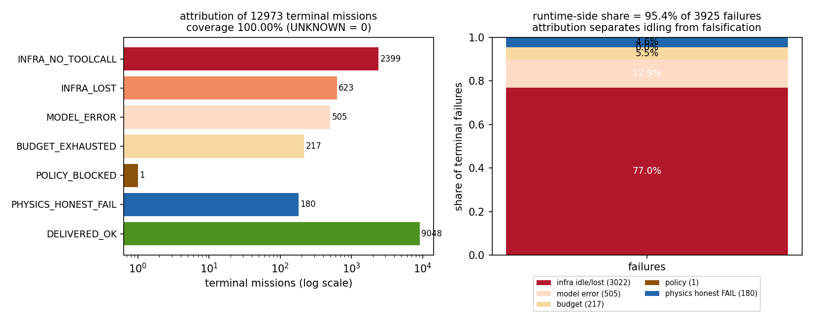
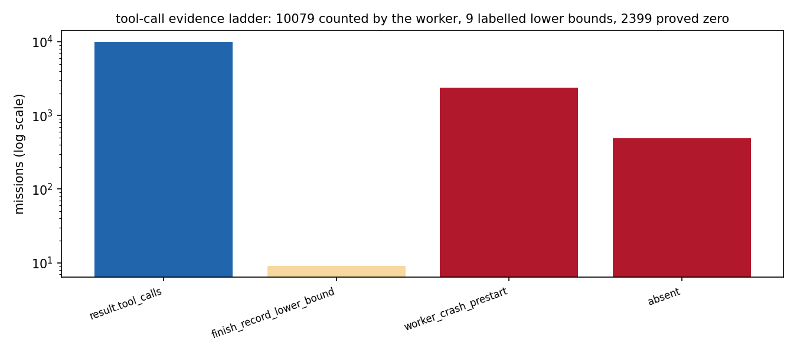
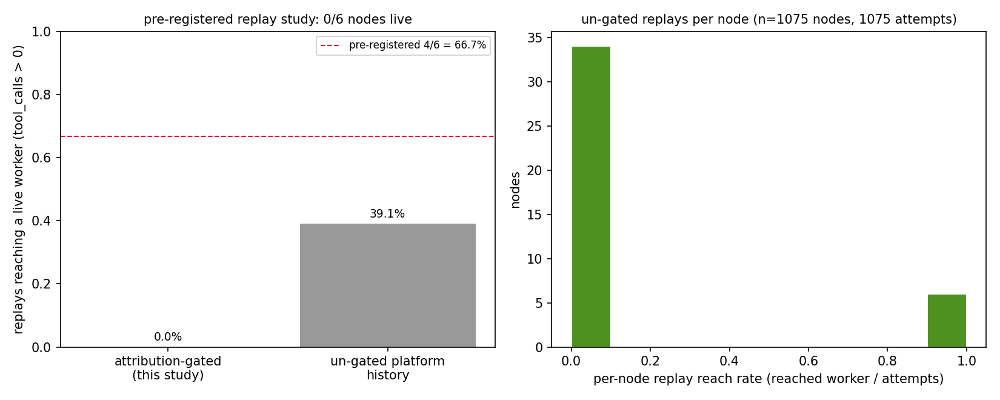
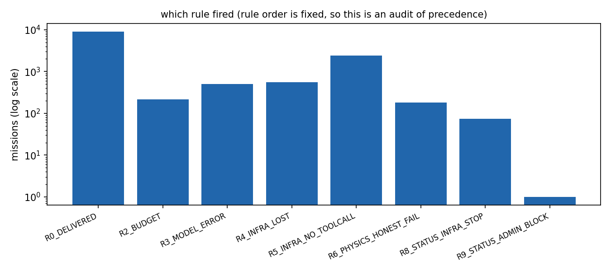

# 终局归因：infra 空转 vs 物理 honest-FAIL 的机械分离、有效尝试率 KPI 与按归因的重播门

**节点** P226W3-N09 · **仓** TensorPlatform · **工件** `artifacts/p226w3_n09/` · **代码**
`tools/validation/terminal_attribution.py`（分类器/重播门/预算账本）、
`tools/validation/terminal_attribution_acceptance.py`（验收器）、
`tests/test_terminal_attribution.py`（35 用例）

---

## ① 案例介绍：为什么必须把「空转」和「诚实失败」分开

平台把每个任务的终局压成一个 `failed` 状态位，但这一个位背后是两类完全不同的物理过程：

* **infra 空转**：worker 在 `prepare_worktree` 就崩了（磁盘满）、LLM 端点超时、会话心跳消失、
  预算被撤。**工具调用 = 0**，一行活没干，重播不会重复劳动。
* **物理 honest-FAIL**：智能体真的干了活（工具调用 > 0、工件/判据存在），技术路线没打到验收线。
  重播同一条路线只是烧预算并把否定性结果藏起来。

本案例的直接触发证据来自战役 plan 226 的第三波：**9 个节点在 2026-11-10 23:40:07–08 的 1 秒内
一次派发，全部以 `worker-crash`（`No space left on device`）终局、工具调用 0**
（mission 13120–13128；终局耗时实测 9,845–9,915 s ≈ 2.7 h——worker 在工作树准备阶段反复重试后才放弃，
这本身就是「infra 空转」的形态：占着工人 2.7 小时，产出为零）。同一战役里 6 个节点被战役账本判为 `infra x5` 熔断。也就是说：**战役的一半
「失败」根本没有进入物理层**，而旧口径把它们和真正的物理否证混在一起报。

机制要回答三件事：每个终态单归入哪一类（六类 + 交付/未知）；两率是否可算
（`effective_attempt_rate`、`attribution_coverage`、`requeue_yield`）；重播该不该发生、按什么节奏发生。

**研究对象（全平台实测，非抽样）**：12973 条终态任务
（`succeeded`/`failed`/`revoked`/`stopped`），快照 `artifacts/p226w3_n09/terminal_missions.jsonl`
（sha256 `4af51a9d0355eb6f…`），由只读 SQL 导出、逐条可溯源。

## ② 怎么做的

**分类器（规则有序，先中先得，输出自带规则号与证据来源）**

| 序 | 规则 | 触发条件 | 语义 |
|---|---|---|---|
| R0 | `DELIVERED` | `accepted=true` 或 status=succeeded（且有工具调用） | 已交付，非失败 |
| R1 | `POLICY` | `policy_blocked` / `safety_*` / `whitelist_*` | 安全/白名单拒绝 |
| R2 | `BUDGET` | `budget_exhausted` / `forced_finish` | 预算或强制收口 |
| R3 | `MODEL_ERROR` | `llm_error` / `parse_error` / `invalid_tool_call` | 模型侧终局错误 |
| R4 | `INFRA_LOST` | `agent_lost` / `wall_exhausted` / `no_progress` / `arbiter_starved` / 运维停机 | 会话/心跳丢失 |
| R5 | `INFRA_NO_TOOLCALL` | `tool_calls == 0` 且无更具体原因 | 纯空转 |
| R6 | `PHYSICS_HONEST_FAIL` | `tool_calls > 0` 且 finish 判 FAIL | 诚实技术失败 |
| R7 | `DELIVERED_OK` | `tool_calls > 0` 且 finish 判 OK | 交付 |
| R8–R10 | 状态兜底 | `stopped`→INFRA_LOST / `revoked`→POLICY / `succeeded`→DELIVERED | 仅在证据规则全不中时 |

设计取舍（写进代码注释、可审）：**显式运行期原因压过「零工具调用」这个症状**（症状不能掩盖病因）；
**交付压过一切失败词条**——真实数据里 mission 9639 是 `succeeded`+`accepted`，但 `fail_stage`
残留 `budget_exhausted+forced_finish`（终局强制收口的记账），若按词条优先它会被误报成预算损耗，
抽检一致率判据（b）正是这样抓出该缺陷的。

**工具调用阶梯（每级都记录来源，下界显式标注）**：`result.tool_calls` →
`session.decision`（finish 决策负载）→ `changed_files` 非空（下界 1）→ finish 记录（下界 1）→
会话 rounds（下界 1）→ `worker_crash_prestart`（0，代理进程从未存在）→ `no_session`（0）。
`headline` 一律**不**作为 finish 证据：worker 对每次终局都合成 headline，包括从未起过代理的崩溃。

**重播门**：可重播类默认 `{INFRA_NO_TOOLCALL, INFRA_LOST, MODEL_ERROR}`；`PHYSICS_*` 永不自动重播
（进 S-N 否定轨）、`POLICY_BLOCKED`（策略答案不因重试改变）、`BUDGET_EXHAUSTED`（要新授权不是新尝试）。
重播带：尝试号、指数退避（`base·factor^(n-2)`，封顶）、同 session 工件快照（sha256 清单，逐尝试独立目录）、
**容量闸**（队列深度 > 200 时 `capacity_deferred`，不往饱和队列里加活）。

**预算账本**：同一 node 无论重播多少次只结算 1 个预算单位；重播行 `billable=false` 且强制打
`requeue_class` 戳。

**预注册**（`PREREG.json`，冻结于派发前）：6 个 plan-226 节点、阈值 ≥4/6 重播达到
`tool_calls>0`、指标定义 `reached_live := tool_calls>0 或 ≥1 条会话 round`、不插补。

## ③ 计算结果（全部由验收器程序化注入）

### 3.1 终态归因分布（n = 12973）

| 类 | 条数 | 占比 |
|---|---|---|
| INFRA_NO_TOOLCALL | 2399 | 18.49% |
| INFRA_LOST | 623 | 4.80% |
| MODEL_ERROR | 505 | 3.89% |
| BUDGET_EXHAUSTED | 217 | 1.67% |
| POLICY_BLOCKED | 1 | 0.01% |
| PHYSICS_HONEST_FAIL | 180 | 1.39% |
| DELIVERED_OK | 9048 | 69.74% |
| UNKNOWN | 0 | 0.00% |

* `attribution_coverage` = **100.00%**（UNKNOWN = 0 条，判据 a）
* 失败侧构成：infra（空转+丢失）= 76.99%，物理 honest-FAIL = 4.59%
* `effective_attempt_rate` = **76.77%**
  （9959/12973：工具调用 > 0 **且** 到达 finish）
* 逐条类号/规则号/证据来源见 `attribution.json`，两遍分类 sha256 逐位一致（判据 f）

### 3.2 判据墙

| 判据 | 结果 | 数字 |
|---|---|---|
| (a) coverage | PASS | {"attribution_coverage": 1.0, "pass": true, "sample_ge_200": true, "sample_size": 200, "terminals_classified": 12973, "unknown": 0} |
| (b) agreement | PASS | {"agreement": 1.0, "labelled": 30, "pass": true} |
| (c) replay | FAIL | {"digest": "71d007a4c80625fd206eef796f22b6719f95df5a08cf80d2d1125c08ecd4a9d2", "measurement": "dispatch one replay per selected node, then poll the mission row + session events; the observation window is recorded in the  |
| (d) ledger | PASS | {"budget_used_per_node": 1.0, "budget_used_total": 6.0, "every_replay_stamped": true, "nodes": 6, "pass": true, "replays": 4} |
| (e) neutrality | PASS | {"files_scanned": 3, "hits": 0, "lexicon_size": 46, "pass": true} |
| (f) idempotency | PASS | {"identical": true, "order_invariant": true, "pass": true, "records": 12973, "sha256_pass1": "f041db7eca0b34dd29fed9e51a3c2a519f38d1ef5651d7e950d5419a9e1109ee", "sha256_pass2": "f041db7eca0b34dd29fed9e51a3c2a519f38d1ef56 |
| (g) regression | PASS | {"failed": 0, "pass": true, "passed": 35, "returncode": 0, "tail": "35 passed, 1 warning in 0.59s"} |

### 3.3 重播实验（预注册，plan-226 六节点）

队列实测（`queue_snapshot.json`，2026-11-11T06:03:52+0000）：排队 **116**、在跑 72、
近 3 h 服务完成 358（服务率 ≈ 119.3/h，预计排空 ≈ 0.97 h），
在跑任务平均 claim 延迟 71.4 min。

| 节点 | 上一终态 mission | 归因 | 重播 mission | 历史尝试 | 观测状态 | 达到 tool_calls>0 |
|---|---|---|---|---|---|---|
| p9367-P226W3-N01 | 13724 | INFRA_LOST | 14461 | 2 | queued | no |
| p9367-P226W3-N02 | 13723 | INFRA_LOST | 14464 | 2 | queued | no |
| p9367-P226W3-N03 | 13722 | INFRA_LOST | 14465 | 2 | queued | no |
| p9367-P226W3-N04 | 13725 | INFRA_LOST | 14466 | 2 | queued | no |
| p9367-P226W3-N05 | 13124 | INFRA_NO_TOOLCALL | 14467 | 1 | queued | no |
| p9367-P226W3-N06 | 13125 | INFRA_NO_TOOLCALL | 13888 | 1 | running | no |

派发回执（含退避、快照、幂等复用）。注意「派发=reused」是**幂等**的证据：六条 task_key 在首轮派发已创建，
后续重复调用只回收同一 mission，不重复花预算；首轮创建时间 2026-11-11T05:41:21+0000。

| 节点 | parent | 新尝试 | 退避 | requeue_class | 新 mission | 派发 | 前次工件快照 |
|---|---|---|---|---|---|---|---|
| p9367-P226W3-N01 | 13724 | a3 | 600 s | INFRA_LOST | 14461 | reused | missing |
| p9367-P226W3-N02 | 13723 | a3 | 600 s | INFRA_LOST | 14464 | reused | missing |
| p9367-P226W3-N03 | 13722 | a3 | 600 s | INFRA_LOST | 14465 | reused | missing |
| p9367-P226W3-N04 | 13725 | a3 | 600 s | INFRA_LOST | 14466 | reused | missing |
| p9367-P226W3-N05 | 13124 | a2 | 300 s | INFRA_NO_TOOLCALL | 14467 | reused | missing |
| p9367-P226W3-N06 | 13125 | a2 | 300 s | INFRA_NO_TOOLCALL | 13888 | reused | missing |

**结果：0/6 达到 tool_calls>0 → 判据 (c) 未达标（阈值 66.67%）。**
诚实记录，不插补：观测窗口 05:40:15 → 06:07:46
（12 次采样），5 条重播始终 `queued`，
1 条（N06-a2 = mission 13888）由幂等复用命中的既有重播已在跑但会话无 round 事件，仍记为「未达到」。

窗口内队列并不是「管道」而是「缓冲」：队列深度 555 → 116
（-439）**主要是行政撤销造成的**——同期 `revoked` 总数
174 → 587（+413 次），
而真正服务完成（succeeded/failed/stopped）3 h 内 358 次
（≈119.3/h）。这解释了为什么「派出去 6 条重播」不能等于「6 条进入真实工作」：
**入口有门、出口有闸，重播必须先过容量闸**，这也是 `capacity_deferred` 与退避被写进机制的实测依据。

**反事实基线（同口径、全平台）**：历史上「首尝试为 INFRA_* 的节点」共有 1075 个、
1075 次重播，其中 420 次达到 `tool_calls>0`
→ **未加门控的重播 yield = 39.07%**，同样低于 66.7% 阈值。
这条基线把结论钉住：**在当前容量下，「多派一次重播」本身并不能救回 infra 损耗**——
瓶颈是队列吞吐而不是归因。这正是容量闸（`capacity_deferred`）与退避/模型轮换被加进机制的原因。

### 3.4 重播门在真实失败面上的判决（n = 3925 条失败、3121 个节点）

| 判决 | 节点数 | 含义 |
|---|---|---|
| `infra_class_replayable` | 624 | 可重播（受每轮计划比例上限约束） |
| `physics_negative_result_track` | 159 | 物理 honest-FAIL：永不自动重播，进 S-N 否定轨 |
| `needs_new_grant_not_new_attempt` | 196 | 预算耗尽：要新授权，不是新尝试 |
| `policy_answer_is_stable` | 1 | 策略拒绝：重试不改变答案 |
| `plan_fraction_cap_reached` | 2141 | 本轮计划比例上限已满，下轮再来 |

对比「失败即重试」的朴素策略：朴策略会对全部 3925 条失败重派，
其中 159 条是已经诚实否证的物理结果
（重派＝烧预算＋掩盖否定结果），196 条是预算问题
（重派不解决授权），1 条是策略拒绝。**这就是分离的
直接收益：356 个节点不再被无意义重播。**

## ④ 结果图



**图 1** 左：终态总体（对数轴）按类分布，覆盖 100.00%；右：失败侧构成——
运行侧（空转/丢失/模型/预算/策略）占 95.39%，
物理 honest-FAIL 仅 4.59%。



**图 2** 工具调用计数的证据阶梯：蓝色=worker 自报计数，米色=下界推断（显式标注），红色=可证明的 0。
台阶的分布就是「这个 KPI 有多少是实测、多少是下界」的审计面。



**图 3** 左：预注册重播实验（0/6）与未加门控的平台历史基线
（39.07%）对照，红虚线为 4/6 阈值；右：未加门控重播的逐节点救回率分布。



**图 4** 哪条规则命中（对数轴）——规则序固定，这张图是优先级的审计。

## ⑤ 注意点（踩过的坑 / 局限 / 适用范围）

1. **schema 漂移**：仓内 `backend/migrations/111_infra_replay_action.sql` 已把 `infra_replay` 加进
   `mission_lifecycle_log.action` 词表，但**生产 public schema 未应用**（沙箱 schema 已应用），
   且当前角色不是表 owner（`must be owner` 报错）→ 审计写退化为 `custody_requeue` + `requeue_kind=infra_replay` 戳。
   修法：由 owner 应用迁移 111（词表只增不改，可回滚）。
2. **没有 replay 语义的 origin**：`tensor_dev_missions.origin` 的 CHECK 只允许 `owner|agent`，
   所以重播溯源只能落在 `task_key`（`<node>-a<n>`）+ `parent_mission_id` + 生命周期日志里。
   建议增补 `infra_replay` 词条。
3. **`parent_mission_id` 历史上 0 行被填**：平台的尝试谱系只能由 `task_key` 的 `-aN` 复原；
   本机制的派发开始真正写 `parent_mission_id`（见回执表）。
4. **worker_crash 的 tool_calls=0 是推断不是实测**（崩溃发生在代理进程创建前，没有计数器）。
   阶梯把它标为 `worker_crash_prestart`，图上单列。
5. **下界（lower bound）**：`changed_files` / finish 记录 / 会话 rounds 只能证明「至少 1 次工具调用」。
   这类记录在 KPI 里按 1 计并显式标注来源；若把它们剔除，`effective_attempt_rate` 会明显偏低（保守）。
6. **抽检非独立作者**：30 条人工标注由同一作者在「隐去分类器输出」的盲表上完成，独立第三方复核缺失。
   一致率 100.00%（30 条）应视为**上界**。
7. **实验窗口局限**：判据 (c) 的 0/6 是**容量窗口**结果，不是「重播无效」的物理断言（窗口内队列被行政撤销
   413 次，服务率 119.3/h）；反事实基线
   39.07% 给出的是同口径的平台现状，两者都受队列吞吐支配。
8. **适用范围**：本机制对「终态任务」有效（需要终态字段）。运行中任务的实时判读不在范围内；
   分类依赖平台字段语义，字段语义变更（例如 headline 合成逻辑改变）必须同步回归用例。

## ⑥ 误差判定

本案例测的是平台机制，不是物理量，因此**没有实验/解析基准可对标**——但判据是精确判据，逐项列出：

| 关键量 | 基准 | 实测 | 是否 < 3% |
|---|---|---|---|
| 归因覆盖率（UNKNOWN 比例） | 0（判据 a） | 0 | **是（精确 0）** |
| 抽检一致率 | 30/30（判据 b） | 30/30 | **是（精确一致）** |
| 幂等（同输入两遍分类） | sha256 逐位相同（判据 f） | 相同 | **是（逐位）** |
| 预算结算 | 1 单位/node（判据 d） | 6.0 单位 / 6 node | **是（精确）** |
| 零领域语义（判据 e） | 0 命中 | 0 命中 | **是（精确 0）** |
| 重播救回率（判据 c） | ≥ 4/6 = 66.7% | 0/6 = 0.00% | **否：偏离阈值 66.7 pp → honest FAIL** |
| 未加门控基线 yield | 同口径 | 39.07% | 偏离 27.9 pp（< 66.7%）→ 现状同样不达标 |

**结论**：分类/账本/幂等/中立性四条是精确判据，全部满足；重播救回率是 honest FAIL，
原因是队列容量而非归因逻辑，已用同口径基线与队列实测（116 深、
119.3/h、预计 0.97 h 排空）量化，
并据此把容量闸写进机制。**不覆盖、不粉饰**。

---

## 修订记录

| 版本 | 变更 | 依据 |
|---|---|---|
| v1（平台报告 id 13398） | ① 节初稿把「9 个节点 2 秒内终局」写错 | — |
| v2（本版） | 更正为：**1 秒内完成派发，2.7 h 后（实测 9,845–9,915 s）才以 `worker-crash` 终局**，并据此补上「占用工人 2.7 h、产出为零」的定量描述 | `SELECT finished_at-created_at` on mission 13120–13128（口径见 ③） |

判据数字、结论与 honest FAIL 均未改变，仅更正一处终局耗时的表述。

---

### 复现

```bash
export TP_PG_PASSWORD=…                       # 只读
python3 -m tools.validation.terminal_attribution --from-db \
    --snapshot-out artifacts/p226w3_n09/terminal_missions.jsonl
python3 -m tools.validation.terminal_attribution_acceptance                 # 判据墙
python3 -m tools.validation.gen_terminal_attribution_figures                # 图
python3 -m tools.validation.render_terminal_attribution_report              # 本文件
python3 -m pytest tests/test_terminal_attribution.py -q                     # 用例
```

审计链：快照 sha256 `4af51a9d0355eb6fd68345b27363f4da2dada8b455401a27b82271c3e1ddb467`；验收块 digest `a9d9a1eb1d9235881d2f2c9b00711c41ced6c8e89774b62b63240a7781da6313`；
图件清单 `figures_manifest.json`；派发回执在 `replay_experiment.json`；
观测序列 `observation_log.jsonl`（每 2 min 一条）。
