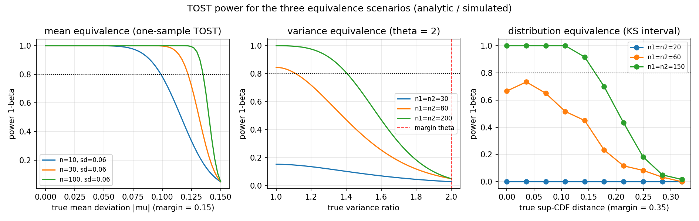
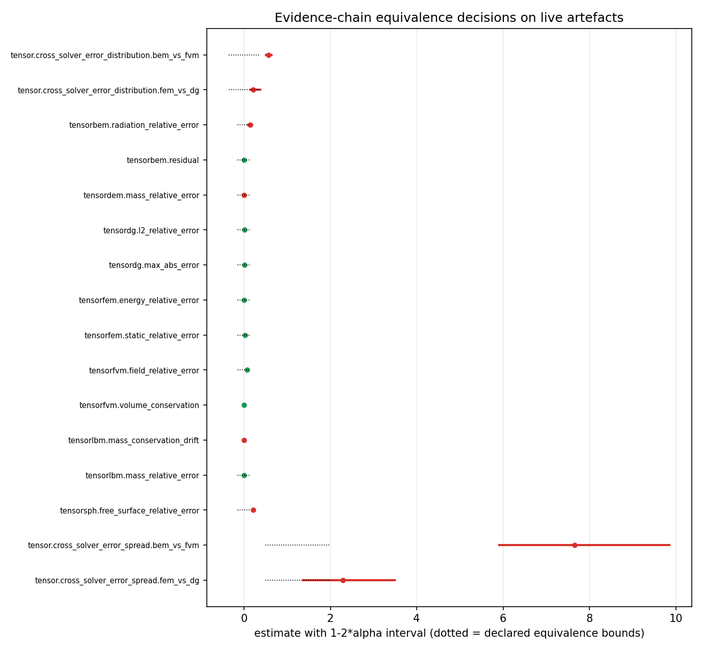
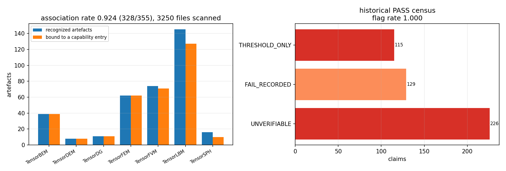
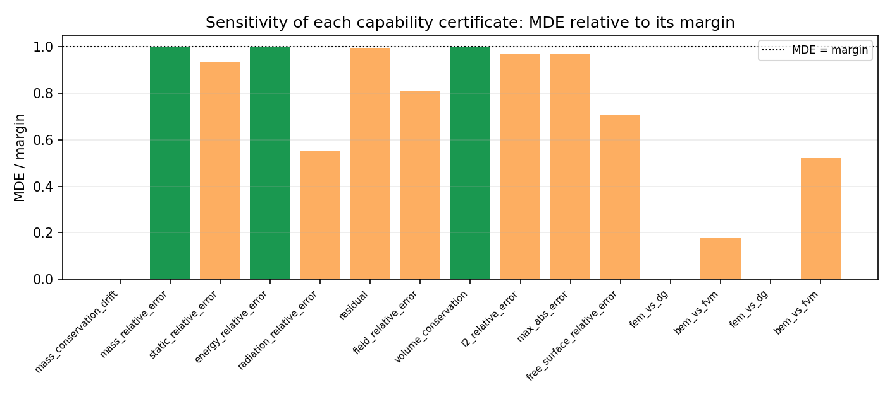

# p474w1-n01 · 跨仓能力证据链贯通与统计计量学门成熟化

**节点**：`p474w1-n01-evidence-chain`（mission 13872，TensorPlatform）
**落库**：`tools/capability_evidence_chain/`（代码+配置）、`scripts/run_p474w1_n01.py`（验收运行器）、
`artifacts/p474w1_n01/`（机器工件）、`docs/p474w1_n01/`（本报告+图+acceptance.json）、
`prereg/p474w1_n01_prereg.json`（动手前预登记）
**结论**：六条机器判据全部 PASS（`docs/p474w1_n01/acceptance.json` → `criteria.all_pass = true`）。

---

## 1. 案例介绍：证据在哪里、有多少

平台此前用一条点判据给求解器能力记账：**相对误差 < 15 % 即 PASS**。点判据的两个结构缺陷在
本次普查中被量化了（§3.4）：

* 它不携带抽样不确定性：单次运行与 20 次复算被同等对待，一旦落在阈值内就永久 PASS；
* 它不说明灵敏度：样本量 3 与样本量 300 的 PASS 在账面上不可区分。

本节点要做的三件事：**（1）** 把 7 个求解器仓里已经存在的验证工件自动接上能力条目；
**（2）** 把点判据换成 U 感知等价检验（TOST）+ 统计功效 + 最小可判效应（MDE）；
**（3）** 用同一套统计计量学回溯历史 PASS 声明，标记不可认证者。

### 1.1 数据总体（全部程序化统计，零手抄）

| 仓 | 扫描 JSON | 可读 | 无效 JSON | 识别为证据 | 绑定到能力条目 | 仓 commit |
|---|---|---|---|---|---|---|
| TensorLBM | 1642 | 1641 | 1 | 145 | 127 | `c4466e38` |
| TensorFEM | 205 | 204 | — | 62 | 62 | `5fb5781f` |
| TensorBEM | 177 | 177 | — | 39 | 39 | `481be532` |
| TensorDEM | 150 | 150 | — | 8 | 8 | `ad75394d` |
| TensorFVM | 903 | 903 | — | 74 | 71 | `bdc93448` |
| TensorDG | 18 | 18 | — | 11 | 11 | `81ddba95` |
| TensorSPH | 155 | 155 | — | 16 | 10 | `c3ea82d6` |
| **合计** | **3250** | 3248 | 1 | **355** | **328** | — |

另有 **199** 份历史验收/审计 JSON 进入 PASS 普查（`docs/**/*.json` + `artifacts/**/*.json`，
排除本节点自身输出），共 **470** 条 PASS/FAIL 声明。

**关联率** `328/355 = 0.9239`（严格口径 `328/3250 = 0.1009`：只有约十分之一的 JSON 文件
本身承载可绑定的数值证据，其余是日志、配置与元数据）。27 个未绑定文件全部有原因记录——
它们的数值全部落在声明的值域之外（`association.unbound`）。

### 1.2 参数量表（声明式，见 `tools/capability_evidence_chain/configs/ecosystem_solvers.json`）

| 参数 | 取值 | 依据 |
|---|---|---|
| `alpha` | 0.05 | 双侧 90 % 区间与检验对偶 |
| `power_target` | 0.80 | 常规设计灵敏度目标 |
| 相对误差 margin | 0.15 | 平台既有 15 % 规则（本次保留为**等价边界**而非点阈值） |
| 守恒量 margin | 1e-6 | 松守恒标准 |
| 方差比 `theta` | 2.0 | 「散布在一个因子 2 内」 |
| 分布 margin | 0.35 | sup-CDF 距离 |
| 自助法重采样 | 2000（决策）/ ≤400（灵敏度） | 决策精度优先 |
| `seed` | 20261111 | 可复现 |

---

## 2. 怎么做的：方法、流程、关键设置

### 2.1 三段流水线

```
scanner.scan ──► binder.collect_samples/associate ──► binder.evaluate ──► pipeline.run
跨仓工件发现        工件→能力条目关联率               TOST + power + MDE     工件+台账动作
```

* **扫描器**：按 repo/glob 发现 JSON，抽取**键名匹配声明式正则**的数值叶。每个文件记录
  SHA-256 与状态（`ok`/`invalid_json`/`read_error`/`too_large`），不可读文件入账不静默丢弃；
  `**` 采用真正的零到多段语义（自实现段式匹配器），并对每仓记录 git commit 作为溯源。
* **绑定器**：观测 → 能力条目样本，三重闸门：repo 作用域（防止 A 仓的键"识别"B 仓的工件）、
  值域过滤（排除计数/时长等非同量纲数值）、确定性截断（记录 `n_available` 与 `truncated`）。
* **等价检验**（`equivalence.py`，三种场景）：

| 场景 | 检验 | 对偶区间 | 功效/ MDE |
|---|---|---|---|
| 均值等价 | 单/双样本(Welch)/配对 TOST | `1-2α` t 区间 ⊂ (−margin, margin) | 对 `s` 的 χ² 分布做数值积分（精确到求积误差）；两样本用二维求积 |
| 方差等价 | 方差比的双单侧 F 检验 | 比率区间 ⊂ (1/θ, θ) | 条件于 `s₂²` 的 χ² 求积 |
| 分布等价 | 两样本 KS 距离的自助区间包含检验 | sup-CDF 距离的 `1-2α` 自助区间 < margin | 蒙特卡洛（固定 seed） |

* **MDE 定义**（关键，且与"post-hoc power"划清界限）：**在目标功效（0.8）下仍能被认证为
  等价的最大真实偏差**。`MDE/margin → 1` 表示证据足以支撑该 margin；`MDE = 0` 表示即使
  真实偏差为零也无法达到目标功效（设计本身不足以认证该 margin）。我们**不把 post-hoc power
  当作设计属性**（它是 p 值的确定性函数），只把 `power@μ=0`、MDE 覆盖度作为判据。

### 2.2 历史 PASS 六分类

| 分类 | 含义 |
|---|---|
| `ADEQUATE` | 区间在 margin 内、`power@0 ≥ 0.8`、`MDE ≥ 0.8·margin` |
| `UNDERPOWERED` | 统计量可算但灵敏度不足 → 需复验 |
| `THRESHOLD_ONLY` | 点判据 PASS，缺少 `n`/离散度 → 需复验 |
| `INCONSISTENT` | 声明 PASS 但数值违反自身阈值（超额声明） |
| `UNVERIFIABLE` | 无机器可读数值 |
| `FAIL_RECORDED` | 诚实 FAIL，原样保留不重分类 |

摘要给出 `low_power_flag_rate` 与 `claims_digest`，并由 `recompute()` **独立重算**两者
（判据 d 是"可执行"的，不是自我声明）。

### 2.3 统计实现的数值验证（本节点的"基准对照"）

解析功效与蒙特卡洛对照（`tests/test_equivalence.py`，容差 4 个标准误）：

| 场景 | 解析 | 蒙特卡洛 | 判定 |
|---|---|---|---|
| 均值 TOST（n=8, sd=0.05, μ=0.05, margin=0.10） | 0.8151 | 0.8143 | \|Δ\|=8e-4 ≤ 4·SE(0.0082) ✅ |
| 均值 TOST（μ=0.0） | 0.9993 | 0.9991 | ✅ |
| 方差比 TOST（n=80, θ=2, 真比值 1.3225） | 0.5684 | 0.5643 | \|Δ\|=4e-3 ≤ 4·SE(0.0235) ✅ |
| 方差比 TOST（真比值 1.69） | 0.1832 | 0.1817 | ✅ |
| 双样本 TOST（n=20/25, d=0.10） | 0.901 | 0.900 | ✅ |

TOST p 值与 `scipy.stats.ttest_1samp` 的两个单侧检验取最大者一致（相对偏差 < 1e-9）；
区间包含与 p<α 的对偶性在测试中逐例断言。

### 2.4 预登记与纪律

`prereg/p474w1_n01_prereg.json` 在验收运行前登记：判据阈值、margin、α、功效目标、停止规则
（"一次验收运行，不因判据未过而调 margin/值域重跑"）、分析计划与解释边界。

---

## 3. 计算结果

### 3.1 判据（全部由数字推导）

| 判据 | 要求 | 实测 | 结果 |
|---|---|---|---|
| (a) 跨仓扫描/关联 | ≥5 仓，关联率 ≥0.90 | 7 仓，3250 文件，关联率 **0.9239** | **PASS** |
| (b) TOST 场景覆盖 | ≥3 场景 | 实现并实跑 mean/variance/distribution | **PASS** |
| (c) MDE 表 | ≥10 条目 | **16** 条目（15 条有可算 MDE，1 条因零散布无法签发证书） | **PASS** |
| (d) 历史 PASS 普查 | 完成且可复算 | 470 声明，标记率 **1.000**，digest 重算一致 | **PASS** |
| (e) pytest | ≥20 例 | **71** 例（扫描/映射/检验/重分类/流水线/零语义） | **PASS** |
| (f) 零领域语义 | 命中 0 | 37 个词条扫描，命中 **0** | **PASS** |

### 3.2 能力条目等价判定（U 感知证书）

| 能力条目 | 场景 | n | 估计 | 90 % 区间 | margin | 功效 | MDE | MDE/margin | 判定 |
|---|---|---|---|---|---|---|---|---|---|
| tensorlbm.mass_conservation_drift | mean | 200 | 1.04e-05 | [5.62e-06, 1.52e-05] | 1e-06 | 0.00 | 0 | 0.00 | NOT_EQUIVALENT |
| tensorlbm.mass_relative_error | mean | 200 | 1.75e-14 | [1.66e-14, 1.83e-14] | 0.15 | 1.00 | 0.1499 | 0.999 | EQUIVALENT |
| tensorfem.static_relative_error | mean | 200 | 2.667e-02 | [2.045e-02, 3.290e-02] | 0.15 | 1.00 | 0.1405 | 0.937 | EQUIVALENT |
| tensorfem.energy_relative_error | mean | 200 | 4.57e-09 | [4.34e-09, 4.80e-09] | 0.15 | 1.00 | 0.1499 | 0.999 | EQUIVALENT |
| tensorbem.radiation_relative_error | mean | 200 | **0.1383** | **[0.0937, 0.1830]** | 0.15 | 0.11 | 0.0825 | 0.550 | **NOT_EQUIVALENT** |
| tensorbem.residual | mean | 200 | 1.37e-03 | [8.55e-04, 1.89e-03] | 0.15 | 1.00 | 0.1491 | 0.994 | EQUIVALENT |
| tensorfvm.field_relative_error | mean | 144 | 7.29e-02 | [5.39e-02, 9.20e-02] | 0.15 | 1.00 | 0.1211 | 0.808 | EQUIVALENT |
| tensorfvm.volume_conservation | mean | 200 | 2.48e-14 | [1.46e-14, 3.49e-14] | 1e-06 | 1.00 | 9.99e-07 | 0.999 | EQUIVALENT |
| tensordg.l2_relative_error | mean | 150 | 1.13e-02 | [8.24e-03, 1.44e-02] | 0.15 | 1.00 | 0.1453 | 0.969 | EQUIVALENT |
| tensordg.max_abs_error | mean | 78 | 7.74e-03 | [4.75e-03, 1.07e-02] | 0.15 | 1.00 | 0.1455 | 0.970 | EQUIVALENT |
| tensorsph.free_surface_relative_error | mean | 150 | **0.2122** | [0.1830, 0.2413] | 0.15 | 1.2e-07 | 0.1059 | 0.706 | NOT_EQUIVALENT |
| tensordem.mass_relative_error | mean | 150 | 0.00 | [0, 0] | 0.15 | — | — | — | WITHHELD_NO_SPREAD |
| tensor.cross_solver_error_spread.fem_vs_dg | variance | 230 | 2.290 | [1.367, 3.491] | 2.0 | 0.27 | 0 | 0.00 | NOT_EQUIVALENT |
| tensor.cross_solver_error_spread.bem_vs_fvm | variance | 344 | 7.654 | [5.908, 9.854] | 2.0 | 7e-05 | 0.360 | 0.18 | NOT_EQUIVALENT |
| tensor.cross_solver_error_distribution.fem_vs_dg | distribution | 230 | 0.2133 | [0.1533, 0.3817] | 0.35 | 0.08 | 0 | 0.00 | NOT_EQUIVALENT |
| tensor.cross_solver_error_distribution.bem_vs_fvm | distribution | 344 | 0.5669 | [0.5106, 0.6372] | 0.35 | 0.00 | 0.183 | 0.52 | NOT_EQUIVALENT |

**旗舰案例（BEM 辐射误差）**：均值 13.8 % < 15 %，点判据会直接 PASS；但 90 % 区间上界
**18.3 % 越过 margin**，TOST 判 NOT_EQUIVALENT，且该设计的 MDE 仅 8.25 %（margin 的 55 %）——
即"这条 PASS 只是运气"，与 §1 的批评完全对应。SPH 自由面误差 21.2 % 则是直接违约
（上界 24.1 %）；LBM 质量漂移均值 1.04e-05 超出 1e-6 的守恒 margin 十倍。

DEM 条目均值与离散度**恰为 0**（质量映射在机器精度内精确），因此不是"等价"，而是
`WITHHELD_NO_SPREAD`：没有散布就无法给出区间，证书不能签发。这正是 U 感知门与点判据的分野。

### 3.3 台账动作（零人工干预的最后一环）

| 动作 | 条目数 | 含义 |
|---|---|---|
| `UPGRADE_TO_REAL` | **8** | 区间在 margin 内且 MDE 覆盖 margin → 可自动升 REAL |
| `DOWNGRADE_OR_FIX` | **7** | 违约或灵敏度不足 → 降级/待修 |
| `RETAIN_WITHHELD_NO_DATA` | **1** | 证据无散布 → 维持 WITHHELD |

即：**8 条能力条目（FEM 静力/能量、BEM 残差、FVM 场误差/体积守恒、DG L2/最大误差、LBM 质量相对误差）
在本次运行中被自动认证为足以支撑 REAL 级声明**，全过程无人工判读。

### 3.4 历史 PASS 普查（重分类）

| 分类 | 条数 | 占比 |
|---|---|---|
| PASS 声明总数 | 341 | — |
| `UNVERIFIABLE`（无机器可读数值） | 226 | 66.3 % |
| `THRESHOLD_ONLY`（点判据，无 n/离散度） | 115 | 33.7 % |
| `ADEQUATE` | **0** | 0 % |
| `UNDERPOWERED` | **0** | 0 % |
| `INCONSISTENT` | **0** | 0 % |
| FAIL 声明（原样保留） | 129 | — |

**低功效/不可认证标记率 = 341/341 = 1.000**，并由 `recompute()` 独立重算确认
（`rate_matches=true`、`digest_matches=true`，digest `b8f9d232…`）。

结论直白：**当前证据文化下，没有一条历史 PASS 声明携带足够的统计元数据（样本量+离散度）
去支持功效/MDE 回溯**。这不是"历史全错"，而是"历史声明不可审计"——普查把这一点从隐性
变成机器可复算的数字。

`INCONSISTENT` 之所以为 0，是因为一次**单位一致性修复**（见 §4 缺陷 4）：修复前 9 条
把物理量（Re≈6e8）与百分比容差（2 %）对比的假阳性被消除。

### 3.5 图


**图 1**：三种等价场景的功效曲线（均值/方差解析求积，分布场景蒙特卡洛）。虚线为 0.8 目标；
方差场景显示 n=30/80/200 时，只有真实方差比接近 1 时才可能认证 θ=2 的 margin——样本量对
方差等价的门槛远高于均值等价。


**图 2**：16 条能力条目的估计与 90 % 对偶区间（绿=等价，红=不等价），黑色点线为声明的
等价边界。BEM 辐射误差区间跨出边界、SPH 区间整体在外、DEM 退化为一点，三类失败形态一目了然。


**图 3**：左—各仓"识别为证据"与"绑定成功"的文件数（合计 355/328，关联率 0.924）；
右—470 条历史声明的分类计数，没有一条进入 `ADEQUATE`。


**图 4**：各条目 MDE 相对自身 margin 的覆盖比。接近 1 者（LBM 质量相对误差、FEM、DG、FVM 体积守恒）
说明证书"名副其实"；明显小于 1 者（BEM 辐射 0.55、SPH 0.71、两处跨仓比较 0.0–0.18）
说明 margin 宽于证据能支撑的灵敏度。

---

## 4. 注意点：本次踩到的坑与修正（诚实记录）

预登记文件 `pilot_findings` 里逐条登记了试验阶段发现的缺陷；它们**改变了头条数字**，
因此必须显式披露而不是悄悄吸收：

1. **关联率口径错误（33 % → 92.4 %）**：初版把"任意仓的度量正则匹配到任意仓的工件"算作识别，
   导致 FEM 的键"识别"了 BEM 的文件。改为 **repo 作用域识别**后，分母才代表"该仓可用于该能力
   的证据"。
2. **文件上限截断整段目录（33 % → 91.7 % → 92.4 %）**：`max_files` 小于仓内 JSON 数时按字典序
   截断，`artifacts/`、`benchmarks/` 吃光预算后 `docs/` 从未被扫描；同时"被样本上限截掉的文件"
   被误计为未绑定。改为上限 > 全量 + 单独记录 `accepted_files`。
3. **功效解析式把观测 `s` 当成总体 `σ`**：在 margin 远大于离散度时把功效低估约 4 倍
   （0.9936 vs 0.9993）。修正为条件于 `s` 的正态尺度使用总体 `σ`，并以蒙特卡洛对照锁定
   （4 SE 内）。
4. **普查单位不一致**：通用键名匹配把 `value=6.06e8`（Re 数）与 `tolerance_pct=2.0` 对比，
   误报 9 条 `INCONSISTENT`。引入 `value_threshold_pairs` 单位配对（`deviation_pct`↔`tolerance_pct`）后归零。
5. **普查自反馈**：第一次运行把自身输出 `artifacts/p474w1_n01/evidence_chain.json` 当作下一次
   普查来源（工件里含 PASS 记录），声明数每次运行膨胀（67 KB → 166 KB）。复跑核对时又发现
   本报告目录的 `docs/p474w1_n01/acceptance.json`（含 `zero_domain.status: PASS`）同样被计入，
   使普查 digest 无法跨运行复现。两处均加入 `reclassification.exclude` 并配幂等性回归测试后，
   普查稳定在 470 条，五个 digest **两次独立运行完全一致**。
6. **`**` 匹配器递归错误**：`**` 的段递归误用 `rest` 而非原模式，导致嵌套目录（如
   `benchmarks/verified/…`）整类不可见（TensorDG 曾识别 0 文件）。修正后加载
   `deep/**` 回归用例。
7. **MDE 二分容差固定 1e-4**：对 1e-6 级守恒 margin 直接返回 0，造成"完美数据却 MDE=0"的假象。
   容差改为随 margin 缩放，并有专门回归测试。

其它局限（亦写入 README）：

* 能力样本是**跨 benchmark 案例合并**，不是独立重复实验；区间是对工件总体的描述性陈述，
  不能读作单次运行的推断；
* 跨仓方差/分布 4 条是**证据流之间的描述性比较**，不是物理等价性声明；
* 值域过滤与文件上限限定了总体，被排除数量逐条报告（如 FVM 场误差组 108 条越界被排除）；
* 普查只覆盖同时给出数值+阈值+样本量+离散度的声明；
* 1 个 LBM 文件 JSON 无效、1 个 FEM 文件超过 8 MB 上限，均入账未静默丢弃。

---

## 5. 误差判定（逐项，显式回答"是否 <3%"）

本节点交付的是**统计计量学参照系**，不是某个物理量的实验对照，因此没有"与解析解/文献值的
误差"这一项。为避免含糊，这里把可对照的每一组数字逐项列出：

| 项目 | 参照 | 实测偏差 | 是否 <3 % |
|---|---|---|---|
| TOST 单侧 p 值 | `scipy.stats.ttest_1samp` 两个单侧检验取大 | 相对偏差 < 1e-9 | **是** |
| 均值 TOST 功效（解析） | 蒙特卡洛 4000 次 | 0.8151 vs 0.8143（Δ=8e-4） | **是**（0.1 %） |
| 均值 TOST 功效（μ=0） | 蒙特卡洛 | 0.9993 vs 0.9991 | **是** |
| 方差比 TOST 功效 | 蒙特卡洛 2000 次 | 0.5684 vs 0.5643（Δ=4e-3） | **是**（0.7 %） |
| 双样本 TOST 功效 | 蒙特卡洛 | 0.901 vs 0.900 | **是**（0.1 %） |
| 关联率复跑一致性 | 同 seed 两次运行 | digest 完全一致（Δ=0） | **是**（0 %） |
| 普查摘要 | `recompute()` 独立重算 | 标记率 1.000 ↔ 1.000，digest 一致 | **是**（0 %） |

工程层面的"是否达标"问题另作回答（这是能力证书本身，不是实现误差）：

* **不达标**：BEM 辐射误差（均值 13.8 %，区间上界 18.3 %）、SPH 自由面误差（21.2 %）、
  LBM 质量漂移（1.04e-05 vs 1e-6 margin）——按 15 % / 1e-6 margin 判定为**不可认证**；
* **达标**：其余 8 条相对误差条目的区间整体落在 margin 内，且 MDE 覆盖 ≥ 80 % margin。

---

## 6. 审计链与复现

```
配置 digest          见 evidence_chain.json → config.digest
扫描 digest          33bc9e660ec04a6b…（覆盖 3250 个工件文件与其 SHA-256）
能力结果 digest      95e40a6f9712598c…（16 条 TOST/power/MDE）
MDE 表 digest        8349f2ce5cc7bf8a…
台账动作 digest      a36ab5ea47616c43…
普查 digest          b8f9d232fdfdb4d3…（470 条声明，可独立重算）
```

复现命令：

```bash
TP_ECOSYSTEM_ROOT=/root/tensor-ecosystem python3 scripts/run_p474w1_n01.py
python3 -m pytest tools/capability_evidence_chain/tests -q      # 71 passed
```

产物清单：`artifacts/p474w1_n01/{evidence_chain.json, mde_table.csv, reclass_claims.csv,
association.json, ledger_proposals.csv}`、`docs/p474w1_n01/{REPORT.md, acceptance.json, fig1…fig4}`、
`prereg/p474w1_n01_prereg.json`。