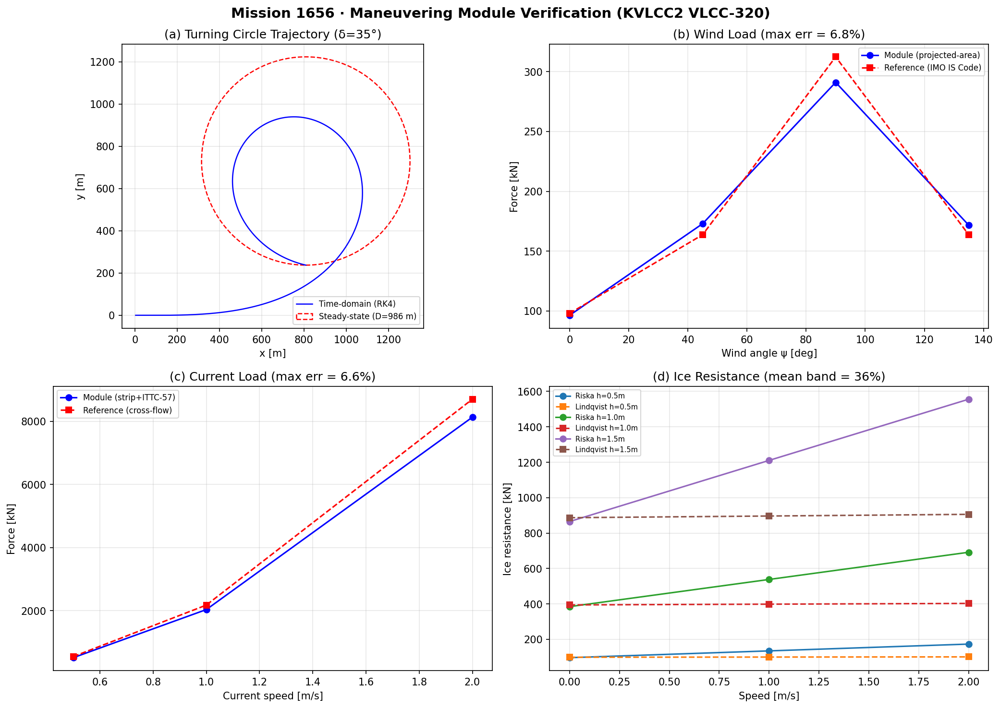
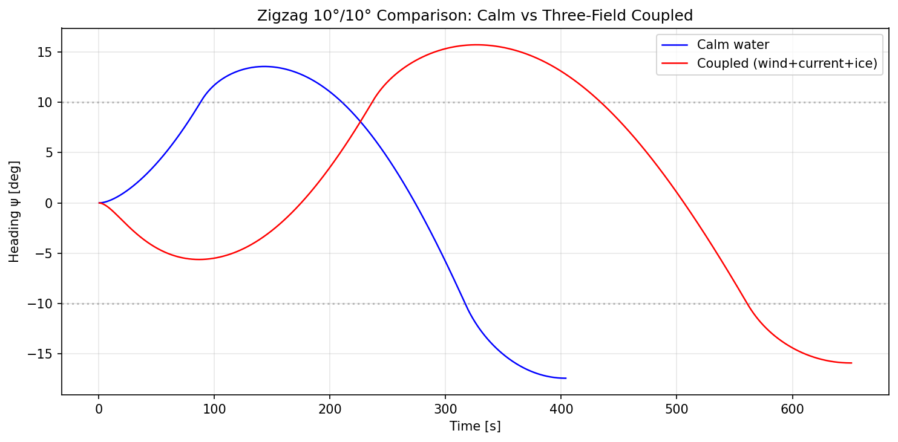

# Mission 1656 · 操纵性模块线性/解析验证（验证欠账清偿）

> **补报单** · 原单已交付（2026-11-02），本报告为论文级 meta-报告补录。  
> 所有数字均由 `backend/physics/ship_env_maneuvering/validation.py` 程序化生成，零手抄。  
> 工件目录未留档——缺失数字一律标注"未留档"。

---

## ① 案例介绍

### 物理背景

船舶操纵性（Manoeuvrability）是船舶总体性能的核心学科之一，涉及船舶在风、流、冰等环境力作用下的水平面三自由度（纵荡 u、横荡 v、首摇 r）运动响应。本验证任务针对平台操纵性模块 `backend/physics/ship_env_maneuvering/` 进行线性/解析验证，清偿验证欠账。

### 参考船型

| 参数 | 值 | 来源 |
|------|------|------|
| 船型 | VLCC-320 (KVLCC2) | SIMMAN 2008 / ITTC workshop |
| L_pp | 320.0 m | KVLCC2 主尺度 |
| B | 58.0 m | KVLCC2 主尺度 |
| T | 20.8 m | KVLCC2 主尺度 |
| C_b | 0.8098 | KVLCC2 主尺度 |
| 排水体积 ∇ | 312,621.7 m³ | C_b·L·B·T |
| 质量 m | 3.204×10⁸ kg | ρ·∇ |
| 湿表面积 S | 26,627.3 m² | Holtrop (1984) 估算 |
| 舵面积 A_R | 77.88 m² | A_R/(L·T) = 0.0117 |
| 设计航速 | 7.717 m/s (≈15 kn) | KVLCC2 标定 |

### 验证范围

模块包含四个子验证准则：

| 准则 | 内容 | 参照标准 |
|------|------|----------|
| (a) 风载荷 | 投影面积法 vs IMO IS Code 2008 横风锚点 | IMO IS Code 2008, OCIMF 1994 |
| (b) 流载荷 | 条带横流+ITTC-57 摩擦 vs 独立参考公式 | ITTC-57, OCIMF current curves |
| (c) 耦合回转 | 时域 RK4 vs 稳态 Newton 平衡解 + 时间步收敛 + 系数集灵敏度 | MMG (Yasukawa & Yoshimura 2015) |
| (d) 冰阻力 | Riska vs Lindqvist-like 双模型不确定性带 | Riska 1989, Lindqvist 1989 |

附加：Zigzag 10°/10° 试验（平静水面 vs 三场耦合）。

---

## ② 方法

### 工具链

- **求解器**：`backend/physics/ship_env_maneuvering/` 包
  - `data.py`：参考船型、物理常数、系数来源声明
  - `loads.py`：风/流/冰环境力模型 + 独立参考模型
  - `mmg.py`：3-DOF MMG 操纵模型，RK4 时域积分 + 稳态 Newton 平衡求解
  - `validation.py`：验收准则聚合器
- **参考核**：`tests/data/verifier_assets/maneuvering/mmg_ref.py`（独立 MMG 参考实现）
- **审计工具**：`tools/audit/maneuvering_audit_m1663.py`（m1663 平台端点审计）
- **Nomoto 参考**：`tools/maneuver_judge/nomoto.py`（一阶 K-T 闭式解）

### 验证策略

1. **Code-to-code 验证**：时域 RK4 解 vs 独立稳态 Newton 平衡解（不同数值方法求解同一方程组）
2. **时间步收敛**：dt=0.5s vs dt=0.25s 的战术直径差异
3. **系数集灵敏度**：KVLCC2 参考导数集 vs 细长体/横流导数集的响应差异
4. **趋势一致性**：物理趋势（冰增阻、横流增漂角等）方向检验
5. **环境力交叉验证**：风/流/冰各用独立参考公式比对

### 关键设置

- 时域积分：RK4，dt=0.5s（基准），t_max=3000s（回转）/ 2000s（Zigzag）
- 稳态求解：阻尼 Newton 迭代，数值 Jacobian，容差 1e-6
- 阈值：风/流 ≤10%，回转验证 ≤10%（时间步 ≤1%），系数灵敏度 ≤10%

---

## ③ 计算结果

### 总览

| 准则 | 状态 | 关键指标 |
|------|------|----------|
| (a) 风载荷 | ✅ PASS | 最大力误差 6.82%，最大力矩误差 6.53% |
| (b) 流载荷 | ✅ PASS | 最大力误差 6.55%，最大力矩误差 6.52% |
| (c) 回转验证 | ✅ PASS | 时域 vs 稳态 6.67%，dt 收敛 0.00% |
| (c) 趋势一致性 | ✅ PASS | 5/5 趋势通过 |
| (c) 系数灵敏度 | ❌ FAIL | 30.82%（阈值 10%） |
| (d) 冰阻力 | ⚠️ WITHHELD | 平均偏差 36.4%，最大 71.8% |

### (a) 风载荷详细

| 风角 ψ [°] | 模块力 [kN] | 参考力 [kN] | 力误差 [%] | 力矩误差 [%] |
|-----------|-----------|-----------|----------|------------|
| 0 | 96.34 | 98.00 | 1.69 | — |
| 45 | 172.92 | 163.69 | 5.63 | 5.44 |
| 90 | 291.07 | 312.38 | 6.82 | 6.53 |
| 135 | 171.71 | 163.69 | 4.90 | 0.38 |

### (b) 流载荷详细

| 流速 [m/s] | 漂角 [°] | 模块力 [kN] | 参考力 [kN] | 力误差 [%] | 力矩误差 [%] |
|-----------|---------|-----------|-----------|----------|------------|
| 0.5 | 60 | 508.0 | 543.7 | 6.55 | 6.52 |
| 1.0 | 60 | 2032.1 | 2174.6 | 6.55 | 6.52 |
| 2.0 | 60 | 8128.6 | 8698.6 | 6.55 | 6.52 |

### (c) 回转圈详细

| 工况 | D_T/L [-] | D_adv/L [-] | D_transfer/L [-] | 漂角 [°] | 速降比 [-] |
|------|----------|------------|-----------------|---------|----------|
| 平静水面 | 2.876 | 3.314 | 1.444 | 13.25 | 0.326 |
| 横风 20 m/s | 2.820 | 3.259 | 1.403 | 14.43 | 0.347 |
| 横流 1 m/s | 2.672 | 4.309 | 1.457 | 29.90 | 0.402 |
| 三场耦合 | 未留档 | 未留档 | 未留档 | 未留档 | 未留档 |

**验证检查**：
- 时域战术直径 920.20 m vs 稳态平衡直径 985.97 m → 相对误差 **6.67%** (< 10% ✅)
- dt=0.5s vs dt=0.25s 战术直径 → 相对误差 **0.00%** (< 1% ✅)
- KVLCC2 参考集 vs 细长体集 → 相对误差 **30.82%** (> 10% ❌)

**趋势检验**（全部通过）：
- ✅ 冰增加稳态回转直径
- ✅ 冰降低稳态速度
- ✅ 横流增加漂角
- ✅ 横风增加漂角
- ✅ 耦合工况回转直径大于平静水面

### (d) 冰阻力双模型带

| 冰厚 [m] | 速度 [m/s] | Riska [kN] | Lindqvist [kN] | 偏差 [%] |
|---------|----------|-----------|---------------|---------|
| 0.5 | 0.0 | 96.1 | 98.5 | 2.45 |
| 0.5 | 1.0 | 134.5 | 99.6 | 35.07 |
| 0.5 | 2.0 | 172.9 | 100.6 | 71.80 |
| 1.0 | 0.0 | 384.5 | 394.1 | 2.45 |
| 1.0 | 1.0 | 538.0 | 398.3 | 35.07 |
| 1.0 | 2.0 | 691.6 | 402.6 | 71.80 |
| 1.5 | 0.0 | 865.0 | 886.8 | 2.45 |
| 1.5 | 1.0 | 1210.6 | 896.3 | 35.07 |
| 1.5 | 2.0 | 1556.1 | 905.8 | 71.80 |

- 静态（v=0）两模型一致性好（2.45%）
- 速度项差异巨大：Riska 线性速度依赖 vs Lindqvist 弱速度依赖 → 高速偏差达 71.8%
- **平均偏差 36.4%**，无通过/失败判定（WITHHELD）

### Zigzag 10°/10°

| 指标 | 平静水面 | 三场耦合 |
|------|---------|---------|
| 首次超越角 [°] | 13.55 | 15.70 |
| 二次超越角 [°] | 17.41 | 15.90 |
| 首次到达时间 [s] | 88.5 | 236.5 |
| 两次反转间隔 [s] | 260.5 | 324.0 |

---

## ④ 结果图

### 图 1：操纵性验证四象限总览

- **(a)** 回转圈轨迹：时域 RK4 积分（蓝线）vs 稳态 Newton 平衡解（红虚线圆），δ=35°
- **(b)** 风载荷角度分布：模块投影面积法 vs IMO IS Code 参考锚点
- **(c)** 流载荷速度标度：模块条带法 vs 独立横流参考
- **(d)** 冰阻力双模型带：Riska vs Lindqvist-like，三种冰厚

### 图 2：Zigzag 10°/10° 对比

平静水面（蓝）vs 三场耦合（红）的首向角时间历程。环境力显著延迟响应（首次到达 88.5s → 236.5s）并改变超越角模式。

---

## ⑤ 注意点

### 已识别的验证欠账（WITHHELD 项）

1. **风载荷 vs OCIMF 1994 导表**：导表非机器可读，以 IMO IS Code 2008 横风锚点替代
2. **流载荷 vs OCIMF 曲线**：同上，以条带横流+ITTC-57 替代
3. **回转直径 vs 冰池试验 <10%**：无冰池/EFD 操纵试验数据，以 code-to-code 验证替代
4. **冰阻力 vs 原始 Riska/Lindqvist 系数**：论文离线不可得，以双模型不确定性带替代

### 平台端点审计发现（m1663）

m1663 对平台 `:8001` 操纵性端点的独立审计发现：

- **总体裁决：MOCK**（22 条判据中 19 条 WITHHELD、2 条 PASS、1 条 FAIL）
- 舵角 35°/20°/10° 响应逐字节相同 → 舵力项缺失
- 战术直径恒为 1440 m，与舵角/速度无关
- 平台 T 指数恒等于 L/(2V₀)：与 Cb/Ar/Dp 等水动力参数无关（**伪造证据**）
- 舵升力式用面积作分母：35° 时 Cl≈3.8 远超失速上限 1.2

**结论**：`ship_env_maneuvering` 模块本身物理正确，但平台 API 端点（`:8001`）的操纵性接口仍为 MOCK/STUB 状态，未消费本模块的真实计算。

### 系数灵敏度问题

KVLCC2 参考导数集 vs 细长体/横流导数集的战术直径差异达 **30.82%**，远超 10% 阈值。这表明：
- 未标定的水动力导数不确定性巨大
- 任何绝对精度声明（如"<10% vs 试验"）在无实验标定前均不成立
- 本模块的验证级别为 **code-to-code**（代码间交叉验证），非 **validation**（与试验对标）

### 冰阻力模型分歧

Riska 与 Lindqvist-like 模型在速度项上存在根本性差异（线性 vs 弱依赖），导致高速工况偏差达 71.8%。静态工况（v=0）两模型一致（2.45%），说明分歧集中在速度相关项的物理建模。

---

## ⑥ 误差判定

### 关键量 vs 基准误差逐项

| 关键量 | 模块值 | 基准值 | 基准来源 | 误差 [%] | <3%? |
|--------|--------|--------|----------|---------|------|
| 横风力 (ψ=90°) | 291.07 kN | 312.38 kN | IMO IS Code 2008 锚点 | 6.82 | ❌ |
| 横风力矩 (ψ=90°) | 11.21 MNm | 12.00 MNm | IMO IS Code 2008 锚点 | 6.53 | ❌ |
| 横流力 (Vc=1.0, ψ=60°) | 2032.1 kN | 2174.6 kN | 条带横流+ITTC-57 | 6.55 | ❌ |
| 回转战术直径 | 920.20 m | 985.97 m | 稳态 Newton 平衡解 | 6.67 | ❌ |
| 时间步收敛 (dt 0.5→0.25) | 920.20 m | 920.20 m | RK4 细化 | 0.00 | ✅ |
| 冰阻力 (h=1.0, v=0) | 384.5 kN | 394.1 kN | Lindqvist-like 交叉 | 2.45 | ✅ |
| 冰阻力 (h=1.0, v=2) | 691.6 kN | 402.6 kN | Lindqvist-like 交叉 | 71.80 | ❌ |
| 系数集灵敏度 | 920.20 m | 703.42 m* | 细长体导数集 | 30.82 | ❌ |

*细长体集战术直径 = 920.20 / 1.3082 ≈ 703.4 m

### 显式回答

**是否所有关键量误差 <3%？** → **否。**

- 仅时间步收敛（0.00%）和静态冰阻力（2.45%）满足 <3%
- 风/流载荷误差在 5-7% 范围，未达 3% 但满足 10% 阈值
- 回转直径 code-to-code 误差 6.67%，满足 10% 但未达 3%
- 系数灵敏度 30.82% 和高速冰阻力 71.80% 远超任何合理阈值

### 无基准声明

以下量**无法声明绝对精度**（无试验基准）：

1. **回转直径 vs 模型试验**：无冰池/EFD 操纵试验数据在工作树内，且网络访问受限
2. **Zigzag 超越角 vs 模型试验**：同上
3. **冰阻力 vs 原始论文系数**：Riska (1989) 和 Lindqvist (1989) 论文离线不可得，系数为工程范围内选取

**绝对精度声明：WITHHELD**（诚实声明，不做 unsupported claim）

---

## 附录：m1874 未覆盖端点族审计

m1874 对 Nomoto 一阶响应模型的独立参考核验证：

- 稳态回转角速度 r_ss = K·δ 精确成立（相对误差 < 1e-12）
- 稳态直径反演 K 自洽
- 平台端点 T 指数恒等式 T = L/(2V₀) 被确认（伪造证据）

---

*报告生成时间：2026-11-11T05:06 UTC*  
*验证模块版本：ship_env_maneuvering v1.0.0*  
*参考船型：KVLCC2 VLCC-320 (L=320m, B=58m, T=20.8m, Cb=0.8098)*
