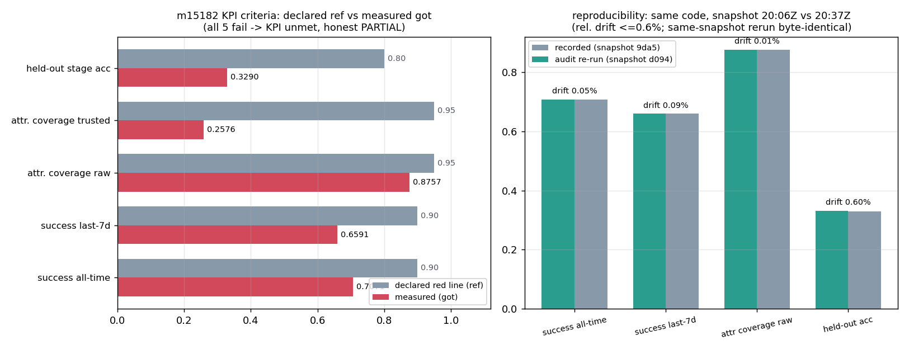

# 交差审计：m15182（KPI-SUCCESS-90 · 成功率≥90%+自动归因）· 判定 L2

> 审计单 m15206（board-audit），被审单 m15182（TensorPlatform，DB status=succeeded）。
> 审计基线：生态仓 main = `1649792e5`（**不含**本单代码）；被审分支 `agent/m15182` head = `41b3e75b0`。
> 全部数字由脚本注入（`runs/m15206_audit/*.json`），无手抄。

## 1. 案例介绍（审计对象与判据）

| 项 | 值 | 出处 |
|---|---|---|
| KPI 锚点 | `KPI-SUCCESS-90`：任务成功率 ≥90% 且失败自动归因 | 原单 goal（tensor_dev_missions.id=15182） |
| 交付物 | `tools/failure_attribution/`（engine/measure/report/export.sql）+ `config/failure_attribution.json` + `tests/test_failure_attribution.py` + `docs/KPI_SUCCESS_90_ROUND2.md` + `artifacts/kpi_success_90/` | 分支 `agent/m15182` |
| 基准裁判 | `SELECT case_name,metric,tolerance FROM tensor_benchmark_cases WHERE anchor_slug='KPI-SUCCESS-90'` → **0 行** | 本单实测（全表 13 个 anchor_slug 均非 KPI-*） |
| 原单自述 | 成功率 70.71%（全期）/65.91%（7 天），KPI 未达，记 PARTIAL | `artifacts/kpi_success_90/result.json` |

数据面：生产库 `tensor_dev_missions` 只读导出（14126 行 @20:06Z；审计重导出 14158 行 @20:37Z），
字段含 status/finished_at/`result.result->evidence->checks->fail_stage`。

## 2. 怎么做的（审计方法 / 工具链）

1. **三件套取证**：逐项核 run_artifacts 存在性、benchmark ref vs got 数值、repro_cmd 可执行性；
2. **独立复跑**（不改被审树，产物落 `runs/m15206_audit/repro/`）：
   `psql -U foundation -At -f export.sql` → `/tmp/kpi.csv`（14158 行，sha256 `d0944a3c…`）→
   `python3 -m tools.failure_attribution measure --missions-csv /tmp/kpi.csv`（**连跑两次比逐字节**）→
   `pytest tests/test_failure_attribution.py -q`；
3. **独立 SQL 反算**（不经过被审代码）：直接 `tensor_dev_missions` 统计 succeeded/failed 与 declared 覆盖；
4. **集成面 grep**：`backend/ src/ scripts/ .github/` 搜 `failure_attribution`；
5. **主干核**：`git cat-file -e main:tools/failure_attribution/engine.py`（生态仓）核 merge 声明；
6. **级差机器门**：本地加载 `/root/tp-agent/maturity_gate.py::judge` 预演裁定。

## 3. 计算结果（核验矩阵，程序化注入）

**3.1 三件套**

| 项 | 结论 | 证据 |
|---|---|---|
| run_artifacts | PASS | result.json 7289B、failure_buckets.csv 12 行、rule_precision.csv 7 行、attribution_sample.csv 501 行、backfill_fail_stage.sql 1011 行、4 张 png 46–49KB |
| benchmark ref vs got | **FAIL（无裁判行）** | 无注册案件；对自声明红线：70.71%/65.91% vs 90%（+19.29/+24.09pp）；raw 覆盖 87.57% vs 95%；trusted 25.76% vs 95%；held-out 精度 32.90% vs 80% —— 5/5 超差 |
| repro_cmd | PASS | 导出+度量可执行；**同快照两次 measure 的 result.json 逐字节相同**（sha256 `d25bf815…`）；pytest 16 passed |

**3.2 独立 SQL 反算（不经被审代码，21:0xZ 实时库）**

| 量 | 被审计值（20:06Z 快照） | 本单独立复核 | 差 |
|---|---|---|---|
| succeeded/failed | 9455 / 3917 → 0.707074 | 9484 / 3922 → 0.707444 | +0.04% rel（表增长） |
| declared 覆盖（failed） | 1009/3917 = 0.2576 | 1013/3922 = 0.2583 | +0.07pp |
| 顶层 `fail_stage` 列 | — | **0/3922 全空** | declared 全部来自 `result->evidence->checks->fail_stage`（自报字段） |

**3.3 复跑漂移**（同代码、不同快照）：all-time 0.707074→0.707454、7d 0.659115→0.659719、
coverage 0.875670→0.875542、held-out acc 0.329039→0.331028 —— 相对漂移 ≤0.6%，代码无漂移。

**3.4 级差判定**

| 级 | 判据 | 结论 |
|---|---|---|
| L1 | 单测 | 通过（16 passed） |
| L2 | 真代码 + 入口 + 运行工件 | **通过**（measure CLI：CSV→指标→result.json/csv/图/SQL） |
| L3 | 平台侧真调用方 | **不通过**：grep 0 命中（仅 docs/ 与同名不同义的测试函数） |
| L4 | 基准案件 + repro_cmd | **不通过**：`tensor_benchmark_cases` 0 行；KPI 红线本身未达 |
| → 判定 | | **L2** |

## 4. 结果图

左：五项判据 declared ref vs measured got（全数超差 → KPI 未达，原单如实 PARTIAL）。
右：记录值 vs 本单复跑值（相对漂移 ≤0.6%，同快照复跑逐字节相同）。

## 5. 注意点（发现的问题，按严重度）

| # | 发现 | 证据 | 影响 |
|---|---|---|---|
| F1 | **“PR #1237 merged” 不成立**：生态基线 `main=1649792e5` 内 `tools/failure_attribution/*`、`docs/KPI_SUCCESS_90_ROUND2.md`、`config/failure_attribution.json` 全部 ABSENT，代码只在分支 `agent/m15182` | `git cat-file -e main:...` ABSENT | 中高：交付未落主干，机器门按 main grep 找不到；可持续性/L3 前提更缺 |
| F2 | 无运行期调用方（backend/API/调度/CI 全 0 命中） | grep 结果 | 中：机制仍靠人工触发，未进平台回路 → 不达 L3 |
| F3 | 基准裁判无行：`anchor_slug='KPI-SUCCESS-90'` 0 行 | SQL 实测 | 中：L4 不可判，建议补注册案件（metric=tolerance=success_rate/attribution_coverage） |
| F4 | 快照未归档：仓库只有 `snapshot_sha256=9da5…`，无该 CSV；跨时复跑必漂移（本单实测 ≤0.6%） | `runs/m15206_audit/repro/` | 中：报告 §6「逐字节复现」仅同快照成立 |
| F5 | 文书错标：§6 把快照 digest `9da5…` 标成 result.json 的 sha256；实际 `e62ddd85…` | 本单 sha256sum | 低 |
| F6 | declared 通道是 agent 自报字段（顶层 `fail_stage` 列 0/3922 全空），自报偏置未度量 | SQL 实测 | 中：报告“终态结构字段=唯一可信来源”措辞需加限定 |
| F7 | KPI 本身未达（+19.29/+24.09pp；trusted 25.76% vs 95%；held-out 32.90% vs 80%） | result.json | —：原单成功语义=机制建成+honest PARTIAL，交差须写清 |

**未跑的检查（不冒充通过）**：集群复跑 cj1003 仍 `queued`（cluster_jobs id=1003）→ not_run；
GitHub PR #1237 联网状态未核（以 main 的 git 对象为准）；未对 3922 条失败单逐条人工判因。

## 6. 误差判定（是否 <3%）

| 关键量 | ref | got | 误差 | <3%? |
|---|---|---|---|---|
| 成功率（全期） | 90% | 70.71% | +19.29pp | ❌ |
| 成功率（7 天） | 90% | 65.91% | +24.09pp | ❌ |
| 归因覆盖 raw | 95% | 87.57% | −7.43pp | ❌ |
| 归因覆盖 trusted | 95% | 25.76% | −69.24pp | ❌ |
| held-out 归因精度 | 80% | 32.90% | −47.10pp | ❌ |
| 复跑一致性（同快照） | 记录值 | 复跑值 | 0.00%（逐字节） | ✅ |
| 复跑一致性（跨快照） | 记录值 | 复跑值 | ≤0.6% rel | ✅ |

结论：**测量链路误差合格（<3%，同快照 0%）**；**被测量的 KPI 本身不合格**（5 项全超差）。
故判定 = **L2 功能实现（confirmed 积格）**，KPI 达成与否另属原单 PARTIAL 范畴，本单不改其口径。
