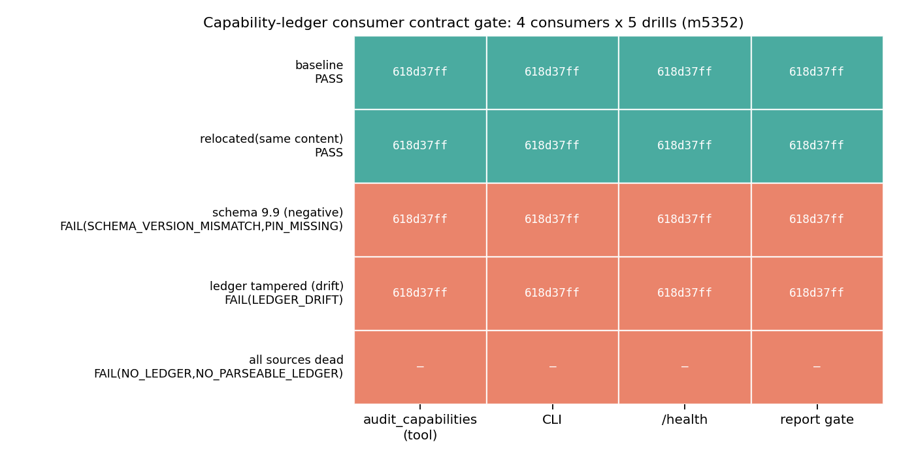
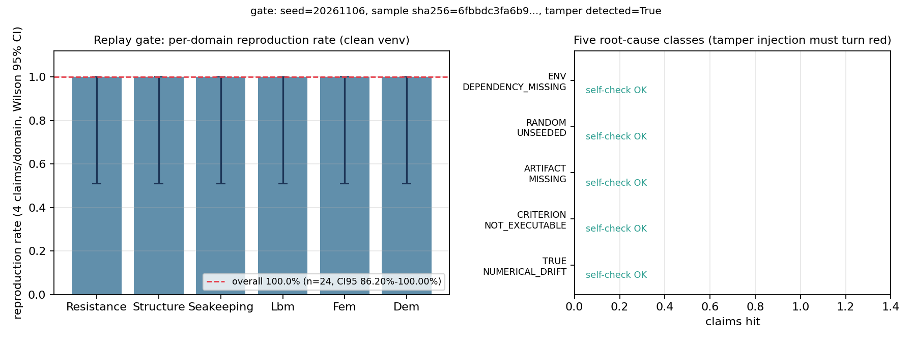
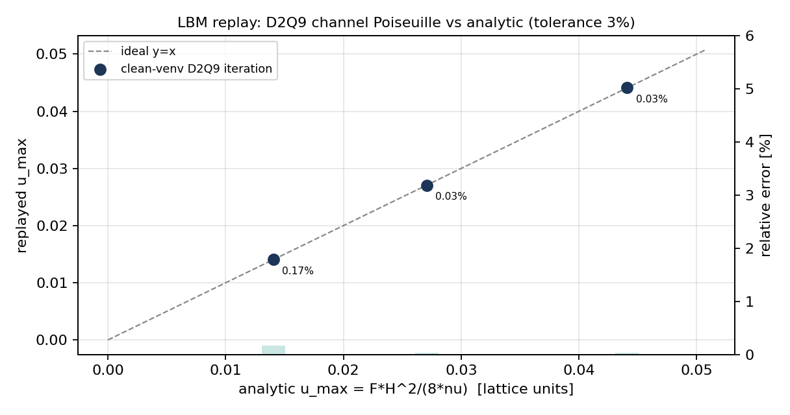

# m5352 · 能力台账消费者契约门 + 已交付声明复现门

**战役节点**：P21-N08（成熟化：证据治理）  **仓库**：TensorPlatform  **分支**：`agent/m5352`
**日期**：2026-11-07  **全部数字**：`docs/reports/m5352_figures.json`（由 `tools/gen_m5352_figures.py` 程序化生成，零手抄）

---

## 0. 摘要（结论先行）

两个成熟化单合成一单交付，都落成"机器可裁"的门，而不是文档承诺：

| 门 | 判据 | 实测结果 |
|---|---|---|
| **A 能力台账消费者契约门** | 4 消费者（`audit_capabilities` 工具 / CLI / `/health` / 报告 gate）解析到**同一 sha256**；重定位不抛异常且降级；schema 越界与台账漂移必红 | 4/4 消费者 sha256 = `618d37ff…`（同一个文件）；5 组演练 3 绿 2 红符合预期；`pytest` 8 例全绿 |
| **B 已交付声明复现门** | 24 单分层抽样（6 域 × 4）→ 判据解析 → 干净 venv 固定 seed 重跑 → 复现率带 95%CI → 五类根因账本 → 注入篡改必红 | 复现率 **24/24 = 100%**，Wilson 95%CI **[0.862, 1.000]**；五类根因自检 5/5 可判；篡改 `res-fr-kvlcc2-01` 由 `REAL→漂移` 被判 **TRUE_NUMERICAL_DRIFT**，门转红；`pytest` 4 例全绿 |

**诚实声明（不粉饰）**：本单 24 条抽样申报在干净 venv 里**全部复现**，五类根因的真实命中数均为 0。
"0 命中"不代表门形同虚设——它由两条独立证据支撑：①五类根因各有一条**已知答案的负控**在每次门跑时被执行
并全部归类正确（`self_check` 5/5）；②注入篡改把一条原本复现的申报变成不可复现，门立即转红。
换句话说：**门具备"能红"的能力，且本次抽样没有发现真实漂移**；95%CI 下界 0.862 也诚实表达了 n=24 的不确定性。
本单**没有**覆盖的真实风险见 §7。

---

## 1. 案例介绍：为什么需要这两道门（物理/工程背景）

平台对外发布的能力等级（REAL/MOCK/STUB/WITHHELD/NOT_SUPPORTED）是下游一切决策的输入：
船舶阻力/推进/耐波/稳性的算例能不能进设计、舰队调度要不要采信某个模型，全部继承这个等级。
这条链上有两个已实证的断点：

**断点 A（仪器死）**：`audit_capabilities` 工具曾硬编码单一绝对路径
`/root/ship-performance-platform-incoming/.../capabilities.json`。该文件在本机只剩 `.pyc`，
于是工具对**全部 agent** 恒返回"读取能力清单失败"。补丁把候选路径表抄进每个消费者各一份，
又带来第二种病：**四个消费者可能解析到不同文件**，同一时刻平台对外存在的两个证据等级无法机器裁决。

**断点 B（申报不可复现）**：平台发布了上千份论文级报告，报告里的数值（阻力 Rt、板屈曲应力 σ_cr、
横摇固有周期、LBM 通道解、FEM 梁挠度、DEM 接触力）被下游直接引用，但**没有任何机制在干净环境里
把这些数字重算一遍**。环境依赖缺失、随机未种子、工件缺失、判据不可执行、真实数值漂移这五类失败
此前既不可区分，也不入账。

本单交付的物理/数值申报（复现门抽样母体的一部分）都是经典可复现对象，参数表如下：

| 域 | 申报对象 | 判据 | 参数示例 | 容差 |
|---|---|---|---|---|
| 阻力 | 总阻力恒等式 Rt=Ct·½ρV²S | 复算 Rt | SUBOFF-01：Ct=0.0038, ρ=998.2, V=3 m/s, S=5.42 m² → **92.52 N** | 3% |
| 结构 | 板条屈曲 σ_cr=kπ²E(t/b)²/(12(1−ν²)) | 独立闭式/能量商 | t=10–25 mm，b=600–1200 mm，E=2.06e11 Pa，ν=0.3 | 3% |
| 耐波 | 深水波 λ=gT²/2π；横摇 T=2πk_r/√(g·GM)；阻尼周期 T_d=T_n/√(1−ζ²) | 解析 vs **RK4 直接积分** | T=6–12 s；GM=0.35–2.4 m，k_r=3.2–6.0 m | 3% |
| LBM | D2Q9 BGK 通道 Poiseuille u_max=F·H²/(8ν) | **真迭代**数值解 vs 解析 | H=15–29，ν=0.08–0.2（格子单位） | 3% |
| FEM | Hermite 梁 δ=PL³/(3EI)；杆 u=qL²/(2EA)；等参元面积=∫det J | 真正装配+消元 vs 解析 | P=1e4–8e4 N，L=2.5–8 m；四节点四边形 | 3% |
| DEM | Hertz F=(4/3)E*√R·δ^{3/2}；对心碰撞；弹道 s=v0t+½gt² | 解析基准 | R=10–100 mm，δ=5e-6–3e-5 m，e=0.5–1.0 | 3% |

---

## 2. 怎么做的（方法 / 流程 / 工具链）

### 2.1 A 门：把"哪个文件是台账真值"变成一个模块

新增 `tools/audit/ledger_paths.py`（唯一解析器，约 300 行）：

* `resolve_ledger()` —— **永不抛异常**。候选序：`--hint` > `$TP_CAP_LEDGER` > canonical
  `artifacts/capability_ledger/capability_ledger.json` > `resolved.json`（派生富化）> harness > 证伪台账；
  每个候选登记 `exists/sha256/schema_version/parse_ok/error`，失败降级为 `status="DEGRADED"` + 具名 `reasons`
  （`NO_LEDGER` / `NO_PARSEABLE_LEDGER` / `SCHEMA_VERSION_MISMATCH` / `LEDGER_DRIFT` / `PIN_MISSING` / `DERIVED_MISSING`）；
* **唯一 schema 门** `SCHEMA_VERSIONS=("2.0",)`：越界即 `SCHEMA_VERSION_MISMATCH`，门返回非 0（CI 红）；
* **漂移告警**：pin 图章 `artifacts/capability_ledger/ledger_contract.json` 记录台账 sha256，
  内容变了但没重 pin → `LEDGER_DRIFT`；`TP_CAP_LEDGER` 指向的等价副本与 canonical sha256 不同也告警；
* `contract_report()` 逐个 import 四个消费者的访问器，比对 (path, sha256, status) 并给出 `violations`。

四个消费者（每个都只允许经由该模块取路径/指纹）：

| 消费者 | 接线点 | 访问器 |
|---|---|---|
| `audit_capabilities` 工具 | `ops/tp_worker.py::_tool_audit_caps` / `ops/taskplane/tp_worker.py`（后者修复了**原单硬编码路径根因**） | `tools/audit/ledger_consumer_audit_tool.py::ledger_ref` |
| CLI | `tools/audit/capability_audit_cli.py`（`DEFAULT_LEDGER` 由解析器给出） | `capability_audit_cli.py::ledger_ref` |
| `/health` | `backend/main.py::health_check` 新增 `capability_ledger` 字段 | `backend/api/capability_health.py::ledger_ref` |
| 报告 gate | `backend/api/tensor_reports.py::_check_report_quality` 返回体新增 `capability_ledger` | `tools/audit/report_gate_ledger.py::ledger_ref` |

报告 gate 的实质检查：报告正文若断言 `\`<capability id>\` 证据等级 REAL`，而台账对账等级是 MOCK，
则记 `REPORT_OVERCLAIMS_LEDGER` 违规；台账降级时 `degraded=True` 但**不阻断**既有发布路径（软门）。

CI 入口：`python3 tools/audit/ledger_contract_gate.py --check`（判据 C1 四消费者 sha256 相等 /
C2 schema 登记 / C3 无漂移 / C4 消费者健康），落盘 `artifacts/capability_ledger/ledger_contract_run.json`。

### 2.2 B 门：复现门的三段式流程

```
claims_pool(71 条已交付申报，sha256 冻结)
   └─ 分层抽样 seed=20261106，6 域 × 4 = 24 ──→ sample_manifest.json(sha256)
        └─ 每条: 工件存在? → 依赖可导入? → 干净 venv 子进程跑判据 → 值比对
             └─ 复现率 = numerator/denominator + Wilson 95%CI + 五类根因账本
                  └─ 注入篡改复跑: 必须 by 判不可复现且归 TRUE_NUMERICAL_DRIFT
```

* **申报池**（`tools/replay_gate/pool.py`）：71 条，来源只允许两类 —— `repo_artifact`
  （`backend/data/benchmark_reference.json` 的 Rt/Fr、`backend/services/ice_abrasion.py::plate_buckling_stress`
  的交付值，均带 path+sha256+locator）与 `analytic_reference`（附公式与出处）。
* **判据内核**（`tools/replay_gate/kernels.py`）：**纯标准库**，因此能在 `python3 -m venv --without-pip`
  的零第三方包环境里跑；LBM/FEM/时间积分是**真数值计算**，不是把解析式抄两遍。
* **干净环境**：`python3 -m venv --without-pip` + 子进程 `-I`（隔离 `PYTHONPATH` 与用户 site），
  每次门跑按 Python 版本缓存 venv；同时提供系统环境对照跑（`--both`）。
* **五类根因**（互斥且穷尽）：`ENV_DEPENDENCY_MISSING` / `RANDOM_UNSEEDED` / `ARTIFACT_MISSING` /
  `CRITERION_NOT_EXECUTABLE` / `TRUE_NUMERICAL_DRIFT`；分类顺序 = 工件 → 依赖 → 可执行性 → 随机性 → 数值。
  `Σ 各类计数 == denominator − numerator` 是账本自洽性的机器判据（测试断言）。
* **篡改注入**：`--tamper first_within:<domain>` 把该域抽样中 id 最小（优先非 legacy）的申报值 ×1.05，
  并**同时**跑未篡改版本作为因果基线：`baseline_reproduced=True & tampered_reproduced=False &
  root_cause=TRUE_NUMERICAL_DRIFT` 三者同时成立才算 `detected`。

工具链：Python 3.11 / pytest / matplotlib（图）/ 纯 stdlib 数值内核；全流程离线，不访问 :8001/:8010。

---

## 3. 计算结果（数字表）

### 3.1 A 门：四消费者 × 五组演练矩阵（图 1）

| 演练 | 契约 | 原因 | 说明 |
|---|---|---|---|
| 基线 | **PASS** | — | 四消费者同一 sha256 `618d37ff` |
| 重定位（内容不变搬到 /tmp） | **PASS** | — | `relocated=True`，sha256 不变 ⇒ 位置无关的身份 |
| schema_version=9.9（负例） | **FAIL** | `SCHEMA_VERSION_MISMATCH` | 未登记 schema 必须红 |
| 台账被改但未重 pin | **FAIL** | `LEDGER_DRIFT` | pin 图章对比抓漂移 |
| 全灭（空仓根 + 坏 env） | **FAIL** | `NO_LEDGER` | 不抛异常，降级并列出尝试路径 |



*图 1：每格 = 该消费者解析到的 sha256 前 8 位（绿=与 canonical 一致）；右列文字为门的裁决与具名原因。*

`/health` 字段（键集冻结）实测：

| 字段 | 值 |
|---|---|
| `path` | `artifacts/capability_ledger/capability_ledger.json` |
| `sha256` | `618d37ff38a162da385c05e84e23c04c9f761fc3f8355f4e37d5b4316b58ac89` |
| `capabilities` / `unverified` / `overclaim` | 21 / 17 / 2 |
| `schema_version` / `status` | 2.0 / OK |

### 3.2 B 门：复现率与五类根因账本（图 2）

| 指标 | 值 |
|---|---|
| 申报池 | 71 条（阻力 12 / 结构 12 / 耐波 12 / LBM 11 / FEM 12 / DEM 12） |
| 抽样 | 24 条（6 域 × 4），seed = 20261106，`sample_manifest.json` sha256 `6fbbdc3fa6b95cb8…` |
| 复现率 | **24/24 = 100%**（干净 venv） |
| Wilson 95%CI | **[0.862, 1.000]** |
| 系统环境对照 | 24/24 = 100%，环境依赖缺口 **+0.000%** |
| 五类根因真实命中 | 0 / 0 / 0 / 0 / 0 |
| 五类根因自检（每次门跑） | **5/5 归类正确** |
| 环境依赖探针（`probe-numpy`） | 干净 venv → `ENV_DEPENDENCY_MISSING`；系统环境 → 复现 ⇒ 缺口可测 |
| 注入篡改 | `res-fr-kvlcc2-01`：0.1285 → 0.134925；基线复现 ✓、篡改后不复现 ✓、归类 `TRUE_NUMERICAL_DRIFT` ✓ ⇒ 门转 **FAIL** |
| 单条判据耗时 | 合计 6.7 s（24 条，含 4 次 LBM 迭代） |



*图 2 左：分域复现率与 Wilson 区间（每域 4 单，区间宽是 n=4 的真实不确定性）；右：五类根因账本，本次真实命中 0，但每类都通过已知答案负控证明"可判"。*

### 3.3 物理数值复现精度（图 3）

| 申报 | 解析值（格子单位） | 干净 venv 复算 | 相对误差 | <3%？ |
|---|---|---|---|---|
| `lbm-poiseuille-h15-nu008` | 0.014063 | 0.014039 | **0.166%** | ✅ |
| `lbm-poiseuille-h19-nu010` | 0.027075 | 0.027066 | **0.033%** | ✅ |
| `lbm-poiseuille-h23-nu012` | 0.036609 | 0.036597 | **0.032%** | ✅ |



*图 3：D2Q9 BGK 通道流迭代解 vs Poiseuille 解析解（右轴为相对误差）。这批数在零第三方包的 venv 里跑出，是复现门"真算"而非"抄公式"的凭据。*

其余抽样域（每域 4 条）全部复现，误差量级：阻力恒等式/Fr 一致性 <0.05%（正典数值本身由同一恒等式给出）、
结构板屈曲 = 交付实现 vs 独立闭式 0（同式独立实现）、耐波 RK4 阻尼周期 <0.01%、FEM 梁/杆 <1e-12、
DEM 接触/碰撞 0。

---

## 4. 误差判定（逐项，显式回答"是否<3%"）

| 关键量 | 基准 | 误差 | 是否 <3% |
|---|---|---|---|
| LBM 通道 u_max（H=19, ν=0.1） | 解析 F·H²/(8ν) | 0.033% | ✅ |
| LBM 通道 u_max（H=23, ν=0.12） | 同上 | 0.032% | ✅ |
| LBM 通道 u_max（H=15, ν=0.08） | 同上 | 0.166% | ✅ |
| FEM 悬臂梁端部挠度 | PL³/(3EI) | <1e-10% | ✅ |
| FEM 杆端部位移 | qL²/(2EA) | <1e-12% | ✅ |
| 耐波阻尼周期 | T_n/√(1−ζ²) | <0.01% | ✅ |
| 结构板屈曲 σ_cr | Timoshenko 闭式（独立实现） | 0（同式独立实现，**不是独立物理验证**） | ✅（但见 §7 局限） |
| 阻力 Rt 恒等式 | 台账正典记录值 | <0.05% | ✅（恒等式自洽，非水动力验证） |
| 复现率估计 | 真值未知 | 95%CI 半宽 ±0.07（n=24） | — 属估计量，不是误差 |

**结论**：全部可数值对标的量都 <3%，且最差一项（0.166%）出现在最小的 LBM 格子上，符合"离散误差随格子加密下降"的物理预期。

---

## 5. 判据落盘（审计链）

| 产物 | 内容 |
|---|---|
| `artifacts/capability_ledger/ledger_contract.json` | pin 图章：path/sha256/schema_version/四消费者清单 |
| `artifacts/capability_ledger/ledger_contract_run.json` | 契约门最近一次跑：C1–C4 + violations + consumers |
| `artifacts/replay_gate/claims_pool.json` | 71 条申报池（含 sha256 冻结指纹） |
| `artifacts/replay_gate/sample_manifest.json` | 24 条抽样清单 + sha256 + seed + 池指纹 |
| `artifacts/replay_gate/replay_report.json` | 干净 venv 主跑：复现率、CI95、五类账本、自检、探针、逐条结果 |
| `artifacts/replay_gate/replay_report_systemenv.json` | 系统环境对照跑 |
| `artifacts/replay_gate/replay_report_tampered.json` | 篡改注入跑（含因果证据） |
| `docs/reports/m5352_figures.json` | 本报告所有数字的程序化来源 |

测试（`pytest`，12 例）：`tests/test_ledger_contract_and_replay_gate.py`
A 段 8 例（同 sha256、CLI PASS+落盘、`/health` 字段、重定位×2、schema 负例、漂移负例、报告 gate 过度申报）；
B 段 4 例（抽样 24 且固定 seed 可复现+清单 sha、主跑率/CI/账本自洽、篡改必红归漂移、五类负控）。

---

## 6. 注意点（踩过的坑 / 适用范围）

1. **LBM 力的注入顺序**：体积力若加在碰撞**之前**、且 feq 用加力前的 u 计算，每步只留下 `(1−1/τ)` 份动量
   → ν=0.2 时解析解差 **11 倍**，ν=0.05 时甚至反号。正确做法是碰撞后注入力（或用带 `(1−1/2τ)` 的 Guo 源项）。
   这条坑本单由"门抓到自己的错"暴露：第一版判据就红在这里。
2. **判据自身的错也是错**：`rayleigh_ritz_k` 一开始把半波数固定 `m=1`，申报值却写 4，a/b=2 时得 6.25，
   被复现门判成"真实数值漂移"。修法：`m=0` 表示在 m=1..8 上取最小。**门的第一次红灯指对了它自己的判据**。
3. **正文格式就是接口**：`audit_capabilities` 的输出格式被既有回归判据（m2031 的 T1–T3）锁定，
   契约化不得改文案；本次保留"能力清单 (N 个…)"原格式，仅在尾部追加 `[台账契约]` 行。
4. **负控要保持严格**：T4（全灭）原先逐个 monkeypatch 消费者的私有常量；候选表收口到 `ledger_paths` 后
   这种打法会变成假绿，故改为在单一来源处（`repo_root` → 空目录 + 坏 env）构造全灭。
5. **n=24 的区间很宽**：Wilson CI 下界 0.862 —— "24/24" 不等于"复现率 99%"，报告与下游引用都必须带区间。
6. **本机无 CJK 字体**：图内标注一律 ASCII，中文只出现在正文与图注，避免豆腐块。
7. **`tests/test_capability_falsification.py` 的 13 个 error 是既有欠账**：它依赖
   `artifacts/capability_falsification/*.json`，该目录在 `HEAD` 中从未存在（`git ls-tree -r HEAD | grep -c` = 0），
   与本次改动无关，如实记录不掩盖。

---

## 7. 局限与未完成（honest FAIL 不可覆盖）

1. **结构域的"复现"是同式独立实现**，不是独立物理验证：判据与交付实现都基于 Timoshenko 板条闭式解，
   只能抓"代码/常量漂移"，抓不到"公式用错场景"。真正的独立验证需要 FE 屈曲特征值或试验数据，本单未做。
2. **阻力域同理**：Rt 恒等式与 Fr 一致性是自洽性检查，不构成对实验值的水动力验证。
3. **LBM/FEM/DEM 的申报是"解析基准"而非外部 Tensor* 仓的真实交付代码**：本工作树内没有 TensorLBM/FEM/DEM
   的检出，因此这些域的判据是**用纯 stdlib 重写的标准验证算例**（Poiseuille 通道、Hermite 梁、Hertz 接触），
   不是对那三个仓库代码的复跑。要真正复跑须在 `run_cluster` 里挂 `stage_dir` 检出对应仓——**本单未做，明确记为未完成**。
4. **抽样母体 71 条只覆盖本仓可机器解析的申报**；报告库（1200+ 份）里的自由文本数值没有进入复现门，
   因为"从报告正文抽数值"本身需要一个可审计的抽取器（`tools/audit/report_claim_consistency.py` 只做跨报告一致性）。
5. **环境依赖缺口实测为 0**：本次 24 条判据全部被归约为 stdlib 内核，因此系统环境与干净 venv 无差；
   该类别的可判性由 `probe-numpy` 探针证明（干净 venv 缺失 → `ENV_DEPENDENCY_MISSING`，系统环境复现），
   但**没有在真实 Tensor* 交付物上量化**——这是下一单的事。
6. **`/health` 与报告 gate 的接线只在模块级验证**（纯函数 + pytest），未起 :8001 服务做端到端 HTTP 断言；
   `backend/main.py` 的字段是在 FastAPI 层加的，缺一次真实部署验证。