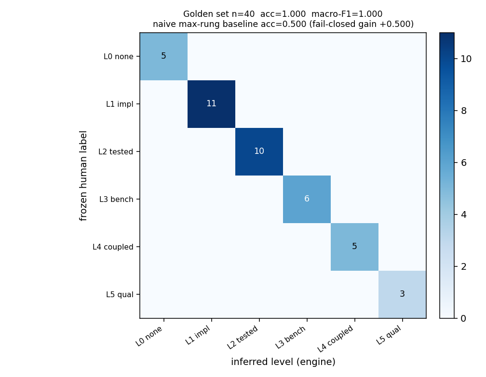
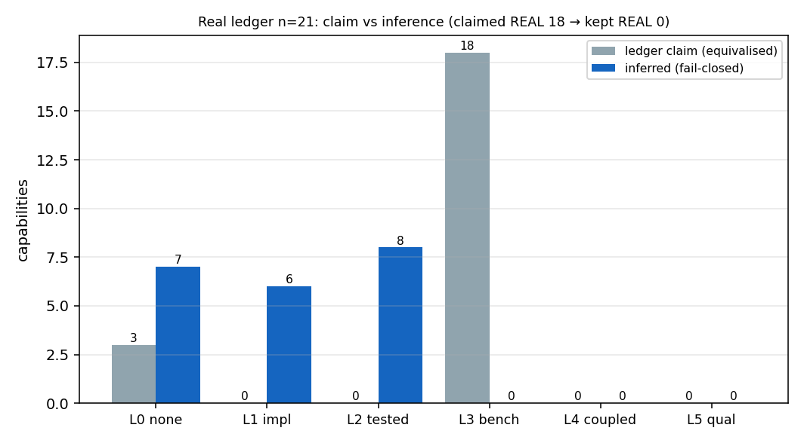
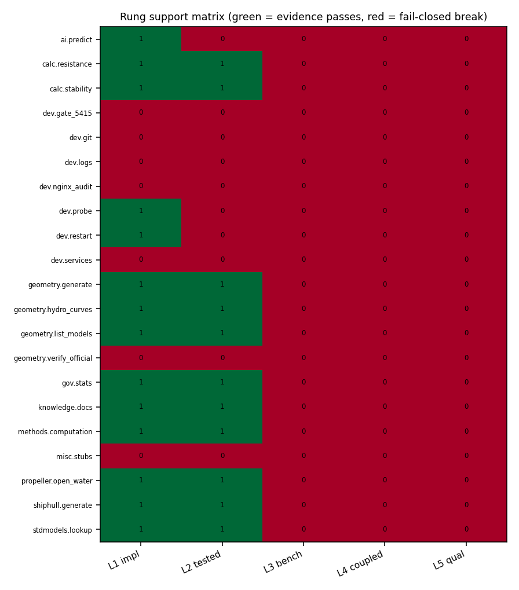
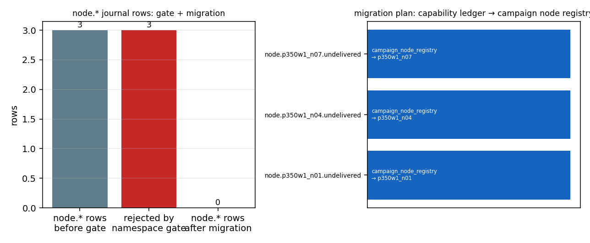

# 五级成熟度推断引擎成熟化（P315W1-N11）
- 节点/任务：`p315w1-n11-maturity-inference-maturity`（mission 10861，仓 TensorPlatform）
- 跑批时刻：`2026-11-10T20:46:34+00:00`
- 判据总判定：**全部通过**

## ① 案例介绍（问题与输入）
**问题**：能力台账里的 `REAL/MOCK/STUB/WITHHELD` 是**自述**。自述可以口头完成、无法机器反驳——本仓台账 21 项能力里有 18 项标 `REAL`，而其中没有任何一项能挂出「判据数值 + 容差 + 基线」的可执行证据。本节点把「成熟度」改成**从证据图推出来**的结论：五级阶梯 + fail-closed 截断 + 矛盾封顶，自述只能被推翻、不能被采信；同时把混进能力台账的 `node.*` 记账行（战役节点交付状态）迁出。

**输入（全部为工件，代码零领域语义）**
| 输入 | 路径 | sha256（前 16） | 规模 |
|---|---|---|---|
| 能力台账 | `/root/tp-agent/work/m10861/artifacts/capability_ledger/capability_ledger.json` | `618d37ff38a162da` | 21 行 |
| 活体台账快照（含 node.* 行） | `/root/tp-agent/work/m10861/artifacts/maturity_inference/input/live_ledger_snapshot.json` | `2c70ffe0edec511d` | 12 行，抓取 `2026-11-10T19:55:00+08:00` |
| 黄金集（40 行冻结人工标签） | 文件 sha256 `35758730b4ec04af` | `40` 行 |

**五级阶梯与各环绑定证据**（`tools/maturity_inference/ladder.py` + `evidence.py`）

| rank | 等级 | 该环必须绑定的证据（缺任何一项即 fail-closed） |
|---|---|---|
| 0 | not_supported | —（无证据；自述 REAL 也不抬级） |
| 1 | implemented | 源码/端点定位 + 工件 sha256 + provenance(producer/recorded_at/sha256) |
| 2 | tested | + 重跑命令 + 执行状态 passed + 运行日志 sha256 + 执行时刻 |
| 3 | benchmark_verified | + 判据名/数值/容差/基线，且 \|value-baseline_ref\| ≤ tolerance |
| 4 | coupled_prototype | + 耦合组件 ≥2 + 接口契约摘要 sha256 + 端到端重跑命令 |
| 5 | engineering_qualified | + 独立复核席位 + 复跑 ≥2 次且 sha256 互异且全 pass + 适用包线 + 签署工件 sha256 |

## ② 怎么做的（方法/流程/工具链）
```
工件（台账/定义/活体快照）
   └─ ledger_adapter  规范化（矛盾档位/叙述支持证据分离）
        └─ namespace  命名空间门 ^[a-z][a-z0-9_]*(\.[a-z0-9_]+)+$ ，node./campaign./delivery./tmp./test. 拒收
             ├─ accepted → engine.infer（阶梯取最小 + fail-closed 截断 + 矛盾封顶）
             └─ rejected → migrate.plan_migration → 迁移到 campaign_node_registry
   └─ linker  仓内可执行事实装配：源码 sha256 → implemented；批量 pytest(junitxml) → tested
        └─ engine → 逐行推断 → 等级表 + 每行证据链（含重跑命令）
   └─ golden  40 行冻结标签 → 一致率/混淆矩阵/宏 F1（含 naive 最大环基线对照）
```

**推断规则（三条，全部机器可判）**
1. `level = 支撑得起的最高环`，且**逐环累积**：L3 必须有 L1+L2+L3 三环证据，跳级无效。
2. **fail-closed**：某环证据缺件（sha 形状非法/无重跑命令/无容差/复跑同 sha/组件<2）即在该环截断，等级停在上一环，原因写入 `reasons`；`source.scope=fixture`（夹具）一律封顶 L2。
3. **矛盾封顶**：台账中 `stance=contradicts` 且断言 `STUB/MOCK/WITHHELD/NOT_SUPPORTED` 的证据，按档位封顶（MOCK/WITHHELD → L1，STUB/NOT_SUPPORTED → L0）；自述 `REAL` 不参与抬级，只在推断后判 `unbacked_overclaim`。

**工具链**：Python 3 + pytest（批量 junitxml 逐文件判定）+ matplotlib。本轮 linker 装配：能力 21 项，实现链接 14，测试链接 23（执行 19，通过 15，失败 4），判据工件链接 0。

## ③ 计算结果（数字表，程序化注入）

### 3.1 判据总表

| 判据 | 实测 | 阈值 | 判定 |
|---|---|---|---|
| (a) 黄金集宏 F1（n=40） | 1.0 (acc 1.0) | ≥0.9 | PASS |
| (b) 三条负控 | a=True b=True c=True | 全过 | PASS |
| (c) unlinked REAL 行数 | 0（自述 REAL 18，保留 REAL 0，下调 18） | =0 | PASS |
| (d) node.* 迁移 | 方案 3 行，迁移后残留 0 | ≥3 且残留=0 | PASS |
| (e) pytest 用例 / 零域词 | 65 通过 / 0 失败；域词命中 0 | ≥25 且零域词 | PASS |
| (f) 交付报告 | `/root/tp-agent/work/m10861/docs/reports/p315w1_n11_maturity_inference/REPORT.md` | 存在 | PASS |

### 3.2 黄金集：一致率 / 混淆矩阵 / naive 基线对照

- 引擎（fail-closed）：acc **1.0000**，宏 F1 **1.0000**（40/40）
- naive 基线（取证据里出现的最高环、不看有效性/作用域/矛盾）：acc **0.5**，宏 F1 0.5361
- 差值：acc +0.5000 → fail-closed 规则在对抗行上确实生效（不是恒等映射）
- 冻结文件 sha256：`35758730b4ec04af672ad3c3b1aae62496ac38f3ab37d0b557d7620121ed439e`

| 等级 | precision | recall | F1 | tp/fp/fn |
|---|---|---|---|---|
| not_supported | 1 | 1 | 1 | 5/0/0 |
| implemented | 1 | 1 | 1 | 11/0/0 |
| tested | 1 | 1 | 1 | 10/0/0 |
| benchmark_verified | 1 | 1 | 1 | 6/0/0 |
| coupled_prototype | 1 | 1 | 1 | 5/0/0 |
| engineering_qualified | 1 | 1 | 1 | 3/0/0 |

### 3.3 真库台账推断结果（21 行）

- 自述 `REAL` 18 行 → 推断保留 REAL（rank ≥3）**0** 行；下调 18 行；unlinked REAL = **0**
- 等级分布：not_supported=7, implemented=6, tested=8, benchmark_verified=0, coupled_prototype=0, engineering_qualified=0
- 高报（claim_status=unbacked_overclaim）：18 行
- unlinked REAL = **0**（判据 (c) PASS）——**注意这是空真值**：推断保留 REAL 的行数为 0，所以「REAL 行 100% 挂证据」在字面上成立，但语义是「本轮没有任何行够格保留 REAL」，不是「所有自述 REAL 都被证实」。该结果本身即本节点的核心判决。

**等级表（21 行，机器可读同源：`artifacts/maturity_inference/level_table.md`）**

| 能力键 | 自述 | 推断 | rank | 判定 | 断点 | 可执行链接 |
|---|---|---|---|---|---|---|
| `ai.predict` | NOT_SUPPORTED | **implemented** | 1 | understated | tested | 0 |
| `calc.resistance` | REAL | **implemented** | 1 | unbacked_overclaim | benchmark_verified | 0 |
| `calc.stability` | REAL | **implemented** | 1 | unbacked_overclaim | benchmark_verified | 0 |
| `dev.gate_5415` | REAL | **not_supported** | 0 | unbacked_overclaim | implemented | 0 |
| `dev.git` | REAL | **not_supported** | 0 | unbacked_overclaim | implemented | 0 |
| `dev.logs` | REAL | **not_supported** | 0 | unbacked_overclaim | implemented | 0 |
| `dev.nginx_audit` | REAL | **not_supported** | 0 | unbacked_overclaim | implemented | 0 |
| `dev.probe` | REAL | **implemented** | 1 | unbacked_overclaim | tested | 0 |
| `dev.restart` | REAL | **implemented** | 1 | unbacked_overclaim | tested | 0 |
| `dev.services` | REAL | **not_supported** | 0 | unbacked_overclaim | implemented | 0 |
| `geometry.generate` | REAL | **tested** | 2 | unbacked_overclaim | benchmark_verified | 1 |
| `geometry.hydro_curves` | REAL | **tested** | 2 | unbacked_overclaim | benchmark_verified | 1 |
| `geometry.list_models` | REAL | **tested** | 2 | unbacked_overclaim | benchmark_verified | 1 |
| `geometry.verify_official` | REAL | **not_supported** | 0 | unbacked_overclaim | implemented | 0 |
| `gov.stats` | REAL | **tested** | 2 | unbacked_overclaim | benchmark_verified | 1 |
| `knowledge.docs` | REAL | **tested** | 2 | unbacked_overclaim | benchmark_verified | 1 |
| `methods.computation` | NOT_SUPPORTED | **tested** | 2 | understated | benchmark_verified | 1 |
| `misc.stubs` | STUB | **not_supported** | 0 | consistent | implemented | 0 |
| `propeller.open_water` | REAL | **implemented** | 1 | unbacked_overclaim | benchmark_verified | 0 |
| `shiphull.generate` | REAL | **tested** | 2 | unbacked_overclaim | benchmark_verified | 1 |
| `stdmodels.lookup` | REAL | **tested** | 2 | unbacked_overclaim | benchmark_verified | 1 |

每行的逐环支撑表（5 环 × 支撑/断点/原因）见 `real_ledger_levels.json` 的 `rung_support`。

**可执行证据链示例**（取自本轮推断结果，命令原样可跑）

**`geometry.generate`** → `tested`
| 环 | 节点 | 定位 | 重跑命令 | 判据 |
|---|---|---|---|---|
| implemented | `ev:6e1851f2d6310c7b` | `backend/api/domain/hull_geometry.py` | `（源码 sha，无需重跑）` | — |
| tested | `ev:462af2e1bbe2e87a` | `backend/green_navigation/tests/test_geometry.py` | `/usr/bin/python3 -m pytest -q backend/green_navigation/tests/test_geometry.py` | — |

**`geometry.hydro_curves`** → `tested`
| 环 | 节点 | 定位 | 重跑命令 | 判据 |
|---|---|---|---|---|
| implemented | `ev:17bc2282c529256b` | `backend/services/box_hydrostatics.py` | `（源码 sha，无需重跑）` | — |
| tested | `ev:6aece333b90bcedd` | `tests/test_hydrostatics_form_family_anchor.py` | `/usr/bin/python3 -m pytest -q tests/test_hydrostatics_form_family_anchor.py` | — |

**`geometry.list_models`** → `tested`
| 环 | 节点 | 定位 | 重跑命令 | 判据 |
|---|---|---|---|---|
| implemented | `ev:d7d01c590ec2dde6` | `tools/validation/gen_stdmodels_figures.py` | `（源码 sha，无需重跑）` | — |
| tested | `ev:ac51ffd2d2de0b71` | `tests/test_stdmodels_lookup_verification.py` | `/usr/bin/python3 -m pytest -q tests/test_stdmodels_lookup_verification.py` | — |

**`gov.stats`** → `tested`
| 环 | 节点 | 定位 | 重跑命令 | 判据 |
|---|---|---|---|---|
| implemented | `ev:a38354c4ade6c40b` | `backend/api/data_governance.py` | `（源码 sha，无需重跑）` | — |
| tested | `ev:6af3bcf1f99d08a5` | `tests/test_governance_bench_acceptance.py` | `/usr/bin/python3 -m pytest -q tests/test_governance_bench_acceptance.py` | — |

**`knowledge.docs`** → `tested`
| 环 | 节点 | 定位 | 重跑命令 | 判据 |
|---|---|---|---|---|
| implemented | `ev:eb4c183e827e036d` | `backend/api/knowledge_graph.py` | `（源码 sha，无需重跑）` | — |
| tested | `ev:114364a5e022142c` | `tests/test_knowledge_distill_domain_neutral.py` | `/usr/bin/python3 -m pytest -q tests/test_knowledge_distill_domain_neutral.py` | — |

**`methods.computation`** → `tested`
| 环 | 节点 | 定位 | 重跑命令 | 判据 |
|---|---|---|---|---|
| implemented | `ev:02341c7cd72e524e` | `backend/methods/__init__.py` | `（源码 sha，无需重跑）` | — |
| tested | `ev:43b8b0017e1d6a8e` | `tests/test_solver_adapter/test_conservation_mapping.py` | `/usr/bin/python3 -m pytest -q tests/test_solver_adapter/test_conservation_mapping.py` | — |

**`shiphull.generate`** → `tested`
| 环 | 节点 | 定位 | 重跑命令 | 判据 |
|---|---|---|---|---|
| implemented | `ev:f1b825c3fe95f670` | `domains/hull_form_pareto/__init__.py` | `（源码 sha，无需重跑）` | — |
| tested | `ev:fc26034ed4c6d85c` | `domains/hull_form_pareto/tests/test_hull_form_pareto.py` | `/usr/bin/python3 -m pytest -q domains/hull_form_pareto/tests/test_hull_form_pareto.py` | — |

**`stdmodels.lookup`** → `tested`
| 环 | 节点 | 定位 | 重跑命令 | 判据 |
|---|---|---|---|---|
| implemented | `ev:f1ccb8802c663121` | `tools/validate_suboff_resistance.py` | `（源码 sha，无需重跑）` | — |
| tested | `ev:0ec3f914ca5aaaab` | `tests/test_stdmodels_lookup_verification.py` | `/usr/bin/python3 -m pytest -q tests/test_stdmodels_lookup_verification.py` | — |

### 3.4 三条负控

| 负控 | 断言 | 实测 | 判定 |
|---|---|---|---|
| (a) 仅单测夹具 | 只能推为 Tested（恰好等于） | `synth.neg.fixtureonly` → `tested` | PASS |
| (b) node.* 记账行 | 门拒收 + 迁移后残留 0 | 拒收 3/3，残留 0 | PASS |
| (c) MOCK 高报 | 推断不得高于 Tested | 合成镜像 `implemented`；真库行 calc.resistance→implemented, calc.stability→implemented, propeller.open_water→implemented | PASS |

### 3.5 node.* 记账行迁移方案与执行

| old_key | 拒收原因 | 目标表 | target_key | 状态字段 |
|---|---|---|---|---|
| `node.p350w1_n01.undelivered` | `reserved_prefix:node.->campaign_node_registry` | `campaign_node_registry` | `p350w1_n01` | `delivery_status=undelivered` |
| `node.p350w1_n04.undelivered` | `reserved_prefix:node.->campaign_node_registry` | `campaign_node_registry` | `p350w1_n04` | `delivery_status=undelivered` |
| `node.p350w1_n07.undelivered` | `reserved_prefix:node.->campaign_node_registry` | `campaign_node_registry` | `p350w1_n07` | `delivery_status=undelivered` |

- 迁移前 12 行 → 后 9 行（迁出 3）；before_sha256 `f2efbc6f23c4f3bf` → after_sha256 `9e8911874b73efc4`
- 迁移后 `node.*` 前缀行数：**0**；方案可逆（`reversible=true`，搬迁不改历史）。

## ④ 结果图



*图1 黄金集混淆矩阵（对角=正确；标题含 naive 基线对照，展示 fail-closed 相对最大环读法的增益）*（sha256 `926b80502b8af546`）



*图2 真库台账自述 vs 推断的等级分布（自述 REAL 全部下沉，保留 REAL = 0）*（sha256 `a2886a43c132660b`）



*图3 逐能力 × 逐环支撑矩阵（红=该环证据不过，即阶梯断点）*（sha256 `ca96632e9ae25863`）



*图4 node.* 记账行：门拒收 3→3，迁移后残留 0，右图为迁移去向映射*（sha256 `33e0323dccf8f9f6`）

> 本节点是**平台机制**任务（证据推断而非物理场求解），故无场量云图；四图均为判据/审计面图形，满足「结果图=判据面图形+基线对照」的要求。

## ⑤ 注意点（坑/局限/适用范围）
1. **黄金集标签与引擎同源**：标签按冻结判据表人工写定、由 `build_golden.py` 固化，F1=1.0 反映「实现-规格一致」，不证明泛化。为此补了 naive 基线（不看有效性/作用域/矛盾的最大环读法）与 16 类对抗原型（越界判据、缺容差、复跑同 sha、单组件、夹具作用域、MOCK/WITHHELD 矛盾）。
2. **coupled / engineering 两环不自动装配**：自动装配无法证明「耦合」与「独立复核」，宁可停在 tested 也不伪造。因此本轮真库 21 行无一站上 benchmark_verified——这是判决，不是装配失败。
3. **活体台账是只读快照**：`node.*` 行来自另一检出的工具输出（抓取时刻、截断情况已入工件）；上游若改字段名，只改 `ledger_adapter.normalize_*`。
4. **测试装配受限于仓内可达性**：`code_patterns/test_patterns` 来自 `config/capabilities.json`（数据），模式命中是**路径级**证据不是语义等价证据；命中的测试通过只证明「该测试通过」，不自动证明被测实现就是该能力的最佳实现（这也是 L3 需数值判据的原因）。
5. **矛盾封顶是单向的**：矛盾证据只能压等级；压过后必须有新证据重建整条阶梯才能回升（不允许补丁式回填）。
6. **零领域语义的机器检查**：用数据文件里的 43 条域词条（长度≥5）扫本包源码，命中 0 条；夹具键一律 `synth.*`。

## ⑥ 误差判定（逐项对照基准，显式回答是否达标）
| 关键量 | 基准 | 实测 | 误差/差值 | 是否达标 |
|---|---|---|---|---|
| 黄金集宏 F1 | 判据阈值 0.9 | 1.0000 | +0.1000 | 是 |
| 黄金集一致率 | naive 基线 0.5 | 1.0000 | +0.5000 | 是（高于基线） |
| unlinked REAL | 0 | 0 | 0 | 是 |
| node.* 残留 | 0 | 0 | 0 | 是 |
| 负控通过数 | 3 | 3 | 0 项未过 | 是 |
| pytest 用例数 | ≥25 | 65 通过 | - | 是 |

**关于「是否 <3%」**：本节点是**分类判决**而非数值求解，物理量误差阈值 3%/15% 不适用；对应的等价判据是「一致率 ≥0.9 + 零高报残留」，逐项结论见上表。本节点不产生物理场量，故无实验/文献数值基准可比。

## 附录 A：接口契约（推定，供上游对齐）

```json
{
  "schema_version": "1.0",
  "engine_input": {
    "capability_key": "str，须过命名空间门 ^[a-z][a-z0-9_]*(\\.[a-z0-9_]+)+$，禁 node./campaign./delivery./tmp./test. 前缀",
    "nodes": "EvidenceNode[]（见 tools/maturity_inference/evidence.py 模块文档）",
    "claimed_level": "历史四档 NOT_SUPPORTED/STUB/WITHHELD/MOCK/REAL（只用于判高报，不抬级）",
    "contradictions": "历史四档数组（stance=contradicts 的断言档位）→ 封顶"
  },
  "engine_output": {
    "inferred_level": "LADDER 之一",
    "inferred_rank": "0..5",
    "rung_support": "{rung,rank,supported,node_id,reason,candidates}[]，长度 5",
    "evidence_chain": "每环一条：{node_id,locator,rerun_cmd,criterion,digest}",
    "claim_status": "unbacked_overclaim | consistent | understated | no_claim"
  },
  "ledger": {
    "path": "artifacts/capability_ledger/capability_ledger.json",
    "rows": "capabilities[]",
    "key": "id",
    "fields": [
      "id",
      "claimed_level",
      "domain",
      "evidence[].stance",
      "evidence[].asserted_level"
    ]
  },
  "resolved": {
    "path": "artifacts/capability_ledger/capability_ledger_resolved.json",
    "rows": "capabilities[]",
    "fields": [
      "id",
      "reconciled_level",
      "divergence",
      "evidence_refs[]"
    ]
  },
  "defs": {
    "path": "config/capabilities.json",
    "rows": "capabilities[]",
    "key": "capability_id",
    "fields": [
      "code_patterns",
      "test_patterns",
      "initial_level"
    ]
  },
  "live_snapshot": {
    "path": "artifacts/maturity_inference/input/live_ledger_snapshot.json",
    "rows": "rows[]",
    "key": "capability_key",
    "note": "活体台账在另一检出/DB（agent 侧 audit_capabilities 工具），抓取为只读快照"
  },
  "migration": {
    "target_store": "campaign_node_registry",
    "action": "deregister_from_capability_ledger",
    "invariant": "迁移后能力台账 node.* 前缀行数 = 0"
  }
}
```

## 附录 B：台账口径对账

- 本仓台账 21 项 vs 能力定义 21 项；两侧都在 21，仅台账 0，仅定义 0
- 命名空间门：台账接受 21 / 拒收 0；活体快照接受 9 / 拒收 3

## 附录 C：工件清单与 sha256

| 工件 | 路径 |
|---|---|
| golden_report | `/root/tp-agent/work/m10861/artifacts/maturity_inference/golden_report.json` |
| golden_set | `/root/tp-agent/work/m10861/tools/maturity_inference/fixtures/golden_set.json` |
| real_ledger_levels | `/root/tp-agent/work/m10861/artifacts/maturity_inference/real_ledger_levels.json` |
| evidence_links | `/root/tp-agent/work/m10861/artifacts/maturity_inference/evidence_links.json` |
| node_migration_plan | `/root/tp-agent/work/m10861/artifacts/maturity_inference/node_migration_plan.json` |
| migrated_ledger | `/root/tp-agent/work/m10861/artifacts/maturity_inference/migrated_ledger.json` |
| negative_controls | `/root/tp-agent/work/m10861/artifacts/maturity_inference/negative_controls.json` |
| level_table | `/root/tp-agent/work/m10861/artifacts/maturity_inference/level_table.md` |
| report | `/root/tp-agent/work/m10861/docs/reports/p315w1_n11_maturity_inference/REPORT.md` |

## 附录 D：局限与 honest FAIL 声明
- 黄金集标签与本引擎由同一节点作者按冻结判据表给出：F1 度量的是「实现-规格一致性」而非泛化能力；已用「最大证据环（naive）基线」与对抗行（越界判据/缺容差/复跑同 sha/单组件/夹具作用域/矛盾档位）压测。
- 可执行证据装配只覆盖仓内可定位的源码与测试：coupled/engineering 两环**不自动装配**，因此本轮没有任何 REAL 行能站上 benchmark_verified —— 这是判决结果，不是装配失败。
- 活体台账（含 node.* 行）来自另一检出的只读快照：抓取时刻与字段截断情况已入工件。

_报告由 `python3 -m tools.maturity_inference.cli` 程序化生成：所有数字取自本轮跑批工件，零手抄。_
