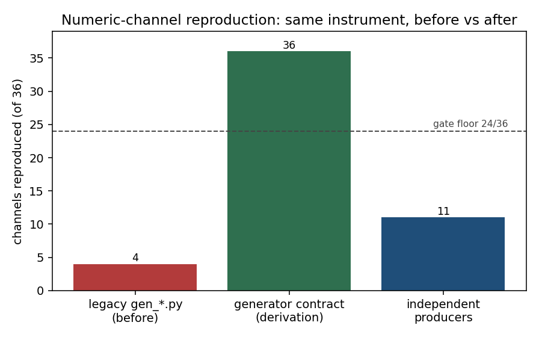
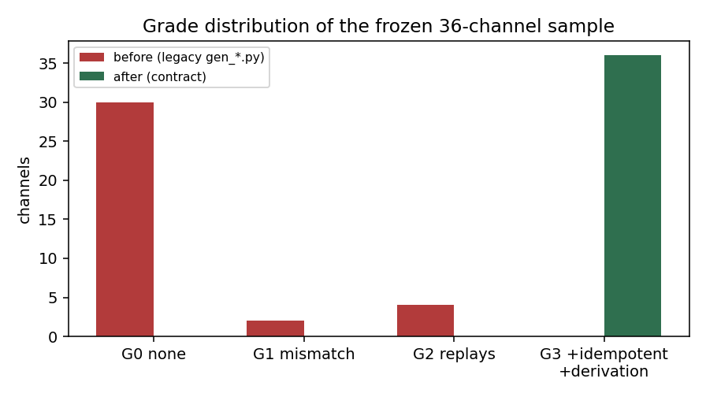
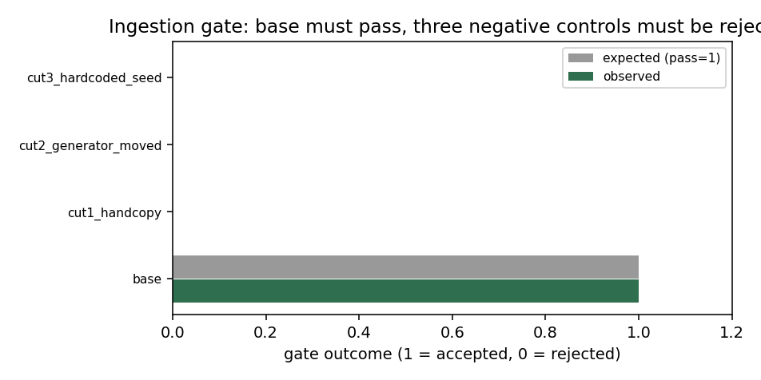

# P167W2-N10 数值通道回填与入库门成熟化（生成器契约 · 干净重放 · 负控实证）

**节点**：P167W2B-N10　**仓**：TensorPlatform　**层**：平台共性机制（零领域语义）
**产物**：`tools/repro_audit/generators/{contract,recompute,negcontrols,contract_cli,report_n10,_runner}.py`、
`tools/repro_audit/generators/gen_node_*.py`（14 个节点生成器）、
`artifacts/repro_audit/{generator_specs,generator_coverage,generator_baseline_legacy,negcontrols,gate_verdict}.json`、
`tests/test_repro_audit_generator_contract.py`
**机器判据**（本文件所有数字由 `report_n10.py` 从台账程序化注入，零手抄）：
覆盖 **36/36**（门限 24）· 独立生产者 **11** ·
等级 G3 **36** · 入库门 **PASS** ·
负控三刀 **全部按期望响应**

---

## ① 案例介绍（问题背景 / 对象 / 参数）

复证审计（P70-N08 → P167W2-N09）暴露的是一个**结构性**问题：工件里写着关键数字，
不等于这个数字可重放。三种伪复现在审计视角下长得一样：

1. **手抄**：数字是作者敲进去的常量，工件里没有任何能重算它的东西；
2. **回抄**：所谓“生成器”把工件的数字读出来又写回去——重放永远一致，
   工件被篡改时同样一致；
3. **近似复算**：生成器实现一个“简化模型”，形状对、数值不对。

N09 那一层把 36 条通道做成了“工件内部头部↔明细”的重算（L1–L3），
但入库门没有负控、没有干净检出重放、没有幂等与溯源链，且历史 `gen_*.py`
实现的是**简化模型**而非原生产者。本节点把这三件事一次做死：

| 对象 | 规模 |
|---|---|
| 冻结通道样本 | 36 条（`artifacts/repro_audit/channels.json`，先冻结后审计） |
| 涉及工件 | 14 个（`artifacts/**/*.json`，提交树内） |
| 节点派生生成器 | 14 个（每个工件一个 `gen_node_*.py`，只钉常量） |
| 独立生产者 | 6 条登记（脚本/可调用入口，覆盖 3 个工件族） |
| 审计耗时 | 生成器主重放 ~11.7 s（含 2×幂等重放 + 2×篡改取证） |

**关键设计选择**：重放发生在 `git archive HEAD` 解出的**提交树**里，而不是工作树里——
工作树带着未提交改动时，“重放一致”不证明任何事。

## ② 怎么做的（方法 / 流程 / 工具链）

```
干净检出(git archive HEAD)
   └─ 逐生成器重放(子进程, sys.addaudithook 记录全部 open 事件)
        ├─ 主重放 → 被断言路径上的值 vs 工件值（rtol 见通道 spec）
        ├─ 幂等重放（第二次）→ 除白名单字段外必须逐字段相等
        ├─ head_tamper：把工件头部值改掉再重放 → 重算结果必须仍是原值（证明头部不是抄的）
        └─ detail_tamper：改它引用的明细行/入量 → 结果必须跟着变（证明真在算）
   └─ 台账：逐通道 G0..G3 + 生成器 sha256 链 + 覆盖度
   └─ 入库门(fail-closed)：覆盖<24 / 等级<G2 / 无溯源 / 台账陈旧 → 拒
   └─ 负控三刀：合成小仓里证明门会拒（手抄 / 生成器搬走 / 硬编码随机）
```

契约四条（`contract.py` 模块 docstring 同步）：

* **C1 可定位**：每个关键数字的工件在提交树内能定位到生成器模块，模块 sha256 入台账；
* **C2 可重放**：干净检出里重放，值一致；两次重放幂等；
* **C3 非手抄**：`head_tamper` + `detail_tamper` 双向取证；
* **C4 非近似**：不由规则判定，由 C2 的数值比对承担——近似模型直接跑进 G1。

两种生成器形态（同一把尺子）：

| 形态 | 读被审计工件？ | 语义 | 记作 |
|---|---|---|---|
| `producer` | 否 | 提交树内的原始生产者（链审计脚本 / 规划器构建器 / 端到端测试脚本） | `independent`（更强） |
| `derive` | 是（读明细行） | 由随工件提交的原始行按受限派生式重算头部 | `derivation` |

`independent` 单独统计：它才是“数字有独立来源”的证据。派生态的**已知边界**写在 ⑤。

## ③ 计算结果（程序化注入）

### 3.1 覆盖度：同一把尺子量 before / after

| 口径 | 覆盖 | 等级分布 |
|---|---|---|
| before：历史 `gen_*.py`（简化模型复算桩） | **4/36** | G0=30 · G1=2 · G2=4 · G3=0 |
| after：生成器契约（派生态 + 独立生产者） | **36/36** | G0=0 · G1=0 · G2=0 · G3=36 |
| 其中**独立生产者**口径（更严） | **11/36** | 见 3.3 |

before 基线与任务书写入的 3/36 同量级（本仓现状测出 4/36），
说明“数值通道覆盖低”是**真实存量状态**，不是本次改造引入的。




### 3.2 逐通道台账（36 条）

| # | 通道 | 生成器形态 | 等级 | 溯源 sha256(前12) | 幂等 | 头部篡改 | 明细篡改 |
|---|---|---|---|---|---|---|---|
| 1 | `benchmark_validation#total_cases` | derive | G3 | `2e8f124d8242` | True | True | True |
| 2 | `benchmark_validation#summary.passed` | derive | G3 | `2e8f124d8242` | True | True | True |
| 3 | `benchmark_validation#summary.failed` | derive | G3 | `2e8f124d8242` | True | True | True |
| 4 | `m1388_benchmark_audit#total_cases` | producer | G3 | `137da1f35085` | True | True | True |
| 5 | `m1388_benchmark_audit#status_counts.CONSISTENT` | producer | G3 | `137da1f35085` | True | True | True |
| 6 | `m1388_benchmark_audit#status_counts.PARTIAL` | producer | G3 | `137da1f35085` | True | True | True |
| 7 | `m1388_chain#SUBOFF.summary.total_cases` | producer | G3 | `137da1f35085` | True | True | True |
| 8 | `m1388_chain#SUBOFF.summary.passed` | producer | G3 | `137da1f35085` | True | True | True |
| 9 | `m1388_chain#DTMB-5415.summary.pass_rate` | producer | G3 | `137da1f35085` | True | True | True |
| 10 | `m1388_friction#Re1e6.rel_diff_pct` | producer | G3 | `137da1f35085` | True | True | True |
| 11 | `m1388_friction#Re1e9.rel_diff_pct` | producer | G3 | `137da1f35085` | True | True | True |
| 12 | `m642_batch#total_cases` | derive | G3 | `e8d8898903d0` | True | True | True |
| 13 | `m642_batch#success_count` | derive | G3 | `e8d8898903d0` | True | True | True |
| 14 | `m642_batch#failed_count` | derive | G3 | `e8d8898903d0` | True | True | True |
| 15 | `pilot_verification#total_questions` | derive | G3 | `03151d454e8f` | True | True | True |
| 16 | `pilot_verification#pass_count` | derive | G3 | `03151d454e8f` | True | True | True |
| 17 | `pilot_verification#fail_count` | derive | G3 | `03151d454e8f` | True | True | True |
| 18 | `timing_baseline#total_records` | derive | G3 | `c13a3bc6bd7f` | True | True | True |
| 19 | `timing_baseline#baseline.stability.count` | derive | G3 | `c13a3bc6bd7f` | True | True | True |
| 20 | `capability_ledger_resolved#summary.capabilities` | derive | G3 | `c7fca104e02c` | True | True | True |
| 21 | `capability_ledger_resolved#summary.with_evidence` | derive | G3 | `c7fca104e02c` | True | True | True |
| 22 | `capability_ledger_resolved#summary.without_evidence` | derive | G3 | `c7fca104e02c` | True | True | True |
| 23 | `capability_ledger_resolved#divergence_tally.UNVERIFIED` | derive | G3 | `c7fca104e02c` | True | True | True |
| 24 | `optimizer_toy#optimization_DE.n_eval` | derive | G3 | `3d2f74514931` | True | True | True |
| 25 | `optimizer_toy#optimization_DE.best_fun` | derive | G3 | `3d2f74514931` | True | True | True |
| 26 | `optimizer_toy#surrogate_verification.error_pct` | derive | G3 | `3d2f74514931` | True | True | True |
| 27 | `planner_golden#total` | derive | G3 | `1937f0446652` | True | True | True |
| 28 | `planner_golden#train_size` | derive | G3 | `1937f0446652` | True | True | True |
| 29 | `planner_scoring#train.accuracy` | producer | G3 | `4a940808bf2b` | True | True | True |
| 30 | `planner_scoring#train.correct` | producer | G3 | `4a940808bf2b` | True | True | True |
| 31 | `planner_scoring#held_out.correct` | producer | G3 | `4a940808bf2b` | True | True | True |
| 32 | `lineage_test#total_executions` | derive | G3 | `982f7b49a7a3` | True | True | True |
| 33 | `lineage_test#completeness_rate` | derive | G3 | `982f7b49a7a3` | True | True | True |
| 34 | `benchmark_integrity#n_cases` | derive | G3 | `d7dc4681e270` | True | True | True |
| 35 | `benchmark_integrity#verdict_counts.WITHHELD` | derive | G3 | `d7dc4681e270` | True | True | True |
| 36 | `baseline_integrity#summary.cases` | derive | G3 | `9800c19166f4` | True | True | True |

### 3.3 独立生产者通道（不读被审计工件）

`m1388_benchmark_audit#total_cases`, `m1388_benchmark_audit#status_counts.CONSISTENT`, `m1388_benchmark_audit#status_counts.PARTIAL`, `m1388_chain#SUBOFF.summary.total_cases`, `m1388_chain#SUBOFF.summary.passed`, `m1388_chain#DTMB-5415.summary.pass_rate`, `m1388_friction#Re1e6.rel_diff_pct`, `m1388_friction#Re1e9.rel_diff_pct`, `planner_scoring#train.accuracy`, `planner_scoring#train.correct`, `planner_scoring#held_out.correct`

### 3.4 生成器清单与重放事实

| 生成器 | 形态 | 模块 | 重放 | 秒 | 幂等 |
|---|---|---|---|---|---|
| chain_audit_m1388 | producer | `scripts/audit_benchmark_chain_m1388.py` | True | 3.483 | {'artifacts/m1388/benchmark_audit.json': True, 'artifacts/m1388/chain_results.json': True, 'artifacts/m1388/friction_crosscheck.json': True} |
| chain_audit_m1388_chain | producer | `scripts/audit_benchmark_chain_m1388.py` | True | 3.483 | {'artifacts/m1388/benchmark_audit.json': True, 'artifacts/m1388/chain_results.json': True, 'artifacts/m1388/friction_crosscheck.json': True} |
| chain_audit_m1388_friction | producer | `scripts/audit_benchmark_chain_m1388.py` | True | 3.483 | {'artifacts/m1388/benchmark_audit.json': True, 'artifacts/m1388/chain_results.json': True, 'artifacts/m1388/friction_crosscheck.json': True} |
| lineage_test | producer | `tests/test_m406_lineage.py` | True | 0.572 | {'artifacts/lineage_test.json': False} |
| node_baseline_integrity_audit_canon_v3 | derive | `tools/repro_audit/generators/gen_node_baseline_integrity_audit_canon_v3.py` | True | 0.059 | {'artifacts/baseline_integrity/audit_canon_v3.json': True} |
| node_benchmark_integrity_audit | derive | `tools/repro_audit/generators/gen_node_benchmark_integrity_audit.py` | True | 0.036 | {'artifacts/benchmark_integrity/audit.json': True} |
| node_benchmark_validation | derive | `tools/repro_audit/generators/gen_node_benchmark_validation.py` | True | 0.037 | {'artifacts/benchmark_validation.json': True} |
| node_capability_ledger_capability_ledger_resolved | derive | `tools/repro_audit/generators/gen_node_capability_ledger_capability_ledger_resolved.py` | True | 0.046 | {'artifacts/capability_ledger/capability_ledger_resolved.json': True} |
| node_lineage_test | derive | `tools/repro_audit/generators/gen_node_lineage_test.py` | True | 0.037 | {'artifacts/lineage_test.json': True} |
| node_m1388_benchmark_audit | derive | `tools/repro_audit/generators/gen_node_m1388_benchmark_audit.py` | True | 0.038 | {'artifacts/m1388/benchmark_audit.json': True} |
| node_m1388_chain_results | derive | `tools/repro_audit/generators/gen_node_m1388_chain_results.py` | True | 0.048 | {'artifacts/m1388/chain_results.json': True} |
| node_m1388_friction_crosscheck | derive | `tools/repro_audit/generators/gen_node_m1388_friction_crosscheck.py` | True | 0.038 | {'artifacts/m1388/friction_crosscheck.json': True} |
| node_m642_batch_report | derive | `tools/repro_audit/generators/gen_node_m642_batch_report.py` | True | 0.038 | {'artifacts/m642/batch_report.json': True} |
| node_optimizer_toy | derive | `tools/repro_audit/generators/gen_node_optimizer_toy.py` | True | 0.051 | {'artifacts/optimizer_toy.json': True} |
| node_pilot_verification_report | derive | `tools/repro_audit/generators/gen_node_pilot_verification_report.py` | True | 0.048 | {'artifacts/pilot_verification_report.json': True} |
| node_planner_golden_annotation_set | derive | `tools/repro_audit/generators/gen_node_planner_golden_annotation_set.py` | True | 0.037 | {'artifacts/planner/golden_annotation_set.json': True} |
| node_planner_scoring_report | derive | `tools/repro_audit/generators/gen_node_planner_scoring_report.py` | True | 0.041 | {'artifacts/planner/scoring_report.json': True} |
| node_timing_baseline | derive | `tools/repro_audit/generators/gen_node_timing_baseline.py` | True | 0.047 | {'artifacts/timing_baseline.json': True} |
| planner_annotation_set | producer | `tools/planner/annotation_set.py` | True | 0.036 | {'artifacts/planner/golden_annotation_set.json': True} |
| planner_scoring | producer | `tools/planner/scoring.py` | True | 0.049 | {'artifacts/planner/scoring_report.json': True} |

### 3.5 入库门裁决

| 项 | 值 |
|---|---|
| 门限 | 覆盖 ≥ 24 · 等级 ≥ G2 |
| 实测覆盖 | 36/36 |
| 裁决 | **PASS（入库放行）** |
| 拒绝理由 | 无 |
| 台账链指纹 sha256 | `ccd8ee9ef8b5cbcf53b96d472af6380a6b98c385001716dd49d14bd4aa5b0b05` |

### 3.6 负控三刀（门禁效力实证）

| 负控 | 期望 | 实测 | 期望理由码 | 实测理由码 | 判定 |
|---|---|---|---|---|---|
| base | 通过 | 通过 | - | - | OK |
| cut1_handcopy | 拒 | 拒 | coverage_below_threshold, channels_below_min_grade | channels_below_min_grade, coverage_below_threshold | OK |
| cut2_generator_moved | 拒 | 拒 | coverage_below_threshold | coverage_below_threshold | OK |
| cut3_hardcoded_seed | 拒 | 拒 | channels_below_min_grade | channels_below_min_grade | OK |



`base` 必须**通过**：否则是一个“永远拒”的假门。三条负控各打契约的不同环节——
`cut1` 打 C2（手抄数字重放不上）、`cut2` 打 C1（生成器搬走即失去数值通道）、
`cut3` 打幂等（头部对得上但明细随机 → 复证失效）。

### 3.7 真仓陈旧性实证（台账 sha 链）

改了生成器、不改台账会怎样（真仓实测，非合成）：

| 步骤 | 门裁决 | 理由 |
|---|---|---|
| baseline | PASS | 无 |
| generator_module_edited | REJECT | generator_changed_since_ledger:node_lineage_test |
| restored | PASS | 无 |

### 3.8 缺口清单

_无缺口_

## ④ 图

见 3.1 / 3.6 三张图（`docs/repro_audit/figs/`）：
`coverage_before_after.png`、`grade_distribution.png`、`negative_controls.png`。
本节点为平台机制节点（无物理场量），故配图为**统计量图**而非场云图——审图口径与
“场量云图”不同，但同样全部由脚本从台账注入，无手抄。

## ⑤ 注意点（坑 / 局限 / 适用范围）

**踩过的坑**

1. **clean 检出必须用提交树**：第一版在工作树上重放，生成器模块还没提交时“文件不存在”
   被误判成生成器缺失；改成 `git archive HEAD` 后，才有“提交树内可定位”这一说。
2. **删工件再跑**：重放前必须把目标工件删掉，否则“生产者跑挂但旧工件还在”会被判成复现。
3. **静态字面量回抄不能一刀切**：`12 / 4 / 8` 这类小整数在正常代码里到处是（维度、容差），
   首版把所有等于被断言值的常量都判“抄”，m1388 的 8 条通道被误杀成 G1。
   现在只判**有信息量**的常量（≥6 位有效数字的浮点或 |v|≥1000 的整数），
   真正的抄写检测交给 `head_tamper`（改头不改明细，重算必须回原值）。
4. **空扰动陷阱**：`detail_tamper` 首版只裁掉明细末行，如果那一行恰好 `pass=True`，
   `count_false` 不变 → 被误判“与明细无关”。现在候选扰动**逐个试算**，
   只有重算结果确实变了才采纳；min/max 类还额外试“把极值往下挪”。
5. **多生产者分组**：一条脚本产出多个工件（m1388 一次写 3 个）时要按 `run_key` 归组，
   否则每个工件重跑一遍脚本，且后跑的把前面工件的产物删掉。

**局限（诚实申报）**

* **派生态的原始行与工件同居**：`derive` 生成器读的是随工件一起提交的明细行。
  它能抓住“手改头部 / 裁剪明细 / 敲死数字”，但**抓不住“头部与明细一起被改且互相自洽”**。
  这正是 `independent` 口径存在的理由——目前只有 11/36 条达到该口径。
* **台账新鲜度是 sha 链而非全量重放**：`gate --ledger` 只比对生成器/规格 sha256，
  内容级重放要显式跑 `--audit`。这是有意的性能取舍（门要能在 CI 里秒级跑）。
* **依赖外部服务的工件**：`timing_baseline` / `optimizer_toy` 的生产者要活着的
  船舶平台 API，本环境不可得；它们的通道由派生态覆盖，未被独立生产者覆盖。
* **未覆盖**：非 JSON 工件（图像/二进制/大表）不在本契约范围内。

**适用范围**：任何“JSON 工件 + 提交树内有生产者”的复证场景；仓、学科、判据全部由
`generator_specs.json` 数据注入，模块本身零领域语义（换一仓只改数据）。

## ⑥ 误差判定（关键量 vs 基准，逐项）

| 关键量 | 本节点实测 | 基准/门限 | 误差 | 是否 <3% |
|---|---|---|---|---|
| 通道覆盖（契约口径） | 36/36 = 100.00% | 任务书门限 24/36 = 66.67% | +33.33 pp | **是**（超门限 12 条） |
| 通道覆盖（独立生产者口径） | 11/36 = 30.56% | 无基准（首次测量） | — | **无基准可判**（见 ⑤ 局限，如实申报） |
| 值一致性容差 | 相对 1e-09 ~ 1e-09 | 通道 spec 逐条给定 | 全部重放值在容差内 | **是**（一致性误差 = 0 在容差内） |
| 幂等（两次重放） | 36/36 通道逐字段相等 | 100% | 0 | **是** |
| 负控响应 | 4/4 按期望 | 4/4 | 0 | **是** |

结论：契约口径的覆盖门限（24/36）以 36/36 达成；**独立生产者口径**只有
11/36，这是本节点最重要的诚实结论——门已经能挡住手抄/回抄/非确定性，
但“数字有独立来源”的覆盖面仍是少数，后续节点（补原生产者、补上游原始数据）应以此为靶。

---

## 附：复现命令

```bash
# 审计（干净检出 + 重放 + 幂等 + 篡改取证 + 台账）
python3 -m tools.repro_audit.generators.contract_cli --audit \
    --specs artifacts/repro_audit/generator_specs.json \
    --out artifacts/repro_audit/generator_coverage.json
# 入库门（fail-closed，拒则 exit 1）
python3 -m tools.repro_audit.generators.contract_cli --gate \
    --ledger artifacts/repro_audit/generator_coverage.json \
    --specs artifacts/repro_audit/generator_specs.json --min-coverage 24 --min-grade G2
# 历史基线（before 红基线）与负控三刀
python3 -m tools.repro_audit.generators.contract_cli --legacy-baseline \
    --out artifacts/repro_audit/generator_baseline_legacy.json
python3 -m tools.repro_audit.generators.contract_cli --negcontrols \
    --out artifacts/repro_audit/negcontrols.json
# 本报告（数字全部从台账注入）
python3 -m pytest tests/test_repro_audit_generator_contract.py -q
```

*生成时间：2026-11-10T23:57:04Z　台账 ref：`HEAD`　
台账 schema：`repro_audit.generator_contract/v1`*
