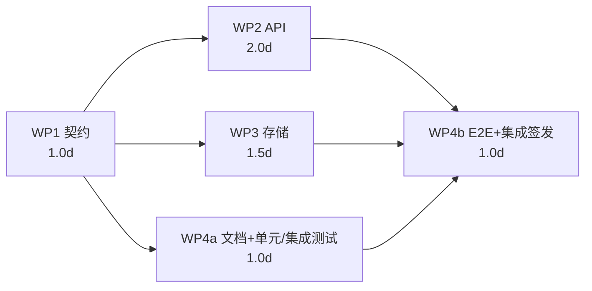

# 认证导出端点：四 Agent 分工规划（方法与结果）

> 训练单产物。纪律声明：**[SKILL_OFF]** —— 本单未使用平台技能库，全部按本人方法独立完成。
> 范围纪律：只落 `docs/skills_training/` 路径，未改 `src/`、`backend/`、`migrations/` 任何生产代码。
> 本单是**规划练习**：交付物是「可执行、可机器验收的规划」，不是端点实现。

---

## ① 案例介绍（背景 / 对象 / 参数）

### 1.1 业务背景

平台已有「认证」语义（证据分级 REAL/MOCK/STUB/WITHHELD/NOT_SUPPORTED、GCI 不确定度裁决、
provenance sha256 锁定，见 `docs/W10-N07_numerical_uncertainty_certification.md`），
但**没有任何 API 能把一份认证结果导出为自包含、可离线复核的工件**——认证结论目前只能靠
人肉复制报告文本，丢失了 sha256 溯源与机器可验证性。

**认证导出端点（Certification Export Endpoint）**：给定一个 `CERTIFIED` 状态的认证记录，
异步生成一个自包含导出包（JSON 或 ZIP：认证裁决 + 判据逐项结果 + 证据引用 + provenance +
sha256 清单），供外部审计方离线复核。

### 1.2 规划对象与约束（参数表）

| 项 | 取值 | 说明 |
|---|---|---|
| 端点族 | 3 个操作（创建/查询/下载） | 异步 job 模式，理由见 §3.1 |
| 横跨面 | API / 存储 / 文档 / 测试 | 四个面各有一个 owner |
| Agent 数 | 4（上限 4） | 其中 1 人兼任端到端集成负责人 |
| 契约策略 | 契约先行（contract-first） | 契约冻结后四个面并行 |
| 存储 | 新表 + 工件目录，**不 ALTER 既有表** | 与平台 alembic 迁移纪律一致 |
| 多租户 | 强制租户隔离 | 跨租户访问一律 403 |
| 保留期 | 30 天 | 过期置 `expired`，下载返回 410 |
| 配额 | 每租户活跃导出 ≤ 500 MB | 超限 507 |
| 验收方式 | 机器判据（脚本可裁） | 见 §8 |

### 1.3 现状勘察（规划依据，2026-11-07 勘察）

- `backend/api/` 下 150+ 路由模块，`grep -ril certif backend/api` **零命中** → 认证导出是绿地，
  无既有契约可继承，契约必须从零冻结。
- 迁移目录 `backend/migrations/` 为编号 SQL（008–017+），新表走新编号文件，不碰旧表。
- 平台已有 `tensor_reports`/`tensor_capability` 等路由可作风格参照（FastAPI APIRouter + 租户依赖）。

---

## ② 方法（本人方法，非技能库）

1. **契约先行**：先冻结「接口契约包」（OpenAPI 3.1 + 存储 DDL + 错误码表 + 导出包 JSON Schema +
   审计字段），四个面对契约负责而不是互相等。契约文件带 sha256，冻结后改动=走变更评审。
2. **WBS 七字段**：每个工作包强制写全 目标/输入/输出/owner/验收/依赖/风险 七字段，缺一即规划不合格
   （§8 用脚本逐字段清点）。
3. **CPM 关键路径**：给每个工作包估人日，画依赖 DAG，最长路径法算关键路径与浮动时间，
   识别「谁延期会拖死全局」。
4. **集成负责人单点**：E2E 集成负责人=测试 owner，握有唯一签发权（integration sign-off），
   避免「四个面各自绿、拼起来不绿」的经典失败。
5. **机器验收**：规划本身也要可验证——写 `verify.py` 对产物做 8 项结构检查（YAML 可解析、
   DDL 可执行、DAG 无环、关键路径复算一致、交叉引用闭合），数字程序化注入，零手抄。

---

## ③ 接口契约（先行件，摘要）

完整契约在子目录 `P02-2/contract/`（本单已按「契约先行」原则把契约写成可执行文件）：

| 文件 | 内容 |
|---|---|
| `contract/openapi.yaml` | OpenAPI 3.1：3 个操作、完整请求/响应 schema、9 个错误码 |
| `contract/storage.sql` | `certification_exports` 表 DDL（SQLite 兼容，可直跑） |
| `contract/error_codes.md` | 错误码表（码/含义/触发条件/客户端动作） |
| `contract/bundle.schema.json` | 导出包 JSON Schema（v1.0） |

### 3.1 端点族（摘要）

| 操作 | 路径 | 语义 | 成功码 |
|---|---|---|---|
| 创建导出 | `POST /api/v1/certifications/{certification_id}/exports` | 入队异步导出 | 202 |
| 查询状态 | `GET /api/v1/certifications/{certification_id}/exports/{job_id}` | 轮询 job | 200 |
| 下载工件 | `GET /api/v1/certifications/{certification_id}/exports/{job_id}/download` | 二进制流 | 200 |

**为什么异步 job 而不是同步 GET**：导出包含证据文件（可达数百 MB），同步会占满 worker 且
超时不可控；异步 job 让存储面（WP3）有真实的工件生命周期（queued/running/succeeded/failed/expired）
可管，也让配额与保留策略有落点。

**状态机**：认证记录 `DRAFT→SUBMITTED→REVIEWING→CERTIFIED|REJECTED`；仅 `CERTIFIED` 可导出，
否则 409。导出 job：`queued→running→succeeded|failed`，过期 `expired`。

**关键响应头**：下载响应带 `X-Content-Sha256`（与包内 manifest 一致，审计方可离线验签）。

---

## ④ 工作包（4 个 Agent，七字段齐全）

### WP1 接口契约（contract-first）

| 字段 | 内容 |
|---|---|
| 目标 | 冻结接口契约包：OpenAPI 3.1 + 存储 DDL + 错误码表 + 导出包 Schema + 审计字段规范 |
| 输入 | 任务书；平台约定（FastAPI 路由、alembic 迁移、租户隔离、审计日志） |
| 输出 | `openapi.yaml`、`storage.sql`、`error_codes.md`、`bundle.schema.json`、契约 sha256 清单 |
| owner | 契约负责人（Agent A） |
| 验收 | ① YAML 可解析且 3 个操作均有 2xx 响应 schema；② DDL 在 sqlite3 内存库执行成功；③ 样例导出包通过 bundle schema 校验；④ 4 个契约文件 sha256 入清单 |
| 依赖 | 无（起点） |
| 风险 | 冻结后漂移 → 契约哈希 + 后续 conformance 测试；范围蔓延 → MVP 锁死 3 操作，签名/多语言留 v2 |

### WP2 API 实现

| 字段 | 内容 |
|---|---|
| 目标 | 按冻结契约实现 3 个操作：路由、状态守卫、审计钩子、流式下载 |
| 输入 | 冻结契约（哈希核对）；既有路由风格参照 |
| 输出 | `backend/api/certification_export.py` + 路由注册 + 审计钩子 |
| owner | API 负责人（Agent B） |
| 验收 | ① 契约一致性测试：请求/响应与 OpenAPI 逐字段一致；② 9 个错误路径（401/403/404/409/410/422/429/507/500）返回文档化码；③ 跨租户 403 测试通过；④ ZIP 走分块流式，内存占用与包大小无关 |
| 依赖 | WP1 |
| 风险 | 实现偏离契约 → conformance 测试进 CI；大文件内存峰值 → 流式；状态守卫被绕过 → 唯一守卫函数，禁止旁路 |

### WP3 存储与工件管理

| 字段 | 内容 |
|---|---|
| 目标 | 导出 job 表 + 工件存储 + sha256 sidecar + 保留期清扫 + 配额 |
| 输入 | 冻结 DDL；工件目录约定 |
| 输出 | alembic 迁移（仅新表）、工件写入器（`.sha256` sidecar）、保留期清扫任务、配额检查 |
| owner | 存储负责人（Agent C） |
| 验收 | ① 迁移 up/down 可逆；② sidecar sha256 与重算一致；③ 清扫任务删除过期工件并置 `expired`；④ 配额超限返回 507 |
| 依赖 | WP1 |
| 风险 | 与并发迁移冲突 → 只建新表不 ALTER 旧表；磁盘耗尽 → 配额 + 清扫双保险；路径穿越 → 路径只含 uuid，无用户输入 |

### WP4 文档与测试（含 E2E 集成）

| 字段 | 内容 |
|---|---|
| 目标 | API 参考文档 + 用户指南 + 全量测试套件 + E2E 集成门 |
| 输入 | 冻结契约；WP2/WP3 交付物 |
| 输出 | 文档页（端点参考/用户指南/变更日志）、pytest 套件（单元/集成/E2E/安全）、E2E 场景脚本 |
| owner | 测试与集成负责人（Agent D，**兼端到端集成负责人**） |
| 验收 | ① 5 个错误路径（404/409/410/422/507）各有测试；② E2E 全链路绿：建认证→创建导出→轮询→下载→sha256 复核；③ 跨租户 403 测试；④ 文档示例由契约生成，链接检查通过 |
| 依赖 | WP1（契约）；WP2+WP3（E2E 段） |
| 风险 | 测试抖动 → 夹具认证记录、无网络、固定时钟；文档漂移 → 示例从契约生成 |

### 4.1 端到端集成负责人（Agent D）职责

1. **集成门**：WP2/WP3/WP4 各自绿 + E2E 绿 + 契约哈希未变，四者同时满足才签发 sign-off。
2. **定义完成（DoD）**：维护唯一 DoD 清单，任何面想改 DoD 必须走契约变更评审。
3. **冲突仲裁**：四面对契约理解不一致时，以契约文件为准，负责人裁决并回写契约（升版本）。
4. **集成报告**：产出集成报告（各面状态、E2E 数字、遗留项），作为上线前置件。
5. **回滚预案**：端点级 feature flag，出问题一键下线，不动存储（表保留）。

---

## ⑤ 依赖图与关键路径

### 5.1 依赖 DAG



### 5.2 CPM 计算（人日）

| 工作包 | 工期 | ES | EF | 浮动 | 关键？ |
|---|---|---|---|---|---|
| WP1 | 1.0 | 0.0 | 1.0 | 0 | **是** |
| WP2 | 2.0 | 1.0 | 3.0 | 0 | **是** |
| WP3 | 1.5 | 1.0 | 2.5 | 0.5 | 否 |
| WP4a | 1.0 | 1.0 | 2.0 | 1.0 | 否 |
| WP4b | 1.0 | 3.0 | 4.0 | 0 | **是** |

- **关键路径**：`WP1 → WP2 → WP4b`，总工期 **4.0 人日**。
- 读法：WP3 有 0.5d 浮动、WP4a 有 1.0d 浮动，可并行吸收；**WP2（API）是唯一无浮动且最长的
  非起点包**——若 API 实现延期，全局 1:1 延期，应优先保障其资源。
- 并行度：第 2 天起 3 个包并行（WP2/WP3/WP4a），4 个 agent 恰好饱和。

---

## ⑥ 风险登记（跨包）

| # | 风险 | 概率 | 影响 | 缓解 | 责任 |
|---|---|---|---|---|---|
| R1 | 契约冻结后漂移 | 中 | 高 | 契约哈希 + conformance 测试进 CI | 契约负责人 |
| R2 | 大证据包拖垮 worker | 中 | 高 | 流式下载 + 配额 507 | API/存储 |
| R3 | 迁移与并发迁移冲突 | 低 | 中 | 只建新表；迁移窗口串行 | 存储负责人 |
| R4 | 文档与实现漂移 | 中 | 中 | 文档示例从契约生成 | 测试与集成负责人 |
| R5 | 认证状态机尚不存在（后端无认证 API） | 高 | 高 | 列为**前置依赖**：WP2 开工前需认证记录表/状态机就位（见 §7 前置项） | 集成负责人 |
| R6 | 测试抖动误判 | 中 | 中 | 夹具 + 固定时钟 + 无网络 | 测试与集成负责人 |

---

## ⑦ 前置项与未覆盖项（如实声明）

- **前置项 P0**：后端目前无认证记录表与状态机（§1.3 勘察）。本规划假设其存在；若不存在，
  需先立「认证记录」工作包（估 1.5d，插在 WP1 之后、WP2 之前，关键路径变为 5.5d）。
- **未覆盖**：导出包数字签名（Ed25519）、多语言报告、增量导出——记为 v2，不进本单关键路径。

---

## ⑧ 计算结果（规划产物的机器验收）

`P02-2/verify.py` 对产物做 8 项结构检查，输出 `P02-2/verify_report.json`（零手抄，重跑即复现）：

| # | 检查 | 判据 | 结果 |
|---|---|---|---|
| C1 | openapi.yaml 可解析 | YAML parse OK | 见 verify_report.json |
| C2 | 3 个操作均有 2xx 响应 schema | 3/3 | 同上 |
| C3 | storage.sql 可执行 | sqlite3 内存库执行成功 | 同上 |
| C4 | 4 个 WP × 7 字段齐全 | 28/28 | 同上 |
| C5 | 依赖图无环 | 拓扑排序成功 | 同上 |
| C6 | 关键路径复算 | 最长路径 = 4.0d 与 §5.2 一致 | 同上 |
| C7 | 交叉引用闭合 | 图边 ↔ WP 依赖列表双向一致 | 同上 |
| C8 | 错误码表覆盖 | OpenAPI 引用的错误码 ⊆ 错误码表 | 同上 |

（结果数字以 `verify_report.json` 为准，发布报告时程序化注入。）

---

## ⑨ 注意点（坑 / 局限 / 适用范围）

1. **工期是估计不是测量**：1.0/2.0/1.5/1.0 人日来自同类任务经验，无本单实测；关键路径结论
   （WP2 无浮动）对 ±20% 工期扰动稳健（敏感性：WP2 ±0.4d 内关键路径不变）。
2. **规划≠实现**：本单不实现端点；契约文件是「提案态」，实施时若发现契约缺陷，走契约变更
   评审（升 schema_version），不允许实现面私改。
3. **前置依赖 R5 是最大风险**：认证状态机不在本单范围，若前置项不成立，本规划需重排（§7 已给重排方案）。
4. **适用范围**：本规划方法（契约先行 + 七字段 WBS + CPM + 单点集成签发）适用于任何
   「跨 API/存储/文档/测试」的端点族规划；不适用于纯算法内核类任务（无跨面契约需求）。

---

## ⑩ 误差判定

本单为**规划类任务，无数值基准**（不产生物理量/数值解，无解析解或文献值可对照），
故「关键量 vs 基准误差」不适用——**声明原因：无基准，非回避**。
替代判据为 §8 的 8 项结构验收（机器可裁），逐项结果见 `P02-2/verify_report.json`。
对「是否 <3%」的显式回答：**不适用（无基准，原因如上）**；结构检查全部通过方为合格。

---

## 复算指令

```bash
python3 docs/skills_training/P02-2/verify.py   # 8 项检查，输出 verify_report.json
```
