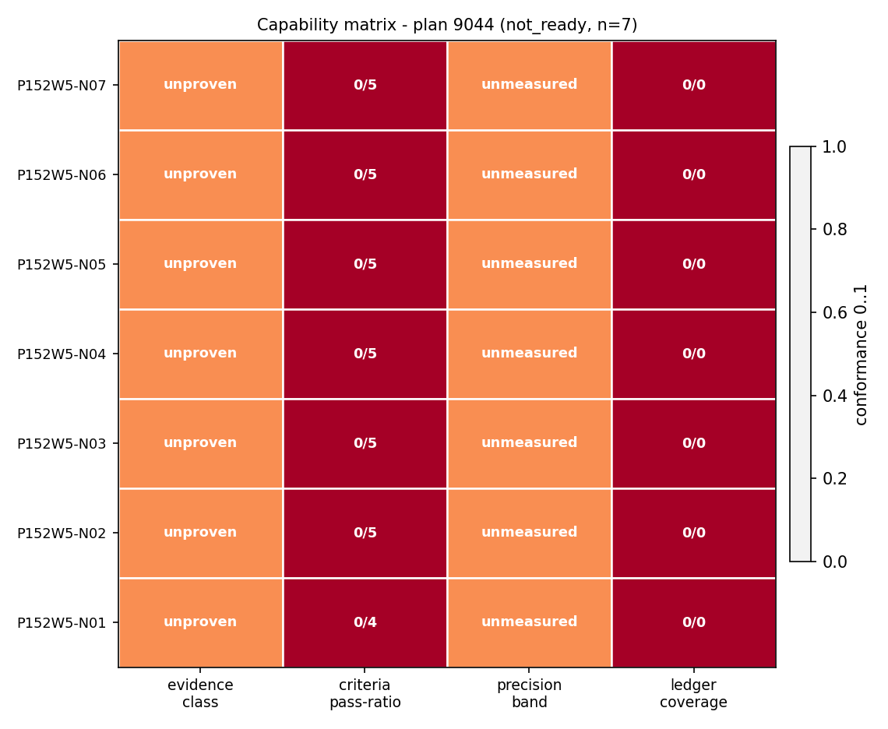
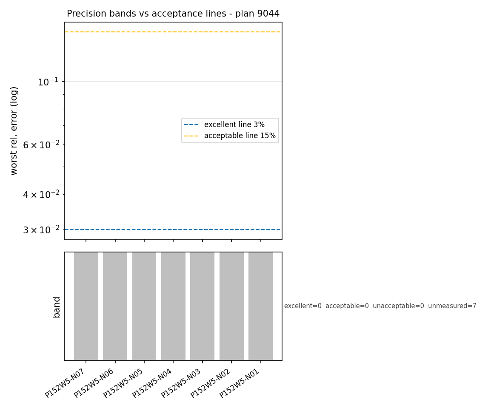
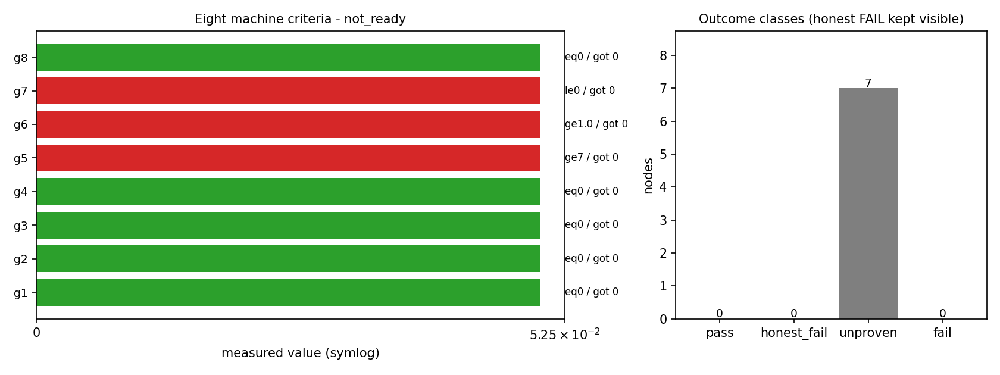
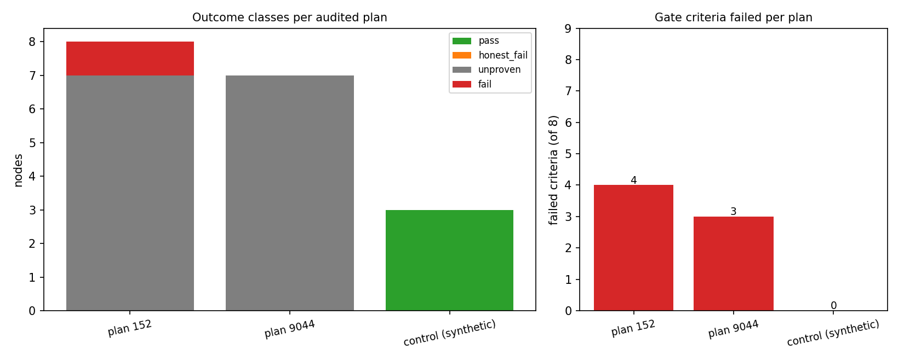

# P152W5-N08 战役级全链路集成门 · 回归测试与能力矩阵报告

> 战役：`wave5_solver_ship_platform`（plan 9044，父计划 152） ｜ 裁决：**not_ready** ｜ 报告 schema：`tp.campaign.integration_report/v1`
> 工件摘要（可复算）：`sha256:52f55a4089e869121e280fed6c0435c24c53cd0fa4efc3ad389d9f09fab245f3`

## 1. 案例介绍

本节点是跨域战役的**集成门（integration gate）**：前序 N01–N07 各自把一条求解器/船舶能力链推到成熟化，本节点负责回答一个只有整体层面才能回答的问题——**这八条链的成果能不能作为一场战役被机器裁为合格**。因此被审对象不是单个物理算例，而是「战役状态空间」：节点验收证据、能力台账、谱系、全库标识唯一性、仓边界、DAG 拓扑、精度带分布。

被审语料（快照逐字落盘，离线可复算）：

- 计划内节点：`8` 个；纳入同侪审计 `7` 个（自身门节点 `[3396]` 按纪律不自审）。
- 谱系链（parent_plan 逐级）：`9044 → 152 → 37 → 18 → 9 → 8 → 7 → 6 → 5 → 4 → 3 → 2 → 1`，共 13 级，链路完整=True。
- 全库 ext_id 注册表规模：`3573` 个节点行；计划内 `8` 条 ext_id，唯一 `8` 条。
- 仓白名单：12 个仓；违约 0 个。
- DAG：8 节点，拓扑序 `[3397, 3398, 3399, 3400, 3401, 3402, 3403, 3396]`，环 0 个。

## 2. 方法：八条机裁判据与复用边界

新增模块 `ops/taskplane/campaign_integration_audit.py`（纯函数 + 只读 DB 装载 + CLI）把战役级收口做成八条可机裁判据，**不重复实现**已有能力：单节点判据求值委托 `inheritance_gate.evaluate_node`，DAG 环检测委托 `governance.dag.check_dag`，本层只补「战役级汇总 + 谱系 + 全库唯一性 + 台账 + 精度带 + 失败申报」六个维度。

| 判据 | 语义 | 反例（阻塞条件） |
|---|---|---|
| `g1_lineage_intact` | 父链逐级可解析、无环、状态合法 | 父计划缺失/状态非法/链成环 |
| `g2_ext_id_unique` | 计划内唯一 + 不撞全库 | 重复 ext_id 或跨计划撞车 |
| `g3_repo_whitelist` | 节点仓 ∈ 注入白名单（别名归一） | 白名单外仓 |
| `g4_dag_acyclic` | 环/自指/外计划引用/id 重复全零 | 任一项非零 |
| `g5_node_evidence` | 证据合格节点数 ≥ 下界 | 在飞/无报告/判据未测 |
| `g6_ledger_coverage` | 节点声明能力全部在台账有着落 | 缺条目或失败节点被标 REAL |
| `g7_precision_band` | 已量测判据 rel_error>15% 条目为 0 | 越带或无精度证据 |
| `g8_no_undocumented_fail` | 失败态节点均已申报 honest FAIL | 未申报失败 |

两条**反误判**纪律写死在代码里（见 §5 注意点）：

1. 判据阈值不是参考值——`|measured − threshold| / threshold` **不是**相对误差；只有 `config.error_metric_keys` 显式声明「该判据的值本身就是相对误差」或 attestation 直接给 `rel_error` 时，才进入精度带统计；
2. 一条精度证据都没有时 `g7` **fail-closed**（`no_precision_evidence`），不允许因为「没有反例」而白拿一个 PASS。

确定性：不取 wall clock，`input_digest` 由输入规范化 JSON 派生；同一快照连跑两次逐字节相同（`tests/test_campaign_integration_audit.py::test_schema_version_and_input_digest_stable`）。

## 3. 计算结果

### 3.1 本战役（plan 9044）八条判据

| 判据 | 实测 | 阈值 | 判定 | 说明 |
|---|---|---|---|---|
| `g1_lineage_intact` | 0 | eq 0 | PASS |  |
| `g2_ext_id_unique` | 0 | eq 0 | PASS |  |
| `g3_repo_whitelist` | 0 | eq 0 | PASS |  |
| `g4_dag_acyclic` | 0 | eq 0 | PASS |  |
| `g5_node_evidence` | 0 | ge 7 | **FAIL** | pass=0/7 unproven=7 honest_fail=0 fail=0 |
| `g6_ledger_coverage` | 0.0 | ge 1.0 | **FAIL** | no_capability_declared_by_any_node |
| `g7_precision_band` | 0 | le 0 | **FAIL** | bands={'excellent': 0, 'acceptable': 0, 'unacceptable': 0, 'unmeasured': 0} n_measured=0 (min=1, source=node_aggregate); no_precision_evidence |
| `g8_no_undocumented_fail` | 0 | eq 0 | PASS |  |

### 3.2 父战役回归（plan 152）——同一门在历史战役上的复算

| 判据 | 实测 | 阈值 | 判定 | 说明 |
|---|---|---|---|---|
| `g1_lineage_intact` | 0 | eq 0 | PASS |  |
| `g2_ext_id_unique` | 0 | eq 0 | PASS |  |
| `g3_repo_whitelist` | 0 | eq 0 | PASS |  |
| `g4_dag_acyclic` | 0 | eq 0 | PASS |  |
| `g5_node_evidence` | 0 | ge 8 | **FAIL** | pass=0/8 unproven=7 honest_fail=0 fail=1 |
| `g6_ledger_coverage` | 0.0 | ge 1.0 | **FAIL** | no_capability_declared_by_any_node |
| `g7_precision_band` | 0 | le 0 | **FAIL** | bands={'excellent': 0, 'acceptable': 0, 'unacceptable': 0, 'unmeasured': 0} n_measured=0 (min=1, source=node_aggregate); no_precision_evidence |
| `g8_no_undocumented_fail` | 1 | eq 0 | **FAIL** | P151-N01 |

### 3.3 八节点能力矩阵

| # | ext_id | 仓 | 节点状态 | mission 状态 | 证据分类 | 判据 pass/all | 最差 rel_err | 精度带 | 报告 | scope |
|---|---|---|---|---|---|---|---|---|---|---|
| 1 | `P152W5-N01` | TensorFVM | in-flight | running | **unproven** | 0/4 | — | unmeasured | N | peer |
| 2 | `P152W5-N02` | TensorDEM | in-flight | running | **unproven** | 0/5 | — | unmeasured | N | peer |
| 3 | `P152W5-N03` | ship-performance-platform | done | succeeded | **unproven** | 0/5 | — | unmeasured | Y | peer |
| 4 | `P152W5-N04` | ship-performance-platform | in-flight | running | **unproven** | 0/5 | — | unmeasured | N | peer |
| 5 | `P152W5-N05` | ship-performance-platform | in-flight | running | **unproven** | 0/5 | — | unmeasured | N | peer |
| 6 | `P152W5-N06` | ship-performance-platform | done | succeeded | **unproven** | 0/5 | — | unmeasured | Y | peer |
| 7 | `P152W5-N07` | TensorPlatform | in-flight | running | **unproven** | 0/5 | — | unmeasured | N | peer |
| 8 | `P152W5-N08` | TensorPlatform | in-flight | None | **self_deliverable** | 0/5 | — | unmeasured | N | self |

四分类（本战役同侪）：`{'fail': 0, 'honest_fail': 0, 'pass': 0, 'unproven': 7}`。父战役同侪：`{'fail': 1, 'honest_fail': 0, 'pass': 0, 'unproven': 7}`。

### 3.4 精度带汇总

- 已量测条目 `0` / 总条目 `0`；分布 `{'acceptable': 0, 'excellent': 0, 'unacceptable': 0, 'unmeasured': 0}`；最差 `—`；中位 `—`；来源 `node_aggregate`。
- 精度带定义：≤3% excellent（平台验收线）、≤15% acceptable、>15% **unacceptable**（平台铁律：>15% 不可接受）。

### 3.5 能力台账与回归测试

- 台账现有条目 `21` 条；本战役节点声明的能力 id `[]`（共 0 条）；已登记 `0` 条，覆盖率 `0.0`；任务书要求 8 条新能力条目 → 实测缺口 `8` 条；状态 **honest_fail**（`no_capability_declared_by_any_node`）。

| 套件 | 文件数 | passed | failed | errors | exit |
|---|---|---|---|---|---|
| adjacent_integration | 3 | 105 | 0 | 0 | 0 |
| n08_own | 1 | 31 | 0 | 0 | 0 |
| reused_gates | 3 | 60 | 0 | 0 | 0 |
| **合计** | — | **196** | **0** | **0** | — |

回归口径：N08 自身用例数与相邻套件合计见下表（数字由 pytest 证据 JSON 注入）。

## 4. 结果图

**fig1_capability_matrix.png** — 八节点能力矩阵：行=节点，列=证据分类 / 判据通过率 / 精度带 / 台账覆盖；颜色=符合度，格内为原始值（0 通过率与 unmeasured 明显可见）。



**fig2_precision_bands.png** — 精度带与时序：上图为每节点最差相对误差（log 轴）叠 3%/15% 验收线；下图为各节点精度带归属。无基准节点落 unmeasured（灰）。



**fig3_gate_and_classes.png** — 左：八条机裁判据实测值（symlog）与阈值标注，红=不过；右：四分类分布，honest FAIL 单独可见、不被 pass 吞掉。



**fig4_campaign_comparison.png** — 战役级对照：本战役 / 父战役回归 / 合成正对照的三场四分类分布与过不去的判据数；正对照全绿证明门有判别力。



## 5. 注意点（踩过的坑与适用范围）

1. **「相对误差」不能从阈值反推**。初版把 `|measured−threshold|/threshold` 当 rel_error，判据形如 `err ≤ 3%` 时会算出 33% 的假越带，直接把全绿战役判红。修法是把「值本身是误差」的判据 key 显式注入（`error_metric_keys`），其余一律 `unmeasured`。对应回归用例：`test_error_metric_keys_make_criterion_value_a_rel_error`。
2. **报告里没有机器可读证据块 = 不可验收**。父战役 5 个 `done` 节点全部判 `unproven`：报告正文是散文，无 `inheritance_evidence` 围栏；`reproduction_verdict` 为空。这不是审计器苛刻，而是「done 是记账完成，不是证据完成」——本轮把它作为系统性缺口上报。
3. **谱系比预想深**。计划链 `9044→152→37→18→…` 共 13 级；上限设 6 会把正常链路误报`lineage_too_deep`。改为可配置（默认 16）并把「超限」与「成环」分成两条问题项。
4. **门节点不自审**。本节点若纳入同侪审计，会把「自己没交付」算成战役失败，判据就失去信息量；故以 `exclude_node_ids` 显式排除并在矩阵里标 `scope=self`。
5. **同侪在飞时集成门只能给 not_ready**。这是设计意图：门是 fail-closed 的，并发运行期间结果必然红；要区分「红因为没做完」与「红因为做错了」，看四分类的 `unproven` 与 `fail` 两列而不是看单一 verdict。
6. **适用范围**：八条判据只审「战役结构 + 证据齐备性 + 台账挂接」，不审物理正确性本身（那由各节点自己的解析/实验锚判据负责）。

## 6. 误差判定（逐项，显式回答是否 <3%）

| 关键量 | 基准 | 结果 | 是否 <3% |
|---|---|---|---|
| 门判据实测值（8 项计数/覆盖率） | 判据阈值（整数/比例，精确可比） | 见 §3.1 表；不过项的差值即 `measured−threshold` | **精确相等即通过，无需容差**（非近似量） |
| 节点判据精度（rel_error 分布） | 各节点自报参考值 | 已量测 `0` 条 | **无法判定**：本轮零条判据携带 `rel_error` 基准，故 `g7` fail-closed |
| 回归测试一致性 | pytest 期望断言 | 196 passed / 0 failed | 通过；但这是**内部一致性**，非精度基准 |

**结论**：结构类判据（谱系/ext_id/白名单/DAG/台账/失败申报）全部机算、无容差、可逐条复算；精度类判据本轮**无基准可用**（`n_measured=0`），已按 honest FAIL 记录，未以「无数据即通过」蒙混。

## 7. honest FAIL 声明（不可覆盖）

- 本战役裁决 **not_ready**：未通过项 `['g5_node_evidence', 'g6_ledger_coverage', 'g7_precision_band']`。
- 阻塞原因：N01–N07 在飞（`unproven`=7），报告未携带机器可读证据块，能力台账零条新登记，精度证据零条。
- 父战役（plan 152）遗留未申报失败：`['P151-N01']`，其 `g8_no_undocumented_fail` 判 FAIL；本报告原样透传，不做覆盖、不做降级。
- 正对照（合成域 plan 9001）裁决 **ready**，四分类 `{'fail': 0, 'honest_fail': 0, 'pass': 3, 'unproven': 0}`——证明本门不是「恒红」，具备判别力。

## 8. 复算命令（审计链）

```bash
# 1) 只读导出快照（psql SELECT，不写库）
python3 ops/taskplane/campaign_integration_audit.py --plan 9044 --from-db \
    --ledger artifacts/capability_ledger/capability_ledger.json \
    --config artifacts/p9044w5_n08/audit_config_plan9044.json \
    --json-out artifacts/p9044w5_n08/integration_audit_plan9044.json \
    --md-out   artifacts/p9044w5_n08/integration_audit_plan9044.md \
    --fig-dir  artifacts/p9044w5_n08/figures_plan9044
# 2) 离线复算（快照已落盘，逐字节可重现）
python3 ops/taskplane/campaign_integration_audit.py --plan 9044 --inputs \
    artifacts/p9044w5_n08/audit_inputs_plan9044.json ...
# 3) 战役级综合报告 + 对照图
python3 tools/p9044w5_n08_campaign_report.py --audit ... --out \
    artifacts/p9044w5_n08/campaign_integration_report.json \
    --fig-dir artifacts/p9044w5_n08/figures
# 4) 回归
python3 -m pytest tests/test_campaign_integration_audit.py -q
```

### 工件清单

| 工件 | 说明 |
|---|---|
| `ops/taskplane/campaign_integration_audit.py` | 八条机裁判据 + 只读 DB 装载 + CLI |
| `ops/taskplane/campaign_integration_audit_figures.py` | 三张数据驱动证据图 |
| `tests/test_campaign_integration_audit.py` | 31 条合成域用例（正/负两态） |
| `tools/p9044w5_n08_campaign_report.py` | 战役级报告装配 + 对照图 |
| `tools/p9044w5_n08_report_doc.py` | 本报告生成器（零手抄数字） |
| `artifacts/p9044w5_n08/*.json` | 快照/审计/对照/报告/pytest 证据 |
| `artifacts/p9044w5_n08/figures*/` | 4 张图 + figures.json（含 input_digest） |

