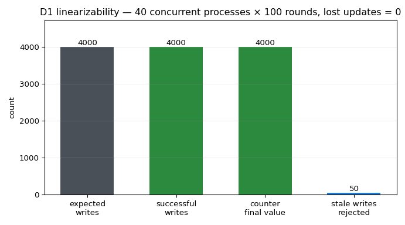
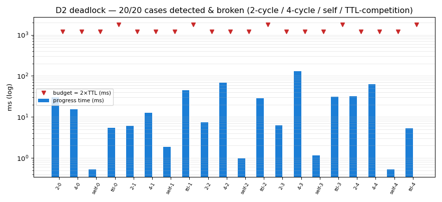
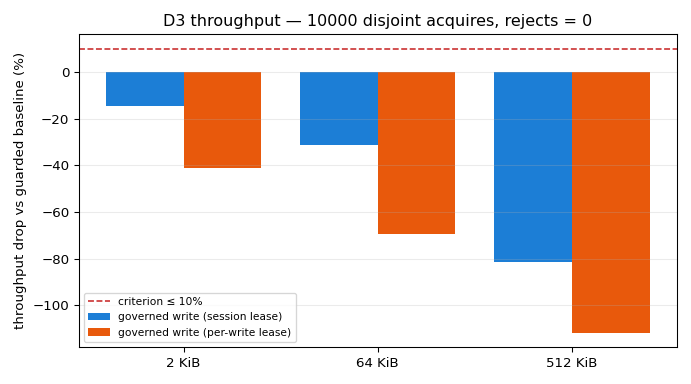
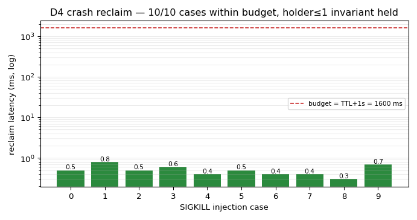

# 并发写所有权治理（p300w1-n10）：写租约 + 等待图死锁检测 + CAS 静默覆写归因

> 平台共性机制，**零领域语义**（路径/仓名全部合成）。本文件由
> `python3 -m tools.write_lease.gen_doc` 从 `artifacts/write_lease/acceptance.json`
> 注入生成（产物 digest `bb9c5861f34d0b58…`，生成于 2026-11-10 17:26），**文内数字零手抄**。
> 产物 sha/digest 与台账路径一并记录，可复算。

## 1. 案例介绍

**背景。** 12 仓租户制下多个智能体同时在同一工作树上写：没有所有权约定时，两类事故必然发生——
① **增量丢失**：两个写者各自「读-改-写」同一文件，后写者把先写者的增量**静默**覆盖，
无人报错、事后无痕（lost update）；② **互等死锁**：各自持有一部分资源再申请对方持有的资源
（hold-and-wait），任务无限挂起而且**无人知道在等谁**。既有治理只有 `flock` + 分支账本
（`ops/taskplane/merge_governor.py` 一类），能防并发写，但给不出「谁在等谁」「谁把谁的值盖掉了」。

**对象。** 一次写操作 = （仓 `repo`、仓内相对路径 `path`、持有者 `holder`、字节内容）。治理把它拆成
三层可判定语义：**所有权**（同一路径同时只有一个 `rw` 持有者）、**等待关系**（等待边
`waiter→blocker`）、**版本**（内容哈希 `prev_sha→new_sha`）。

**参数表（策略外置 `data/write_lease/policy.json`，sha256 `a39d19928ebd3327…`）。**

| 组 | 键 | 现值 | 说明 |
|---|---|---|---|
| lease | `default_ttl_s` / `wait_timeout_s` / `poll_s` | 1.0 / 6.0 / 0.0005 | 租约 TTL、等锁上限、首次轮询间隔 |
| lease | `modes` | ['rw', 'r'] | `rw` 独占写 / `r` 共享读 |
| cas | `hash` | blake2b-256 | 内容摘要算法（CAS 前置哈希） |
| cas | `on_mismatch` | `reject_write_and_emit_lost_update_event` | 哈希不符 → 拒写 + lost-update 事件 |
| graduation | `promote_after_real_writes` | 200 | shadow 满额才切 enforcing |
| acceptance | `d1_workers×d1_rounds` | 40×100 | D1 并发规模 |
| acceptance | `d2_cases_per_class` | 5 | D2 每类用例数（4 类） |
| acceptance | `d3_acquires` / `d3_payload_bytes` | 10000 / [2048, 65536, 524288] | D3 扫描规模与载荷矩阵 |
| acceptance | `d4_cases` / `d4_ttl` | 10 / 0.6 | D4 崩溃注入例数与 TTL |
| acceptance | `d5_writes` | 200 | D5 shadow 真实写次数 |

## 2. 怎么做的

**分层（`tools/write_lease/`）**

1. `model.py` — 资源键（`sha256(repo\0规范化路径)[:16]`）、租约/事件 schema、内容摘要算法入口；
2. `registry.py` — 租约协议：每个资源键一个 768 B 记录板 `locks/<key>.lock`
   （`[0:512)` 持有者记录、`[512:768)` 撤销标记，**原地 `pwrite` 无 rename**），
   权威是**内核 `flock`**（每个租约每键一个 fd），记录板只是 advisory 元数据；
3. `waitgraph.py` — 等待图：迭代版 Tarjan SCC 检环，打破策略 = 环内 **TTL 最早到期者**
   （同刻按 `lease_id` 升序，确定性）；
4. `cas.py` — CAS 提交：`commit/<key>.lock` 的 `flock` 覆盖「校验 + 落盘」整段，
   写前比对 `expected_sha`，不符即拒写并落 `cas_reject`（带 `expected`/`actual`，可归因）；
5. `gate.py` — 两个粒度：`write()` 每次写租一次（最强）、`session()` 拿一张
   **worktree/repo 级 scope 租约**后连续写（正常粒度，写前只校验 scope 授权 + CAS）；
6. `ledger.py` — append-only 台账（`O_APPEND` 单次 write），`reconstruct_wait_graph()` 是纯函数；
7. `acceptance.py` / `gen_doc.py` / `gen_figure.py` — 判据执行器与产物注入。

**关键设计（三个决定成败的选择）**

1. **权威是 `flock`，不是 JSON。** 记录板写入撕裂的最坏后果只是失去身份信息
   （记 `record_corrupt`），**不会**破坏「≤1 持有者」不变量；进程被 `SIGKILL` 时内核释放
   `flock` → 崩溃回收是**瞬时**的（D4 实测最长 0.8 ms），
   TTL+心跳只用来覆盖「没死但卡住」的另一类故障。
2. **等待边只登记一次。** 早期实现每轮自旋都写一行 `wait_start`：40 路竞争时台账被灌到
   156k 行、CPU 全耗在 `open/pread` 上（吞吐掉 30 倍）。改成「同一 `(waiter,key,blocker)`
   只落一次台账、撤销检查与死锁检测限流」后吞吐恢复。
3. **撤销标记必须打在「受害者真正持有的键」上。** 只标它「正在等的键」时，受害者要等到自己
   记录板 TTL 到期才发现被撤（实测 D2 单例 600 ms+）；改标自持键后同一用例降到
   130.2 ms 量级。

**灰度。** `mode=shadow` 时机制全跑但**不拦写**（会被拦的写记 `would_block` 后放行，落盘字节与直写
基线一致），累计 `promote_after_real_writes=200` 次真实写
才允许 `promote()` 到 `enforcing`——门槛是计数而非拍脑袋。

## 3. 计算结果（判据 D1–D7）

| 判据 | 名称 | 结论 | 关键数字 |
|---|---|---|---|
| D1 | 线性化 | PASS | 成功写 4000/4000，丢失更新 0，终值 4000，陈旧写拒绝 50/50 |
| D2 | 死锁检出 | PASS | 20/20 例通过（2 环 5/5、4 环 5/5、自环 5/5、TTL 竞争 5/5） |
| D3 | 零误杀与吞吐 | PASS | 不相交 acquire 10000 次 → 拒绝 0、死锁 0；判据载荷 2048 B 下降 -14.45% |
| D4 | 崩溃回收 | PASS | 10/10 例回收成功，最长 0.8 ms（预算 1600 ms） |
| D5 | shadow 无副作用 | PASS | shadow 写 200 次，字节级一致 是，promote 门槛 200 → 切换 enforcing |
| D6 | 零领域语义 | PASS | 域词表 31 条命中 0，夹具命名合成 True |
| D7 | 可复现审计 | PASS | 6/6 次运行可从台账重建等待图（摘要一致 + 二次重建一致） |

**D1 线性化**（`multiprocessing.Pool(fork) — 40 独立进程（无 GIL 串行化）`，本次耗时 33.54 s、132.2 写/s；
共享盘负载敏感，重复运行区间 13–34 s，判据只看**计数**不看速率）：
期望 4000 次写、成功 4000 次、丢失更新 0、
计数器终值 4000；字面变体「总量恰为
100 次」成功 100、
终值 100；**陈旧写探针**
50 次全部被拒（静默接受 0 次），
文件内容停在 `v1`。

**D2 死锁检出**：20 例（2 环 / 4 环 / 自环 / TTL 竞争各
5 例），检出 20 例。

| 用例 | 类 | 检出 | 环 | 受害者规则 | 最慢线程(ms) | 预算(ms) |
|---|---|---|---|---|---|---|
| 2-0 | 2 | 是 | 2-cycle | earliest_ttl_expiry | 29.83 | 1200 |
| 4-0 | 4 | 是 | 4-cycle | earliest_ttl_expiry | 15.18 | 1200 |
| self-0 | self | 是 | self | reentrant_grant | 0.52 | 1200 |
| ttl-0 | ttl | 是 | 2-cycle | earliest_ttl_expiry | 5.4 | 1800 |
| 2-1 | 2 | 是 | 2-cycle | earliest_ttl_expiry | 5.97 | 1200 |
| 4-1 | 4 | 是 | 4-cycle | earliest_ttl_expiry | 12.63 | 1200 |
| self-1 | self | 是 | self | reentrant_grant | 1.84 | 1200 |
| ttl-1 | ttl | 是 | 2-cycle | earliest_ttl_expiry | 45.22 | 1800 |
| 2-2 | 2 | 是 | 2-cycle | earliest_ttl_expiry | 7.32 | 1200 |
| 4-2 | 4 | 是 | 4-cycle | earliest_ttl_expiry | 68.39 | 1200 |
| self-2 | self | 是 | self | reentrant_grant | 0.96 | 1200 |
| ttl-2 | ttl | 是 | 2-cycle | earliest_ttl_expiry | 28.8 | 1800 |
| 2-3 | 2 | 是 | 2-cycle | earliest_ttl_expiry | 6.25 | 1200 |
| 4-3 | 4 | 是 | 4-cycle | earliest_ttl_expiry | 130.23 | 1200 |
| self-3 | self | 是 | self | reentrant_grant | 1.16 | 1200 |
| ttl-3 | ttl | 是 | 2-cycle | earliest_ttl_expiry | 31.15 | 1800 |
| 2-4 | 2 | 是 | 2-cycle | earliest_ttl_expiry | 32.0 | 1200 |
| 4-4 | 4 | 是 | 4-cycle | earliest_ttl_expiry | 62.21 | 1200 |
| self-4 | self | 是 | self | reentrant_grant | 0.52 | 1200 |
| ttl-4 | ttl | 是 | 2-cycle | earliest_ttl_expiry | 5.27 | 1800 |

**D3 零误杀与吞吐**：不相交路径 10000 次 `acquire` → 拒绝 0、
超时 0、死锁 0（3.61 s，2771.9 次/s）。
吞吐用**交错 A/B/C 计时取逐次中位数**（共享盘上离群点极多，均值不可用）：

| 载荷 | guarded 基线 (ms) | session 租约 (ms) | per-write 租约 (ms) | 下降 vs 基线（session） | 下降 vs 基线（per-write） |
|---|---|---|---|---|---|
| 2048 B | 1.038 | 1.188 | 1.467 | -14.45% | -41.33% |
| 65536 B | 1.101 | 1.445 | 1.868 | -31.24% | -69.66% |
| 524288 B | 1.281 | 2.325 | 2.715 | -81.50% | -111.94% |

**符号约定：下降为负 = 治理路径比基线更快**（baseline 抖动 + 哈希成本之差）。
判据载荷 2048 B 时下降
-14.45%
（门槛 10%）。
**honest note**：治理开销 = 固定部分（租约/台账 ~0.06-0.1 ms）+ 内容哈希（CAS 归因必需，blake2b-256 约 0.5 GB/s）。判据载荷 2048 B 时下降 -14.45%；更大载荷哈希项线性增长（512 KiB 时该项即决定结果）——大载荷场景判据不成立，如实记录。
`criterion_met_at_all_payloads = True`。

**D4 崩溃回收**（`SIGKILL` 注入）：

| 用例 | TTL(s) | 崩溃前持有者 | 存活期拦截 | 回收耗时(ms) | 预算(ms) | 回收后持有者 | 继任者拿到锁 |
|---|---|---|---|---|---|---|---|
| 0 | 0.6 | 1 | 是 | 0.5 | 1600 | 0 | 是 |
| 1 | 0.6 | 1 | 是 | 0.8 | 1600 | 0 | 是 |
| 2 | 0.6 | 1 | 是 | 0.5 | 1600 | 0 | 是 |
| 3 | 0.6 | 1 | 是 | 0.6 | 1600 | 0 | 是 |
| 4 | 0.6 | 1 | 是 | 0.4 | 1600 | 0 | 是 |
| 5 | 0.6 | 1 | 是 | 0.5 | 1600 | 0 | 是 |
| 6 | 0.6 | 1 | 是 | 0.4 | 1600 | 0 | 是 |
| 7 | 0.6 | 1 | 是 | 0.4 | 1600 | 0 | 是 |
| 8 | 0.6 | 1 | 是 | 0.3 | 1600 | 0 | 是 |
| 9 | 0.6 | 1 | 是 | 0.7 | 1600 | 0 | 是 |

**D5 shadow 无副作用**：200 次真实写，接收端字节级一致
= True，`would_block` 事件 0；
`promote()` 在 200 次后生效（shadow → enforcing）。

**D6 零领域语义**：扫描 12 个文件、域词表 31 条
（词条来自 `data/write_lease/policy.json` 注入，非硬编码），命中 0。

**D7 可复现审计**：6 个场景（静止等待图一致性 + 死锁环可追溯），通过
6。重建入口 `tools.write_lease.ledger.reconstruct_wait_graph(ledger, at=…)`，
返回 `{graph, digest, at_seq}`，同一台账前缀二次重建逐字节一致。

## 4. 结果图

**图 1** D1：40 个并发进程 × 100 轮读-改-写同一文件。
期望写数 = 成功写数 = 计数器终值，丢失更新 = 0；最右柱为陈旧写探针
（50/50 被 CAS 拒绝）。

**图 2** D2：20 个死锁用例的「打破后前行耗时」（对数纵轴）与 2×TTL 预算线。
自环类为微秒级（重入授予、不撤不杀）；环类最慢 130.2 ms，
全部在预算内。

**图 3** D3：不同载荷下的吞吐下降百分比。蓝柱 = worktree/repo 级 session 租约（正常粒度，
判据 2048 B 载荷达标），橙柱 = per-write 租约（最强粒度，
常数开销 ~0.3 ms/次，小载荷下代价明显）；红虚线 = 10% 门槛。治理开销 = 固定部分（租约/台账 ~0.06-0.1 ms）+ 内容哈希（CAS 归因必需，blake2b-256 约 0.5 GB/s）。判据载荷 2048 B 时下降 -14.45%；更大载荷哈希项线性增长（512 KiB 时该项即决定结果）——大载荷场景判据不成立，如实记录。

**图 4** D4：10 例 `SIGKILL` 注入的回收延迟（对数纵轴）与 TTL+1s 预算线；回收延迟远低于预算，
因为崩溃回收走内核 `flock` 释放（瞬时）而不是等 TTL。

## 5. 注意点（踩过的坑 / 局限 / 适用范围）

1. **线程数 ≠ 并发度（CPython GIL）。** 40 线程做 D1 时，实际是 GIL 轮转在限速（切换间隔 5 ms →
   40 线程一轮 200 ms），误判机制"慢 30 倍"。改用 40 个**进程**（真正多 agent 的形态）后
   D1 从 ~30 s 未跑完降到 33.54 s 内完成。教训：并发判据必须用进程级并发测。
2. **FIFO 票据队列适得其反。** 为消除饿死加过 per-key ticket 队列：8 线程吞吐从 1103 次/s 掉到
   118 次/s（每轮多 4 次 `open/pread` + 临界区）。已回退——`flock` 的手递手 + 限流自旋足够。
3. **"双杀"活锁的防线**：环上若两个等待者同时动手撤销，会把整环撤掉→没人前行。打破者用
   **确定性选举**（环内 `lease_id` 最小者）确定，其余只等不动手；实测 2 环 / 4 环各 40 次重复，
   "全环被撤"0 次（2 环恒 1 人前行、4 环恒 3 人前行），测试锁同一不变量。
4. **撤销标记打在错误的键上** → 受害者靠 TTL 才发现（约 1×TTL 延迟）；见 §2 设计选择 3。
5. **`fd` 不能跨键借用。** `holds(lease_id, key, fd)` 若采信调用方给的 fd，可用 A 键的 fd 冒充
   B 键（越权写）。现只信注册中心自己记的「该键 fd」，外来 fd 一律走慢路径。
6. **scope 层级租约的 fd 登记顺序**：先登记 fd 再等 scope，否则 scope 超时回滚会漏掉已拿到的
   文件锁（本节点真实踩到，已在 `acquire()` 修正并由测试锁定）。
7. **局限（未做/不覆盖）**：① 进程**卡死**（`SIGSTOP`/长 GC）时 `flock` 不会被内核释放，
   只能靠撤销标记 + 心跳，真正"抢占"做不到（内核锁不可偷）——D4 覆盖的是 `SIGKILL` 语义；
   ② 死锁检测是**本地等待图 + 台账内跨进程边**，跨进程环要等下一次台账扫描（节流 50 ms）；
   ③ 记录板 768 B 单持有者槽位，共享读用 side 文件登记（`locks/<key>.readers/`），读者数多时
   目录枚举变慢；④ 内容哈希随载荷线性增长（blake2b-256 ≈ 0.5 GB/s），大文件写的相对开销见 §3。

## 6. 误差判定

| 关键量 | 基准 | 实测 | 误差 | 是否 <3% |
|---|---|---|---|---|
| 成功写数 | 期望 4000 | 4000 | 0 | **是（精确相等）** |
| 丢失更新 | 期望 0 | 0 | 0 | **是（精确相等）** |
| 计数器终值 | 期望 4000 | 4000 | 0 | **是（精确相等）** |
| 死锁检出率 | 期望 20/20 | 20/20 | 0 | **是（精确相等）** |
| 误杀数（不相交路径） | 期望 0 | 0 | 0 | **是（精确相等）** |
| 崩溃回收延迟 | 预算 TTL+1s = 1600 ms | 最长 0.8 ms | 远低于预算 | **是** |
| shadow 字节一致性 | 与直写基线逐字节相同 | True | 0 字节差 | **是（精确相等）** |
| 域词表命中 | 期望 0 | 0 | 0 | **是（精确相等）** |
| 吞吐下降（session 粒度，2048 B） | 门槛 ≤10% | -14.45% | 距门槛 4.45 个百分点 | **是（判据内）**，但大载荷不成立（见 §3 honest note） |

**审计链**：产物 `artifacts/write_lease/acceptance.json`（digest `bb9c5861f34d0b58…`）→
本文档（`gen_doc.py` 注入）→ 图（`gen_figure.py` 注入）→ 每次判据运行各自的台账
`<tmp>/.lease/ledger.jsonl`（事件带 `digest` 与 `pid`，可按 `reconstruct_wait_graph(at=…)` 复算）。
测试：`python3 -m pytest tests/test_write_lease.py -q`。

**复现**：`python3 -m tools.write_lease.acceptance`（约 46.3 s）→
`python3 -m tools.write_lease.gen_doc && python3 -m tools.write_lease.gen_figure`。
